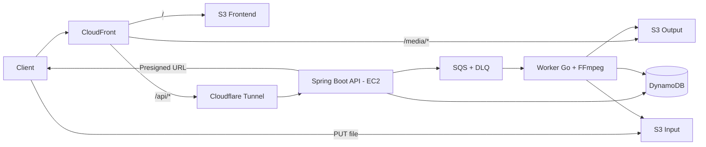

<div align="center">

# TransVidCloud

**Upload một lần — xử lý nền — phát HLS mọi nơi.**

Nền tảng upload video, tự động chuyển mã HLS 360p/720p và phân phối qua CDN.

[](https://openjdk.org/)
[](https://spring.io/projects/spring-boot)
[](https://go.dev/)
[](https://react.dev/)
[](https://aws.amazon.com/)
[](LICENSE)

[Giới thiệu](#giới-thiệu) ·
[Kiến trúc](#kiến-trúc) ·
[Chạy local](#chạy-local) ·
[API](#api) ·
[Tài liệu](#tài-liệu)

</div>

<details>
<summary><strong>Mục lục</strong></summary>

- [Giới thiệu](#giới-thiệu)
  - [Trạng thái dự án](#trạng-thái-dự-án)
  - [Thành phần](#thành-phần)
  - [Công nghệ](#công-nghệ)
- [Kiến trúc](#kiến-trúc)
  - [Luồng upload](#luồng-upload)
  - [Trạng thái video](#trạng-thái-video)
  - [Môi trường local](#môi-trường-local)
- [Chạy local](#chạy-local)
  - [Yêu cầu](#yêu-cầu)
  - [Cài đặt](#cài-đặt)
  - [Chạy full stack](#chạy-full-stack)
  - [Kiểm thử thủ công](#kiểm-thử-thủ-công)
- [API](#api)
- [Cấu trúc dự án](#cấu-trúc-dự-án)
- [Trạng thái và Roadmap](#trạng-thái-và-roadmap)
- [Kiểm thử](#kiểm-thử)
- [Ghi chú thiết kế](#ghi-chú-thiết-kế)
- [Triển khai](#triển-khai)
- [Tài liệu](#tài-liệu)
- [Nhóm phát triển](#nhóm-phát-triển)
- [Giấy phép](#giấy-phép)

</details>

## Giới thiệu

**TransVidCloud** là đồ án môn Điện toán đám mây (UET – ĐHQGHN), xây dựng nền tảng SaaS/PaaS cho phép người dùng upload video, hệ thống tự động chuyển mã sang **HLS 360p/720p**, tạo thumbnail và phát lại qua CDN/Edge.

Ý tưởng chính là **không để API ôm file video**:

- Client PUT thẳng lên S3 bằng Presigned URL.
- API chỉ ghi metadata, kiểm tra quyền và đẩy job nhỏ vào SQS.
- Worker Go + FFmpeg chạy nền, xử lý video và ghi kết quả lại S3.
- DynamoDB là nguồn trạng thái duy nhất.
- CloudFront (hoặc nginx khi chạy local) phục vụ nội dung đã xử lý.

Hệ thống phục vụ hai nhóm người dùng trên cùng một lõi:

| Nhóm | Xác thực | Mục đích |
|------|----------|----------|
| SaaS Web | JWT Bearer (HS256) | Người dùng cuối quản lý project, upload và xem video |
| Developer API | `X-API-Key` theo Project | Hệ thống bên ngoài tích hợp qua REST API |

### Trạng thái dự án

> `main` hiện chỉ có tài liệu, contracts, hạ tầng local và CI/CD. **Chưa có mã nguồn ứng dụng.**

| Thành phần | Vị trí |
|------------|--------|
| Backend Spring Boot | nhánh `phuong-integration` |
| Worker Go | nhánh `dev` và `phuong-integration` |
| Frontend React | nhánh `dev` và `phuong-integration` |
| Terraform / hạ tầng AWS | chưa triển khai |

Trên nhánh `phuong-integration`, full stack local đã chạy được: `make up`, `make smoke`, `make e2e`, Playwright real-stack, 24 integration test backend, 10 package test worker và 136 test frontend. Kết quả này chưa được merge vào `main`.

### Thành phần

| Thành phần | Vai trò |
|------------|---------|
| **Backend** | Xác thực, quản lý project/API key/video, cấp Presigned URL, confirm upload, transactional outbox |
| **Worker** | Nhận job SQS, validate `ffprobe`, chuyển mã HLS, tạo thumbnail, cập nhật trạng thái |
| **Frontend** | Đăng nhập, project, upload dialog, polling trạng thái, HLS player, chế độ mock/real |
| **Local infra** | LocalStack mô phỏng S3/SQS/DynamoDB/SSM; nginx mô phỏng CloudFront |

### Công nghệ

- **Backend:** Java 21, Spring Boot 3.4, Spring Security (JWT + API Key), Spring Cloud AWS, AWS SDK v2.
- **Worker:** Go 1.24, AWS SDK for Go v2, FFmpeg/ffprobe, HLS.
- **Frontend:** React 19, TypeScript, Vite, React Router, hls.js, MSW.
- **Local:** Docker Compose, LocalStack, nginx.
- **Cloud dự kiến:** S3, SQS + DLQ, DynamoDB, EC2 Auto Scaling, ECR, CloudFront, Cloudflare Tunnel, CloudWatch, SSM.

Không dùng Redis/ElastiCache. DynamoDB on-demand và cache tại Edge là đủ cho quy mô đồ án.

## Kiến trúc



Một domain thống nhất với ba behavior: `/` → S3 frontend, `/api/*` → API qua Cloudflare Tunnel, `/media/*` → S3 output. Cloudflare Tunnel cho phép API EC2 không mở inbound port và không cần ALB.

### Luồng upload

1. `POST /projects/{id}/videos` — API tạo video `UPLOADING`, trả Presigned PUT URL (15 phút).
2. Client PUT file trực tiếp lên S3 input.
3. `POST /videos/{id}/confirm` — API kiểm tra `HeadObject`, ghi `PENDING` + outbox trong cùng transaction.
4. Job vào SQS. Worker nhận, chuyển `PROCESSING`, tải file, chạy `ffprobe`, tạo HLS 360p/720p + thumbnail.
5. Worker upload output, ghi `COMPLETED` kèm assets, xóa message.

### Trạng thái video

```text
UPLOADING → PENDING → PROCESSING → COMPLETED
                              ↘ FAILED_VALIDATION | FAILED_TRANSCODE | FAILED_STORAGE
```

API chỉ ghi `UPLOADING → PENDING`. Worker ghi các trạng thái còn lại và luôn dùng điều kiện `status <> COMPLETED` để không ghi đè kết quả cuối.

### Môi trường local

```text
Browser :8000 → nginx edge
  ├── /        → Vite dev server :5173
  ├── /api/*   → Backend :8080
  └── /media/* → LocalStack S3 :4566

Backend và Worker → LocalStack (S3, SQS, DynamoDB)
```

Frontend dùng đường dẫn tương đối (`/api/...`, `/media/...`) nên code giống hệt local và cloud.

## Chạy local

### Yêu cầu

- Docker + Docker Compose v2
- Node.js >= 20.19 và npm
- cURL, bash, Python 3
- LocalStack auth token (gói free phi thương mại)

Không cần cài Java/Maven/Go/FFmpeg trên host nếu chạy bằng Docker.

### Cài đặt

```bash
git clone git@github.com:vllddlvh/TransvidCloud.git
cd TransvidCloud
cp .env.example .env
```

Điền `LOCALSTACK_AUTH_TOKEN` và `JWT_SECRET` (tối thiểu 32 byte) trong `.env`. Không commit file này.

### Chạy full stack

Trên `main` chỉ chạy được hạ tầng:

```bash
make infra     # LocalStack
make smoke     # 3 bucket, 2 queue, 4 bảng DynamoDB
```

`make up` chưa chạy được vì chưa có Dockerfile backend/worker. Muốn chạy full stack:

```bash
git switch phuong-integration
make up
make smoke
```

Sau đó chạy frontend real mode:

```bash
cd frontend
npm install
npm run dev:real
```

Mở `http://localhost:8000` (nginx edge).

| Dịch vụ | URL |
|---------|-----|
| Edge | http://localhost:8000 |
| API | http://localhost:8080/api |
| Swagger UI | http://localhost:8080/api/swagger-ui.html |
| LocalStack | http://localhost:4566 |

Vài lệnh vận hành:

```bash
make logs S=backend
make worker-scale N=3
make reset
make down
```

### Kiểm thử thủ công

1. Mở `http://localhost:8000`, đăng ký tài khoản.
2. Tạo project và upload MP4 thật (≤ 200 MB, ≤ 5 phút).
3. Theo dõi trạng thái `PENDING → PROCESSING → COMPLETED`.
4. Phát HLS trong trang chi tiết video.
5. Upload file giả đuôi `.mp4` để thử nhánh `FAILED_VALIDATION` / `NOT_A_VIDEO`.

## API

Base path `/api`. Contract nguồn: [`contracts/openapi.yaml`](contracts/openapi.yaml).

| Method | Endpoint | Xác thực | Mô tả |
|--------|----------|----------|-------|
| POST | `/auth/register`, `/auth/login` | Public | Đăng ký/đăng nhập, trả JWT |
| GET | `/auth/me` | JWT | Thông tin tài khoản |
| GET/POST | `/projects` | JWT | Danh sách/tạo project |
| GET/PATCH/DELETE | `/projects/{projectId}` | JWT | Xem/sửa/xóa mềm |
| POST/GET | `/projects/{projectId}/api-keys` | JWT | Tạo/liệt kê API key |
| DELETE | `/projects/{projectId}/api-keys/{keyHash}` | JWT | Thu hồi key |
| POST | `/projects/{projectId}/videos` | JWT hoặc API Key | Init upload, trả Presigned URL |
| GET | `/projects/{projectId}/videos` | JWT hoặc API Key | Danh sách, cursor pagination |
| GET/DELETE | `/videos/{videoId}` | JWT hoặc API Key | Chi tiết/xóa video |
| POST | `/videos/{videoId}/confirm` | JWT hoặc API Key | Confirm và đưa job vào SQS |

Giới hạn upload: 200 MB, 300 giây, cao tối đa 1080p, định dạng MP4/MOV/MKV/WEBM.

`GET /videos/{videoId}` vẫn yêu cầu xác thực. Trang `/embed` hiện chỉ chạy với mock; backend thật chưa có API public cho embed.

## Cấu trúc dự án

```text
TransvidCloud/
├── backend/                 # Spring Boot API (nhánh phuong-integration)
│   ├── src/main/java/.../   # auth, project, apikey, video, job, common
│   ├── src/test/            # unit + Testcontainers/LocalStack
│   └── Dockerfile
├── worker/                  # Go + FFmpeg (nhánh dev)
│   ├── cmd/worker/          # entrypoint, vòng lặp consumer
│   ├── internal/            # config, consumer, job, validate, transcode,
│   │                        # storage, state, heartbeat, workdir, shutdown
│   ├── testdata/            # video mẫu ngắn
│   └── Dockerfile
├── frontend/                # React SPA (nhánh dev)
│   ├── src/pages/           # login, projects, videos, video detail, embed
│   ├── src/api/             # client, session, upload transport, types
│   ├── src/player/          # HlsPlayer
│   ├── src/mocks/           # MSW handlers, fixture HLS
│   └── e2e/                 # Playwright
├── contracts/               # OpenAPI, SQS schema, state machine, DynamoDB, S3 keys
├── local/                   # LocalStack init, nginx, smoke/chaos scripts
├── infra/terraform/         # khung module, chưa có .tf
├── scripts/                 # deploy-api.sh, bump-worker-tag.sh
├── docs/                    # kiến trúc, ADR, SRS, tài liệu module
└── .github/workflows/       # ci.yml, deploy.yml
```

> Trên `main`, các thư mục `backend/src`, `worker/internal`, `frontend/src` chưa tồn tại. Cây trên mô tả đầy đủ khi hợp nhất các nhánh.

## Trạng thái và Roadmap

- [x] Contracts, kiến trúc, harness local, CI cơ bản
- [x] Backend: auth, project, API key, upload, confirm, outbox
- [x] Worker: FFmpeg HLS, heartbeat, retry, DLQ, SIGTERM
- [x] Frontend: mock-first, real mode, HLS player, upload dialog
- [x] Tích hợp full-stack local, e2e, chaos và bench
- [ ] Terraform modules và môi trường `dev`
- [ ] CloudFront + Cloudflare Tunnel + deploy AWS thật
- [ ] Webhook callback, `metricpub`, public embed API

Chi tiết trạng thái từng tuần nằm trong [`docs/`](docs/README.md) và `PROGRESS.md` trên nhánh tích hợp.

## Kiểm thử

```bash
# Backend
cd backend && ./mvnw verify

# Worker
cd worker && go vet ./... && go test ./...

# Frontend
cd frontend && npm run api:check && npm test && npm run build
npx playwright install chromium && npm run test:e2e

# Tích hợp (nhánh phát triển)
make smoke
make e2e
make e2e-worker
make bench
make chaos
```

## Ghi chú thiết kế

- **Direct-to-S3:** API không nhận file, giảm tải và tránh giới hạn request body.
- **Transactional Outbox:** video `PENDING` và outbox ghi cùng transaction, đảm bảo job không bị mất khi publish SQS lỗi.
- **Idempotency:** output key cố định theo `projectId/videoId`; worker bỏ qua video đã `COMPLETED`.
- **Một lần decode:** FFmpeg dùng `filter_complex split` tạo cả 360p và 720p, preset `veryfast`.
- **Heartbeat + SIGTERM:** job dài không mất visibility; worker Spot bị thu hồi sẽ trả message sớm.
- **Không NAT/ALB:** dùng Cloudflare Tunnel và S3 Gateway Endpoint để giảm chi phí cố định.

## Triển khai

> Hạ tầng AWS và Terraform **chưa được triển khai**. Các script dưới đây chỉ là khung.

```bash
ENV=dev TAG=<git-sha> ECR_REPO=<registry>/tvc-backend ./scripts/deploy-api.sh
ENV=dev TAG=<git-sha> ./scripts/bump-worker-tag.sh
```

`deploy-api.sh` dùng SSM Run Command để pull image và chạy container. `bump-worker-tag.sh` ghi tag vào `/tvc/${ENV}/worker/image-tag` và kích hoạt ASG instance refresh. Cả hai cần ECR, EC2, ASG và SSM đã tồn tại.

## Tài liệu

- [Kiến trúc Cloud chi tiết](docs/adr/CloudTransvid_Kien_Truc_Cloud.md)
- [ADR: DynamoDB-only](docs/adr/0001-dynamodb-only.md)
- [SRS high-level](docs/introduction/3.%20SRS%20highlevel.md)
- [Local & CI/CD](docs/introduction/2.%20LOCAL_AND_CICD.md)
- [Contracts](contracts/README.md) · [OpenAPI](contracts/openapi.yaml)
- [Backend](docs/docs-backend/README.md) · [Worker](docs/docs-worker/README.md) · [Frontend](docs/docs-frontend/README.md)

## Nhóm phát triển

| Thành viên | Phụ trách |
|------------|-----------|
| Phương | Backend API, xác thực, contracts |
| Vũ | Worker xử lý video, frontend |
| Lưu | Docker, hạ tầng, hosting, CI/CD |

Quy ước khi đóng góp: tạo branch từ `dev`, đổi API thì sửa contract trước, không commit `.env` hoặc credentials, chạy test liên quan trước khi mở PR.

## Giấy phép

Phát hành theo giấy phép [MIT](LICENSE).

<div align="center">

Cảm ơn **LocalStack**, **FFmpeg** và **hls.js** — những công cụ giúp dự án chạy được từ local đến cloud.

</div>
