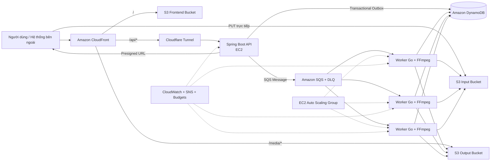
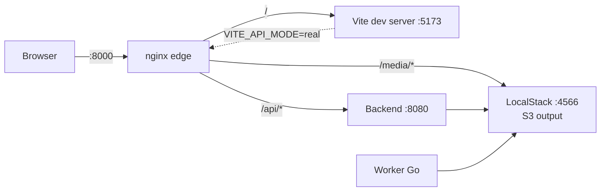
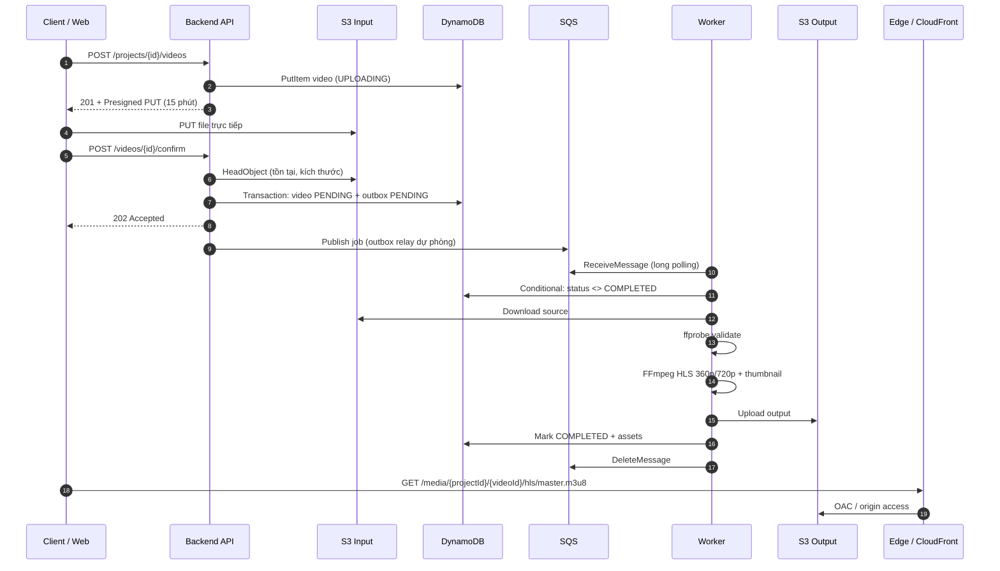
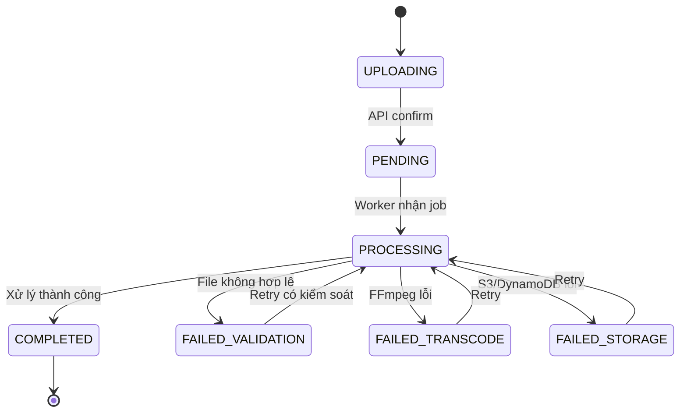

<div align="center">

# TransVidCloud

**Nền tảng xử lý và phân phối video trên nền tảng Cloud**

Upload trực tiếp lên Object Storage → xử lý bất đồng bộ bằng hàng đợi → chuyển mã HLS đa chất lượng → phát video qua Edge.

[](https://spring.io/projects/spring-boot)
[](https://go.dev/)
[](https://react.dev/)
[](https://aws.amazon.com/)
[](LICENSE)

</div>

---

## Mục lục

- [1. Tổng quan](#1-tổng-quan)
- [2. Trạng thái dự án](#2-trạng-thái-dự-án)
- [3. Tính năng](#3-tính-năng)
- [4. Công nghệ sử dụng](#4-công-nghệ-sử-dụng)
- [5. Kiến trúc hệ thống](#5-kiến-trúc-hệ-thống)
- [6. Cấu trúc thư mục](#6-cấu-trúc-thư-mục)
- [7. Các thành phần chi tiết](#7-các-thành-phần-chi-tiết)
- [8. Cloud Infrastructure](#8-cloud-infrastructure)
- [9. Dữ liệu, Messaging và Luồng xử lý](#9-dữ-liệu-messaging-và-luồng-xử-lý)
- [10. Chạy dự án trên Local](#10-chạy-dự-án-trên-local)
- [11. Triển khai lên Cloud](#11-triển-khai-lên-cloud)
- [12. CI/CD, Monitoring và Logging](#12-cicd-monitoring-và-logging)
- [13. API Documentation và Testing](#13-api-documentation-và-testing)
- [14. Quyết định thiết kế kỹ thuật](#14-quyết-định-thiết-kế-kỹ-thuật)
- [15. Lộ trình phát triển](#15-lộ-trình-phát-triển)
- [16. Tài liệu tham khảo](#16-tài-liệu-tham-khảo)
- [17. Đội ngũ và Giấy phép](#17-đội-ngũ-và-giấy-phép)

---

## 1. Tổng quan

**TransVidCloud** là đồ án môn **Điện toán đám mây** (UET – ĐHQGHN), xây dựng một nền tảng SaaS/PaaS cho phép người dùng tải video lên, hệ thống tự động chuyển mã sang **HLS 360p/720p**, tạo thumbnail và phân phối nội dung qua CDN/Edge.

Điểm cốt lõi của thiết kế là **tách đường truyền dữ liệu lớn khỏi API**:

- Video được upload **trực tiếp** từ trình duyệt/client lên Amazon S3 bằng **Presigned URL**.
- API chỉ ghi metadata, kiểm tra quyền và đẩy một job nhỏ vào **Amazon SQS**.
- Các **worker** chạy Go + FFmpeg trên EC2 Auto Scaling lấy job, xử lý và ghi kết quả trở lại S3.
- Trạng thái video được cập nhật nguyên tử trong **Amazon DynamoDB**.
- Nội dung hoàn chỉnh được phát qua **CloudFront** (thiết kế) hoặc nginx mô phỏng Edge khi chạy local.

Hệ thống phục vụ **hai nhóm người dùng trên cùng một lõi xử lý**:

| Nhóm | Cách xác thực | Mục đích |
|------|---------------|----------|
| **SaaS Web** | JWT Bearer (HS256) | Người dùng cuối đăng ký, tạo project, upload và xem video trên giao diện web |
| **Developer API** | `X-API-Key` theo từng Project | Hệ thống bên ngoài tích hợp upload/xử lý video qua REST API |

### Mục tiêu

- Xây dựng pipeline xử lý video **bất đồng bộ, chịu lỗi và có thể mở rộng ngang**.
- Áp dụng các mẫu thiết kế cloud thực tế: direct-to-S3, queue-based decoupling, idempotency, conditional write, transactional outbox, at-least-once delivery.
- Tối ưu chi phí ở mức sinh viên: **không NAT Gateway, không ALB, không EKS**, ưu tiên dịch vụ serverless/managed và EC2 Spot.
- Đảm bảo môi trường local **mô phỏng sát Cloud** bằng LocalStack + Docker Compose + nginx.

---

## 2. Trạng thái dự án

> **Quan trọng:** Repository đang được phát triển song song trên nhiều nhánh. Tại thời điểm hiện tại, nhánh `main` **chưa chứa mã nguồn ứng dụng**; toàn bộ mã nguồn backend, worker và frontend nằm trên các nhánh phát triển/tích hợp. README này phản ánh **cả thiết kế đã có mã nguồn** và **phần hạ tầng cloud chưa được triển khai**.

### 2.1. Phân bố mã nguồn theo nhánh

| Hạng mục | `main` | `dev` | `phuong-integration` |
|----------|:------:|:-----:|:--------------------:|
| Tài liệu, ADR, contracts | ✅ | ✅ | ✅ |
| LocalStack init, Docker Compose, nginx edge | ✅ | ✅ | ✅ |
| CI/CD workflows, deploy scripts | ✅ | ✅ | ✅ |
| Backend Spring Boot (source + tests + Dockerfile) | ❌ | ❌ | ✅ |
| Worker Go (source + tests + Dockerfile) | ❌ | ✅ | ✅ |
| Frontend React (source + tests + e2e) | ❌ | ✅ | ✅ |
| E2E/Bench/Chaos scripts đầy đủ | ❌ | ✅ | ✅ |
| Terraform (`*.tf`) | ❌ | ❌ | ❌ |
| Hạ tầng AWS thật đã provision | ❌ | ❌ | ❌ |

`main` hiện là nhánh **documentation-first**: contracts, tài liệu kiến trúc, harness local và pipeline CI/CD đã có; các thư mục `backend/`, `worker/`, `frontend/` mới chỉ có README mô tả phạm vi và quy ước.

### 2.2. Mức độ hoàn thành

| Hạng mục | Trạng thái | Ghi chú |
|----------|-----------|---------|
| Contracts (OpenAPI, SQS schema, state machine, DynamoDB, S3 keys, upload limits) | 🟡 DRAFT | Là nguồn tham chiếu thiết kế; cần đồng bộ với implementation |
| Local infrastructure (LocalStack + nginx) | ✅ Hoàn thành | Tạo bucket, queue, DLQ, 4 bảng DynamoDB tự động |
| Backend API | ✅ Có mã nguồn trên `phuong-integration` | JWT + API Key, presigned URL, confirm, outbox, phân trang cursor |
| Worker xử lý video | ✅ Có mã nguồn trên `dev`/`phuong-integration` | FFmpeg HLS 360p/720p, thumbnail, heartbeat, SIGTERM, DLQ |
| Frontend SaaS | ✅ Có mã nguồn trên `dev`/`phuong-integration` | Mock-first + real mode, HLS player, upload dialog, embed (mock) |
| Kiểm thử tích hợp full-stack | ✅ Theo `PROGRESS.md` trên `phuong-integration` | `make up`, `make smoke`, `make e2e` được ghi nhận PASS trên nhánh |
| Terraform / AWS provisioning | ❌ Chưa triển khai | Chỉ có README module và `.gitkeep` |
| Cloud deployment thực tế | ❌ Chưa triển khai | Workflow và script đã có nhưng phụ thuộc hạ tầng chưa tồn tại |
| Webhook callback | 🟡 Thiết kế P1 | Trường `webhookUrl` đã có trong project; chưa có bộ gửi webhook |
| `metricpub` cho Auto Scaling | 🟡 Dự kiến | Chưa có `cmd/metricpub` trong mã nguồn worker |
| Public embed API | ❌ Chưa có trên backend thật | Trang `/embed` hiện chỉ hoạt động ở chế độ mock |

> Các tài liệu trạng thái trong `docs/` là **ảnh chụp theo thời điểm** và có thể lệch nhau. Khi có mâu thuẫn, ưu tiên kiểm tra trực tiếp mã nguồn trên nhánh tương ứng.

---

## 3. Tính năng

### 3.1. Đã có trong mã nguồn (trên nhánh phát triển/tích hợp)

**Xác thực và phân quyền**

- Đăng ký / đăng nhập tài khoản SaaS, mật khẩu băm bằng **BCrypt**.
- JWT **HS256** stateless, claim `sub` và `email`.
- Đảm bảo email duy nhất tuyệt đối bằng `TransactWriteItems` với item khóa `EMAIL#<email>`.
- API Key theo Project: raw key chỉ trả **một lần**, server chỉ lưu **SHA-256 hash**; tối đa 5 key/project; hỗ trợ revoke.
- Phân tách quyền: API Key không được quản lý project/API key và không truy cập chéo project.

**Quản lý Project**

- Tạo, xem, cập nhật, xóa mềm project; cách ly dữ liệu theo owner.
- Chặn xóa nếu project còn video đang xử lý.
- Lưu `webhookUrl` (chưa gửi webhook).

**Upload và xử lý video**

- Khởi tạo upload, nhận **S3 Presigned PUT URL** (TTL 15 phút), giới hạn 200 MB.
- Upload trực tiếp lên S3, không đi qua API.
- Xác nhận upload bằng `HeadObject`, kiểm tra tồn tại và kích thước thực tế.
- Ghi job vào SQS theo **Transactional Outbox** trong cùng transaction DynamoDB.
- Worker tải video, kiểm tra bằng `ffprobe`, chuyển mã HLS 360p/720p, tạo thumbnail, upload output.
- Theo dõi trạng thái `UPLOADING → PENDING → PROCESSING → COMPLETED / FAILED_*`.
- Phân trang danh sách video bằng **cursor** (Base64URL), không dùng offset.
- Xóa video (từ chối khi đang `PROCESSING`).

**Độ tin cậy của Worker**

- SQS long polling 20 giây, mỗi lần nhận 1 message.
- Heartbeat gia hạn visibility timeout trong lúc xử lý.
- Bắt `SIGTERM`, trả message về queue sớm để worker khác xử lý.
- Idempotency: video đã `COMPLETED` thì bỏ qua và xóa message.
- Conditional write bảo vệ trạng thái cuối `COMPLETED`.
- Phân loại lỗi: lỗi validation xóa message; lỗi hệ thống giữ message để retry/DLQ.
- Dọn thư mục tạm an toàn, chống path traversal qua `jobId`.

**Frontend**

- Đăng nhập, quản lý project, danh sách video, chi tiết video.
- Upload dialog: chọn/kéo thả file, tiến trình, retry khi lỗi mạng.
- Trình phát HLS dùng `hls.js`, fallback HLS native trên Safari.
- Polling trạng thái video khi còn `PENDING`/`PROCESSING`.
- Chế độ **mock (MSW)** để phát triển UI độc lập và chế độ **real** gọi backend.
- Playwright e2e cho cả mock và real stack.

### 3.2. Dự kiến (chưa triển khai)

- Terraform modules và môi trường `dev`/`demo` trên AWS.
- CloudFront + Cloudflare Tunnel cho domain thống nhất.
- Webhook callback khi video hoàn tất/thất bại.
- `metricpub` đẩy metric `BacklogPerInstance` phục vụ Auto Scaling target tracking.
- Public embed API và chia sẻ video công khai trên backend thật.
- Dashboard, alarm, budget alert đầy đủ trên CloudWatch/SNS/Budgets.

---

## 4. Công nghệ sử dụng

### 4.1. Backend

| Nhóm | Công nghệ |
|------|-----------|
| Ngôn ngữ / Runtime | Java 21 (Virtual Threads) |
| Framework | Spring Boot 3.4.5, Spring Web, Spring Validation, Spring Security, OAuth2 Resource Server |
| AWS | Spring Cloud AWS 3.3.0, AWS SDK for Java v2 (S3, SQS, DynamoDB Enhanced) |
| Mapping / Boilerplate | MapStruct 1.6.3, Lombok |
| API Docs | Springdoc OpenAPI 2.8.5 (Swagger UI) |
| Testing | JUnit 5, Testcontainers + LocalStack, Spring Security Test, Maven Failsafe |
| Build | Maven Wrapper, multi-stage Dockerfile (`eclipse-temurin`) |

### 4.2. Worker

| Nhóm | Công nghệ |
|------|-----------|
| Ngôn ngữ | Go 1.24 |
| AWS SDK | AWS SDK for Go v2 (SQS, S3, DynamoDB) |
| Media | FFmpeg / ffprobe, HLS, libx264, AAC |
| Logging | `log/slog` JSON handler |
| Testing | Go testing, unit test cho config, consumer, heartbeat, job, state, storage, transcode, validate, workdir |
| Runtime | Debian slim + ffmpeg, chạy non-root UID 10001 |

### 4.3. Frontend

| Nhóm | Công nghệ |
|------|-----------|
| Ngôn ngữ | TypeScript 5.9 |
| Framework | React 19, React Router 7 |
| Build | Vite 7 |
| Video | hls.js 1.7 |
| UI | Lucide React, Fontsource Roboto, CSS thuần |
| Mock / Contract | MSW 2, openapi-typescript 7, Ajv |
| Testing | Vitest 4, Testing Library, Playwright 1.56 |

### 4.4. Hạ tầng và vận hành

| Nhóm | Công nghệ |
|------|-----------|
| Local Cloud | LocalStack (S3, SQS, DynamoDB, SSM) |
| Container | Docker, Docker Compose v2 |
| Edge local | nginx (mô phỏng CloudFront routing) |
| CI/CD | GitHub Actions, GitHub OIDC |
| Cloud target | S3, SQS, DynamoDB, EC2 Auto Scaling, ECR, CloudFront, Cloudflare Tunnel, CloudWatch, SNS, AWS Budgets, SSM |
| IaC | Terraform (dự kiến, chưa có `.tf`) |

---

## 5. Kiến trúc hệ thống

### 5.1. Kiến trúc mục tiêu trên AWS



**Nguyên tắc routing một domain:**

| Path | Nguồn phục vụ | Mục đích |
|------|---------------|----------|
| `/` | S3 frontend bucket | React SPA tĩnh |
| `/api/*` | Spring Boot API qua Cloudflare Tunnel | REST API |
| `/media/*` | S3 output bucket | HLS playlist, segment, thumbnail |

Cloudflare Tunnel cho phép API EC2 **không mở inbound port**, không cần ALB, không cần chứng chỉ TLS trên EC2. Đây là quyết định giảm chi phí có chủ đích của dự án.

### 5.2. Kiến trúc local (mô phỏng Cloud)



- `nginx` đóng vai trò **CloudFront**: cùng một origin, ba behavior `/`, `/api/`, `/media/`.
- `LocalStack` đóng vai trò **S3 + SQS + DynamoDB + SSM**.
- Frontend gọi **đường dẫn tương đối** (`/api/...`, `/media/...`) nên code giống hệt local và cloud.

### 5.3. Luồng upload và xử lý video



### 5.4. State machine của video



Quy ước quyền ghi trạng thái:

- **API** chỉ ghi `UPLOADING → PENDING`.
- **Worker** ghi `PROCESSING`, `COMPLETED`, `FAILED_*`.
- Mọi cập nhật của worker dùng `ConditionExpression: status <> COMPLETED`.
- `COMPLETED` là trạng thái cuối, không được ghi đè.

---

## 6. Cấu trúc thư mục

```text
TransvidCloud/
├── backend/                 # API Spring Boot (mã nguồn trên phuong-integration)
│   ├── src/main/java/.../
│   │   ├── auth/            # Đăng ký, đăng nhập, JWT
│   │   ├── project/         # CRUD project
│   │   ├── apikey/          # Sinh, băm, xác thực API Key
│   │   ├── video/           # Presigned URL, confirm, danh sách, xóa
│   │   ├── job/             # Outbox publisher/relay, tích hợp SQS
│   │   └── common/          # Config AWS/CORS, exception, logging, security
│   ├── src/test/            # Unit test + integration test (LocalStack)
│   └── Dockerfile
├── worker/                  # Video worker Go + FFmpeg (mã nguồn trên dev)
│   ├── cmd/worker/          # Entrypoint, vòng lặp consumer
│   ├── internal/
│   │   ├── config/          # Đọc và validate biến môi trường
│   │   ├── consumer/        # SQS receive/delete/change-visibility
│   │   ├── job/             # Pipeline xử lý một job
│   │   ├── validate/        # ffprobe + kiểm tra giới hạn
│   │   ├── transcode/       # FFmpeg args, master playlist
│   │   ├── storage/         # S3 download/upload, Content-Type
│   │   ├── state/           # DynamoDB conditional updates
│   │   ├── heartbeat/       # Gia hạn SQS visibility
│   │   ├── workdir/         # Thư mục tạm an toàn
│   │   ├── shutdown/        # SIGTERM/SIGINT
│   │   └── logging/         # slog JSON
│   ├── testdata/            # Video mẫu ngắn
│   └── Dockerfile
├── frontend/                # React SaaS Web (mã nguồn trên dev)
│   ├── src/pages/           # Login, Projects, Videos, VideoDetail, Embed
│   ├── src/components/      # Layout, Auth, Upload, Modal, Notice
│   ├── src/api/             # Client, session, upload transport, generated types
│   ├── src/player/          # HlsPlayer dùng chung
│   ├── src/mocks/           # MSW handlers, fixture HLS
│   ├── e2e/                 # Playwright specs
│   └── scripts/             # Kiểm tra bundle production, nginx local
├── contracts/               # Hợp đồng tích hợp (SSOT)
│   ├── openapi.yaml
│   ├── sqs-job-message.schema.json
│   ├── video-state-machine.md
│   ├── dynamodb-tables.md
│   ├── s3-key-convention.md
│   └── upload-limits.md
├── local/
│   ├── localstack/init/     # Script tạo bucket, queue, table
│   ├── nginx/               # Cấu hình edge mô phỏng CloudFront
│   └── scripts/             # smoke-test, seed, chaos
├── infra/terraform/         # Khung module Terraform (chưa có .tf)
├── scripts/                 # deploy-api.sh, bump-worker-tag.sh
├── tests/e2e/               # Hướng dẫn/kịch bản e2e trên main
├── docs/                    # Tài liệu kiến trúc, ADR, SRS, module docs
├── .github/workflows/       # ci.yml, deploy.yml
├── docker-compose.yml
├── Makefile
└── README.md
```

> Trên `main`, các thư mục `backend/src`, `worker/internal`, `frontend/src` **chưa tồn tại**; chỉ có README mô tả phạm vi. Cây trên mô tả đầy đủ khi hợp nhất các nhánh phát triển.

---

## 7. Các thành phần chi tiết

### 7.1. Backend API (Spring Boot)

**Vai trò:** tiếp nhận request, xác thực, quản lý metadata, cấp Presigned URL, tạo job. Backend **không chạy FFmpeg** và **không trung chuyển file video**.

**Cấu trúc package chính:**

| Package | Trách nhiệm |
|---------|-------------|
| `auth` | Đăng ký/đăng nhập, JWT, `UserItem`, email lock transaction |
| `project` | CRUD project, kiểm tra owner, soft delete |
| `apikey` | Sinh key, lưu hash, filter xác thực `X-API-Key` |
| `video` | Init upload, confirm, list cursor, detail, delete |
| `job` | `OutboxItem`, publisher, relay scheduler |
| `common` | AWS beans, CORS, security, exception model, correlation ID, log masking |

**Điểm kỹ thuật đáng chú ý:**

- **Transactional Outbox:** video chuyển `PENDING` và outbox item được ghi trong cùng một `TransactWriteItems`. Nếu publish SQS thất bại, relay scheduler quét outbox `PENDING` mỗi 5 giây để gửi lại → tránh mất job.
- **Idempotent confirm:** gọi lại `confirm` không tạo job trùng; video đã `PENDING/PROCESSING/COMPLETED` trả kết quả idempotent.
- **Kiểm tra thực tế:** `HeadObject` xác minh object tồn tại và kích thước sau khi client upload.
- **Cursor pagination:** dùng `LastEvaluatedKey` của DynamoDB, mã hóa Base64URL; không dùng offset.
- **API Key:** chỉ lưu SHA-256; raw key trả về đúng một lần khi tạo; kiểm tra prefix/độ dài trước khi tra cứu.
- **Log masking:** tự động che password, raw API key, Bearer token, chữ ký S3 Presigned URL và AWS secret trong log.
- **Correlation ID:** nhận `X-Correlation-ID`/`X-Request-ID` hoặc sinh UUID; gắn vào MDC và response header.

### 7.2. Worker xử lý video (Go + FFmpeg)

**Pipeline một job:**

1. Parse và validate message theo `schemaVersion = 1`.
2. Kiểm tra jobId hợp lệ (chống path traversal).
3. Bật heartbeat gia hạn visibility.
4. Đọc trạng thái; nếu đã `COMPLETED` → xóa message và bỏ qua.
5. `MarkProcessing` với điều kiện `status <> COMPLETED`; tăng `attemptCount`.
6. Tải source từ S3 input.
7. `ffprobe`: kiểm tra có video, codec, thời lượng, chiều cao.
8. FFmpeg một lần chạy, dùng `filter_complex split` sinh đồng thời 360p và 720p.
9. Tạo thumbnail tại giây thứ 1 (hoặc giây 0 nếu video ngắn hơn 1 giây).
10. Viết master playlist với `RESOLUTION` thực tế.
11. Upload toàn bộ output với `Content-Type` và `Cache-Control` phù hợp.
12. Ghi `COMPLETED` + `assets`; xóa message.

**Thông số chuyển mã:**

| Rendition | Video | Audio | Segment |
|-----------|-------|-------|---------|
| 360p | H.264, `veryfast`, 800 kbps, maxrate 856k, bufsize 1200k | AAC 96 kbps | HLS 4 giây, VOD |
| 720p | H.264, `veryfast`, 2800 kbps, maxrate 3000k, bufsize 4800k | AAC 128 kbps | HLS 4 giây, VOD |
| Thumbnail | JPEG, quality 3 | — | 1 frame |

**Chiến lược không phóng to:** nếu video nguồn thấp hơn 720p/360p, rendition tương ứng map trực tiếp luồng gốc thay vì upscale.

**Xử lý lỗi:**

| Loại lỗi | Trạng thái | Hành vi message |
|----------|-----------|-----------------|
| Message sai schema | Không đổi | Xóa message (không thể retry) |
| File không phải video / sai codec / quá giới hạn | `FAILED_VALIDATION` | Xóa message (retry vô ích) |
| FFmpeg lỗi/timeout | `FAILED_TRANSCODE` | Giữ message để retry |
| Lỗi S3/DynamoDB | `FAILED_STORAGE` | Giữ message để retry |
| Mất quyền sở hữu message | Không ghi đè | Dừng job, không dùng receipt handle cũ |
| SIGTERM | Giữ nguyên | Trả message với visibility 30 giây |

### 7.3. Frontend SaaS (React + Vite)

**Route chính:**

| Route | Chức năng |
|-------|-----------|
| `/login` | Đăng nhập / đăng ký |
| `/projects` | Danh sách và tạo project |
| `/projects/:id/videos` | Danh sách video, upload |
| `/videos/:id` | Chi tiết, trạng thái, HLS player, copy link/mã nhúng |
| `/embed?video=<id>` | Trang nhúng công khai (hiện chỉ mock) |

**Hai chế độ runtime:**

- **Mock:** MSW phục vụ API và fixture HLS; không cần backend/Docker. Dùng để phát triển UI.
- **Real:** gọi `/api/*` thật; yêu cầu backend, LocalStack và worker đang chạy.

**Upload flow trên UI:** xin Presigned URL → PUT bằng `XMLHttpRequest` (có tiến trình) → gọi `confirm` → polling trạng thái đến `COMPLETED`.

**Bảo vệ production build:** `npm run build` bắt buộc `VITE_API_MODE=real`, loại bỏ MSW/fixture khỏi bundle và kiểm tra ngưỡng kích thước chunk.

### 7.4. Edge nginx (local)

Cấu hình `local/nginx/default.conf` mô phỏng CloudFront:

- `/api/` → `backend:8080`
- `/media/` → rewrite sang `/tvc-local-output/...` trên LocalStack
- `/` → Vite dev server với WebSocket HMR
- Hỗ trợ `host.docker.internal` để container truy cập dịch vụ trên host.

---

## 8. Cloud Infrastructure

> **Trạng thái:** Toàn bộ mục này là **kiến trúc thiết kế**. Chưa có file Terraform `.tf`, chưa có tài nguyên AWS nào được provision trong repository.

### 8.1. Dịch vụ Cloud

| Nhóm | Dịch vụ | Vai trò | Trạng thái |
|------|---------|---------|-----------|
| Storage | **Amazon S3** (3 bucket) | Frontend tĩnh, input video, output HLS/thumbnail | Thiết kế |
| Messaging | **Amazon SQS** Standard + DLQ | Hàng đợi job, cách ly lỗi | Thiết kế |
| Database | **Amazon DynamoDB** on-demand | Users, projects, API keys, videos, outbox | Thiết kế |
| Compute | **Amazon EC2** | API instance + Worker Auto Scaling Group | Thiết kế |
| Container Registry | **Amazon ECR** | Image backend và worker | Thiết kế |
| CDN | **Amazon CloudFront** | Phân phối `/`, `/api/*`, `/media/*` | Thiết kế |
| Tunnel | **Cloudflare Tunnel** | Đưa API ra Internet không mở inbound port | Thiết kế |
| Security | **AWS IAM**, GitHub OIDC | Role least-privilege, không long-lived key | Thiết kế |
| Config/Secrets | **SSM Parameter Store**, Session Manager, Run Command | Cấu hình, vận hành không SSH | Thiết kế |
| Observability | **CloudWatch**, SNS, AWS Budgets | Log, metric, alarm, cảnh báo chi phí | Thiết kế |
| IaC | **Terraform** | Provision toàn bộ hạ tầng | Chưa triển khai |

### 8.2. Networking

Thiết kế mạng tối giản, tránh chi phí cố định:

- **Không NAT Gateway** (tiết kiệm ~32 USD/tháng): worker và API dùng public subnet với Security Group hạn chế, hoặc S3 Gateway Endpoint cho lưu lượng S3.
- **Không ALB:** Cloudflare Tunnel kết nối outbound từ `cloudflared` trên EC2 đến Cloudflare; CloudFront trỏ `/api/*` tới hostname tunnel.
- **Không Route 53/ACM bắt buộc:** domain và TLS do Cloudflare quản lý.
- **Không EKS/Kubernetes:** Auto Scaling Group + Docker là đủ cho quy mô đồ án.
- S3 bucket **private**, truy cập qua presigned URL (upload) và CloudFront OAC (playback).

### 8.3. Storage

| Bucket | Nội dung | Quyền truy cập |
|--------|----------|----------------|
| Frontend | Build React tĩnh | Công khai qua CloudFront |
| Input | Video gốc `{projectId}/{videoId}/source.{ext}` | Private; presigned PUT/GET |
| Output | HLS, segment, thumbnail `{projectId}/{videoId}/...` | Private; đọc qua CloudFront `/media/*` |

Quy ước key ổn định theo `projectId/videoId` để retry ghi đè đúng vị trí, không sinh bản trùng.

### 8.4. Security

- **Không lưu long-lived AWS credentials trong CI:** GitHub Actions dùng OIDC để assume role.
- **IAM least privilege:** role riêng cho API, worker và CI; giới hạn theo bucket/queue/table.
- **Secrets:** JWT secret, cấu hình nhạy cảm đặt trong SSM Parameter Store; không commit `.env`.
- **API Key:** server chỉ lưu hash SHA-256; raw key không thể khôi phục.
- **Dữ liệu riêng tư:** bucket private; presigned URL có TTL ngắn.
- **Vận hành không SSH:** Session Manager thay cho mở port 22.
- **Log an toàn:** masking tự động trước khi ghi log.
- **CORS:** whitelist origin, không dùng `*` khi bật credentials.
- **Upload validation nhiều lớp:** frontend (UX), API khi khai báo, `HeadObject` khi confirm, `ffprobe` tại worker.

### 8.5. Môi trường

| Môi trường | Cách chạy | Mục đích |
|------------|-----------|----------|
| `local` | Docker Compose + LocalStack | Phát triển, test tích hợp, e2e |
| `dev` | AWS + Terraform `envs/dev` (dự kiến) | Môi trường phát triển trên cloud |
| `demo` | AWS + Terraform `envs/demo` (dự kiến) | Demo ngắn hạn, hủy sau khi dùng |

---

## 9. Dữ liệu, Messaging và Luồng xử lý

### 9.1. DynamoDB

Thiết kế **single source of truth**, billing `PAY_PER_REQUEST`, tên bảng theo mẫu `tvc-{env}-{table}` (local: `tvc-local-*`).

| Bảng | Partition Key | GSI | Nội dung |
|------|---------------|-----|----------|
| `users` | `userId` | `email-index` (PK `email`) | Tài khoản, password hash |
| `projects` | `projectId` | `owner-index` (PK `ownerId`, SK `createdAt`) | Project, `webhookUrl` |
| `apikeys` | `keyHash` | `project-index` (PK `projectId`) | Hash, prefix, tên key |
| `videos` | `videoId` | `project-index` (PK `projectId`, SK `createdAt`) | Metadata, trạng thái, assets, outbox item |

**Video item chính:**

```jsonc
{
  "videoId": "vid_...",
  "projectId": "prj_...",
  "status": "COMPLETED",
  "attemptCount": 1,
  "inputKey": "prj_.../vid_.../source.mp4",
  "assets": {
    "hls": "prj_.../vid_.../hls/master.m3u8",
    "hls360": "prj_.../vid_.../hls/360p/index.m3u8",
    "hls720": "prj_.../vid_.../hls/720p/index.m3u8",
    "thumbnail": "prj_.../vid_.../thumb/default.jpg"
  },
  "errorCode": null,
  "createdAt": "2026-...",
  "updatedAt": "2026-..."
}
```

**Outbox item** dùng chung bảng `videos` theo single-table design:

- PK: `OUTBOX#<videoId>`
- GSI: `OUTBOX#PENDING` / `OUTBOX#PUBLISHED`, sort theo `createdAt`
- Trạng thái: `PENDING → PUBLISHED`
- Cho phép relay scheduler gửi lại job chưa được publish.

**Email uniqueness:** transaction ghi user item + lock item `EMAIL#<email>` với `attribute_not_exists`, tránh race condition đăng ký trùng.

### 9.2. S3 Key Convention

```text
# Input
{projectId}/{videoId}/source.mp4

# Output
{projectId}/{videoId}/hls/master.m3u8
{projectId}/{videoId}/hls/360p/index.m3u8
{projectId}/{videoId}/hls/360p/seg_000.ts
{projectId}/{videoId}/hls/720p/index.m3u8
{projectId}/{videoId}/hls/720p/seg_000.ts
{projectId}/{videoId}/thumb/default.jpg
```

| Đuôi file | Content-Type | Cache-Control |
|-----------|--------------|---------------|
| `.m3u8` | `application/vnd.apple.mpegurl` | `max-age=60` |
| `.ts` | `video/mp2t` | `public, max-age=31536000, immutable` |
| `.jpg` | `image/jpeg` | — |

### 9.3. SQS

| Thuộc tính | Giá trị |
|------------|---------|
| Loại | Standard queue |
| Long polling | 20 giây |
| Max messages/lần nhận | 1 |
| Visibility timeout | 300 giây |
| DLQ | Có, `maxReceiveCount = 3` |
| Message schema | `schemaVersion`, `jobId`, `videoId`, `projectId`, `inputKey`, `requestedAt` |

Worker dùng **heartbeat** (mặc định 120 giây) để gia hạn visibility khi FFmpeg chạy lâu. Cấu hình bắt buộc `heartbeat interval <= 1/2 visibility timeout` để còn dư cho retry.

### 9.4. Caching

Hiện tại **không có lớp cache** (không Redis/ElastiCache). Lý do:

- DynamoDB on-demand đáp ứng độ trễ thấp cho quy mô đồ án.
- Output video đã được cache tại Edge/CDN với `Cache-Control` dài hạn cho segment.
- Tránh thêm một thành phần vận hành và chi phí chưa cần thiết.

Nếu cần mở rộng, có thể bổ sung DAX hoặc Redis ở giai đoạn sau.

### 9.5. Giới hạn upload

| Giới hạn | Giá trị | Biến môi trường |
|----------|---------|-----------------|
| Kích thước tối đa | 200 MB (209.715.200 byte) | `MAX_UPLOAD_BYTES` |
| Thời lượng tối đa | 300 giây | `MAX_DURATION_SECONDS` |
| Chiều cao tối đa | 1080 px | `MAX_HEIGHT_PIXELS` |
| Định dạng | MP4, MOV, MKV, WEBM | — |
| Presigned URL TTL | 15 phút | Cấu hình backend |

---

## 10. Chạy dự án trên Local

### 10.1. Yêu cầu

| Công cụ | Phiên bản |
|---------|-----------|
| Docker + Docker Compose | Compose v2 |
| Node.js | >= 20.19 (hoặc >= 22.12) |
| npm | Đi kèm Node |
| cURL, bash, Python 3 | Cho smoke/e2e script |
| LocalStack auth token | Tài khoản LocalStack (gói free phi thương mại) |

Không bắt buộc cài Java/Maven/Go/FFmpeg trên host nếu chạy bằng Docker.

### 10.2. Chuẩn bị môi trường

```bash
cp .env.example .env
```

Mở `.env` và cấu hình:

- `LOCALSTACK_AUTH_TOKEN`: token cá nhân, **không commit**.
- `JWT_SECRET`: chuỗi bí mật tối thiểu 32 byte cho môi trường dev.
- Các biến còn lại giữ mặc định cho local.

> Không đưa token, mật khẩu hoặc secret thật vào README, issue hay commit.

### 10.3. Chạy trên nhánh `main` (hiện tại)

Trên `main`, chỉ hạ tầng LocalStack và smoke test là chạy được:

```bash
make infra     # Khởi động LocalStack (S3, SQS, DynamoDB, SSM)
make smoke     # Kiểm tra 3 bucket, 2 queue, 4 bảng DynamoDB
```

`make up` **chưa chạy được trên `main`** vì `backend/` và `worker/` chưa có Dockerfile/mã nguồn. Tương tự, `make test` sẽ bỏ qua các module chưa tồn tại.

### 10.4. Chạy full stack trên nhánh phát triển/tích hợp

```bash
git switch phuong-integration   # hoặc nhánh đã hợp nhất backend + worker + frontend
cp .env.example .env
# Điền LOCALSTACK_AUTH_TOKEN và JWT_SECRET

make up        # Build & chạy LocalStack, backend, worker, nginx edge
make smoke     # 9 kiểm tra tài nguyên local
```

Sau khi stack lên:

| Dịch vụ | URL |
|---------|-----|
| Edge tổng hợp | http://localhost:8000 |
| Backend API | http://localhost:8080/api |
| Swagger UI | http://localhost:8080/api/swagger-ui.html |
| LocalStack | http://localhost:4566 |

Chạy frontend ở chế độ real (dev server):

```bash
cd frontend
npm install
npm run dev:real
```

Truy cập qua `http://localhost:8000` để đi đúng edge nginx. Nếu mở trực tiếp `5173`, API và media có thể không được proxy.

### 10.5. Biến môi trường quan trọng

**Backend:**

| Biến | Ý nghĩa |
|------|---------|
| `AWS_REGION` | Region AWS/LocalStack |
| `AWS_ENDPOINT_URL` | Endpoint LocalStack (để trống trên AWS thật) |
| `S3_BUCKET_INPUT`, `S3_BUCKET_OUTPUT` | Bucket input/output |
| `S3_PRESIGN_ENDPOINT` | URL S3 mà trình duyệt truy cập được |
| `SQS_QUEUE_NAME` | Tên queue job |
| `DDB_TABLE_PREFIX` | Tiền tố bảng (`tvc-local-`) |
| `JWT_SECRET` | Khóa ký JWT (>= 32 byte) |
| `MAX_UPLOAD_BYTES` | Giới hạn upload |

**Worker:**

| Biến | Bắt buộc | Mặc định |
|------|:--------:|----------|
| `TVC_INPUT_BUCKET` | ✅ | — |
| `TVC_OUTPUT_BUCKET` | ✅ | — |
| `TVC_JOBS_QUEUE_URL` | ✅ | — |
| `TVC_DDB_VIDEOS` | ✅ | — |
| `TVC_TMP_DIR` | — | `/tmp/tvc` |
| `MAX_DURATION_SECONDS` | — | `300` |
| `MAX_HEIGHT_PIXELS` | — | `1080` |
| `TVC_FFMPEG_TIMEOUT` | — | `15m` |
| `TVC_HEARTBEAT_INTERVAL` | — | `120s` |
| `TVC_VISIBILITY_TIMEOUT` | — | `300s` |

### 10.6. Lệnh vận hành local

```bash
make logs                 # Xem log toàn bộ stack
make logs S=backend       # Log một service
make worker-scale N=3     # Scale worker
make reset                # Xóa volume và khởi tạo lại LocalStack
make down                 # Dừng stack
```

### 10.7. Kịch bản kiểm thử thủ công

1. Mở `http://localhost:8000`, đăng ký tài khoản.
2. Tạo project.
3. Upload file MP4 thật (≤ 200 MB, ≤ 5 phút).
4. Theo dõi trạng thái chuyển `PENDING → PROCESSING → COMPLETED`.
5. Phát HLS trong trang chi tiết video.
6. Kiểm tra output trong bucket `tvc-local-output`.
7. Thử upload file giả có đuôi `.mp4` → worker trả `FAILED_VALIDATION` với mã `NOT_A_VIDEO`.

---

## 11. Triển khai lên Cloud

> **Cảnh báo:** Chưa có hạ tầng AWS thật và chưa có file Terraform. Các script dưới đây là **khung triển khai**, sẽ thất bại nếu ECR, EC2, ASG, SSM, S3, CloudFront chưa được tạo.

### 11.1. Điều kiện tiên quyết (dự kiến)

- Terraform state backend trên S3 (khóa state; `use_lockfile` dự kiến).
- ECR repository `tvc-backend`, `tvc-worker`.
- EC2 API instance có tag `Name=tvc-${ENV}-api`, chạy Docker + `cloudflared`.
- Auto Scaling Group `tvc-${ENV}-worker-asg` với launch template đọc image tag từ SSM.
- S3 frontend bucket, CloudFront distribution, SQS, DynamoDB, IAM role.
- GitHub repository variables: `AWS_DEPLOY_ROLE_ARN`, `ECR_REGISTRY`, `FRONTEND_BUCKET`, `CLOUDFRONT_DISTRIBUTION_ID`.

### 11.2. Script hiện có

```bash
# Deploy API lên EC2 qua SSM Run Command
ENV=dev TAG=<git-sha> ECR_REPO=<registry>/tvc-backend ./scripts/deploy-api.sh

# Cập nhật worker image tag và kích hoạt ASG instance refresh
ENV=dev TAG=<git-sha> ./scripts/bump-worker-tag.sh
```

`deploy-api.sh` dùng `aws ssm send-command`, pull image từ ECR và chạy container cổng 8080. Script còn TODO cho: đọc secret từ Parameter Store, health check/rollback, chạy `cloudflared`, và bind API vào loopback.

`bump-worker-tag.sh` ghi tag vào `/tvc/${ENV}/worker/image-tag` và gọi `StartInstanceRefresh` với `MinHealthyPercentage=50`.

### 11.3. Terraform (dự kiến)

Khung module đã được đặt tên trong `infra/terraform/modules/` (chỉ README/`.gitkeep`):

| Module | Phạm vi |
|--------|---------|
| `storage` | 3 S3 bucket, CORS, lifecycle, OAC |
| `queue` | SQS + DLQ, redrive policy |
| `database` | 4 bảng DynamoDB + GSI |
| `network` | VPC, subnet, Security Group, S3 Gateway Endpoint |
| `iam` | Role API/Worker/CI, OIDC provider |
| `compute` | EC2 API, launch template, ASG |
| `edge` | CloudFront, behaviors, cache policy |
| `observability` | CloudWatch log group, alarm, dashboard, SNS, budget |

Môi trường: `infra/terraform/envs/dev` và `envs/demo`. Trên `main` hiện **chưa có file `.tf`**, nên `make tf-plan` không chạy được.

---

## 12. CI/CD, Monitoring và Logging

### 12.1. CI — `.github/workflows/ci.yml`

Kích hoạt khi `pull_request` hoặc `push` vào `main`.

| Job | Điều kiện chạy | Nội dung |
|-----|----------------|----------|
| Backend | `backend/pom.xml` tồn tại | Java 21 Temurin, cache Maven, `./mvnw -B verify` |
| Worker | `worker/go.mod` tồn tại | `go vet ./...`, `go test ./...` |
| Frontend | `frontend/package.json` tồn tại | Node 20, `npm ci`, build, test |
| Terraform | `infra/terraform/envs/dev/*.tf` tồn tại | `terraform fmt -check`, `init -backend=false`, `validate` |

Thiết kế **conditional skip** cho phép `main` xanh trong giai đoạn chưa hợp nhất mã nguồn. Khi mã nguồn được merge, các job tự động kích hoạt.

### 12.2. CD — `.github/workflows/deploy.yml`

Kích hoạt thủ công (`workflow_dispatch`), chọn môi trường `dev` hoặc `demo`.

```text
build-push → deploy-api → deploy-worker
           → deploy-frontend
```

- Xác thực AWS bằng **GitHub OIDC**, không dùng access key dài hạn.
- Build và push image backend/worker với tag `${{ github.sha }}`.
- Deploy API qua SSM Run Command.
- Cập nhật worker tag và instance refresh ASG.
- Build frontend, `aws s3 sync dist --delete`, invalidate CloudFront.

Pipeline này **chưa thể chạy thành công** cho đến khi hạ tầng AWS được provision.

### 12.3. Monitoring (thiết kế)

| Hạng mục | Thiết kế |
|----------|----------|
| Log | CloudWatch Logs, retention 7 ngày |
| Dashboard | 4 widget chính (API, queue, worker, lỗi) |
| Alarm | DLQ có message, oldest message > 15 phút, API CPU > 80% |
| Auto Scaling | Target tracking `BacklogPerInstance = messages / max(1, workers)` (cần `metricpub`) |
| Cảnh báo | SNS email |
| Chi phí | AWS Budgets ngưỡng 25 USD và 50 USD |

### 12.4. Logging (đã có trong mã nguồn)

**Backend:**

- Log dạng text (có thể chuyển JSON), có `correlationId` trong MDC.
- `CorrelationIdFilter` nhận/ sinh `X-Correlation-ID`, giới hạn 128 ký tự, chỉ cho phép `[A-Za-z0-9-_]`.
- `MaskingMessageConverter` che password, API key, Bearer token, S3 signature, AWS secret.

**Worker:**

- `slog` JSON một dòng mỗi bản ghi, trường `service=worker`.
- Log có `jobId`, `videoId`, `projectId`, `attempt`, `queueWaitMs`, `ffmpegMs`, `bytesIn`, `bytesOut`.
- Không log nội dung file hay thông tin xác thực.

---

## 13. API Documentation và Testing

### 13.1. API

- **Contract nguồn:** `contracts/openapi.yaml` (DRAFT, phiên bản `0.1.0`).
- **Base path:** `/api`.
- **Swagger UI:** `/api/swagger-ui.html`.
- **OpenAPI JSON:** `/api/v3/api-docs`.

**Endpoint chính (theo mã nguồn backend):**

| Method | Path | Xác thực | Mô tả |
|--------|------|----------|-------|
| `POST` | `/auth/register` | Public | Đăng ký, trả JWT |
| `POST` | `/auth/login` | Public | Đăng nhập, trả JWT |
| `GET` | `/auth/me` | JWT | Thông tin tài khoản hiện tại |
| `GET` | `/projects` | JWT | Danh sách project của owner |
| `POST` | `/projects` | JWT | Tạo project |
| `GET` | `/projects/{projectId}` | JWT | Chi tiết project |
| `PATCH` | `/projects/{projectId}` | JWT | Cập nhật project |
| `DELETE` | `/projects/{projectId}` | JWT | Xóa mềm project |
| `POST` | `/projects/{projectId}/api-keys` | JWT | Tạo API key (trả raw một lần) |
| `GET` | `/projects/{projectId}/api-keys` | JWT | Liệt kê metadata key |
| `DELETE` | `/projects/{projectId}/api-keys/{keyHash}` | JWT | Thu hồi key |
| `POST` | `/projects/{projectId}/videos` | JWT hoặc API Key | Init upload + Presigned URL |
| `GET` | `/projects/{projectId}/videos` | JWT hoặc API Key | Danh sách video, cursor pagination |
| `GET` | `/videos/{videoId}` | JWT hoặc API Key | Chi tiết video và assets |
| `DELETE` | `/videos/{videoId}` | JWT hoặc API Key | Xóa video |
| `POST` | `/videos/{videoId}/confirm` | JWT hoặc API Key | Xác nhận upload, đưa job vào SQS |

**Mô hình lỗi thống nhất:**

```json
{
  "error": {
    "code": "EMAIL_ALREADY_EXISTS",
    "message": "Email đã được sử dụng."
  }
}
```

Các mã lỗi tiêu biểu: `VALIDATION_ERROR`, `UNAUTHENTICATED`, `ACCESS_DENIED`, `NOT_FOUND`, `EMAIL_ALREADY_EXISTS`, `INVALID_STATE_TRANSITION`, `UPLOAD_LIMIT_EXCEEDED`, `UNSUPPORTED_MEDIA_TYPE`, `S3_OBJECT_NOT_FOUND`, `UPLOAD_SIZE_MISMATCH`.

> **Lưu ý:** `GET /videos/{videoId}` yêu cầu xác thực. Trang `/embed` công khai hiện chỉ hoạt động với mock; backend thật **chưa có** endpoint public cho embed.

### 13.2. Testing

**Backend:**

```bash
cd backend
./mvnw test          # Unit test
./mvnw verify        # Unit + integration test
./scripts/verify.sh  # Script tổng hợp trên nhánh tích hợp
```

Integration test dùng Testcontainers + LocalStack cho S3, SQS, DynamoDB.

**Worker:**

```bash
cd worker
go vet ./...
go test ./...
```

Bao phủ unit test cho config, consumer, heartbeat, job pipeline, state, storage, transcode, validate và workdir.

**Frontend:**

```bash
cd frontend
npm run api:check     # Kiểm tra generated types khớp OpenAPI
npm test              # Vitest
npm run build         # Production build + bundle check
npx playwright install chromium
npm run test:e2e      # Playwright
```

**Tích hợp và tải:**

```bash
make smoke            # Kiểm tra tài nguyên local
make e2e              # API end-to-end (nhánh tích hợp)
make e2e-worker       # Worker end-to-end (nhánh tích hợp)
make bench            # So sánh 1 vs 2 worker (nhánh tích hợp)
make chaos            # Chaos test worker (nhánh tích hợp)
```

Theo `PROGRESS.md` trên nhánh `phuong-integration`, các kiểm tra sau đã PASS trên nhánh đó:

- `make up` + `make smoke`: 4 container, 9/9 kiểm tra.
- `make e2e`: register → project → S3 PUT → confirm → worker → HLS + thumbnail trong khoảng 4 giây.
- Playwright real-stack: upload, phát HLS, embed, nhánh `FAILED_VALIDATION`.
- Backend: unit test + 24 integration test.
- Worker: 10 package test.
- Frontend: 136 test, build production sạch mock/fixture.

Đây là **bằng chứng trên nhánh tích hợp**, không phải trạng thái đã hợp nhất vào `main`.

---

## 14. Quyết định thiết kế kỹ thuật

### 14.1. Chỉ dùng DynamoDB, không dùng RDBMS

**Quyết định:** DynamoDB là nguồn dữ liệu duy nhất, không thêm PostgreSQL/RDS.

**Lý do:**

- Khớp mô hình truy cập key-value: tra cứu theo `userId`, `projectId`, `videoId`.
- On-demand billing phù hợp tải thất thường của đồ án.
- Hỗ trợ conditional write và transaction cần cho idempotency.
- Giảm thành phần vận hành và chi phí cố định.

**Đánh đổi:** không có JOIN, truy vấn linh hoạt bị giới hạn; phải thiết kế GSI và mô hình truy cập trước. Xem [ADR 0001](docs/adr/0001-dynamodb-only.md).

### 14.2. Upload trực tiếp lên S3

**Quyết định:** client PUT thẳng lên S3 bằng presigned URL; API không nhận file.

**Lý do:**

- Giảm tải băng thông và bộ nhớ cho API.
- Tránh giới hạn request body của servlet container.
- Tận dụng khả năng mở rộng của S3.
- API chỉ xử lý metadata và job nhỏ.

**Đánh đổi:** cần kiểm tra hậu upload (`HeadObject`, `ffprobe`) vì client có thể khai báo sai.

### 14.3. Transactional Outbox

**Quyết định:** ghi video `PENDING` và outbox item trong cùng transaction; publish SQS qua publisher + relay scheduler.

**Lý do:**

- Tránh trường hợp video đã `PENDING` nhưng job không bao giờ vào queue.
- Đảm bảo **at-least-once** publish, chấp nhận có thể gửi trùng.
- Worker idempotent nên message trùng không gây hại.

### 14.4. Idempotency và stable keys

**Quyết định:** output key cố định theo `projectId/videoId`; worker bỏ qua video đã `COMPLETED`; conditional write bảo vệ trạng thái cuối.

**Lý do:** SQS standard giao ít nhất một lần; worker có thể chết giữa chừng; retry phải ghi đè đúng chỗ thay vì sinh bản trùng.

### 14.5. Một lần decode, hai rendition

**Quyết định:** dùng `filter_complex split` để tạo 360p và 720p trong một lần chạy FFmpeg; preset `veryfast`; không tạo 1080p.

**Lý do:** giảm CPU và thời gian xử lý — yếu tố quan trọng khi chạy trên EC2 Spot và target scaling theo backlog.

### 14.6. Heartbeat thay vì visibility timeout dài

**Quyết định:** visibility 300 giây + heartbeat 120 giây, thay vì đặt visibility rất dài.

**Lý do:**

- Video dài có thể vượt visibility mặc định.
- Visibility quá dài làm job bị kẹt lâu nếu worker chết.
- Heartbeat cho phép phát hiện mất quyền sở hữu và dừng an toàn.

### 14.7. SIGTERM-safe trên Spot

**Quyết định:** bắt `SIGTERM`, ngừng nhận job mới, trả message hiện tại với visibility 30 giây.

**Lý do:** EC2 Spot có thể bị thu hồi; worker khác cần nhận lại job nhanh thay vì chờ hết visibility.

### 14.8. Không NAT Gateway, không ALB

**Quyết định:** dùng Cloudflare Tunnel cho API và S3 Gateway Endpoint cho lưu lượng S3.

**Lý do:** NAT Gateway và ALB đều có chi phí cố định cao so với ngân sách đồ án. Cloudflare Tunnel đáp ứng nhu cầu public API mà không mở inbound port.

**Đánh đổi:** thêm phụ thuộc Cloudflare; vận hành `cloudflared` trên EC2.

### 14.9. Cursor pagination

**Quyết định:** dùng `LastEvaluatedKey` mã hóa Base64URL thay vì offset.

**Lý do:** DynamoDB không hỗ trợ offset hiệu quả; cursor ổn định khi dữ liệu thay đổi và tránh quét lại.

### 14.10. Contract-first

**Quyết định:** OpenAPI, SQS schema, state machine, key convention là nguồn tham chiếu giữa các module.

**Lý do:** backend, worker và frontend phát triển song song; thay đổi contract phải được thực hiện trước và đồng bộ.

---

## 15. Lộ trình phát triển

| Giai đoạn | Nội dung | Trạng thái |
|-----------|----------|-----------|
| 1 | Contracts, kiến trúc, harness local, CI | ✅ |
| 2 | Backend: auth, project, API key, upload, outbox | ✅ Trên nhánh tích hợp |
| 3 | Worker: FFmpeg, heartbeat, retry, DLQ | ✅ Trên nhánh phát triển |
| 4 | Frontend: mock-first, real mode, HLS player | ✅ Trên nhánh phát triển |
| 5 | Tích hợp full-stack, e2e, chaos, bench | ✅ Trên nhánh tích hợp |
| 6 | Terraform modules, môi trường `dev` | ⏳ Chưa bắt đầu |
| 7 | CloudFront + Cloudflare Tunnel + deploy thật | ⏳ Chưa bắt đầu |
| 8 | Webhook, `metricpub`, public embed API | ⏳ Dự kiến |

---

## 16. Tài liệu tham khảo

**Kiến trúc và quyết định:**

- [Kiến trúc Cloud chi tiết](docs/adr/CloudTransvid_Kien_Truc_Cloud.md)
- [ADR: DynamoDB-only](docs/adr/0001-dynamodb-only.md)
- [Kiến trúc tổng quan](docs/docs-common/2.%20Architecture.md)
- [SRS high-level](docs/introduction/3.%20SRS%20highlevel.md)

**Hợp đồng tích hợp:**

- [Contracts README](contracts/README.md)
- [OpenAPI](contracts/openapi.yaml)
- [SQS Job Message Schema](contracts/sqs-job-message.schema.json)
- [Video State Machine](contracts/video-state-machine.md)
- [DynamoDB Tables](contracts/dynamodb-tables.md)
- [S3 Key Convention](contracts/s3-key-convention.md)
- [Upload Limits](contracts/upload-limits.md)

**Theo module:**

- [Backend docs](docs/docs-backend/README.md)
- [Worker docs](docs/docs-worker/README.md)
- [Frontend docs](docs/docs-frontend/README.md)
- [API Integration](docs/docs-frontend/5.%20API%20Integration.md)

**Vận hành:**

- [Local & CI/CD](docs/introduction/2.%20LOCAL_AND_CICD.md)
- [Timelines](docs/introduction/1.%20Timelines.md)
- [Smoke test script](local/scripts/smoke-test.sh)
- [Deploy API script](scripts/deploy-api.sh)

---

## 17. Đội ngũ và Giấy phép

**Nhóm 12 — Điện toán đám mây, UET – ĐHQGHN**

| Thành viên | Phụ trách |
|------------|-----------|
| Phương | Backend API, xác thực, contracts |
| Vũ | Worker xử lý video, frontend |
| Lưu | Docker, hạ tầng, hosting, CI/CD |

Dự án phục vụ mục đích học tập. Giấy phép: [MIT](LICENSE).

---

<div align="center">

**TransVidCloud** — Upload một lần, phát mọi nơi.

</div>
