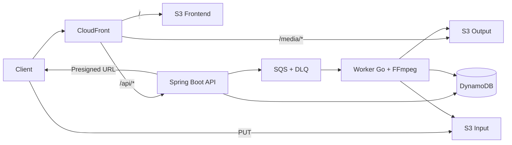

# TransVidCloud

TransVidCloud là một dự án cloud nhỏ: người dùng upload video, hệ thống tự chuyển mã sang HLS 360p/720p, tạo thumbnail rồi phát lại qua CDN.

Ý tưởng chính là không để API ôm file video. Client PUT thẳng lên S3 bằng Presigned URL. API chỉ ghi metadata và đẩy một job vào SQS. Worker Go + FFmpeg xử lý video, ghi kết quả lại S3 và cập nhật trạng thái trong DynamoDB.

## Trạng thái

`main` hiện chỉ có tài liệu, contracts, hạ tầng local và CI/CD. **Chưa có mã nguồn ứng dụng.**

| Thành phần | Nằm ở đâu |
|---|---|
| Backend Spring Boot | nhánh `phuong-integration` |
| Worker Go | nhánh `dev` và `phuong-integration` |
| Frontend React | nhánh `dev` và `phuong-integration` |
| Terraform / AWS | chưa triển khai |

Trên nhánh `phuong-integration`, full stack local đã chạy được: `make up`, `make smoke`, `make e2e`, Playwright, 24 integration test backend, 10 package test worker và 136 test frontend. Đó là kết quả trên nhánh đó, chưa merge vào `main`.

## Kiến trúc



Luồng upload:

1. `POST /projects/{id}/videos` — API tạo video `UPLOADING` và trả Presigned PUT URL (15 phút).
2. Client PUT file thẳng lên S3 input.
3. `POST /videos/{id}/confirm` — API kiểm tra `HeadObject`, ghi `PENDING` và outbox trong cùng transaction.
4. Job vào SQS. Worker nhận, chuyển `PROCESSING`, tải file, chạy `ffprobe`, tạo HLS 360p/720p + thumbnail.
5. Worker upload output, ghi `COMPLETED` kèm assets, xóa message.

Trạng thái video:

```text
UPLOADING → PENDING → PROCESSING → COMPLETED
                              ↘ FAILED_VALIDATION | FAILED_TRANSCODE | FAILED_STORAGE
```

API chỉ ghi `UPLOADING → PENDING`. Worker ghi các trạng thái còn lại và luôn dùng điều kiện `status <> COMPLETED` để không ghi đè kết quả cuối.

## Công nghệ

- **Backend:** Java 21, Spring Boot 3.4, Spring Security (JWT + API Key), Spring Cloud AWS, DynamoDB Enhanced Client.
- **Worker:** Go 1.24, AWS SDK v2, FFmpeg/ffprobe, HLS.
- **Frontend:** React 19, TypeScript, Vite, hls.js, MSW cho mock.
- **Local:** Docker Compose, LocalStack (S3/SQS/DynamoDB/SSM), nginx mô phỏng CloudFront.
- **Cloud dự kiến:** S3, SQS, DynamoDB, EC2 Auto Scaling, ECR, CloudFront, Cloudflare Tunnel, CloudWatch, SSM.

Không dùng Redis/ElastiCache. DynamoDB on-demand và cache tại Edge là đủ cho quy mô này.

## Chạy local

Cần Docker Compose v2, Node >= 20.19 và một LocalStack auth token.

```bash
cp .env.example .env
# điền LOCALSTACK_AUTH_TOKEN và JWT_SECRET (>= 32 byte)
```

Trên `main` chỉ chạy được hạ tầng:

```bash
make infra
make smoke
```

`make up` chưa chạy được vì chưa có Dockerfile backend/worker. Muốn chạy full stack:

```bash
git switch phuong-integration
make up
make smoke
```

Sau đó chạy frontend real mode:

```bash
cd frontend
npm install
npm run dev:real
```

Mở `http://localhost:8000` (nginx edge). API ở `http://localhost:8080/api`, Swagger UI ở `/api/swagger-ui.html`.

Vài lệnh khác:

```bash
make logs S=backend
make worker-scale N=3
make reset
make down
```

## API chính

Base path `/api`.

| Method | Endpoint | Ghi chú |
|---|---|---|
| POST | `/auth/register`, `/auth/login` | Trả JWT |
| GET | `/auth/me` | Thông tin tài khoản |
| GET/POST | `/projects` | Danh sách/tạo project |
| GET/PATCH/DELETE | `/projects/{projectId}` | Xem/sửa/xóa mềm |
| POST/GET | `/projects/{projectId}/api-keys` | Tạo/liệt kê API key |
| POST | `/projects/{projectId}/videos` | Init upload, trả Presigned URL |
| GET | `/projects/{projectId}/videos` | Danh sách, cursor pagination |
| GET/DELETE | `/videos/{videoId}` | Chi tiết/xóa video |
| POST | `/videos/{videoId}/confirm` | Confirm và đưa job vào SQS |

Giới hạn upload: 200 MB, 300 giây, cao tối đa 1080p, định dạng MP4/MOV/MKV/WEBM.

`GET /videos/{videoId}` vẫn yêu cầu xác thực. Trang `/embed` hiện chỉ chạy với mock; backend thật chưa có API public cho embed.

## Cấu trúc

```text
backend/      Spring Boot API (nhánh phuong-integration)
worker/       Go + FFmpeg (nhánh dev)
frontend/     React SPA (nhánh dev)
contracts/    OpenAPI, SQS schema, state machine, DynamoDB, S3 keys
local/        LocalStack init, nginx, smoke/chaos scripts
infra/        khung Terraform, chưa có .tf
scripts/      deploy-api.sh, bump-worker-tag.sh
docs/         kiến trúc, ADR, SRS, tài liệu từng module
```

## Vài điểm thiết kế

- **Direct-to-S3:** API không nhận file, giảm tải và tránh giới hạn request body.
- **Transactional Outbox:** đảm bảo video `PENDING` luôn có job, kể cả khi publish SQS lỗi.
- **Idempotency:** output key cố định theo `projectId/videoId`; worker bỏ qua video đã `COMPLETED`.
- **Một lần decode:** FFmpeg dùng `filter_complex split` tạo cả 360p và 720p, preset `veryfast`.
- **Heartbeat + SIGTERM:** job dài không mất visibility; worker Spot bị thu hồi sẽ trả message sớm.
- **Không NAT/ALB:** dùng Cloudflare Tunnel và S3 Gateway Endpoint để giảm chi phí.

## Đọc thêm

- [Kiến trúc Cloud](docs/adr/CloudTransvid_Kien_Truc_Cloud.md)
- [ADR DynamoDB-only](docs/adr/0001-dynamodb-only.md)
- [Local & CI/CD](docs/introduction/2.%20LOCAL_AND_CICD.md)
- [Contracts](contracts/README.md) · [OpenAPI](contracts/openapi.yaml)
- [Backend](docs/docs-backend/README.md) · [Worker](docs/docs-worker/README.md) · [Frontend](docs/docs-frontend/README.md)

## Nhóm

Phương — backend, xác thực, contracts. Vũ — worker, frontend. Lưu — Docker, hạ tầng, CI/CD.

Giấy phép [MIT](LICENSE).
