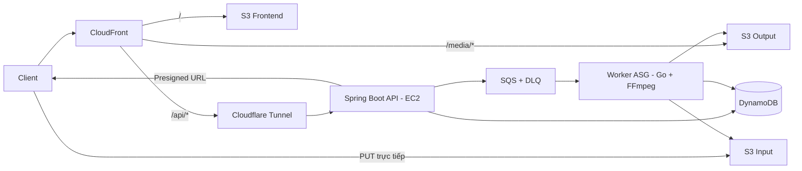
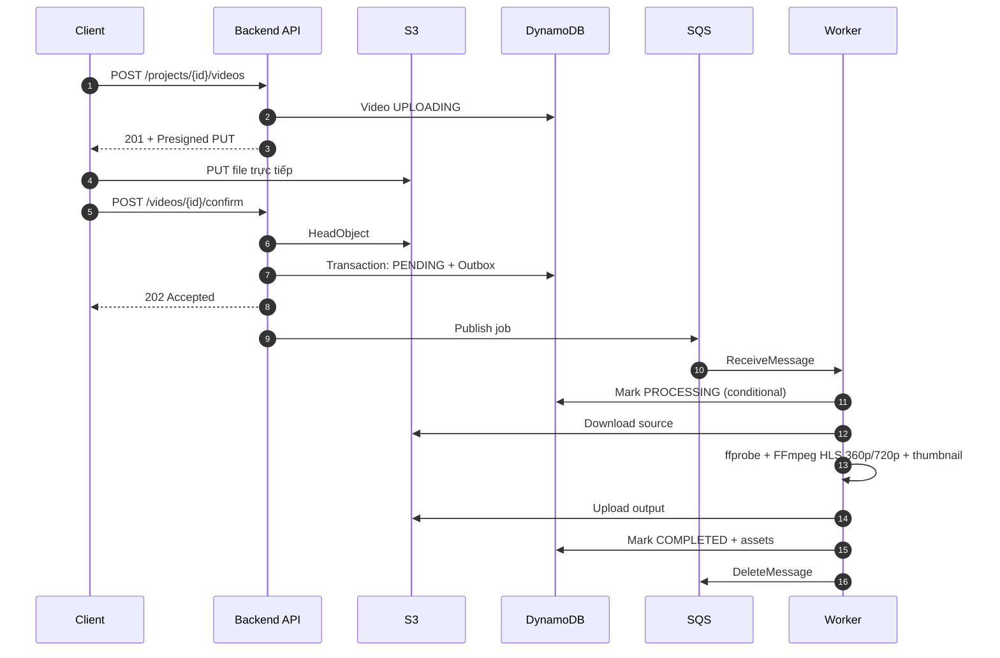

<div align="center">

# TransVidCloud

**Nền tảng xử lý và phân phối video trên Cloud**

Upload trực tiếp lên S3 → xử lý bất đồng bộ bằng SQS + worker FFmpeg → phát HLS 360p/720p qua Edge.

[](https://spring.io/projects/spring-boot)
[](https://go.dev/)
[](https://react.dev/)
[](LICENSE)

</div>

## Mục lục

- [Tổng quan](#tổng-quan)
- [Trạng thái dự án](#trạng-thái-dự-án)
- [Tính năng](#tính-năng)
- [Công nghệ sử dụng](#công-nghệ-sử-dụng)
- [Kiến trúc](#kiến-trúc)
- [Cấu trúc thư mục](#cấu-trúc-thư-mục)
- [Dữ liệu và Messaging](#dữ-liệu-và-messaging)
- [Chạy Local](#chạy-local)
- [Cloud và Triển khai](#cloud-và-triển-khai)
- [CI/CD và Giám sát](#cicd-và-giám-sát)
- [API và Testing](#api-và-testing)
- [Quyết định thiết kế](#quyết-định-thiết-kế)
- [Tài liệu tham khảo](#tài-liệu-tham-khảo)

## Tổng quan

**TransVidCloud** là đồ án môn **Điện toán đám mây** (UET – ĐHQGHN), xây dựng nền tảng SaaS/PaaS cho phép tải video lên, tự động chuyển mã sang **HLS 360p/720p**, tạo thumbnail và phân phối qua CDN/Edge.

Điểm cốt lõi là **tách đường truyền dữ liệu lớn khỏi API**:

- Client upload **trực tiếp** lên Amazon S3 bằng Presigned URL.
- API chỉ ghi metadata, kiểm tra quyền và đẩy job nhỏ vào Amazon SQS.
- Worker Go + FFmpeg chạy trên EC2 Auto Scaling, xử lý video và ghi kết quả lại S3.
- Trạng thái video được cập nhật nguyên tử trong DynamoDB.
- Nội dung hoàn chỉnh phát qua CloudFront (thiết kế) hoặc nginx mô phỏng Edge khi chạy local.

Hệ thống phục vụ hai nhóm người dùng trên cùng một lõi xử lý:

| Nhóm | Xác thực | Mục đích |
|------|----------|----------|
| SaaS Web | JWT Bearer (HS256) | Người dùng cuối quản lý project, upload và xem video |
| Developer API | `X-API-Key` theo Project | Hệ thống bên ngoài tích hợp qua REST API |

Mục tiêu: pipeline **bất đồng bộ, chịu lỗi, mở rộng ngang**, áp dụng các mẫu cloud thực tế (direct-to-S3, queue decoupling, idempotency, conditional write, transactional outbox, at-least-once) và tối ưu chi phí ở mức sinh viên.

## Trạng thái dự án

> **Quan trọng:** `main` **chưa chứa mã nguồn ứng dụng**. Backend, worker và frontend nằm trên các nhánh phát triển/tích hợp. Hạ tầng AWS và Terraform **chưa được triển khai**.

| Hạng mục | `main` | `dev` | `phuong-integration` |
|----------|:------:|:-----:|:--------------------:|
| Tài liệu, contracts, ADR | ✅ | ✅ | ✅ |
| LocalStack, Docker Compose, nginx edge | ✅ | ✅ | ✅ |
| CI/CD workflows, deploy scripts | ✅ | ✅ | ✅ |
| Backend Spring Boot | ❌ | ❌ | ✅ |
| Worker Go | ❌ | ✅ | ✅ |
| Frontend React | ❌ | ✅ | ✅ |
| E2E / Bench / Chaos scripts | ❌ | ✅ | ✅ |
| Terraform (`*.tf`), hạ tầng AWS thật | ❌ | ❌ | ❌ |

`main` là nhánh **documentation-first**: contracts, kiến trúc, harness local và CI/CD đã có; `backend/`, `worker/`, `frontend/` mới chỉ có README mô tả phạm vi.

Theo `PROGRESS.md` trên `phuong-integration`, full-stack local đã được kiểm chứng: `make up`, `make smoke`, `make e2e`, Playwright real-stack, 24 backend integration test, 10 worker package test và 136 frontend test. Đây là bằng chứng **trên nhánh tích hợp**, chưa hợp nhất vào `main`.

## Tính năng

**Đã có trong mã nguồn trên nhánh phát triển:**

- Đăng ký/đăng nhập SaaS; JWT HS256 stateless; mật khẩu BCrypt; email duy nhất bằng transaction DynamoDB.
- API Key theo Project: raw key chỉ trả một lần, server lưu SHA-256; tối đa 5 key/project; hỗ trợ thu hồi.
- CRUD project, cách ly theo owner, xóa mềm, chặn xóa khi còn video đang xử lý.
- Init upload + Presigned PUT URL (TTL 15 phút); upload trực tiếp lên S3; confirm bằng `HeadObject`.
- Transactional Outbox đảm bảo job không bị mất khi publish SQS thất bại.
- Worker tải video, validate bằng `ffprobe`, chuyển mã HLS 360p/720p, tạo thumbnail, upload output.
- Trạng thái `UPLOADING → PENDING → PROCESSING → COMPLETED / FAILED_*`.
- Cursor pagination cho danh sách video; xóa video (từ chối khi `PROCESSING`).
- Worker có heartbeat, idempotency, conditional write, xử lý `SIGTERM`, retry và DLQ.
- Frontend: login, projects, videos, upload dialog, polling trạng thái, HLS player, mock-first (MSW) và real mode.

**Dự kiến, chưa triển khai:**

- Terraform modules, môi trường `dev`/`demo`, CloudFront + Cloudflare Tunnel.
- Webhook callback khi video hoàn tất/thất bại.
- `metricpub` đẩy metric `BacklogPerInstance` cho Auto Scaling.
- Public embed API trên backend thật (trang `/embed` hiện chỉ hoạt động ở mock).

## Công nghệ sử dụng

| Thành phần | Công nghệ |
|------------|-----------|
| Backend | Java 21, Spring Boot 3.4.5, Spring Security/OAuth2 Resource Server, Spring Cloud AWS 3.3.0, AWS SDK v2, MapStruct, Lombok, Springdoc |
| Worker | Go 1.24, AWS SDK for Go v2, FFmpeg/ffprobe, HLS, `log/slog` |
| Frontend | React 19, TypeScript 5.9, Vite 7, React Router 7, hls.js 1.7, MSW 2, Vitest 4, Playwright |
| Local | Docker Compose, LocalStack (S3/SQS/DynamoDB/SSM), nginx mô phỏng CloudFront |
| Cloud target | S3, SQS + DLQ, DynamoDB, EC2 Auto Scaling, ECR, CloudFront, Cloudflare Tunnel, CloudWatch, SNS, Budgets, SSM |
| CI/CD | GitHub Actions, GitHub OIDC |
| IaC | Terraform (dự kiến, chưa có `.tf`) |

## Kiến trúc

### Kiến trúc mục tiêu trên AWS



Một domain thống nhất với ba behavior: `/` → S3 frontend, `/api/*` → API qua Cloudflare Tunnel, `/media/*` → S3 output. Cloudflare Tunnel cho phép API EC2 không mở inbound port, không cần ALB.

### Luồng upload và xử lý



### Trạng thái video

```text
UPLOADING --(API confirm)--> PENDING --(Worker nhận job)--> PROCESSING
PROCESSING --> COMPLETED | FAILED_VALIDATION | FAILED_TRANSCODE | FAILED_STORAGE
```

- API chỉ ghi `UPLOADING → PENDING`.
- Worker ghi `PROCESSING`, `COMPLETED`, `FAILED_*`.
- Mọi update của worker dùng `ConditionExpression: status <> COMPLETED`.
- `COMPLETED` là trạng thái cuối, không ghi đè.

### Kiến trúc local

```text
Browser :8000 → nginx edge
  ├── /       → Vite dev server :5173
  ├── /api/*  → Backend :8080
  └── /media/* → LocalStack S3 :4566
Backend và Worker → LocalStack (S3, SQS, DynamoDB)
```

Frontend dùng đường dẫn tương đối (`/api/...`, `/media/...`) nên code giống hệt local và cloud.

## Cấu trúc thư mục

```text
TransvidCloud/
├── backend/                 # Spring Boot API (source trên phuong-integration)
│   ├── src/main/java/.../   # auth, project, apikey, video, job, common
│   ├── src/test/            # Unit + Testcontainers/LocalStack
│   └── Dockerfile
├── worker/                  # Go + FFmpeg (source trên dev)
│   ├── cmd/worker/          # Entrypoint, vòng lặp consumer
│   ├── internal/            # config, consumer, job, validate, transcode,
│   │                        # storage, state, heartbeat, workdir, shutdown
│   ├── testdata/            # Video mẫu ngắn
│   └── Dockerfile
├── frontend/                # React SaaS Web (source trên dev)
│   ├── src/pages/           # Login, Projects, Videos, VideoDetail, Embed
│   ├── src/api/             # Client, session, upload transport, types
│   ├── src/player/          # HlsPlayer
│   ├── src/mocks/           # MSW handlers, fixture HLS
│   └── e2e/                 # Playwright
├── contracts/               # OpenAPI, SQS schema, state machine,
│                            # DynamoDB, S3 keys, upload limits
├── local/                   # LocalStack init, nginx, smoke/seed/chaos
├── infra/terraform/         # Khung module (chưa có .tf)
├── scripts/                 # deploy-api.sh, bump-worker-tag.sh
├── docs/                    # Kiến trúc, ADR, SRS, tài liệu module
├── .github/workflows/       # ci.yml, deploy.yml
├── docker-compose.yml
├── Makefile
└── README.md
```

> Trên `main`, các thư mục `backend/src`, `worker/internal`, `frontend/src` chưa tồn tại; cây trên mô tả đầy đủ khi hợp nhất các nhánh.

## Dữ liệu và Messaging

### DynamoDB

Billing `PAY_PER_REQUEST`, tên bảng `tvc-{env}-{table}` (local: `tvc-local-*`).

| Bảng | Partition Key | GSI | Nội dung |
|------|---------------|-----|----------|
| `users` | `userId` | `email-index` | Tài khoản, password hash |
| `projects` | `projectId` | `owner-index` | Project, `webhookUrl` |
| `apikeys` | `keyHash` | `project-index` | Hash, prefix, tên key |
| `videos` | `videoId` | `project-index` | Metadata, trạng thái, assets, outbox |

Outbox dùng chung bảng `videos` (PK `OUTBOX#<videoId>`, GSI `OUTBOX#PENDING/PUBLISHED`). Relay scheduler quét outbox mỗi 5 giây để gửi lại job chưa publish.

Email uniqueness dùng transaction ghi user item + lock item `EMAIL#<email>` với `attribute_not_exists`.

### S3 và giới hạn upload

```text
Input:  {projectId}/{videoId}/source.{ext}
Output: {projectId}/{videoId}/hls/master.m3u8
        {projectId}/{videoId}/hls/360p/index.m3u8 + seg_*.ts
        {projectId}/{videoId}/hls/720p/index.m3u8 + seg_*.ts
        {projectId}/{videoId}/thumb/default.jpg
```

| Giới hạn | Giá trị |
|----------|---------|
| Kích thước | 200 MB (`MAX_UPLOAD_BYTES`) |
| Thời lượng | 300 giây (`MAX_DURATION_SECONDS`) |
| Chiều cao | 1080 px (`MAX_HEIGHT_PIXELS`) |
| Định dạng | MP4, MOV, MKV, WEBM |
| Presigned URL TTL | 15 phút |

Key ổn định theo `projectId/videoId` để retry ghi đè đúng vị trí. Content-Type: `.m3u8` → `application/vnd.apple.mpegurl`, `.ts` → `video/mp2t`, `.jpg` → `image/jpeg`.

### SQS và Worker

| Thuộc tính | Giá trị |
|------------|---------|
| Loại | Standard queue + DLQ |
| Long polling | 20 giây |
| Max messages/lần | 1 |
| Visibility timeout | 300 giây |
| DLQ | `maxReceiveCount = 3` |
| Heartbeat | 120 giây (mặc định) |

Worker chuyển mã một lần bằng `filter_complex split`, preset `veryfast`: 360p 800 kbps + AAC 96 kbps, 720p 2800 kbps + AAC 128 kbps, segment HLS 4 giây, thumbnail tại giây thứ 1. Không upscale nếu nguồn nhỏ hơn rendition.

Xử lý lỗi: lỗi validation xóa message (`FAILED_VALIDATION`); lỗi FFmpeg/S3/DynamoDB giữ message để retry (`FAILED_TRANSCODE`, `FAILED_STORAGE`); `SIGTERM` trả message với visibility 30 giây.

### Caching

Không có lớp cache (không Redis/ElastiCache). DynamoDB on-demand đủ cho quy mô đồ án; segment HLS đã được cache tại Edge với `Cache-Control` dài hạn.

## Chạy Local

### Yêu cầu

- Docker + Docker Compose v2
- Node.js >= 20.19 và npm
- cURL, bash, Python 3
- LocalStack auth token (gói free phi thương mại)

Không cần cài Java/Maven/Go/FFmpeg trên host nếu chạy bằng Docker.

### Chuẩn bị

```bash
cp .env.example .env
```

Điền `LOCALSTACK_AUTH_TOKEN` và `JWT_SECRET` (tối thiểu 32 byte). Không commit `.env`.

### Trên `main`

```bash
make infra     # Khởi động LocalStack
make smoke     # Kiểm tra 3 bucket, 2 queue, 4 bảng DynamoDB
```

`make up` chưa chạy được trên `main` vì `backend/` và `worker/` chưa có mã nguồn/Dockerfile. `make test` sẽ bỏ qua các module chưa tồn tại.

### Full stack trên nhánh phát triển

```bash
git switch phuong-integration
cp .env.example .env
make up
make smoke
```

| Dịch vụ | URL |
|---------|-----|
| Edge tổng hợp | http://localhost:8000 |
| Backend API | http://localhost:8080/api |
| Swagger UI | http://localhost:8080/api/swagger-ui.html |
| LocalStack | http://localhost:4566 |

Chạy frontend real mode:

```bash
cd frontend
npm install
npm run dev:real
```

Truy cập qua `http://localhost:8000` để đi đúng edge nginx.

### Lệnh vận hành

```bash
make logs                 # Log toàn bộ stack
make logs S=backend       # Log một service
make worker-scale N=3     # Scale worker
make reset                # Xóa volume, khởi tạo lại LocalStack
make down                 # Dừng stack
```

### Biến môi trường chính

| Thành phần | Biến |
|------------|------|
| Backend | `AWS_REGION`, `AWS_ENDPOINT_URL`, `S3_BUCKET_INPUT`, `S3_BUCKET_OUTPUT`, `S3_PRESIGN_ENDPOINT`, `SQS_QUEUE_NAME`, `DDB_TABLE_PREFIX`, `JWT_SECRET`, `MAX_UPLOAD_BYTES` |
| Worker | `TVC_INPUT_BUCKET`, `TVC_OUTPUT_BUCKET`, `TVC_JOBS_QUEUE_URL`, `TVC_DDB_VIDEOS`, `TVC_TMP_DIR`, `MAX_DURATION_SECONDS`, `MAX_HEIGHT_PIXELS`, `TVC_FFMPEG_TIMEOUT`, `TVC_HEARTBEAT_INTERVAL`, `TVC_VISIBILITY_TIMEOUT` |

### Kiểm thử thủ công

1. Mở `http://localhost:8000`, đăng ký tài khoản.
2. Tạo project, upload MP4 thật (≤ 200 MB, ≤ 5 phút).
3. Theo dõi `PENDING → PROCESSING → COMPLETED`.
4. Phát HLS trong trang chi tiết.
5. Upload file giả đuôi `.mp4` → nhận `FAILED_VALIDATION` / `NOT_A_VIDEO`.

## Cloud và Triển khai

> **Trạng thái:** toàn bộ hạ tầng AWS dưới đây là **thiết kế**. Chưa có file Terraform `.tf` và chưa có tài nguyên nào được provision.

### Dịch vụ

| Nhóm | Dịch vụ | Vai trò |
|------|---------|---------|
| Storage | S3 (frontend, input, output) | Static site, video gốc, HLS/thumbnail |
| Messaging | SQS Standard + DLQ | Hàng đợi job, cách ly lỗi |
| Database | DynamoDB on-demand | Users, projects, API keys, videos, outbox |
| Compute | EC2 + Auto Scaling Group | API instance và worker |
| Registry | ECR | Image backend/worker |
| CDN | CloudFront | Phân phối `/`, `/api/*`, `/media/*` |
| Tunnel | Cloudflare Tunnel | Public API không mở inbound port |
| Security | IAM, GitHub OIDC, SSM | Least privilege, secrets, Session Manager |
| Observability | CloudWatch, SNS, Budgets | Log, metric, alarm, chi phí |

Thiết kế cố tình **không dùng NAT Gateway, ALB, EKS, Route 53/ACM**: giảm chi phí cố định, phù hợp đồ án. S3 bucket private; upload qua presigned URL, playback qua CloudFront OAC.

### Môi trường

| Môi trường | Cách chạy | Mục đích |
|------------|-----------|----------|
| `local` | Docker Compose + LocalStack | Phát triển, test tích hợp, e2e |
| `dev` | Terraform `envs/dev` (dự kiến) | Phát triển trên cloud |
| `demo` | Terraform `envs/demo` (dự kiến) | Demo ngắn hạn |

### Script triển khai hiện có

```bash
ENV=dev TAG=<git-sha> ECR_REPO=<registry>/tvc-backend ./scripts/deploy-api.sh
ENV=dev TAG=<git-sha> ./scripts/bump-worker-tag.sh
```

`deploy-api.sh` dùng SSM Run Command để pull image và chạy container. `bump-worker-tag.sh` ghi tag vào `/tvc/${ENV}/worker/image-tag` và kích hoạt ASG instance refresh. Cả hai **chưa chạy được** nếu ECR, EC2, ASG, SSM chưa tồn tại.

Terraform dự kiến gồm các module: `storage`, `queue`, `database`, `network`, `iam`, `compute`, `edge`, `observability`.

## CI/CD và Giám sát

### CI — `.github/workflows/ci.yml`

Chạy khi `pull_request` hoặc `push` vào `main`, mỗi job có điều kiện tồn tại manifest:

| Job | Điều kiện | Nội dung |
|-----|-----------|----------|
| Backend | `backend/pom.xml` | Java 21, `./mvnw -B verify` |
| Worker | `worker/go.mod` | `go vet ./...`, `go test ./...` |
| Frontend | `frontend/package.json` | Node 20, `npm ci`, build, test |
| Terraform | `infra/terraform/envs/dev/*.tf` | `fmt -check`, `init -backend=false`, `validate` |

Trên `main`, các job backend/worker/frontend/terraform tự động skip do chưa có mã nguồn/`.tf`; khi merge mã nguồn, job tự kích hoạt.

### CD — `.github/workflows/deploy.yml`

Kích hoạt thủ công (`workflow_dispatch`), chọn `dev`/`demo`:

```text
build-push → deploy-api → deploy-worker
           → deploy-frontend
```

Xác thực AWS bằng GitHub OIDC, không dùng access key dài hạn. Pipeline **chưa thể chạy thành công** cho đến khi hạ tầng AWS được provision.

### Logging và monitoring

- Backend: correlation ID (`X-Correlation-ID`), log masking password/API key/Bearer token/S3 signature/AWS secret.
- Worker: JSON log qua `slog`, có `jobId`, `videoId`, `projectId`, `attempt`, `ffmpegMs`, `bytesIn`, `bytesOut`.
- CloudWatch Logs retention 7 ngày; alarm DLQ có message, oldest message > 15 phút, API CPU > 80%; SNS email; AWS Budgets 25/50 USD.
- Auto Scaling dự kiến target tracking `BacklogPerInstance = messages / max(1, workers)`.

## API và Testing

### API

- Base path: `/api`; Swagger UI: `/api/swagger-ui.html`; OpenAPI JSON: `/api/v3/api-docs`.
- Contract nguồn: `contracts/openapi.yaml` (DRAFT).

| Method | Path | Xác thực | Mô tả |
|--------|------|----------|-------|
| POST | `/auth/register`, `/auth/login` | Public | Đăng ký/đăng nhập, trả JWT |
| GET | `/auth/me` | JWT | Thông tin tài khoản |
| GET/POST | `/projects` | JWT | Danh sách/tạo project |
| GET/PATCH/DELETE | `/projects/{projectId}` | JWT | Chi tiết/cập nhật/xóa mềm |
| POST/GET | `/projects/{projectId}/api-keys` | JWT | Tạo/liệt kê API key |
| DELETE | `/projects/{projectId}/api-keys/{keyHash}` | JWT | Thu hồi key |
| POST | `/projects/{projectId}/videos` | JWT hoặc API Key | Init upload + Presigned URL |
| GET | `/projects/{projectId}/videos` | JWT hoặc API Key | Danh sách, cursor pagination |
| GET/DELETE | `/videos/{videoId}` | JWT hoặc API Key | Chi tiết/xóa video |
| POST | `/videos/{videoId}/confirm` | JWT hoặc API Key | Confirm upload, đưa job vào SQS |

Lỗi thống nhất dạng `{"error":{"code":"...","message":"..."}}`. `GET /videos/{videoId}` yêu cầu xác thực; backend thật **chưa có** endpoint public cho embed.

### Testing

```bash
# Backend
cd backend && ./mvnw verify

# Worker
cd worker && go vet ./... && go test ./...

# Frontend
cd frontend && npm run api:check && npm test && npm run build
npx playwright install chromium && npm run test:e2e

# Tích hợp (nhánh phát triển)
make smoke
make e2e
make e2e-worker
make bench
make chaos
```

## Quyết định thiết kế

- **DynamoDB-only:** không RDBMS; phù hợp key-value, on-demand billing, conditional write/transaction. Đánh đổi: không JOIN, phải thiết kế GSI trước.
- **Direct-to-S3:** giảm tải API, không giới hạn body; đổi lại phải kiểm tra hậu upload (`HeadObject`, `ffprobe`).
- **Transactional Outbox:** video `PENDING` và outbox ghi cùng transaction; relay gửi lại nếu publish thất bại → at-least-once, không mất job.
- **Idempotency + stable keys:** output cố định theo `projectId/videoId`; worker bỏ qua video đã `COMPLETED`; conditional write bảo vệ trạng thái cuối.
- **Một lần decode, hai rendition:** `filter_complex split`, preset `veryfast`, không tạo 1080p → giảm CPU/thời gian.
- **Heartbeat + SIGTERM-safe:** visibility 300 giây, heartbeat 120 giây; Spot bị thu hồi thì trả message sớm để worker khác xử lý.
- **Không NAT/ALB:** Cloudflare Tunnel + S3 Gateway Endpoint giảm chi phí; đổi lại phụ thuộc Cloudflare.
- **Cursor pagination:** dùng `LastEvaluatedKey`, tránh offset không hiệu quả trên DynamoDB.
- **Contract-first:** OpenAPI, SQS schema, state machine, key convention là nguồn tham chiếu giữa các module.

## Tài liệu tham khảo

- [Kiến trúc Cloud chi tiết](docs/adr/CloudTransvid_Kien_Truc_Cloud.md)
- [ADR: DynamoDB-only](docs/adr/0001-dynamodb-only.md)
- [SRS high-level](docs/introduction/3.%20SRS%20highlevel.md)
- [Local & CI/CD](docs/introduction/2.%20LOCAL_AND_CICD.md)
- [Contracts](contracts/README.md) · [OpenAPI](contracts/openapi.yaml)
- [Backend docs](docs/docs-backend/README.md) · [Worker docs](docs/docs-worker/README.md) · [Frontend docs](docs/docs-frontend/README.md)

## Đội ngũ và Giấy phép

**Nhóm 12 — Điện toán đám mây, UET – ĐHQGHN**

| Thành viên | Phụ trách |
|------------|-----------|
| Phương | Backend API, xác thực, contracts |
| Vũ | Worker xử lý video, frontend |
| Lưu | Docker, hạ tầng, hosting, CI/CD |

Dự án phục vụ mục đích học tập. Giấy phép: [MIT](LICENSE).
