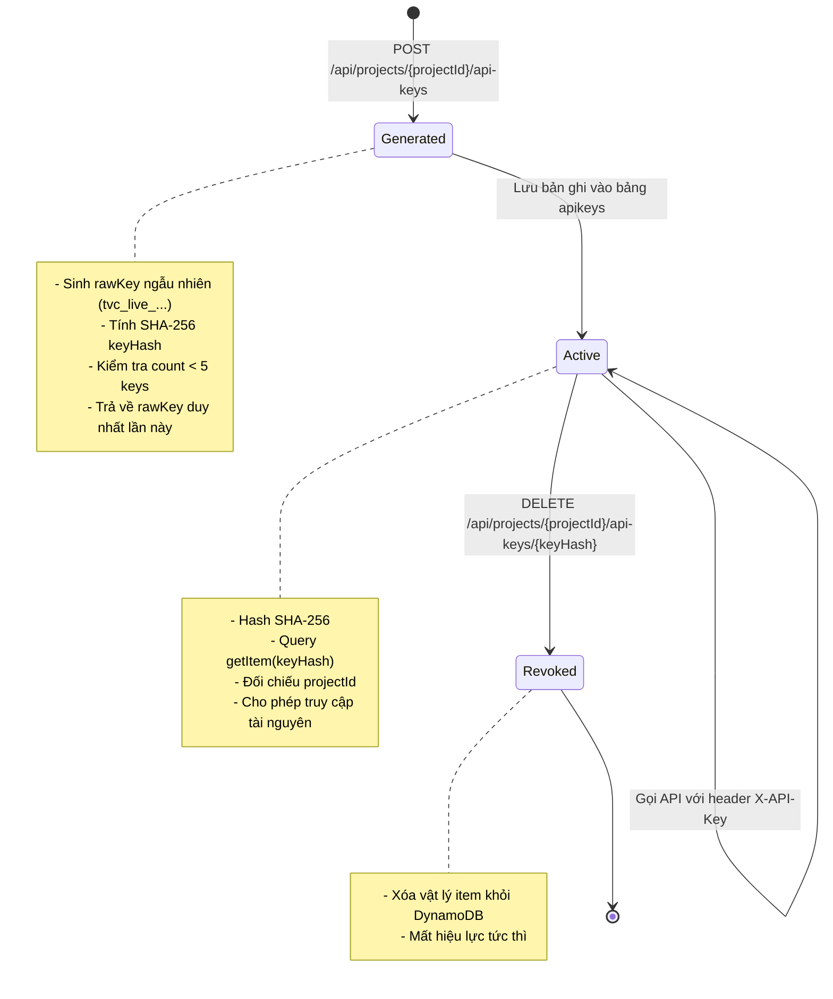

# Data Model & Schema: Quản lý API Key & Xác thực Dual Security

**Feature ID**: `F-005` | **Spec**: [specs/005-apikey-dual-auth/spec.md](spec.md)

Tài liệu này định nghĩa chi tiết mô hình dữ liệu, cấu trúc bảng DynamoDB, các đối tượng DTOs (Java record), ánh xạ MapStruct và vòng đời của thực thể API Key trong TransvidCloud Backend.

---

## 1. Thực thể lưu trữ DynamoDB (Entity)

### Bảng: `tvc-{env}-apikeys` (Local: `tvc-local-apikeys`)

- **Billing Mode**: Pay-Per-Request (On-Demand).
- **Partition Key (PK)**: `keyHash` (String) — Mã băm SHA-256 gồm 64 ký tự hex của chuỗi `rawKey`.
- **Global Secondary Index (GSI)**:
  - **Tên Index**: `project-index`
  - **Index PK**: `projectId` (String)
  - **Projection**: `ALL` (chiếu toàn bộ các trường)
  - **Mục đích**: Liệt kê toàn bộ các API Key thuộc một dự án cụ thể mà không cần quét bảng (Scan).

### Lớp Entity Java: `ApiKeyItem`

Package: `com.transvidcloud.backend.apikey.entity.ApiKeyItem`

```java
@Data
@Builder
@NoArgsConstructor
@AllArgsConstructor
@DynamoDbBean
public class ApiKeyItem {

    private String keyHash;    // Partition Key: SHA-256 hash của rawKey
    private String projectId;  // GSI PK (project-index): ID của Project sở hữu
    private String name;       // Tên gợi nhớ của API Key (1-100 ký tự)
    private String keyPrefix;  // Tiền tố hiển thị an toàn: tvc_live_xxxxxxxx...
    private String createdAt;  // Thời điểm tạo ISO-8601 UTC

    @DynamoDbPartitionKey
    public String getKeyHash() {
        return keyHash;
    }

    @DynamoDbSecondaryPartitionKey(indexNames = "project-index")
    public String getProjectId() {
        return projectId;
    }
}
```

---

## 2. Các đối tượng truyền tải dữ liệu (DTO Records)

Package: `com.transvidcloud.backend.apikey.dto`

### 2.1 Request DTOs

#### `CreateApiKeyRequest`
```java
public record CreateApiKeyRequest(
        @NotBlank(message = "API key name must not be blank")
        @Size(min = 1, max = 100, message = "API key name must be between 1 and 100 characters")
        String name
) {}
```

### 2.2 Response DTOs

#### `ApiKeyCreatedResponse`
Được trả về duy nhất một lần khi tạo mới thành công (`HTTP 201 Created`).
```java
public record ApiKeyCreatedResponse(
        String keyHash,
        String projectId,
        String name,
        String rawKey,      // Chuỗi bí mật đầy đủ (chỉ hiển thị lần đầu)
        String keyPrefix,   // Tiền tố hiển thị an toàn
        String createdAt
) {}
```

#### `ApiKeyMetadataResponse`
Được sử dụng khi liệt kê danh sách hoặc xem thông tin tóm tắt (không bao giờ chứa `rawKey`).
```java
public record ApiKeyMetadataResponse(
        String keyHash,
        String projectId,
        String name,
        String keyPrefix,
        String createdAt
) {}
```

#### `ApiKeyListResponse`
```java
public record ApiKeyListResponse(
        List<ApiKeyMetadataResponse> items
) {}
```

---

## 3. Mô hình Xác thực Bảo mật (Security Models)

Package: `com.transvidcloud.backend.apikey.security`

### 3.1 `ApiKeyPrincipal`
Đại diện cho danh tính của ứng dụng/máy gọi API qua `X-API-Key`.
```java
public record ApiKeyPrincipal(
        String projectId,
        String name,
        String keyPrefix
) implements Principal {
    @Override
    public String getName() {
        return "api-key:" + projectId + ":" + keyPrefix;
    }
}
```

### 3.2 `ApiKeyAuthenticationToken`
Đối tượng xác thực của Spring Security dành cho API Key.
```java
public class ApiKeyAuthenticationToken extends AbstractAuthenticationToken {

    private final ApiKeyPrincipal principal;
    private final String rawKey;

    public ApiKeyAuthenticationToken(ApiKeyPrincipal principal, String rawKey, Collection<? extends GrantedAuthority> authorities) {
        super(authorities);
        this.principal = principal;
        this.rawKey = rawKey;
        setAuthenticated(true);
    }

    public static ApiKeyAuthenticationToken unauthenticated(String rawKey) {
        return new ApiKeyAuthenticationToken(null, rawKey, Collections.emptyList());
    }

    @Override
    public Object getCredentials() {
        return rawKey;
    }

    @Override
    public Object getPrincipal() {
        return principal;
    }

    public String getProjectId() {
        return principal != null ? principal.projectId() : null;
    }
}
```

---

## 4. Bổ sung ErrorCode

Mở rộng `com.transvidcloud.backend.common.exception.ErrorCode`:

| ErrorCode | Code | HttpStatusCode | Message | Ngữ cảnh sử dụng |
|---|---|---|---|---|
| `UNAUTHENTICATED` | 1006 | `401 UNAUTHORIZED` | "Unauthenticated" | Key không hợp lệ, key bị thu hồi hoặc thiếu thông tin xác thực |
| `ACCESS_DENIED` | 1007 | `403 FORBIDDEN` | "You do not have permission" | Không phải chủ sở hữu Project, hoặc `X-API-Key` gọi sang Project khác |
| `RESOURCE_NOT_FOUND` | 1009 | `404 NOT_FOUND` | "Resource not found" | Project không tồn tại/đã xóa mềm, hoặc `keyHash` không tồn tại |
| `INVALID_KEY` | 1001 | `400 BAD_REQUEST` | "Invalid request parameter" | Tên key không hợp lệ, hoặc Project đã đạt tối đa 5 keys |

---

## 5. Vòng đời của API Key (Lifecycle & State Transitions)


