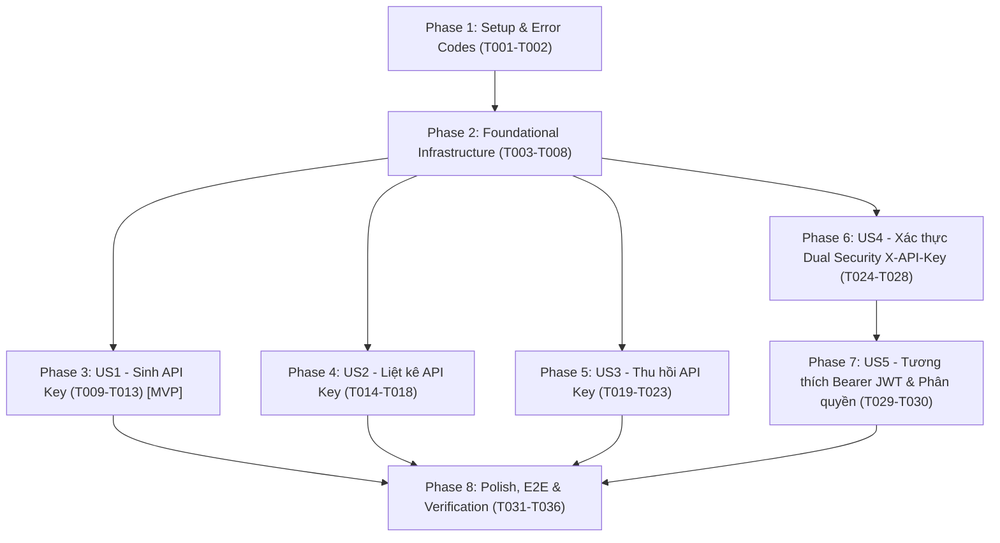

# Tasks: Quản lý API Key & Xác thực Dual Security JWT + X-API-Key (Feature F-005)

**Input**: Tài liệu thiết kế từ `specs/005-apikey-dual-auth/` (`spec.md`, `plan.md`, `data-model.md`, `research.md`, `contracts/api-keys-api.yaml`, `quickstart.md`)  
**Prerequisites**: `plan.md`, `spec.md`, `data-model.md`, `contracts/api-keys-api.yaml`  
**Tests**: Bao gồm đầy đủ Unit Tests, WebMvcTests, Integration Tests với LocalStack 3.0 Testcontainers (`ApiKeyManagementIT`, `DualSecurityAuthIT`) và Postman Collection E2E theo đúng chỉ đạo bắt buộc về Real Verification & Zero Regression của dự án.  

## Format: `- [ ] [TaskID] [P?] [Story?] Description with file path`

- **[P]**: Có thể thực hiện song song (tệp riêng biệt, không phụ thuộc vào task chưa hoàn thành)
- **[Story]**: Gắn với User Story tương ứng (`[US1]`, `[US2]`, `[US3]`, `[US4]`, `[US5]`)
- Mô tả kèm đường dẫn tệp chính xác

---

## Phase 1: Setup & Error Codes (Shared Infrastructure)

**Purpose**: Khởi tạo cấu trúc package tính năng `apikey/` và rà soát các mã lỗi chuẩn.

- [x] T001 Khởi tạo cấu trúc các thư mục package `com.transvidcloud.backend.apikey` (`controller`, `dto`, `entity`, `mapper`, `repository`, `security`, `service`, `util`) trong `backend/src/main/java/com/transvidcloud/backend/apikey/`
- [x] T002 [P] Bổ sung hoặc rà soát các mã lỗi chuẩn (`ErrorCode.INVALID_KEY`, `UNAUTHENTICATED`, `ACCESS_DENIED`, `RESOURCE_NOT_FOUND`) trong `backend/src/main/java/com/transvidcloud/backend/common/exception/ErrorCode.java`

---

## Phase 2: Foundational (Blocking Prerequisites)

**Purpose**: Xây dựng toàn bộ hạ tầng DTOs, DynamoDB Entity `ApiKeyItem`, MapStruct Mapper, tiện ích sinh khóa `ApiKeyGenerator` và các phương thức cơ sở của Repository mà tất cả User Stories dùng chung.

**⚠️ CRITICAL**: Không thể bắt đầu các User Stories cho đến khi Phase 2 hoàn thành.

- [x] T003 [P] Xây dựng tiện ích bảo mật `ApiKeyGenerator.java` (`SecureRandom` 16 bytes hex, tiền tố `tvc_live_` tạo `rawKey` 41 ký tự, tính mã băm một chiều `SHA-256` tạo `keyHash` 64 hex, và trích xuất `keyPrefix` hiển thị `tvc_live_` + 8 hex + `...`) trong `backend/src/main/java/com/transvidcloud/backend/apikey/util/ApiKeyGenerator.java`
- [x] T004 [P] Viết Unit Test cho `ApiKeyGeneratorTest.java` kiểm tra độ dài 41 ký tự, tiền tố `tvc_live_`, băm SHA-256 chính xác và format prefix `tvc_live_xxxxxxxx...` trong `backend/src/test/java/com/transvidcloud/backend/apikey/util/ApiKeyGeneratorTest.java`
- [x] T005 [P] Tạo các request DTO `CreateApiKeyRequest.java` (`name` `@NotBlank` `@Size(min=1, max=100)`) và response DTOs `ApiKeyCreatedResponse.java` (chứa `rawKey` duy nhất lần đầu), `ApiKeyMetadataResponse.java` (chứa `keyPrefix`, không có `rawKey`), `ApiKeyListResponse.java` (`items`) dạng Java `record` trong `backend/src/main/java/com/transvidcloud/backend/apikey/dto/`
- [x] T006 [P] Tạo DynamoDB Bean `ApiKeyItem.java` với các annotation `@DynamoDbBean`, `@DynamoDbPartitionKey` cho `keyHash`, `@DynamoDbSecondaryPartitionKey(indexNames = "project-index")` cho `projectId`, cùng các trường `name`, `keyPrefix`, `createdAt` trong `backend/src/main/java/com/transvidcloud/backend/apikey/entity/ApiKeyItem.java`
- [x] T007 [P] Tạo MapStruct mapper interface `ApiKeyMapper.java` chuyển đổi giữa `ApiKeyItem`, `ApiKeyMetadataResponse` và `ApiKeyCreatedResponse` trong `backend/src/main/java/com/transvidcloud/backend/apikey/mapper/ApiKeyMapper.java`
- [x] T008 Xây dựng `ApiKeyRepository.java` với `DynamoDbEnhancedClient` tương tác bảng `tvc-{env}-apikeys`: triển khai các phương thức `save(ApiKeyItem item)`, `findByKeyHash(String keyHash)`, `findByProjectId(String projectId)` (query GSI `project-index`), `countByProjectId(String projectId)` và `deleteByKeyHash(String keyHash)` trong `backend/src/main/java/com/transvidcloud/backend/apikey/repository/ApiKeyRepository.java`

**Checkpoint**: Hạ tầng nền tảng hoàn tất — các User Story có thể bắt đầu triển khai độc lập.

---

## Phase 3: User Story 1 - Sinh API Key mới cho Project (Priority: P1) 🎯 MVP

**Goal**: Người dùng sở hữu Project (sau khi đăng nhập bằng Bearer JWT) có thể tạo API Key mới với tên gợi nhớ (1-100 ký tự); hệ thống kiểm tra giới hạn tối đa 5 keys/project, sinh chuỗi ngẫu nhiên bảo mật cao có tiền tố `tvc_live_`, lưu mã băm SHA-256 vào DynamoDB và trả về `rawKey` duy nhất một lần với HTTP 201 Created.

**Independent Test**: Gửi `POST /api/projects/{projectId}/api-keys` với token JWT hợp lệ và tên key -> nhận HTTP 201 Created kèm `rawKey`, `keyHash`, `keyPrefix` và xác nhận DynamoDB chỉ lưu `keyHash`.

### Implementation for User Story 1

- [x] T009 [US1] Xây dựng phương thức `createApiKey(String projectId, CreateApiKeyRequest request, String currentUserId)` trong `ApiKeyService.java`: kiểm tra quyền sở hữu Project qua `ProjectService`, kiểm tra số lượng key hiện tại (`countByProjectId < 5`, nếu không ném 400 `INVALID_KEY`), sinh `rawKey` qua `ApiKeyGenerator`, tính `keyHash`, `keyPrefix`, lưu vào DynamoDB và trả về `ApiKeyCreatedResponse` trong `backend/src/main/java/com/transvidcloud/backend/apikey/service/ApiKeyService.java`
- [x] T010 [US1] Xây dựng REST endpoint `POST /api/projects/{projectId}/api-keys` trong `ApiKeyController.java`: nhận `@PathVariable String projectId`, `@Valid @RequestBody CreateApiKeyRequest`, trích xuất `currentUserId` từ `Authentication`, gọi `apiKeyService.createApiKey()`, trả về `ResponseEntity.status(HttpStatus.CREATED).body(response)` trong `backend/src/main/java/com/transvidcloud/backend/apikey/controller/ApiKeyController.java`
- [x] T011 [P] [US1] Viết Unit Test cho luồng tạo API Key trong `ApiKeyServiceTest.java`: kiểm tra tạo key thành công, trả về đúng `rawKey`, chặn khi đạt 5 keys (ném `INVALID_KEY`), chặn khi không phải chủ sở hữu Project (ném 403 `ACCESS_DENIED`), ném 404 khi Project không tồn tại trong `backend/src/test/java/com/transvidcloud/backend/apikey/service/ApiKeyServiceTest.java`
- [x] T012 [P] [US1] Viết WebMvcTest cho endpoint `POST /api/projects/{projectId}/api-keys` trong `ApiKeyControllerTest.java`: kiểm tra trả về 201 Created khi hợp lệ, 400 Bad Request khi tên rỗng hoặc vượt quá 100 ký tự, 401 Unauthorized khi thiếu token trong `backend/src/test/java/com/transvidcloud/backend/apikey/controller/ApiKeyControllerTest.java`
- [x] T013 [US1] Viết Integration Test khởi đầu trong `ApiKeyManagementIT.java` (Testcontainers LocalStack DynamoDB): kiểm chứng tạo Project thật, tạo API Key 1 thật, kiểm chứng DynamoDB chỉ lưu `keyHash` mà không lưu `rawKey` trong `backend/src/test/java/com/transvidcloud/backend/apikey/repository/ApiKeyManagementIT.java`

**Checkpoint**: User Story 1 hoàn thành 100% — hệ thống đã có thể sinh API Key độc lập và trả về khóa bí mật an toàn (MVP hoàn chỉnh).

---

## Phase 4: User Story 2 - Liệt kê danh sách API Key của Project (Priority: P1)

**Goal**: Người dùng sở hữu Project có thể xem danh sách toàn bộ các API Key đang hoạt động của dự án thông qua GSI `project-index`, chỉ nhận được metadata và `keyPrefix`, tuyệt đối không bao giờ nhận lại `rawKey`.

**Independent Test**: Tạo 2 API Key cho Project -> gửi `GET /api/projects/{projectId}/api-keys` -> kiểm tra thấy đúng 2 key với `keyPrefix` hiển thị an toàn và không có `rawKey`.

### Implementation for User Story 2

- [x] T014 [US2] Xây dựng phương thức `listApiKeys(String projectId, String currentUserId)` trong `ApiKeyService.java`: kiểm tra quyền sở hữu Project, query GSI `project-index` lấy danh sách `ApiKeyItem`, ánh xạ sang `ApiKeyListResponse` (chỉ chứa metadata, không có `rawKey`) trong `backend/src/main/java/com/transvidcloud/backend/apikey/service/ApiKeyService.java`
- [x] T015 [US2] Xây dựng REST endpoint `GET /api/projects/{projectId}/api-keys` trong `ApiKeyController.java`: nhận `@PathVariable String projectId`, trích xuất `currentUserId`, gọi `apiKeyService.listApiKeys()`, trả về `ResponseEntity.ok(response)` trong `backend/src/main/java/com/transvidcloud/backend/apikey/controller/ApiKeyController.java`
- [x] T016 [P] [US2] Mở rộng Unit Test trong `ApiKeyServiceTest.java` kiểm tra `listApiKeys` trả về danh sách metadata và ném 403 nếu user không sở hữu Project trong `backend/src/test/java/com/transvidcloud/backend/apikey/service/ApiKeyServiceTest.java`
- [x] T017 [P] [US2] Mở rộng WebMvcTest trong `ApiKeyControllerTest.java` cho `GET /api/projects/{projectId}/api-keys` (200 OK, 401 Unauthorized) trong `backend/src/test/java/com/transvidcloud/backend/apikey/controller/ApiKeyControllerTest.java`
- [x] T018 [US2] Mở rộng Integration Test trong `ApiKeyManagementIT.java`: kiểm chứng truy vấn GSI `project-index` trên LocalStack DynamoDB, xác nhận danh sách trả về không chứa `rawKey` trong `backend/src/test/java/com/transvidcloud/backend/apikey/repository/ApiKeyManagementIT.java`

**Checkpoint**: User Story 1 và User Story 2 đều hoạt động hoàn chỉnh và có thể kiểm thử độc lập.

---

## Phase 5: User Story 3 - Thu hồi (Revoke / Xóa) API Key (Priority: P1)

**Goal**: Người dùng sở hữu Project có thể thu hồi (xóa) API Key bằng `keyHash`. Bản ghi bị xóa vật lý khỏi DynamoDB và key mất hiệu lực ngay lập tức với HTTP 204 No Content.

**Independent Test**: Tạo 1 API Key -> gọi `DELETE /api/projects/{projectId}/api-keys/{keyHash}` -> nhận 204 No Content -> kiểm tra key bị xóa khỏi DynamoDB và không còn xuất hiện trong danh sách.

### Implementation for User Story 3

- [x] T019 [US3] Xây dựng phương thức `revokeApiKey(String projectId, String keyHash, String currentUserId)` trong `ApiKeyService.java`: kiểm tra quyền sở hữu Project, tìm `ApiKeyItem` theo `keyHash`, kiểm tra key tồn tại và `key.projectId == projectId` (nếu không ném 404 `RESOURCE_NOT_FOUND`), gọi `apiKeyRepository.deleteByKeyHash(keyHash)` trong `backend/src/main/java/com/transvidcloud/backend/apikey/service/ApiKeyService.java`
- [x] T020 [US3] Xây dựng REST endpoint `DELETE /api/projects/{projectId}/api-keys/{keyHash}` trong `ApiKeyController.java`: nhận `projectId` và `keyHash`, trích xuất `currentUserId`, gọi `apiKeyService.revokeApiKey()`, trả về `ResponseEntity.noContent().build()` trong `backend/src/main/java/com/transvidcloud/backend/apikey/controller/ApiKeyController.java`
- [x] T021 [P] [US3] Mở rộng Unit Test trong `ApiKeyServiceTest.java` cho luồng thu hồi: kiểm tra xóa thành công, ném 404 khi keyHash không tồn tại hoặc không khớp projectId, ném 403 khi user không sở hữu project trong `backend/src/test/java/com/transvidcloud/backend/apikey/service/ApiKeyServiceTest.java`
- [x] T022 [P] [US3] Mở rộng WebMvcTest trong `ApiKeyControllerTest.java` cho `DELETE /api/projects/{projectId}/api-keys/{keyHash}` (204 No Content, 404 Not Found) trong `backend/src/test/java/com/transvidcloud/backend/apikey/controller/ApiKeyControllerTest.java`
- [x] T023 [US3] Mở rộng Integration Test trong `ApiKeyManagementIT.java`: kiểm chứng thu hồi key trên DynamoDB, xác nhận key bị xóa hoàn toàn khỏi CSDL, thử thu hồi lại báo 404, và kiểm thử giới hạn 5 keys (tạo liên tiếp 5 keys -> key thứ 6 báo 400) trong `backend/src/test/java/com/transvidcloud/backend/apikey/repository/ApiKeyManagementIT.java`

**Checkpoint**: User Stories 1, 2 và 3 đều hoạt động trọn vẹn và độc lập.

---

## Phase 6: User Story 4 - Xác thực Dual Security với X-API-Key trên các endpoint nghiệp vụ (Priority: P1)

**Goal**: Tích hợp `ApiKeyAuthenticationFilter` vào Spring Security. Khi request chứa tiêu đề `X-API-Key: tvc_live_...`, hệ thống băm SHA-256, tra cứu DynamoDB, gán `ApiKeyAuthenticationToken` (`ROLE_API_KEY`) và đối chiếu `projectId` của key với `projectId` trên URL (chặn 403 nếu gọi chéo project, chặn 401 nếu key sai hoặc đã thu hồi).

**Independent Test**: Gửi request tới endpoint Video với `X-API-Key` hợp lệ -> thành công; gửi key sai hoặc đã thu hồi -> 401; gửi key gọi chéo project -> 403.

### Implementation for User Story 4

- [x] T024 [P] [US4] Tạo các lớp bảo mật đại diện cho API Key: `ApiKeyPrincipal.java` (chứa `projectId`, `name`, `keyPrefix`) và `ApiKeyAuthenticationToken.java` (kế thừa `AbstractAuthenticationToken`, quyền `ROLE_API_KEY`) trong `backend/src/main/java/com/transvidcloud/backend/apikey/security/`
- [x] T025 [US4] Xây dựng `ApiKeyAuthenticationFilter.java` kế thừa `OncePerRequestFilter`: kiểm tra nếu request có `Authorization: Bearer ` thì bỏ qua để JWT filter xử lý; nếu có tiêu đề `X-API-Key`, trích xuất `rawKey`, tính SHA-256 hash, tra cứu trong `ApiKeyRepository`. Nếu hợp lệ, gán `ApiKeyAuthenticationToken` vào `SecurityContextHolder` trong `backend/src/main/java/com/transvidcloud/backend/apikey/security/ApiKeyAuthenticationFilter.java`
- [x] T026 [US4] Đăng ký `ApiKeyAuthenticationFilter` vào chuỗi `SecurityFilterChain` trong `SecurityConfig.java` (đặt trước `BearerTokenAuthenticationFilter` hoặc `UsernamePasswordAuthenticationFilter`) trong `backend/src/main/java/com/transvidcloud/backend/common/config/SecurityConfig.java`
- [x] T027 [US4] Xây dựng cơ chế kiểm soát ranh giới Project trong Filter hoặc Controller/Service: đối chiếu `auth.getProjectId().equals(projectId)`. Nếu không khớp, từ chối với HTTP 403 Forbidden (`ACCESS_DENIED`)
- [x] T028 [US4] Xây dựng bài kiểm thử tích hợp chuyên sâu `DualSecurityAuthIT.java` (Testcontainers LocalStack DynamoDB + Spring Security): gửi `X-API-Key` hợp lệ truy cập tài nguyên project -> HTTP 200/201; gửi `X-API-Key` sai hoặc đã thu hồi -> HTTP 401; gửi `X-API-Key` của Project A vào Project B -> HTTP 403 trong `backend/src/test/java/com/transvidcloud/backend/apikey/repository/DualSecurityAuthIT.java`

**Checkpoint**: User Story 4 hoàn thành — xác thực bằng API Key hoạt động độc lập và an toàn tuyệt đối.

---

## Phase 7: User Story 5 - Đảm bảo khả năng tương thích xác thực Bearer JWT trên các endpoint Video (Priority: P1)

**Goal**: Đảm bảo người dùng SaaS Web tiếp tục sử dụng Bearer JWT bình thường; khi request có cả Bearer JWT và `X-API-Key`, hệ thống ưu tiên xác thực Bearer JWT; chặn các request dùng `X-API-Key` cố truy cập các endpoint cá nhân của người dùng web (như `POST /api/projects`). Bảo đảm Zero Regression.

**Independent Test**: Gửi request với Bearer JWT -> thành công; gửi request có cả 2 header -> thẩm định theo JWT; dùng `X-API-Key` gọi `POST /api/projects` -> bị chặn 403.

### Implementation for User Story 5

- [x] T029 [US5] Cấu hình phân quyền endpoint: bảo đảm các endpoint cá nhân (như `POST /api/projects`, `GET /api/projects`, `POST /api/projects/{projectId}/api-keys`) chỉ chấp nhận `ROLE_USER` và từ chối các request mang `X-API-Key` (`ROLE_API_KEY`) với HTTP 403 Forbidden
- [x] T030 [US5] Mở rộng `DualSecurityAuthIT.java`: kiểm thử gửi đồng thời cả header `Authorization: Bearer <JWT>` và header `X-API-Key: <key>` -> xác minh hệ thống ưu tiên xác thực theo Bearer JWT của người dùng; kiểm thử dùng `X-API-Key` gọi `POST /api/projects` -> xác minh bị chặn HTTP 403 Forbidden trong `backend/src/test/java/com/transvidcloud/backend/apikey/repository/DualSecurityAuthIT.java`

**Checkpoint**: Toàn bộ 5 User Stories đều hoạt động trọn vẹn, tương thích tuyệt đối và hoàn thành mục tiêu Dual Security.

---

## Phase 8: Polish, E2E Test Suite & Verification (Real Verification & Zero Regression)

**Purpose**: Hoàn thiện bộ kiểm thử E2E Postman Collection độc lập, chạy toàn bộ bộ kiểm thử tích lũy và lập hồ sơ nghiệm thu thực tế.

- [x] T031 [P] Xây dựng bộ sưu tập Postman Collection E2E độc lập `backend/postman/F-005-apikey-dual-auth.postman_collection.json` kiểm thử 100% các kịch bản thực tế (đăng ký, tạo project, sinh key, gọi API bằng key, thử gọi chéo 403, giới hạn 5 keys 400, thu hồi 204, gọi lại 401)
- [x] T032 Thực thi kiểm chuẩn cấu trúc starter và Harness: `cd backend && ./scripts/check-setup.sh`
- [x] T033 Thực thi toàn bộ Unit Tests và WebMvc Tests: `./mvnw -B test`
- [x] T034 Thực thi kiểm chứng tích hợp Testcontainers LocalStack DynamoDB: `./mvnw -B test -Dtest="ApiKeyManagementIT,DualSecurityAuthIT"`
- [x] T035 Thực thi bộ kiểm tra toàn diện Zero Regression: `./scripts/verify.sh` (`./mvnw -B clean verify`), bảo đảm 100% tests tích lũy của F-001, F-002, F-003, F-004 và F-005 đều PASS
- [x] T036 Tạo hồ sơ Feature Evidence kiểm chứng thực tế tại `backend/quality/evidence/F-005-apikey-dual-auth.md` và cập nhật `PROGRESS.md`

---

## Dependencies & Execution Order

### Phase Dependencies

- **Phase 1 (Setup)**: Có thể bắt đầu ngay lập tức.
- **Phase 2 (Foundational)**: Bắt buộc hoàn thành trước khi triển khai các User Story.
- **Phase 3, 4, 5 (CRUD API Key)**: Triển khai lần lượt theo độ ưu tiên nghiệp vụ hoặc song song.
- **Phase 6, 7 (Dual Security Auth)**: Tích hợp filter bảo mật, đối chiếu tenant và kiểm chứng phân quyền.
- **Phase 8 (Polish & Verification)**: Bắt buộc hoàn tất sau khi toàn bộ User Stories đã xong để kiểm chứng Real Verification và Zero Regression.

---

## Implementation Strategy

### MVP First (User Story 1 Only)
1. Hoàn thành Phase 1 (Setup) và Phase 2 (Foundational).
2. Hoàn thành Phase 3 (User Story 1 - Sinh API Key).
3. **VALIDATE MVP**: Kiểm tra endpoint `POST /api/projects/{projectId}/api-keys` sinh đúng `rawKey`, lưu `keyHash` an toàn.

### Incremental Delivery
1. Setup + Foundational -> Nền tảng sẵn sàng.
2. Thêm US1 -> Sinh API Key (MVP).
3. Thêm US2 -> Liệt kê danh sách API Key.
4. Thêm US3 -> Thu hồi (xóa) API Key.
5. Thêm US4 -> Xác thực qua header `X-API-Key`.
6. Thêm US5 -> Đảm bảo ưu tiên Bearer JWT & phân quyền endpoint.
7. Chạy E2E Postman Runner & `./scripts/verify.sh` nghiệm thu toàn diện.
