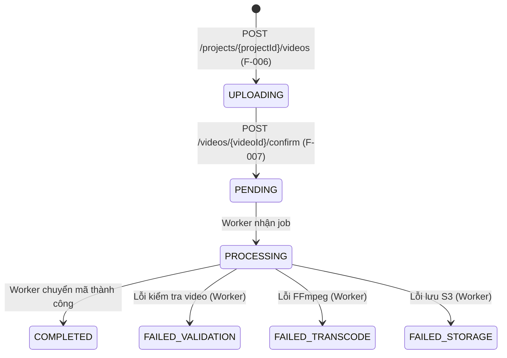

# Data Model: Khởi tạo Upload Video & Cấp S3 Presigned PUT URL (F-006)

**Feature**: F-006 — Khởi tạo Upload Video & Cấp S3 Presigned PUT URL (Epic A3)  
**Date**: 2026-10-31  
**Status**: Completed

---

## 1. Thực thể Lưu trữ DynamoDB (`VideoItem`)

Bảng: `tvc-{env}-videos` (môi trường local: `tvc-local-videos`).  
Cấu hình: On-demand billing, AWS SDK v2 `@DynamoDbBean`.

### Schema bảng `videos`

| Tên thuộc tính | Kiểu dữ liệu | Vai trò | Mô tả / Quy ước |
|---|---|---|---|
| `videoId` | String | **Partition Key (PK)** | Mã định danh video duy nhất, tiền tố `vid_` + 12 ký tự hex (ví dụ: `vid_4a77e1c8d102`). |
| `projectId` | String | **GSI PK** (`project-index`) | Mã định danh dự án sở hữu video (ví dụ: `prj_1c05d9e2a3f4`). |
| `createdAt` | String | **GSI SK** (`project-index`) | Thời điểm tạo video theo định dạng ISO-8601 UTC (ví dụ: `2026-10-31T09:15:00Z`). |
| `title` | String | Thuộc tính | Tiêu đề hiển thị của video (1-200 ký tự, cho phép trùng lặp trong cùng Project). |
| `sizeBytes` | Long | Thuộc tính | Dung lượng file tính bằng byte (1 <= sizeBytes <= 209715200). |
| `contentType` | String | Thuộc tính | Loại MIME của video (`video/mp4`, `video/quicktime`, `video/x-matroska`, `video/webm`). |
| `status` | String | Thuộc tính | Trạng thái vòng đời. Khởi tạo: `UPLOADING`. |
| `attemptCount` | Integer | Thuộc tính | Số lần Worker nhận xử lý job (khởi tạo: `0`). |
| `inputKey` | String | Thuộc tính | Khóa S3 đối tượng video gốc: `{projectId}/{videoId}/source.{ext}`. |
| `assets` | Map<String, String> | Thuộc tính | Map chứa đường dẫn đầu ra (HLS, thumbnail). Khởi tạo: `null` hoặc rỗng. |
| `errorCode` | String | Thuộc tính | Mã lỗi chi tiết nếu Worker xử lý thất bại. Khởi tạo: `null`. |
| `updatedAt` | String | Thuộc tính | Thời điểm cập nhật trạng thái gần nhất (ISO-8601 UTC). |
| `startedAt` | String | Thuộc tính | Thời điểm bắt đầu chuyển mã tại Worker. Khởi tạo: `null`. |
| `completedAt` | String | Thuộc tính | Thời điểm hoàn tất chuyển mã. Khởi tạo: `null`. |

### Định nghĩa Chỉ mục Thứ cấp Toàn cục (GSI)
- **Tên GSI**: `project-index`
- **Partition Key**: `projectId` (String)
- **Sort Key**: `createdAt` (String)
- **Projection Type**: `ALL`

---

## 2. Trạng thái Vòng đời Video (`VideoStatus`)

Theo `contracts/video-state-machine.md`:



- Trong phạm vi **F-006**, trạng thái duy nhất được sinh ra khi khởi tạo là **`UPLOADING`**.
- `attemptCount` được khởi tạo bằng `0`.

---

## 3. Data Transfer Objects (DTOs)

Các DTO được định nghĩa dưới dạng Java `record` bất biến theo tiêu chuẩn thiết kế của dự án.

### 3.1. `InitVideoRequest`

```java
public record InitVideoRequest(
        @NotBlank(message = "Tiêu đề video không được để trống")
        @Size(min = 1, max = 200, message = "Tiêu đề video phải từ 1 đến 200 ký tự")
        String title,

        @NotBlank(message = "Tên tệp tin gốc không được để trống")
        @Size(min = 1, max = 255, message = "Tên tệp tin phải từ 1 đến 255 ký tự")
        String filename,

        @NotNull(message = "Dung lượng tệp không được để trống")
        @Min(value = 1, message = "Dung lượng tệp phải lớn hơn 0 byte")
        Long sizeBytes,

        @NotBlank(message = "Loại nội dung contentType không được để trống")
        String contentType
) {}
```

### 3.2. `PresignedUploadInfo`

```java
public record PresignedUploadInfo(
        String presignedUrl,
        String method,
        int expiresInSeconds,
        Map<String, String> requiredHeaders
) {}
```

### 3.3. `VideoResponse`

```java
public record VideoResponse(
        String videoId,
        String projectId,
        String title,
        VideoStatus status,
        Long sizeBytes,
        String contentType,
        Integer attemptCount,
        String errorCode,
        Map<String, String> assets,
        Instant createdAt,
        Instant updatedAt,
        Instant startedAt,
        Instant completedAt
) {}
```

### 3.4. `InitVideoResponse`

```java
public record InitVideoResponse(
        VideoResponse video,
        PresignedUploadInfo upload
) {}
```

---

## 4. Ánh xạ Dữ liệu (Entity & DTO Mapping)

Sử dụng MapStruct interface `VideoMapper`:
- `VideoItem` -> `VideoResponse`:
  - `status`: Chuyển chuỗi String sang Enum `VideoStatus`.
  - `createdAt`, `updatedAt`, `startedAt`, `completedAt`: Chuyển chuỗi ISO-8601 sang `Instant`.
- Tách biệt hoàn toàn tầng Entity DynamoDB và API Response DTO; không để lộ trường nội bộ (`inputKey`) ra `VideoResponse` (tuân thủ `contracts/openapi.yaml`).
