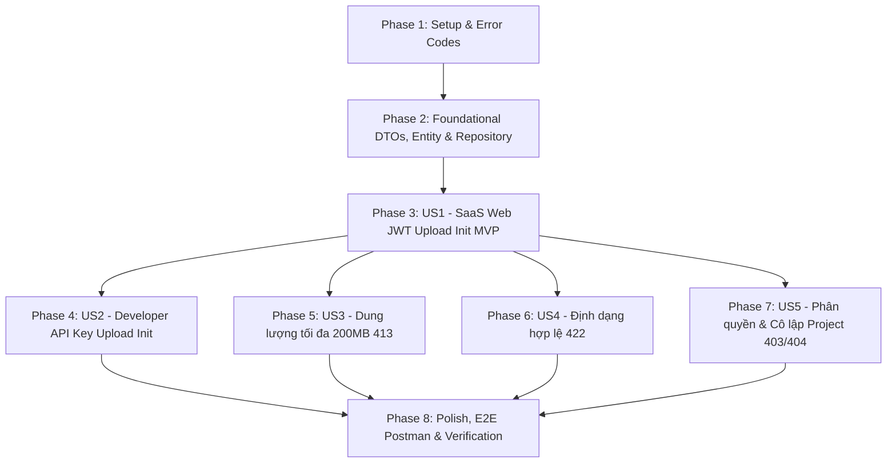

# Tasks: Khởi tạo Upload Video & Cấp S3 Presigned PUT URL (Feature F-006)

**Input**: Tài liệu thiết kế từ `specs/006-video-upload-init/` (`spec.md`, `plan.md`, `data-model.md`, `research.md`, `contracts/video-upload-init-api.yaml`, `quickstart.md`)  
**Prerequisites**: `plan.md`, `spec.md`, `data-model.md`, `contracts/video-upload-init-api.yaml`  
**Tests**: Bao gồm đầy đủ Unit Tests, WebMvcTests, Integration Tests với LocalStack Testcontainers (`VideoUploadInitIT`) và Postman Collection E2E theo đúng chỉ đạo bắt buộc về Real Verification & Zero Regression của dự án.  

## Format: `- [ ] [TaskID] [P?] [Story?] Description with file path`

- **[P]**: Có thể thực hiện song song (tệp riêng biệt, không phụ thuộc vào task chưa hoàn thành)
- **[Story]**: Gắn với User Story tương ứng (`[US1]`, `[US2]`, `[US3]`, `[US4]`, `[US5]`)
- Mô tả kèm đường dẫn tệp chính xác

---

## Phase 1: Setup & Error Codes (Shared Infrastructure)

**Purpose**: Khởi tạo cấu trúc package tính năng `video/` và rà soát các mã lỗi chuẩn.

- [x] T001 Khởi tạo cấu trúc các thư mục package `com.transvidcloud.backend.video` (`controller`, `dto`, `entity`, `mapper`, `repository`, `service`) trong `backend/src/main/java/com/transvidcloud/backend/video/`
- [x] T002 [P] Rà soát và xác nhận các mã lỗi chuẩn `ErrorCode.UPLOAD_LIMIT_EXCEEDED` (HTTP 413) và `ErrorCode.UNSUPPORTED_MEDIA_TYPE` (HTTP 422) trong `backend/src/main/java/com/transvidcloud/backend/common/exception/ErrorCode.java`

---

## Phase 2: Foundational (Blocking Prerequisites)

**Purpose**: Xây dựng toàn bộ hạ tầng DTOs, DynamoDB Entity `VideoItem`, Enum `VideoStatus`, MapStruct Mapper, tiện ích validation và các phương thức cơ sở của Repository mà tất cả User Stories dùng chung.

**⚠️ CRITICAL**: Không thể bắt đầu các User Stories cho đến khi Phase 2 hoàn thành.

- [x] T003 [P] Tạo enum `VideoStatus.java` định nghĩa các trạng thái vòng đời (`UPLOADING`, `PENDING`, `PROCESSING`, `COMPLETED`, `FAILED_VALIDATION`, `FAILED_TRANSCODE`, `FAILED_STORAGE`) trong `backend/src/main/java/com/transvidcloud/backend/video/entity/VideoStatus.java`
- [x] T004 [P] Tạo DynamoDB Bean `VideoItem.java` với các annotation `@DynamoDbBean`, `@DynamoDbPartitionKey` cho `videoId`, `@DynamoDbSecondaryPartitionKey(indexNames = "project-index")` cho `projectId`, `@DynamoDbSecondarySortKey(indexNames = "project-index")` cho `createdAt`, cùng các trường `title`, `sizeBytes`, `contentType`, `status`, `attemptCount`, `inputKey`, `assets`, `errorCode`, `updatedAt`, `startedAt`, `completedAt` trong `backend/src/main/java/com/transvidcloud/backend/video/entity/VideoItem.java`
- [x] T005 [P] Tạo các DTOs bất biến Java record: `InitVideoRequest.java` (`title` 1-200 ký tự, `filename` 1-255 ký tự, `sizeBytes` tối thiểu 1, `contentType`), `PresignedUploadInfo.java` (`presignedUrl`, `method`, `expiresInSeconds`, `requiredHeaders`), `VideoResponse.java`, `InitVideoResponse.java` trong `backend/src/main/java/com/transvidcloud/backend/video/dto/`
- [x] T006 [P] Tạo MapStruct mapper interface `VideoMapper.java` chuyển đổi giữa `VideoItem` và `VideoResponse` (chuyển đổi `status` enum và `Instant` timestamps) trong `backend/src/main/java/com/transvidcloud/backend/video/mapper/VideoMapper.java`
- [x] T007 Xây dựng `VideoRepository.java` với `DynamoDbEnhancedClient` tương tác bảng `tvc-{env}-videos`: triển khai các phương thức `save(VideoItem item)`, `findByVideoId(String videoId)` trong `backend/src/main/java/com/transvidcloud/backend/video/repository/VideoRepository.java`
- [x] T008 [P] Xây dựng tiện ích thẩm định `VideoValidationHelper.java`: trích xuất phần mở rộng sau dấu chấm cuối cùng và chuyển thành chữ thường (`lowercase`), kiểm tra đuôi hợp lệ (`mp4`, `mov`, `mkv`, `webm`), kiểm tra MIME type cho phép, kiểm tra giới hạn dung lượng trong `backend/src/main/java/com/transvidcloud/backend/video/service/VideoValidationHelper.java`
- [x] T009 [P] Viết Unit Test cho `VideoValidationHelperTest.java`: kiểm thử trích xuất đuôi tệp tin nhiều dấu chấm, chuyển hoa thành thường, kiểm tra dung lượng > 200MB, và kiểm tra MIME type trong `backend/src/test/java/com/transvidcloud/backend/video/service/VideoValidationHelperTest.java`

**Checkpoint**: Hạ tầng nền tảng hoàn tất — các User Story có thể bắt đầu triển khai độc lập.

---

## Phase 3: User Story 1 - Khởi tạo Video và nhận S3 Presigned PUT URL từ SaaS Web qua JWT (Priority: P1) 🎯 MVP

**Goal**: Người dùng sở hữu Project (sau khi đăng nhập bằng Bearer JWT) có thể gửi yêu cầu khởi tạo video mới; hệ thống kiểm tra quyền sở hữu, sinh `videoId = vid_...`, cấu thành `inputKey = {projectId}/{videoId}/source.{ext}`, lưu bản ghi `videos` ở trạng thái `UPLOADING` và `attemptCount = 0`, dùng `S3Presigner` ký Presigned PUT URL 15 phút với header `Content-Type` và `Content-Length`, phản hồi HTTP 201 Created.

**Independent Test**: Gửi `POST /api/projects/{projectId}/videos` với token JWT hợp lệ và dữ liệu video hợp lệ -> nhận HTTP 201 Created kèm thông tin video và `presignedUrl`, xác nhận bản ghi trong DynamoDB và xác nhận có thể PUT byte lên S3 qua URL được cấp.

### Implementation for User Story 1

- [x] T010 [US1] Xây dựng phương thức `initVideoUpload(String projectId, InitVideoRequest request, Authentication authentication)` trong `VideoService.java`: kiểm tra quyền sở hữu qua `ProjectService`, sinh `videoId` (`vid_` + 12 hex ngẫu nhiên), trích xuất extension chữ thường, cấu thành `inputKey`, lưu `VideoItem` vào DynamoDB với `status = UPLOADING` và `attemptCount = 0` trong `backend/src/main/java/com/transvidcloud/backend/video/service/VideoService.java`
- [x] T011 [US1] Tích hợp `S3Presigner` trong `VideoService.java`: ký S3 Presigned PUT URL có thời hạn 900 giây (15 phút) trỏ tới bucket `tvcProperties.getAws().getS3().getInputBucket()`, ký kèm `Content-Type` và `Content-Length`, đóng gói `PresignedUploadInfo` và trả về `InitVideoResponse` trong `backend/src/main/java/com/transvidcloud/backend/video/service/VideoService.java`
- [x] T012 [US1] Xây dựng REST endpoint `POST /api/projects/{projectId}/videos` trong `VideoController.java`: nhận `@PathVariable String projectId`, `@Valid @RequestBody InitVideoRequest request`, `Authentication authentication`, gọi `videoService.initVideoUpload()`, trả về `ResponseEntity.status(HttpStatus.CREATED).body(ApiResponse.<InitVideoResponse>builder().code(1000).result(response).build())` trong `backend/src/main/java/com/transvidcloud/backend/video/controller/VideoController.java`
- [x] T013 [P] [US1] Viết Unit Test `VideoServiceTest.java` cho luồng khởi tạo video thành công của người dùng web: kiểm tra lưu DynamoDB đúng trạng thái `UPLOADING`, sinh đúng `inputKey`, gọi `S3Presigner` trả về đúng URL và headers trong `backend/src/test/java/com/transvidcloud/backend/video/service/VideoServiceTest.java`
- [x] T014 [P] [US1] Viết WebMvcTest `VideoControllerTest.java` cho `POST /api/projects/{projectId}/videos`: kiểm tra HTTP 201 Created, serialization DTO, và HTTP 400 Bad Request khi thiếu trường bắt buộc trong `backend/src/test/java/com/transvidcloud/backend/video/controller/VideoControllerTest.java`
- [x] T015 [US1] Viết Integration Test khởi đầu trong `VideoUploadInitIT.java` (Testcontainers LocalStack S3 + DynamoDB): tạo Project thật, gọi API tạo video bằng JWT, nhận Presigned URL, thực hiện HTTP PUT đẩy file mẫu lên LocalStack S3 và xác nhận bằng S3 `HeadObject` cũng như kiểm tra DynamoDB trong `backend/src/test/java/com/transvidcloud/backend/video/repository/VideoUploadInitIT.java`

**Checkpoint**: User Story 1 hoàn thành 100% — hệ thống đã có thể khởi tạo video và cấp S3 Presigned URL cho SaaS Web (MVP hoàn chỉnh).

---

## Phase 4: User Story 2 - Khởi tạo Video tự động từ Developer Application qua API Key (Priority: P1)

**Goal**: Ứng dụng bên ngoài có thể gọi API khởi tạo video bằng `X-API-Key: tvc_live_...`. Hệ thống xác thực danh tính qua `ApiKeyAuthenticationToken`, đối chiếu `projectId` của key với URL, kiểm tra Project đang `ACTIVE` và cấp S3 Presigned PUT URL tương tự người dùng web.

**Independent Test**: Gửi `POST /api/projects/{projectId}/videos` với tiêu đề `X-API-Key` hợp lệ của Project đó -> nhận HTTP 201 Created kèm thông tin video và S3 Presigned URL.

### Implementation for User Story 2

- [x] T016 [US2] Mở rộng logic `initVideoUpload` trong `VideoService.java`: hỗ trợ xác thực `ApiKeyAuthenticationToken`, đối chiếu `principal.projectId().equals(projectId)`, kiểm tra Project cha đang `ACTIVE` trong `backend/src/main/java/com/transvidcloud/backend/video/service/VideoService.java`
- [x] T017 [P] [US2] Mở rộng Unit Test trong `VideoServiceTest.java`: kiểm thử khởi tạo video thành công khi authentication là `ApiKeyAuthenticationToken` trong `backend/src/test/java/com/transvidcloud/backend/video/service/VideoServiceTest.java`
- [x] T018 [US2] Mở rộng Integration Test trong `VideoUploadInitIT.java`: tạo API Key thật cho Project, gọi API `POST /api/projects/{projectId}/videos` với tiêu đề `X-API-Key`, xác minh tạo video và cấp S3 Presigned URL thành công trong `backend/src/test/java/com/transvidcloud/backend/video/repository/VideoUploadInitIT.java`

**Checkpoint**: User Story 1 và User Story 2 đều hoạt động hoàn chỉnh và có thể kiểm thử độc lập.

---

## Phase 5: User Story 3 - Kiểm soát giới hạn dung lượng tối đa 200MB (Priority: P1)

**Goal**: Hệ thống ngăn chặn sớm các yêu cầu tải lên có `sizeBytes` vượt quá 200 MB (209,715,200 bytes) theo `contracts/upload-limits.md`, từ chối ngay với HTTP 413 Payload Too Large (`UPLOAD_LIMIT_EXCEEDED`).

**Independent Test**: Gửi yêu cầu với `sizeBytes = 209715201` -> nhận HTTP 413; gửi yêu cầu với `sizeBytes = 209715200` -> nhận HTTP 201.

### Implementation for User Story 3

- [x] T019 [US3] Tích hợp kiểm tra dung lượng trong `VideoService.java`: nếu `sizeBytes > tvcProperties.getUpload().getMaxBytes()` (209715200 bytes) ném `AppException(ErrorCode.UPLOAD_LIMIT_EXCEEDED)` trong `backend/src/main/java/com/transvidcloud/backend/video/service/VideoService.java`
- [x] T020 [P] [US3] Mở rộng Unit Test trong `VideoServiceTest.java`: kiểm thử từ chối với `UPLOAD_LIMIT_EXCEEDED` khi `sizeBytes = 209715201` và chấp nhận khi `sizeBytes = 209715200` trong `backend/src/test/java/com/transvidcloud/backend/video/service/VideoServiceTest.java`
- [x] T021 [P] [US3] Mở rộng WebMvcTest trong `VideoControllerTest.java`: kiểm thử trả về mã lỗi HTTP 413 Payload Too Large khi dung lượng vượt quá 200MB trong `backend/src/test/java/com/transvidcloud/backend/video/controller/VideoControllerTest.java`
- [x] T022 [US3] Mở rộng Integration Test trong `VideoUploadInitIT.java`: kiểm thử gọi API với `sizeBytes > 200MB` bị từ chối HTTP 413 và không có bản ghi nào được ghi vào DynamoDB hoặc S3 trong `backend/src/test/java/com/transvidcloud/backend/video/repository/VideoUploadInitIT.java`

**Checkpoint**: User Stories 1, 2 và 3 đều hoạt động trọn vẹn và độc lập.

---

## Phase 6: User Story 4 - Kiểm soát định dạng video và phần mở rộng tệp tin hợp lệ (Priority: P1)

**Goal**: Hệ thống chỉ chấp nhận 4 loại container video (`mp4`, `mov`, `mkv`, `webm`) và MIME types tương ứng (`video/mp4`, `video/quicktime`, `video/x-matroska`, `video/webm`). Nếu gửi sai định dạng hoặc đuôi tệp tin không hợp lệ, hệ thống từ chối với HTTP 422 Unprocessable Entity (`UNSUPPORTED_MEDIA_TYPE`).

**Independent Test**: Gửi yêu cầu với `contentType = video/x-msvideo` hoặc `filename = test.avi` -> nhận HTTP 422; gửi với `video/mp4` và đuôi hoa `.MP4` -> hệ thống chấp nhận và chuẩn hóa đuôi lowercase `source.mp4`.

### Implementation for User Story 4

- [x] T023 [US4] Tích hợp kiểm tra MIME type và phần mở rộng trong `VideoService.java`: nếu `contentType` không thuộc `allowedContentTypes` hoặc phần mở rộng tệp tin không thuộc `mp4, mov, mkv, webm` thì ném `AppException(ErrorCode.UNSUPPORTED_MEDIA_TYPE)` trong `backend/src/main/java/com/transvidcloud/backend/video/service/VideoService.java`
- [x] T024 [P] [US4] Mở rộng Unit Test trong `VideoServiceTest.java`: kiểm thử từ chối `UNSUPPORTED_MEDIA_TYPE` khi gửi `video/avi`, `image/png`, hoặc `filename` không có đuôi/đuôi sai trong `backend/src/test/java/com/transvidcloud/backend/video/service/VideoServiceTest.java`
- [x] T025 [P] [US4] Mở rộng WebMvcTest trong `VideoControllerTest.java`: kiểm thử trả về mã lỗi HTTP 422 Unprocessable Entity khi định dạng sai trong `backend/src/test/java/com/transvidcloud/backend/video/controller/VideoControllerTest.java`
- [x] T026 [US4] Mở rộng Integration Test trong `VideoUploadInitIT.java`: kiểm thử gọi API với `contentType = video/x-msvideo` bị từ chối HTTP 422 trong `backend/src/test/java/com/transvidcloud/backend/video/repository/VideoUploadInitIT.java`

**Checkpoint**: User Stories 1, 2, 3 và 4 đều hoạt động trọn vẹn và độc lập.

---

## Phase 7: User Story 5 - Phân quyền và cô lập tài nguyên Project (Priority: P1)

**Goal**: Đảm bảo an toàn bảo mật đa người dùng: Người dùng web không sở hữu Project bị từ chối HTTP 403 Forbidden (`ACCESS_DENIED`); API Key gọi chéo Project bị từ chối HTTP 403 Forbidden; gọi vào Project không tồn tại hoặc đã xóa mềm (`DELETED`) bị từ chối HTTP 404 Not Found (`RESOURCE_NOT_FOUND`); không xác thực bị chặn HTTP 401 Unauthorized (`UNAUTHENTICATED`).

**Independent Test**: Dùng token User B gọi vào Project của User A -> HTTP 403; dùng API Key Project A gọi vào Project B -> HTTP 403; gọi vào Project đã xóa -> HTTP 404.

### Implementation for User Story 5

- [x] T027 [US5] Hoàn thiện logic kiểm tra quyền sở hữu và ranh giới Project trong `VideoService.java`: ném `ACCESS_DENIED` (403) nếu JWT user không sở hữu project hoặc nếu API Key khác `projectId`; ném `RESOURCE_NOT_FOUND` (404) nếu Project không tồn tại hoặc đã `DELETED` trong `backend/src/main/java/com/transvidcloud/backend/video/service/VideoService.java`
- [x] T028 [P] [US5] Mở rộng Unit Test trong `VideoServiceTest.java`: kiểm thử ném 403 khi truy cập chéo tenant, ném 404 khi Project không tồn tại hoặc bị xóa mềm trong `backend/src/test/java/com/transvidcloud/backend/video/service/VideoServiceTest.java`
- [x] T029 [US5] Mở rộng Integration Test trong `VideoUploadInitIT.java`: kiểm thử User B gọi vào Project của User A bị chặn 403, gọi vào Project không tồn tại bị chặn 404, không có token/key bị chặn 401 trong `backend/src/test/java/com/transvidcloud/backend/video/repository/VideoUploadInitIT.java`

**Checkpoint**: Toàn bộ 5 User Stories đều hoạt động trọn vẹn, an toàn và độc lập.

---

## Phase 8: Polish, E2E Test Suite & Verification (Real Verification & Zero Regression)

**Purpose**: Hoàn thiện bộ kiểm thử E2E Postman Collection độc lập, chạy toàn bộ bộ kiểm thử tích lũy và lập hồ sơ nghiệm thu thực tế.

- [x] T030 [P] Xây dựng bộ sưu tập Postman Collection E2E độc lập `backend/postman/F-006-video-upload-init.postman_collection.json` kiểm thử toàn diện các kịch bản: khởi tạo JWT 201, tải PUT file lên S3 thành công, khởi tạo API Key 201, vượt 200MB báo 413, sai định dạng báo 422, chéo project báo 403, không tồn tại báo 404
- [x] T031 Thực thi kiểm chuẩn cấu trúc starter và Harness: `cd backend && ./scripts/check-setup.sh`
- [x] T032 Thực thi toàn bộ Unit Tests và WebMvc Tests: `./mvnw -B test`
- [x] T033 Thực thi kiểm chứng tích hợp Testcontainers LocalStack S3 + DynamoDB: `./mvnw -B test -Dtest="VideoUploadInitIT"`
- [x] T034 Thực thi bộ kiểm tra toàn diện Zero Regression: `./scripts/verify.sh` (`./mvnw -B clean verify`), bảo đảm 100% tests tích lũy của F-001 -> F-006 đều PASS
- [x] T035 Tạo hồ sơ Feature Evidence kiểm chứng thực tế tại `backend/quality/evidence/F-006-video-upload-init.md` và cập nhật snapshot trong `PROGRESS.md`

---

## Dependencies & Execution Order

### Phase Dependencies

### User Story Dependencies

- **User Story 1 (P1)**: Bắt đầu ngay sau khi hoàn thành Phase 2 (Foundational). Không phụ thuộc vào các story khác (đóng vai trò MVP cốt lõi).
- **User Story 2 (P2)**: Bắt đầu sau khi US1 hoàn thành phương thức `initVideoUpload` cơ sở; tích hợp kiểm tra ngữ cảnh `ApiKeyAuthenticationToken`.
- **User Story 3 (P3)**: Bắt đầu sau US1; tích hợp quy tắc kiểm tra ngưỡng 200MB vào service.
- **User Story 4 (P4)**: Bắt đầu sau US1; tích hợp quy tắc kiểm tra MIME type và phần mở rộng vào service.
- **User Story 5 (P5)**: Bắt đầu sau US1; hoàn thiện kiểm tra ranh giới sở hữu và trạng thái project.

### Cơ hội thực hiện Song song (Parallel Opportunities)

- Tại Phase 2: Các task `T003` (Enum), `T004` (Entity), `T005` (DTOs), `T006` (Mapper), `T008` (Validator), `T009` (ValidationTest) hoàn toàn có thể chạy song song vì là các file độc lập.
- Tại Phase 3 (US1): `T013` (Unit Test) và `T014` (WebMvcTest) có thể viết song song.
- Tại các Phase 4-7: Các bài test Unit Test và Slice Test của từng story có thể viết song song với code nghiệp vụ.

---

## Implementation Strategy

### MVP First (User Story 1 Only)

1. Hoàn thành Phase 1: Setup package và mã lỗi.
2. Hoàn thành Phase 2: Nền tảng DTOs, DynamoDB `VideoItem`, Mapper, Repository.
3. Hoàn thành Phase 3: Triển khai trọn vẹn luồng khởi tạo video bằng JWT, ký S3 Presigned URL và lưu DynamoDB.
4. **STOP and VALIDATE**: Kiểm thử độc lập US1 qua `VideoUploadInitIT` trên LocalStack. Lúc này hệ thống đã có một MVP hoàn chỉnh cho SaaS Web.

### Incremental Delivery

1. Tiếp tục triển khai US2 (Dual Security API Key) -> Kiểm thử xác thực API Key độc lập.
2. Tiếp tục triển khai US3 (Chặn 413 khi vượt 200MB) -> Kiểm thử ngưỡng biên.
3. Tiếp tục triển khai US4 (Chặn 422 khi sai định dạng) -> Kiểm thử MIME types.
4. Tiếp tục triển khai US5 (Cô lập quyền sở hữu 403/404) -> Kiểm thử truy cập chéo tenant.
5. Hoàn thiện Phase 8: Bộ Postman Collection E2E và lệnh verify Zero Regression `./scripts/verify.sh`.
