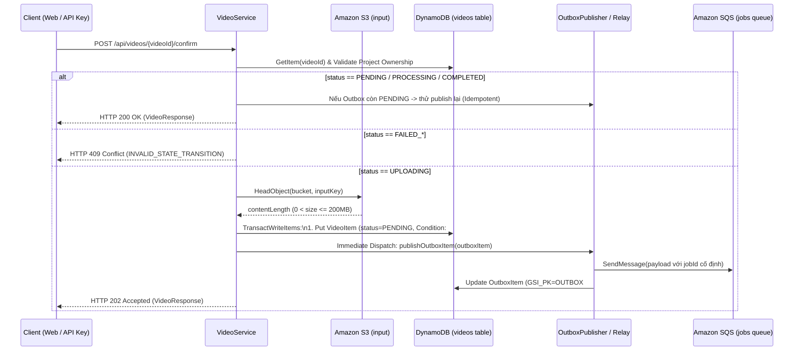

# Data Model: Xác nhận Upload, Chuyển trạng thái & Điều phối SQS Job (F-007)

**Feature**: F-007 — Xác nhận Upload, Chuyển trạng thái & Điều phối SQS Job (Epic A3/A5)  
**Date**: 2026-11-01  
**Status**: Completed

---

## 1. Mô hình Lưu trữ DynamoDB trên Bảng `tvc-{env}-videos` (Single-Table Pattern)

Bảng: `tvc-{env}-videos` (môi trường local: `tvc-local-videos`).  
Chỉ mục GSI: `project-index` (PK: `projectId`, SK: `createdAt`, Projection: `ALL`).

### 1.1. Thực thể `VideoItem` (Bản ghi Video chính)

| Tên thuộc tính | Kiểu dữ liệu | Vai trò | Mô tả / Quy ước trong F-007 |
|---|---|---|---|
| `videoId` | String | **Partition Key (PK)** | Định danh video (`vid_` + 12 ký tự hex, ví dụ: `vid_4a77e1c8d102`). |
| `projectId` | String | **GSI PK** (`project-index`) | Định danh dự án (`prj_...`). |
| `createdAt` | String | **GSI SK** (`project-index`) | Thời điểm khởi tạo video (ISO-8601 UTC). |
| `title` | String | Thuộc tính | Tiêu đề video. |
| `sizeBytes` | Long | Thuộc tính | Được cập nhật đồng bộ theo `contentLength` thực tế từ S3 `HeadObject` (`0 < sizeBytes <= 209715200`). |
| `contentType` | String | Thuộc tính | Loại MIME của video. |
| `status` | String | Thuộc tính | Chuyển nguyên tử từ `UPLOADING` sang `PENDING` qua `TransactWriteItems`. |
| `attemptCount` | Integer | Thuộc tính | Giữ nguyên `0` (do Go Worker tăng khi nhận xử lý job). |
| `inputKey` | String | Thuộc tính | Khóa S3 của tệp gốc: `{projectId}/{videoId}/source.{ext}`. |
| `updatedAt` | String | Thuộc tính | Cập nhật thành thời điểm xác nhận thành công (ISO-8601 UTC). |

### 1.2. Thực thể `OutboxItem` (Bản ghi Transactional Outbox trên cùng bảng `videos`)

Được ghi nguyên tử cùng lúc với `VideoItem` trong một giao dịch `TransactWriteItems` để đảm bảo không bao giờ mất thông điệp SQS.

| Tên thuộc tính | Kiểu dữ liệu | Vai trò | Mô tả / Quy ước |
|---|---|---|---|
| `videoId` | String | **Partition Key (PK)** | Khóa phân vùng Outbox: `"OUTBOX#" + targetVideoId` (ví dụ: `OUTBOX#vid_4a77e1c8d102`). |
| `projectId` | String | **GSI PK** (`project-index`) | Trạng thái phân vùng phục vụ Query không dùng `Scan`: `"OUTBOX#PENDING"` (khi chờ gửi) hoặc `"OUTBOX#PUBLISHED"` (khi đã gửi SQS thành công). |
| `createdAt` | String | **GSI SK** (`project-index`) | Thời điểm tạo sự kiện Outbox (ISO-8601 UTC) — dùng để sắp xếp FIFO khi Outbox Relay quét. |
| `jobId` | String | Thuộc tính | Định danh công việc cố định (`job_` + 12 ký tự hex CSPRNG) đảm bảo idempotency cho Worker. |
| `targetVideoId` | String | Thuộc tính | Mã `videoId` gốc (`vid_...`). |
| `targetProjectId` | String | Thuộc tính | Mã `projectId` gốc (`prj_...`). |
| `inputKey` | String | Thuộc tính | Khóa S3 của tệp video gốc. |
| `payload` | String | Thuộc tính | Chuỗi JSON đã đóng gói của `SqsJobMessage` (`schemaVersion: 1`). |
| `outboxStatus` | String | Thuộc tính | Trạng thái sự kiện Outbox: `"PENDING"` hoặc `"PUBLISHED"`. |
| `attemptCount` | Integer | Thuộc tính | Số lần thử đẩy thông điệp lên SQS (khởi tạo `0`). |
| `lastError` | String | Thuộc tính | Thông báo lỗi của lần gửi SQS thất bại gần nhất (nếu có). |
| `updatedAt` | String | Thuộc tính | Thời điểm cập nhật bản ghi Outbox gần nhất (ISO-8601 UTC). |
| `publishedAt` | String | Thuộc tính | Thời điểm đẩy thành công lên hàng đợi SQS (ISO-8601 UTC). |

---

## 2. Chuyển dịch Trạng thái & Giao dịch Nguyên tử



---

## 3. Data Transfer Objects (DTOs) & Message Payloads

### 3.1. `SqsJobMessage` (Payload gửi tới SQS `tvc-{env}-jobs`)

Tuân thủ tuyệt đối `contracts/sqs-job-message.schema.json` (`additionalProperties: false`):

```java
public record SqsJobMessage(
        int schemaVersion,
        String jobId,
        String videoId,
        String projectId,
        String inputKey,
        String requestedAt
) {
    public static final int CURRENT_SCHEMA_VERSION = 1;
}
```

### 3.2. `ConfirmVideoResult` (Kết quả nội bộ tầng Service -> Controller)

Phân biệt giữa lần xác nhận đầu tiên (`HTTP 202 Accepted`) và các lần gọi lặp idempotent (`HTTP 200 OK`):

```java
public record ConfirmVideoResult(
        VideoResponse video,
        boolean newlyConfirmed
) {}
```

### 3.3. Bổ sung Mã lỗi trong `ErrorCode`

| Enum Constant | Code | HTTP Status | Mô tả |
|---|---|---|---|
| `INVALID_STATE_TRANSITION` | `"INVALID_STATE_TRANSITION"` | `409 Conflict` | Không thể xác nhận video đang ở trạng thái lỗi (`FAILED_*`) |
| `S3_OBJECT_NOT_FOUND` | `"S3_OBJECT_NOT_FOUND"` | `422 Unprocessable Entity` | Tệp video chưa được tải lên S3 bucket tiếp nhận |
| `UPLOAD_SIZE_MISMATCH` | `"UPLOAD_SIZE_MISMATCH"` | `422 Unprocessable Entity` | Tệp video trên S3 có dung lượng không hợp lệ (0 byte) |
| `UPLOAD_LIMIT_EXCEEDED` | `"UPLOAD_LIMIT_EXCEEDED"` | `413 Payload Too Large` | *(Đã có sẵn)* Tệp video trên S3 vượt quá giới hạn tối đa 200 MB |
