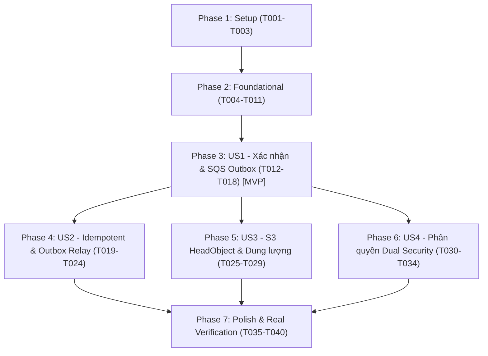

# Tasks: F-007 Xác nhận Upload, Chuyển trạng thái & Điều phối SQS Job

**Input**: Design documents from `/specs/007-video-confirm-dispatch/` (`spec.md`, `plan.md`, `research.md`, `data-model.md`, `contracts/`, `quickstart.md`)  
**Prerequisites**: plan.md (hoàn tất), spec.md (hoàn tất), research.md, data-model.md, contracts/  
**Organization**: Tasks được phân rã theo User Story và các tầng kiến trúc để hỗ trợ triển khai tuần tự, kiểm thử độc lập và bàn giao MVP.

---

## Format: `[ID] [P?] [Story] Description`

- **[P]**: Có thể thực hiện song song (tệp tin độc lập, không phụ thuộc vào task chưa hoàn thành).
- **[Story]**: Gắn nhãn User Story (`[US1]`, `[US2]`, `[US3]`, `[US4]`) cho các phase tính năng.
- Mọi mô tả đều nêu rõ đường dẫn tệp tin và yêu cầu kỹ thuật cụ thể.

---

## Phase 1: Setup & Shared Configuration

**Mục tiêu**: Bổ sung các mã lỗi và thuộc tính cấu hình cần thiết cho tính năng Xác nhận Upload, Transactional Outbox và SQS Dispatcher.

- [x] T001 [P] Bổ sung các mã lỗi chuẩn `INVALID_STATE_TRANSITION` (HTTP 409 Conflict), `S3_OBJECT_NOT_FOUND` (HTTP 422 Unprocessable Entity), `UPLOAD_SIZE_MISMATCH` (HTTP 422 Unprocessable Entity) trong `backend/src/main/java/com/transvidcloud/backend/common/exception/ErrorCode.java`
- [x] T002 [P] Bổ sung cấu hình `OutboxProperties` (thuộc tính `enabled`, `pollIntervalMs` mặc định 5000, `batchSize` mặc định 10) vào cấu hình tập trung trong `backend/src/main/java/com/transvidcloud/backend/common/config/TvcProperties.java`
- [x] T003 Kích hoạt Spring `@EnableScheduling` trên lớp khởi chạy ứng dụng trong `backend/src/main/java/com/transvidcloud/backend/TransvidCloudBackendApplication.java`

---

## Phase 2: Foundational (Mô hình Dữ liệu & Tầng Lưu trữ Outbox)

**Mục tiêu**: Xây dựng các thực thể, DTOs, tiện ích sinh `jobId`, và tầng lưu trữ `OutboxRepository` cũng như giao dịch `TransactWriteItems` trên DynamoDB trước khi triển khai các User Story.

- [x] T004 [P] Bổ sung hàm tiện ích `generateJobId()` (tiền tố `"job_"` + 12 ký tự hex CSPRNG ngẫu nhiên) và unit test trong `backend/src/main/java/com/transvidcloud/backend/video/service/VideoValidationHelper.java` và `backend/src/test/java/com/transvidcloud/backend/video/service/VideoValidationHelperTest.java`
- [x] T005 [P] Tạo Java record `SqsJobMessage` tuân thủ nghiêm ngặt `contracts/sqs-job-message.schema.json` (`schemaVersion: 1`, `jobId`, `videoId`, `projectId`, `inputKey`, `requestedAt`) trong `backend/src/main/java/com/transvidcloud/backend/video/dto/SqsJobMessage.java`
- [x] T006 [P] Tạo Java record `ConfirmVideoResult` (chứa `VideoResponse video` và cờ boolean `newlyConfirmed`) làm kết quả phản hồi nội bộ giữa Service và Controller trong `backend/src/main/java/com/transvidcloud/backend/video/dto/ConfirmVideoResult.java`
- [x] T007 [P] Tạo thực thể DynamoDB `OutboxItem` với chú thích `@DynamoDbBean` trên cùng bảng `tvc-{env}-videos` (PK: `videoId = "OUTBOX#" + targetVideoId`, GSI PK: `projectId = "OUTBOX#PENDING" / "OUTBOX#PUBLISHED"`, GSI SK: `createdAt`, kèm các thuộc tính `jobId`, `payload`, `outboxStatus`, `attemptCount`, `lastError`, `publishedAt`) trong `backend/src/main/java/com/transvidcloud/backend/video/entity/OutboxItem.java`
- [x] T008 Tạo tầng lưu trữ `OutboxRepository` tương tác với `OutboxItem` trên bảng `tvc-{env}-videos` (hỗ trợ `save`, `findByVideoId`, `findPendingOutboxEvents` qua GSI `project-index` Query FIFO không dùng `Scan`, `markAsPublished`, `recordFailedAttempt`) trong `backend/src/main/java/com/transvidcloud/backend/video/repository/OutboxRepository.java`
- [x] T009 Cập nhật `VideoRepository` để thêm phương thức giao dịch nguyên tử `confirmVideoWithOutboxInTransaction(VideoItem video, OutboxItem outbox)` sử dụng `enhancedClient.transactWriteItems` với ràng buộc `#status = :uploading` trên Video và `attribute_not_exists(videoId)` trên Outbox trong `backend/src/main/java/com/transvidcloud/backend/video/repository/VideoRepository.java`
- [x] T010 Cập nhật các phương thức tra cứu `findByVideoId` và `findByProjectId` trong `VideoRepository` để lọc bỏ các bản ghi khóa phân vùng có tiền tố `"OUTBOX#"` trong `backend/src/main/java/com/transvidcloud/backend/video/repository/VideoRepository.java`
- [x] T011 Tạo dịch vụ `OutboxPublisherService` chịu trách nhiệm gửi `SqsJobMessage` vào queue `tvc-{env}-jobs` thông qua `SqsAsyncClient` và cập nhật `OutboxItem` sang `OUTBOX#PUBLISHED` trong `backend/src/main/java/com/transvidcloud/backend/video/service/OutboxPublisherService.java`

**Checkpoint**: Nền tảng Outbox, Entity, DTOs và Repository hoàn tất — sẵn sàng triển khai các User Story.

---

## Phase 3: User Story 1 - Xác nhận Upload & Điều phối SQS Job qua Transactional Outbox (Priority: P1) 🎯 MVP

**Mục tiêu**: Người dùng hoặc ứng dụng có thể xác nhận tệp đã tải lên S3 qua `POST /api/videos/{videoId}/confirm`, hệ thống thực hiện `TransactWriteItems` chuyển trạng thái sang `PENDING`, lưu `OutboxItem`, phát hành ngay thông điệp vào SQS và phản hồi HTTP 202 Accepted.

**Tiêu chuẩn kiểm thử độc lập**: Gửi yêu cầu confirm cho video đang `UPLOADING` có tệp tồn tại trên S3; hệ thống trả về HTTP 202 Accepted, video chuyển sang `PENDING` và trong hàng đợi SQS xuất hiện đúng 1 job message có `schemaVersion: 1`.

- [x] T012 [P] [US1] Viết Unit test Mockito trong `backend/src/test/java/com/transvidcloud/backend/video/service/OutboxPublisherServiceTest.java` kiểm tra gửi message thành công và đánh dấu Outbox là `PUBLISHED`
- [x] T013 [P] [US1] Viết Unit test Mockito trong `backend/src/test/java/com/transvidcloud/backend/video/service/VideoServiceTest.java` kiểm tra luồng xác nhận thành công lần đầu: gọi S3 `HeadObject`, cập nhật DynamoDB `TransactWriteItems`, gọi `OutboxPublisherService`, và trả về `newlyConfirmed = true`
- [x] T014 [US1] Triển khai logic kiểm tra tệp S3 và giao dịch nguyên tử `confirmVideoUpload` trong `backend/src/main/java/com/transvidcloud/backend/video/service/VideoService.java`
- [x] T015 [US1] Kích hoạt phát hành tức thì (fast-path immediate dispatch) qua `OutboxPublisherService` ngay sau khi giao dịch `TransactWriteItems` cam kết thành công trong `backend/src/main/java/com/transvidcloud/backend/video/service/VideoService.java`
- [x] T016 [US1] Thêm endpoint `POST /videos/{videoId}/confirm` vào `backend/src/main/java/com/transvidcloud/backend/video/controller/VideoController.java` xử lý phản hồi HTTP 202 Accepted khi `newlyConfirmed == true`
- [x] T017 [P] [US1] Viết WebMvc slice test trong `backend/src/test/java/com/transvidcloud/backend/video/controller/VideoControllerTest.java` kiểm tra endpoint `POST /videos/{videoId}/confirm` phản hồi HTTP 202 Accepted kèm `VideoResponse`
- [x] T018 [US1] Bổ sung structured logging ghi nhận `videoId`, `projectId`, `jobId`, kích thước tệp và trạng thái chuyển dịch trong `backend/src/main/java/com/transvidcloud/backend/video/service/VideoService.java`

**Checkpoint**: User Story 1 hoàn thành — luồng xác nhận cốt lõi và phát hành SQS qua Transactional Outbox hoạt động độc lập (MVP).

---

## Phase 4: User Story 2 - Xử lý Gọi lặp Idempotent & Chống Tranh chấp Đồng thời & Outbox Relay (Priority: P1)

**Mục tiêu**: Xử lý an toàn khi client gọi lại confirm (trả về HTTP 200 OK, không nhân bản SQS), xử lý xung đột tranh chấp đồng thời (`TransactionCanceledException`), và xây dựng tiến trình nền `OutboxRelayScheduler` phát bù bền vững khi SQS gặp sự cố.

**Tiêu chuẩn kiểm thử độc lập**: Gọi confirm lần 2 cho video đã ở `PENDING`/`PROCESSING`/`COMPLETED` trả về HTTP 200 OK và SQS không nhận thêm message; giả lập Outbox ở trạng thái `PENDING`, tiến trình Relay quét qua GSI và phát bù thành công lên SQS.

- [x] T019 [P] [US2] Viết Unit test trong `backend/src/test/java/com/transvidcloud/backend/video/service/VideoServiceTest.java` kiểm tra nhánh idempotent: video đã ở `PENDING`, `PROCESSING`, `COMPLETED` thì trả về HTTP 200 OK (`newlyConfirmed = false`) và không gọi lại `TransactWriteItems`
- [x] T020 [P] [US2] Viết Unit test trong `backend/src/test/java/com/transvidcloud/backend/video/service/VideoServiceTest.java` kiểm tra xử lý race condition: khi gặp `TransactionCanceledException` do điều kiện `#status = :uploading` không thỏa mãn, nạp lại trạng thái video và fallback về trả về HTTP 200 OK an toàn
- [x] T021 [US2] Triển khai logic kiểm tra trạng thái idempotent và fallback xử lý `TransactionCanceledException` trong `backend/src/main/java/com/transvidcloud/backend/video/service/VideoService.java`
- [x] T022 [US2] Cập nhật `VideoController` để trả về HTTP 200 OK khi `confirmResult.newlyConfirmed() == false` trong `backend/src/main/java/com/transvidcloud/backend/video/controller/VideoController.java`
- [x] T023 [US2] Xây dựng tiến trình nền `@Scheduled` `OutboxRelayScheduler` định kỳ quét các bản ghi `OUTBOX#PENDING` qua GSI `project-index` bằng truy vấn Query (không dùng `Scan`) và gọi `OutboxPublisherService` phát bù trong `backend/src/main/java/com/transvidcloud/backend/video/service/OutboxRelayScheduler.java`
- [x] T024 [P] [US2] Viết Unit test Mockito trong `backend/src/test/java/com/transvidcloud/backend/video/service/OutboxPublisherServiceTest.java` kiểm thử `OutboxRelayScheduler` quét và phát bù các sự kiện tồn đọng

**Checkpoint**: User Story 2 hoàn thành — Idempotency cho cả API và Worker được bảo đảm tuyệt đối; Outbox Relay tự phục hồi lỗi mạng.

---

## Phase 5: User Story 3 - Kiểm tra Tính Toàn vẹn Tệp trên S3 qua `HeadObject` & Dung lượng Linh hoạt (Priority: P1)

**Mục tiêu**: Thẩm định đối tượng tệp trên S3 trước khi xác nhận: từ chối nếu tệp chưa upload (422), tệp rỗng (422), tệp > 200MB (413); chấp nhận linh hoạt `0 < contentLength <= 200MB` và đồng bộ lại `sizeBytes` thực tế.

**Tiêu chuẩn kiểm thử độc lập**: Gọi confirm cho video chưa upload lên S3 trả về HTTP 422 (`S3_OBJECT_NOT_FOUND`); tệp 0 byte trả về HTTP 422 (`UPLOAD_SIZE_MISMATCH`); tệp > 200MB trả về HTTP 413 (`UPLOAD_LIMIT_EXCEEDED`).

- [x] T025 [P] [US3] Viết Unit test trong `backend/src/test/java/com/transvidcloud/backend/video/service/VideoServiceTest.java` kiểm thử các trường hợp S3 lỗi: `NoSuchKeyException` ném lỗi `S3_OBJECT_NOT_FOUND` (422), `contentLength == 0` ném `UPLOAD_SIZE_MISMATCH` (422), và `contentLength > 200MB` ném `UPLOAD_LIMIT_EXCEEDED` (413)
- [x] T026 [P] [US3] Viết Unit test trong `backend/src/test/java/com/transvidcloud/backend/video/service/VideoServiceTest.java` kiểm thử quy tắc dung lượng linh hoạt: `contentLength` thực tế khác với `sizeBytes` khai báo ban đầu nhưng nằm trong khoảng `(0, 200MB]` thì được chấp nhận và cập nhật vào DynamoDB
- [x] T027 [US3] Triển khai gọi `s3Client.headObject` bắt lỗi `NoSuchKeyException` / 404 và kiểm tra ngưỡng dung lượng `(0, MAX_UPLOAD_BYTES]` trong `backend/src/main/java/com/transvidcloud/backend/video/service/VideoService.java`
- [x] T028 [US3] Cập nhật trường `sizeBytes` của `VideoItem` theo `headObjectResponse.contentLength()` trong giao dịch `TransactWriteItems` trong `backend/src/main/java/com/transvidcloud/backend/video/service/VideoService.java`
- [x] T029 [P] [US3] Viết WebMvc slice test trong `backend/src/test/java/com/transvidcloud/backend/video/controller/VideoControllerTest.java` xác minh ánh xạ mã lỗi HTTP 422 và HTTP 413 theo chuẩn `ErrorResponse`

**Checkpoint**: User Story 3 hoàn thành — toàn bộ kiểm soát biên tệp trên S3 và lỗi dữ liệu được xử lý chặt chẽ.

---

## Phase 6: User Story 4 - Phân quyền Dual Security & Cô lập Tenant (Priority: P1)

**Mục tiêu**: Kiểm tra quyền truy cập xác thực kép (Bearer JWT và `X-API-Key`), bảo đảm cô lập dữ liệu đa người thuê, chặn 401 khi thiếu xác thực, 403 khi gọi chéo Project/User, 404 khi không tìm thấy video, và 409 khi video ở trạng thái `FAILED_*`.

**Tiêu chuẩn kiểm thử độc lập**: Gọi confirm với User không sở hữu Project bị chặn 403; dùng API Key của Project khác bị chặn 403; video ở trạng thái `FAILED_VALIDATION` bị chặn 409 (`INVALID_STATE_TRANSITION`).

- [x] T030 [P] [US4] Viết Unit test trong `backend/src/test/java/com/transvidcloud/backend/video/service/VideoServiceTest.java` kiểm tra từ chối HTTP 403 khi JWT không phải owner của Project chứa video
- [x] T031 [P] [US4] Viết Unit test trong `backend/src/test/java/com/transvidcloud/backend/video/service/VideoServiceTest.java` kiểm tra từ chối HTTP 403 khi `X-API-Key` thuộc Project khác với Project chứa video
- [x] T032 [P] [US4] Viết Unit test trong `backend/src/test/java/com/transvidcloud/backend/video/service/VideoServiceTest.java` kiểm tra từ chối HTTP 404 (`RESOURCE_NOT_FOUND`) khi `videoId` không tồn tại, và từ chối HTTP 409 (`INVALID_STATE_TRANSITION`) khi video ở `FAILED_VALIDATION`, `FAILED_TRANSCODE`, `FAILED_STORAGE`
- [x] T033 [US4] Tích hợp logic tra cứu video, kiểm tra trạng thái `FAILED_*` và gọi `validateProjectAccess` trong `backend/src/main/java/com/transvidcloud/backend/video/service/VideoService.java`
- [x] T034 [P] [US4] Viết WebMvc slice test trong `backend/src/test/java/com/transvidcloud/backend/video/controller/VideoControllerTest.java` xác minh trả về HTTP 401, 403, 404, 409 theo đúng `contracts/openapi.yaml`

**Checkpoint**: User Story 4 hoàn thành — ranh giới bảo mật và phân quyền đa người thuê được áp dụng toàn diện.

---

## Phase 7: Polish, Real Verification & Zero Regression

**Mục tiêu**: Kiểm chứng tích hợp toàn diện trên môi trường thực tế LocalStack (S3, DynamoDB, SQS), bảo đảm Zero Regression trên 109 test có sẵn và lập hồ sơ Feature Evidence.

- [x] T035 Xây dựng bộ kiểm thử tích hợp thực tế `VideoConfirmDispatchIT` (sử dụng Testcontainers LocalStack S3 + DynamoDB + SQS) kiểm chứng trọn vòng đời: tạo video -> PUT byte mẫu lên S3 -> gọi confirm -> verify DynamoDB sang `PENDING` -> verify SQS nhận message -> verify gọi lặp trả 200 OK -> verify Outbox Relay phát bù trong `backend/src/test/java/com/transvidcloud/backend/video/repository/VideoConfirmDispatchIT.java`
- [x] T036 [P] Xây dựng bộ Postman Collection E2E độc lập `backend/postman/F-007-video-confirm-dispatch.postman_collection.json` kiểm chứng toàn diện từ tạo video, upload S3, confirm lần đầu (202), confirm lặp lại (200), kiểm tra phân quyền JWT/API Key, và kiểm tra các mã lỗi 403, 404, 409, 413, 422
- [x] T037 Thực thi bộ kiểm thử Postman E2E bằng Newman CLI và lưu kết quả xác minh
- [x] T038 Chạy toàn bộ test suite dự án bằng `./scripts/verify.sh` (`./mvnw -B clean verify`) chứng minh đạt Zero Regression (100% tests PASS, bao gồm 109 test cũ + toàn bộ test mới)
- [x] T039 Lập hồ sơ bằng chứng kiểm thử Feature Evidence tại `backend/quality/evidence/F-007-video-confirm-dispatch.md` ánh xạ đầy đủ 15 Functional Requirements và 4 Success Criteria
- [x] T040 Cập nhật snapshot tiến độ `backend/PROGRESS.md` và `backend/backlog/features.md` sang trạng thái `verified`

---

## Dependencies & Execution Order

### Phase Dependencies

- **Phase 1 (Setup)**: Không có phụ thuộc, chạy đầu tiên.
- **Phase 2 (Foundational)**: Phụ thuộc vào Phase 1, là điều kiện tiên quyết bắt buộc cho mọi User Story.
- **Phase 3 (US1 - MVP)**: Phụ thuộc vào Phase 2. Hoàn thành luồng xác nhận và gửi SQS cốt lõi.
- **Phase 4, 5, 6 (US2, US3, US4)**: Phụ thuộc vào Phase 3 (US1), có thể triển khai song song hoặc tuần tự.
- **Phase 7 (Polish & Verification)**: Chạy sau khi hoàn tất các User Story để kiểm chứng tích hợp và zero regression.

---

## Parallel Opportunities

- **Trong Phase 1**: T001 (`ErrorCode.java`) và T002 (`TvcProperties.java`) độc lập, làm song song [P].
- **Trong Phase 2**: T004 (`generateJobId`), T005 (`SqsJobMessage`), T006 (`ConfirmVideoResult`), T007 (`OutboxItem`) độc lập hoàn toàn, làm song song [P].
- **Trong Phase 3 (US1)**: T012 (`OutboxPublisherServiceTest`), T013 (`VideoServiceTest`), T017 (`VideoControllerTest`) có thể viết song song [P].
- **Trong Phase 4 (US2)**: T019, T020, T024 (các unit test) có thể viết song song [P].
- **Trong Phase 5 (US3)**: T025, T026, T029 có thể viết song song [P].
- **Trong Phase 6 (US4)**: T030, T031, T032, T034 có thể viết song song [P].

---

## Implementation Strategy

### 1. MVP First (User Story 1 Only)
1. Hoàn thành Phase 1 (Setup) và Phase 2 (Foundational).
2. Hoàn thành Phase 3 (US1): API `POST /api/videos/{videoId}/confirm` tiếp nhận, kiểm tra S3, `TransactWriteItems` sang `PENDING` + `OutboxItem`, phát hành SQS và trả về HTTP 202.
3. **Kiểm chứng MVP**: Chạy Unit test và kiểm tra luồng confirm cơ bản hoạt động trơn tru.

### 2. Gia tăng Giá trị Bền vững (Incremental Delivery)
1. Thêm Phase 4 (US2): Xử lý gọi lặp Idempotent (HTTP 200), chống race condition, và kích hoạt Outbox Relay chạy nền quét qua GSI.
2. Thêm Phase 5 (US3): Kiểm tra chặt chẽ các biên lỗi S3 (422, 413) và dung lượng linh hoạt `0 < contentLength <= 200MB`.
3. Thêm Phase 6 (US4): Bảo mật phân quyền kép Bearer JWT + `X-API-Key`, chặn 403/404/409.
4. Hoàn thành Phase 7: Chạy Integration Test `VideoConfirmDispatchIT` (LocalStack thật), Newman E2E, `./scripts/verify.sh` Zero Regression và hoàn thiện hồ sơ Feature Evidence.
