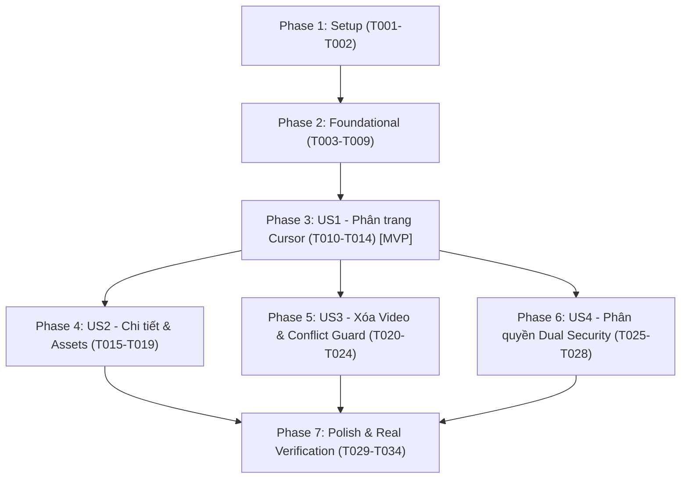

# Tasks: F-008 — Truy Vấn Danh Sách (Cursor Pagination), Chi Tiết, Assets & Xóa Video

**Input**: Design documents from `specs/008-video-query-lifecycle/` (`spec.md`, `plan.md`, `research.md`, `data-model.md`, `contracts/`, `quickstart.md`)  
**Prerequisites**: `spec.md`, `plan.md`, `data-model.md`, `contracts/` đã được phê chuẩn  
**Organization**: Tasks được phân chia theo từng User Story độc lập, đảm bảo khả năng kiểm thử riêng biệt và chuyển giao gia tăng (Incremental Delivery).

---

## Format: `[ID] [P?] [Story] Description with file path`

- **[P]**: Có thể thực hiện song song (khác tệp tin, không phụ thuộc vào task chưa hoàn thành)
- **[Story]**: Đánh dấu User Story mà task phục vụ (`[US1]`, `[US2]`, `[US3]`, `[US4]`)
- Luôn chỉ định đường dẫn tệp tin chính xác trong mô tả công việc

---

## Phase 1: Setup (Cấu hình & Mã lỗi)

**Mục tiêu**: Chuẩn bị mã lỗi và cấu hình tham số hệ thống phục vụ phân trang và URL media.

- [x] T001 Bổ sung mã lỗi `INVALID_CURSOR("INVALID_CURSOR", "Con trỏ phân trang không hợp lệ hoặc đã bị thay đổi", HttpStatus.BAD_REQUEST)` vào `backend/src/main/java/com/transvidcloud/backend/common/exception/ErrorCode.java`
- [x] T002 [P] Xác nhận và hoàn thiện cấu hình `tvc.media.base-url` trong `backend/src/main/java/com/transvidcloud/backend/common/config/TvcProperties.java`

---

## Phase 2: Foundational (Hạ tầng DTO & Tiện ích Cursor)

**Mục tiêu**: Xây dựng cấu trúc dữ liệu và tiện ích phân trang con trỏ dùng chung cho toàn bộ các User Story.

**⚠️ CRITICAL**: Phải hoàn thành Phase 2 trước khi bắt đầu triển khai các User Story.

- [x] T003 [P] Tạo record DTO `VideoCursor` (`projectId`, `videoId`, `createdAt`) trong `backend/src/main/java/com/transvidcloud/backend/video/dto/VideoCursor.java`
- [x] T004 [P] Tạo record DTO `VideoAssets` (`masterPlaylistUrl`, `hls360Url`, `hls720Url`, `thumbnailUrl`) trong `backend/src/main/java/com/transvidcloud/backend/video/dto/VideoAssets.java`
- [x] T005 [P] Cập nhật record DTO `VideoResponse` bổ sung trường `assets`, `startedAt`, `completedAt` trong `backend/src/main/java/com/transvidcloud/backend/video/dto/VideoResponse.java`
- [x] T006 [P] Tạo record DTO `VideoPageResponse` (`items`, `nextCursor`, `hasMore`) trong `backend/src/main/java/com/transvidcloud/backend/video/dto/VideoPageResponse.java`
- [x] T007 [P] Tạo container record `PagedVideoResult` (`items`, `lastEvaluatedKey`) trong `backend/src/main/java/com/transvidcloud/backend/video/repository/PagedVideoResult.java`
- [x] T008 Xây dựng tiện ích `CursorCodec` (mã hóa Base64URL không padding, giải mã JSON và thẩm định chéo `projectId`) trong `backend/src/main/java/com/transvidcloud/backend/video/dto/CursorCodec.java`
- [x] T009 [P] Viết Unit test cho `CursorCodecTest` kiểm tra mã hóa, giải mã đúng và ném `INVALID_CURSOR` khi chuỗi hỏng hoặc tráo đổi project trong `backend/src/test/java/com/transvidcloud/backend/video/dto/CursorCodecTest.java`

**Checkpoint**: Nền tảng DTOs và CursorCodec đã sẵn sàng — có thể bắt đầu triển khai User Story 1 (MVP).

---

## Phase 3: User Story 1 - Truy vấn Danh sách Video theo Dự án kèm Phân trang Con trỏ (Priority: P1) 🎯 MVP

**Mục tiêu**: Cho phép người dùng lấy danh sách video theo từng trang (limit 1..100) sắp xếp giảm dần theo thời gian tạo mới nhất lên đầu, kèm `nextCursor` an toàn.

**Independent Test**: Gọi `GET /api/projects/{projectId}/videos?limit=2`, nhận danh sách 2 video đầu tiên kèm `nextCursor`; truyền `cursor={nextCursor}` để lấy trang tiếp theo; xác nhận trang cuối cùng trả về `hasMore = false` và `nextCursor = null`.

- [x] T010 [P] [US1] Mở rộng `VideoRepository` thêm phương thức `findVideosByProjectWithPagination(String projectId, int limit, Map<String, AttributeValue> exclusiveStartKey)` query GSI `project-index` sắp xếp giảm dần (`ScanIndexForward = false`), giới hạn `limit` và lọc bỏ khóa `OUTBOX#` trong `backend/src/main/java/com/transvidcloud/backend/video/repository/VideoRepository.java`
- [x] T011 [P] [US1] Viết Unit test trong `backend/src/test/java/com/transvidcloud/backend/video/service/VideoServiceTest.java` cho luồng `listVideosByProject` (kiểm tra trang đầu cursor null, trang tiếp theo với cursor, trang cuối `hasMore = false`, và ném `INVALID_CURSOR` khi cursor sai)
- [x] T012 [US1] Cập nhật `VideoService.java` triển khai `listVideosByProject` (thẩm định `limit` 1..100, giải mã cursor bằng `CursorCodec`, gọi repo, ánh xạ response, mã hóa nextCursor) trong `backend/src/main/java/com/transvidcloud/backend/video/service/VideoService.java`
- [x] T013 [P] [US1] Viết WebMvc slice test trong `backend/src/test/java/com/transvidcloud/backend/video/controller/VideoControllerTest.java` kiểm tra endpoint `GET /api/projects/{projectId}/videos` (trả về 200 OK kèm pagination, và 400 Bad Request khi `limit` ngoài phạm vi hoặc cursor không hợp lệ)
- [x] T014 [US1] Cập nhật `VideoController.java` công khai endpoint `GET /api/projects/{projectId}/videos` trong `backend/src/main/java/com/transvidcloud/backend/video/controller/VideoController.java`

**Checkpoint**: User Story 1 hoàn thành — MVP cho phép truy vấn danh sách phân trang con trỏ đã hoạt động độc lập.

---

## Phase 4: User Story 2 - Tra cứu Chi tiết Video, Trạng thái & Danh mục Assets HLS/Thumbnail (Priority: P2)

**Mục tiêu**: Trả về thông tin chi tiết của một video cụ thể, tự động ghép tiền tố `TVC_MEDIA_BASE_URL` cho các đường dẫn `assets` khi video đã `COMPLETED`.

**Independent Test**: Gọi `GET /api/videos/{videoId}` với video `COMPLETED`, xác nhận trả về đầy đủ các trường `assets` (`masterPlaylistUrl`, `hls360Url`, `hls720Url`, `thumbnailUrl`) với tiền tố media URL; gọi với video chưa xong xác nhận `assets = null`; gọi với video không tồn tại nhận về 404 Not Found.

- [x] T015 [P] [US2] Cập nhật `VideoMapper.java` triển khai logic ghép tiền tố `TVC_MEDIA_BASE_URL` cho trường `assets` khi video ở trạng thái `COMPLETED`, và trả về `assets = null` khi video ở trạng thái khác trong `backend/src/main/java/com/transvidcloud/backend/video/mapper/VideoMapper.java`
- [x] T016 [P] [US2] Viết Unit test trong `backend/src/test/java/com/transvidcloud/backend/video/service/VideoServiceTest.java` cho luồng `getVideoDetails` (kiểm tra video `COMPLETED` có assets đã ghép base URL, video `PROCESSING` có `assets = null`, và ném 404 `RESOURCE_NOT_FOUND` khi video không tồn tại hoặc có tiền tố `OUTBOX#`)
- [x] T017 [US2] Cập nhật `VideoService.java` triển khai `getVideoDetails` trong `backend/src/main/java/com/transvidcloud/backend/video/service/VideoService.java`
- [x] T018 [P] [US2] Viết WebMvc slice test trong `backend/src/test/java/com/transvidcloud/backend/video/controller/VideoControllerTest.java` kiểm tra endpoint `GET /api/videos/{videoId}` (trả về 200 OK kèm assets đầy đủ, và 404 Not Found khi video không tồn tại)
- [x] T019 [US2] Cập nhật `VideoController.java` công khai endpoint `GET /api/videos/{videoId}` trong `backend/src/main/java/com/transvidcloud/backend/video/controller/VideoController.java`

**Checkpoint**: User Story 2 hoàn thành — xem chi tiết video và danh mục link phát HLS đã sẵn sàng.

---

## Phase 5: User Story 3 - Xóa Video & Bảo Vệ Tiến Trình Xử Lý Dở Dang (Priority: P3)

**Mục tiêu**: Cho phép xóa video (Fast Delete) và trả về HTTP 204 No Content, nhưng chặn đứng với HTTP 409 Conflict nếu video đang ở trạng thái `PROCESSING`.

**Independent Test**: Gọi `DELETE /api/videos/{videoId}` với video đang `PROCESSING`, xác nhận nhận về HTTP 409 Conflict; gọi với video ở `UPLOADING` hoặc `COMPLETED`, xác nhận nhận về HTTP 204 No Content và gọi `GET` lại nhận về 404 Not Found.

- [x] T020 [P] [US3] Mở rộng `VideoRepository.java` thêm phương thức `deleteVideoWithOutbox(String videoId)` thực thi xóa bản ghi `VideoItem` và bản ghi `OutboxItem` tương ứng nếu tồn tại trong `backend/src/main/java/com/transvidcloud/backend/video/repository/VideoRepository.java`
- [x] T021 [P] [US3] Viết Unit test trong `backend/src/test/java/com/transvidcloud/backend/video/service/VideoServiceTest.java` cho luồng `deleteVideo` (kiểm tra chặn 409 `INVALID_STATE_TRANSITION` khi video đang `PROCESSING`, cho phép xóa thành công khi video ở `UPLOADING`, `PENDING`, `COMPLETED`, `FAILED_*`, và ném 404 khi video không tồn tại)
- [x] T022 [US3] Cập nhật `VideoService.java` triển khai `deleteVideo` (kiểm tra trạng thái `PROCESSING`, gọi xóa repo) trong `backend/src/main/java/com/transvidcloud/backend/video/service/VideoService.java`
- [x] T023 [P] [US3] Viết WebMvc slice test trong `backend/src/test/java/com/transvidcloud/backend/video/controller/VideoControllerTest.java` kiểm tra endpoint `DELETE /api/videos/{videoId}` (trả về 204 No Content khi xóa thành công, 409 Conflict khi video đang `PROCESSING`, và 404 khi video không tồn tại)
- [x] T024 [US3] Cập nhật `VideoController.java` công khai endpoint `DELETE /api/videos/{videoId}` trong `backend/src/main/java/com/transvidcloud/backend/video/controller/VideoController.java`

**Checkpoint**: User Story 3 hoàn thành — vòng đời xóa video và cơ chế bảo vệ xung đột trạng thái chuyển mã đã hoàn tất.

---

## Phase 6: User Story 4 - Phân Quyền Đa Người Thuê Dual Security (Priority: P4)

**Mục tiêu**: Đảm bảo toàn bộ 3 endpoints mới đều được bảo vệ nghiêm ngặt bởi Dual Security (Bearer JWT và `X-API-Key`), cô lập triệt để giữa các Project và Người dùng.

**Independent Test**: Dùng token của User B hoặc API Key của Project B gọi tới video thuộc Project A, xác nhận bị từ chối 403 Forbidden (`ACCESS_DENIED`); gọi không kèm token/key nhận về 401 Unauthorized (`UNAUTHENTICATED`).

- [x] T025 [P] [US4] Viết Unit test trong `backend/src/test/java/com/transvidcloud/backend/video/service/VideoServiceTest.java` kiểm tra từ chối HTTP 403 `ACCESS_DENIED` khi JWT user không sở hữu Project chứa video cho cả 3 thao tác list, detail, delete
- [x] T026 [P] [US4] Viết Unit test trong `backend/src/test/java/com/transvidcloud/backend/video/service/VideoServiceTest.java` kiểm tra từ chối HTTP 403 `ACCESS_DENIED` khi `X-API-Key` thuộc Project khác cố tình truy cập hoặc xóa video
- [x] T027 [US4] Tích hợp và xác nhận `validateProjectAccess` được thực thi đầy đủ trên cả 3 phương thức `listVideosByProject`, `getVideoDetails`, `deleteVideo` trong `backend/src/main/java/com/transvidcloud/backend/video/service/VideoService.java`
- [x] T028 [P] [US4] Viết WebMvc slice test trong `backend/src/test/java/com/transvidcloud/backend/video/controller/VideoControllerTest.java` xác minh cả 3 endpoints đều trả về HTTP 401 Unauthorized khi thiếu thông tin xác thực

**Checkpoint**: User Story 4 hoàn thành — ranh giới bảo mật và phân quyền đa người thuê được áp dụng toàn diện trên cả 3 endpoints.

---

## Phase 7: Polish, Real Verification & Zero Regression

**Mục tiêu**: Kiểm chứng tích hợp toàn diện trên môi trường thực tế LocalStack (DynamoDB, S3), bảo đảm Zero Regression trên 109 test có sẵn và lập hồ sơ Feature Evidence.

- [x] T029 Xây dựng bộ kiểm thử tích hợp thực tế `VideoQueryLifecycleIT` (sử dụng Testcontainers LocalStack DynamoDB + S3) kiểm chứng trọn vòng đời: tạo 5 video -> test phân trang con trỏ `limit=2` các trang 1, 2, 3 -> kiểm tra chi tiết và ghép URL assets cho video `COMPLETED` -> kiểm tra chặn xóa 409 khi video `PROCESSING` -> kiểm tra xóa thành công 204 và verify 404 sau khi xóa trong `backend/src/test/java/com/transvidcloud/backend/video/repository/VideoQueryLifecycleIT.java`
- [x] T030 [P] Xây dựng bộ Postman Collection E2E độc lập `backend/postman/F-008-video-query-lifecycle.postman_collection.json` kiểm chứng toàn diện từ tạo video, phân trang cursor, xem assets, xóa video, kiểm tra bảo mật JWT/API Key, và các mã lỗi 400, 401, 403, 404, 409
- [x] T031 Thực thi bộ kiểm thử Postman E2E bằng Newman CLI và lưu kết quả xác minh
- [x] T032 Chạy toàn bộ test suite dự án bằng `./scripts/verify.sh` (`./mvnw -B clean verify`) chứng minh đạt Zero Regression (100% tests PASS)
- [x] T033 Lập hồ sơ bằng chứng kiểm thử Feature Evidence tại `backend/quality/evidence/F-008-video-query-lifecycle.md` ánh xạ đầy đủ 15 Functional Requirements và 4 Success Criteria
- [x] T034 Cập nhật snapshot tiến độ `backend/PROGRESS.md` và `backend/backlog/features.md` sang trạng thái `verified`

---

## Dependencies & Execution Order

### Phase Dependencies

- **Phase 1 (Setup)**: Không có phụ thuộc, chạy đầu tiên.
- **Phase 2 (Foundational)**: Phụ thuộc vào Phase 1, là điều kiện tiên quyết bắt buộc cho mọi User Story.
- **Phase 3 (US1 - MVP)**: Phụ thuộc vào Phase 2. Hoàn thành luồng phân trang con trỏ cốt lõi.
- **Phase 4, 5, 6 (US2, US3, US4)**: Phụ thuộc vào Phase 3 (US1), có thể triển khai song song hoặc tuần tự.
- **Phase 7 (Polish & Verification)**: Chạy sau khi hoàn tất các User Story để kiểm chứng tích hợp và zero regression.

---

## Parallel Opportunities

- **Trong Phase 1**: T001 (`ErrorCode.java`) và T002 (`TvcProperties.java`) độc lập, làm song song `[P]`.
- **Trong Phase 2**: T003, T004, T005, T006, T007 (các DTO records) độc lập hoàn toàn, làm song song `[P]`.
- **Trong Phase 3 (US1)**: T010 (`VideoRepository`), T011 (`VideoServiceTest`), T013 (`VideoControllerTest`) có thể viết song song `[P]`.
- **Trong Phase 4 (US2)**: T015 (`VideoMapper`), T016 (`VideoServiceTest`), T018 (`VideoControllerTest`) có thể viết song song `[P]`.
- **Trong Phase 5 (US3)**: T020 (`VideoRepository`), T021 (`VideoServiceTest`), T023 (`VideoControllerTest`) có thể viết song song `[P]`.
- **Trong Phase 6 (US4)**: T025, T026, T028 có thể viết song song `[P]`.

---

## Implementation Strategy

### MVP First (User Story 1 Only)
1. Hoàn thành Phase 1 (Setup) và Phase 2 (Foundational).
2. Hoàn thành Phase 3 (User Story 1: Phân trang con trỏ danh sách video).
3. **STOP & VALIDATE**: Chạy Unit test và Slice test cho User Story 1 để xác nhận phân trang con trỏ hoạt động độc lập và đạt chuẩn MVP.

### Incremental Delivery
1. Giao User Story 1 (List videos phân trang) ➔ Demo / Test.
2. Giao tiếp User Story 2 (Chi tiết video & Assets HLS) ➔ Tích hợp web player.
3. Giao tiếp User Story 3 (Xóa video & Chặn 409 khi processing) ➔ Hoàn thiện vòng đời video.
4. Giao tiếp User Story 4 (Dual security kiểm soát đa người thuê) ➔ Bảo mật toàn diện.
5. Chạy Phase 7 (LocalStack IT + Newman E2E + `./scripts/verify.sh`) chứng minh Zero Regression.
