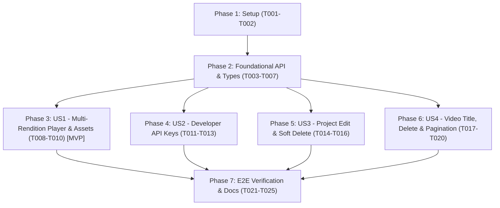

# Tasks: F-011 — Đồng bộ Đầy đủ Tính năng Frontend theo Đặc tả Backend (F-003 -> F-008)

**Input**: Design documents from `specs/011-frontend-feature-parity/` (`spec.md`, `plan.md`, `research.md`, `data-model.md`, `contracts/frontend-parity-api.yaml`, `quickstart.md`)  
**Prerequisites**: `spec.md`, `plan.md`, `research.md`, `data-model.md`, `contracts/` đã được phê chuẩn  
**Organization**: Tasks được phân chia theo từng User Story độc lập (`US1` $\rightarrow$ `US4`), đảm bảo khả năng kiểm thử riêng biệt và chuyển giao gia tăng (Incremental Delivery).

---

## Format: `[ID] [P?] [Story] Description with file path`

- **[P]**: Có thể thực hiện song song (khác tệp tin, không phụ thuộc vào task chưa hoàn thành)
- **[Story]**: Đánh dấu User Story mà task phục vụ (`[US1]`, `[US2]`, `[US3]`, `[US4]`)
- Luôn chỉ định đường dẫn tệp tin chính xác trong mô tả công việc

---

## Phase 1: Setup (Kiểm tra Hợp đồng OpenAPI & Chuẩn bị Styles)

**Mục tiêu**: Xác nhận đồng bộ OpenAPI schema và bổ sung các lớp CSS cho thanh chọn độ phân giải HLS, danh sách API Keys và các nút thao tác quản trị.

- [X] T001 Kiểm tra và đồng bộ OpenAPI TypeScript schema giữa `contracts/openapi.yaml`, `docs/contracts/openapi.yaml` và `frontend/src/api/schema.d.ts`
- [X] T002 [P] Bổ sung các utility styles cho bộ chọn chất lượng phát (`.quality-selector`, `.quality-pill`), danh sách tài nguyên (`.asset-list`, `.asset-item`), bảng quản lý API Keys (`.apikey-list`, `.apikey-row`, `.rawkey-banner`) và nút nguy hiểm (`.button-danger`) trong `frontend/src/styles.css`

---

## Phase 2: Foundational (Tầng Types, Normalizers, HTTP Client & MSW Mocks dùng chung)

**Mục tiêu**: Mở rộng tầng giao tiếp dữ liệu (`types.ts`, `client.ts`) và bộ giả lập MSW (`handlers.ts`) để hỗ trợ đầy đủ 16 endpoints của Backend trước khi gắn lên các màn hình UI.

**⚠️ CRITICAL**: Phải hoàn thành Phase 2 trước khi bắt đầu triển khai các User Story.

- [X] T003 Mở rộng `frontend/src/api/types.ts` bổ sung các interfaces và hàm chuẩn hóa: `UserSummary` (`normalizeUserSummary`), `UpdateProjectRequest` (`name` 1–120 ký tự, `description` tối đa 500 ký tự, `webhookUrl` định dạng URL hợp lệ hoặc `null`), `ApiKey` & `CreatedApiKey` (`normalizeApiKey`, `normalizeCreatedApiKey` với `keyHash`, `projectId`, `name` 1–100 ký tự, `keyPrefix` dạng `tvc_live_xxxxxxxx...`, `rawKey`), `VideoPage`, và bổ sung các trường `webhookUrl`, `status` vào `Project` cùng `inputKey`, `startedAt`, `completedAt` vào `Video` trong `frontend/src/api/types.ts`
- [X] T004 Nâng cấp hàm `request()` hỗ trợ phương thức `'PATCH'` và phản hồi `204 No Content` (`requestVoid`), đồng thời bổ sung các phương thức `getMe`, `getProject`, `updateProject`, `deleteProject`, `listApiKeys`, `createApiKey`, `revokeApiKey`, `deleteVideo` và `listVideosPage` trong `frontend/src/api/client.ts`
- [X] T005 [P] Cập nhật bộ MSW mock handlers hỗ trợ đầy đủ `GET /api/auth/me`, `GET/PATCH/DELETE /api/projects/:id`, `GET/POST /api/projects/:id/api-keys` (kiểm tra giới hạn tối đa 5 API Keys mỗi Project), `DELETE /api/projects/:id/api-keys/:keyHash`, và `DELETE /api/videos/:id` (chặn `409 Conflict` khi `status === 'PROCESSING'`) trong `frontend/src/mocks/handlers.ts`
- [X] T006 [P] Viết Unit tests kiểm chứng các phương thức API client mới (`getMe`, `getProject`, `updateProject`, `deleteProject`, `listApiKeys`, `createApiKey`, `revokeApiKey`, `deleteVideo`, `listVideosPage`) trong `frontend/src/api/client.test.ts`
- [X] T007 [P] Mở rộng Contract tests đối chiếu schema OpenAPI cho `ApiKeyResponse`, `CreatedApiKeyResponse`, `UpdateProjectRequest` và `UserSummary` trong `frontend/src/api/contract.test.ts`

**Checkpoint**: Tầng API Client, Types và MSW Mocks cho cả 16 endpoints đã sẵn sàng — có thể bắt đầu triển khai các User Story.

---

## Phase 3: User Story 1 - Chuyển đổi Độ phân giải Phát (Auto / 720p / 360p) & Quản lý Danh mục Video Assets (Priority: P1) 🎯 MVP

**Mục tiêu**: Cho phép người dùng chủ động chuyển đổi chất lượng phát giữa `Auto (ABR)`, `720p HD` và `360p SD` ngay trên trình phát HLS, đồng thời hiển thị đầy đủ 4 đường dẫn `VideoAssets` (`Master HLS`, `720p HLS`, `360p HLS`, `Thumbnail`) và siêu dữ liệu vòng đời xử lý trên trang chi tiết video.

**Independent Test**: Mở trang `/videos/{videoId}` của một video `COMPLETED`, bấm chuyển đổi giữa `Auto`, `720p`, `360p` trên trình phát `HlsPlayer`, kiểm tra luồng phát thay đổi tương ứng và bảng thông tin hiển thị đủ 4 đường dẫn assets kèm nút Copy cho từng đường dẫn.

- [X] T008 [P] [US1] Nâng cấp `HlsPlayer` bổ sung thanh chọn chất lượng phát (`Auto`, `720p`, `360p`) dựa trên các trường `assets.hls`, `assets.hls720`, `assets.hls360` và giữ nguyên tiến trình thời gian phát khi chuyển độ phân giải trong `frontend/src/player/HlsPlayer.tsx`
- [X] T009 [P] [US1] Viết Unit tests kiểm chứng việc hiển thị và chuyển đổi chất lượng phát (`Auto`, `720p`, `360p`) trong `frontend/src/player/HlsPlayer.test.tsx`
- [X] T010 [US1] Cập nhật trang `VideoDetail` hiển thị đầy đủ 4 tài nguyên đầu ra (`Master HLS`, `720p HLS`, `360p HLS`, `Thumbnail`) kèm nút Copy/Open riêng lẻ và bổ sung hiển thị siêu dữ liệu vòng đời (`title`, `filename`, `attemptCount`, `createdAt`, `startedAt`, `completedAt`, `updatedAt`) trong `frontend/src/pages/VideoDetail.tsx`

**Checkpoint**: User Story 1 hoàn thành — người dùng có thể trực tiếp chọn phát 360p/720p/Auto và lấy toàn bộ link tài nguyên sau khi transcode.

---

## Phase 4: User Story 2 - Quản lý Developer API Keys theo Project (Tạo, Liệt kê, Thu hồi) (Priority: P1)

**Mục tiêu**: Cung cấp giao diện quản lý Developer API Keys ngay trong trang Project: liệt kê danh sách khóa (`name`, `keyPrefix` dạng `tvc_live_xxxxxxxx...`, `createdAt`), đếm giới hạn `x / 5 keys`, tạo khóa mới (`name` 1–100 ký tự) hiển thị `rawKey` một lần duy nhất kèm nút Copy, và thu hồi khóa (`Revoke`) tức thì.

**Independent Test**: Tại trang `/projects/{projectId}/videos`, bấm mở hộp thoại `API Keys`, tạo khóa mới -> xác nhận hiển thị `rawKey` đầy đủ một lần kèm nút Copy; đóng cảnh báo -> xác nhận danh sách hiển thị `keyPrefix`; bấm `Revoke` -> khóa bị xóa khỏi danh sách.

- [X] T011 [P] [US2] Xây dựng component/modal `ApiKeysModal` hỗ trợ liệt kê danh sách API Keys (`x / 5 keys`), form tạo khóa mới (`name` từ 1 đến 100 ký tự, khóa nút tạo khi đã đủ 5 keys), banner hiển thị `rawKey` duy nhất 1 lần kèm nút Copy, và nút `Revoke` thu hồi khóa trong `frontend/src/components/ApiKeysModal.tsx`
- [X] T012 [US2] Tích hợp nút mở hộp thoại `API Keys` vào thanh công cụ trang chi tiết Project trong `frontend/src/pages/Videos.tsx`
- [X] T013 [P] [US2] Viết Unit/Integration test cho luồng liệt kê, tạo mới (hiển thị `rawKey` 1 lần) và thu hồi API Key trong `frontend/src/App.test.tsx`

**Checkpoint**: User Story 2 hoàn thành — tính năng `F-005` (Developer API Keys) đã hoạt động trọn vẹn trên giao diện Frontend.

---

## Phase 5: User Story 3 - Quản trị Vòng đời Project: Xem chi tiết, Chỉnh sửa, Cấu hình Webhook & Xóa Mềm (Priority: P1)

**Mục tiêu**: Hoàn thiện đầy đủ các thao tác CRUD Project theo `F-004`: lấy chi tiết Project qua `GET /api/projects/{projectId}`, cập nhật `name` (1–120 ký tự), `description` (tối đa 500 ký tự), `webhookUrl` (`PATCH /api/projects/{projectId}`), và xóa mềm Project (`DELETE /api/projects/{projectId}` kèm hiển thị lỗi `409 RESOURCE_IN_USE` khi còn video đang xử lý).

**Independent Test**: Mở trang `/projects/{projectId}/videos`, bấm `Edit project` để sửa tên/mô tả/webhookUrl và kiểm tra giao diện cập nhật; bấm `Delete project` và xác nhận dự án được xóa mềm và điều hướng về `/projects`.

- [X] T014 [P] [US3] Cập nhật trang `Projects` hiển thị thông tin thực tế từ `ProjectResponse` của Backend (`status`, `webhookUrl` badge, `createdAt`), đồng bộ giới hạn `name` (`maxLength={120}`) và `description` (`maxLength={500}`) kèm trường tùy chọn `webhookUrl` trong modal tạo Project tại `frontend/src/pages/Projects.tsx`
- [X] T015 [US3] Cập nhật trang `Videos` sử dụng `api.getProject(id)`, bổ sung nút và modal **Edit project** (`PATCH /api/projects/{projectId}` cho `name`, `description`, `webhookUrl`) cùng nút và modal xác nhận **Delete project** (`DELETE /api/projects/{projectId}`, hiển thị lỗi khi gặp `409 RESOURCE_IN_USE` và điều hướng về `/projects` khi thành công) trong `frontend/src/pages/Videos.tsx`
- [X] T016 [P] [US3] Viết Integration test kiểm chứng luồng chỉnh sửa Project (`PATCH`) và xóa mềm Project (`DELETE`) trong `frontend/src/App.test.tsx`

**Checkpoint**: User Story 3 hoàn thành — toàn bộ tính năng quản lý Project của `F-004` đã đồng bộ trên Frontend.

---

## Phase 6: User Story 4 - Xóa Video, Nhập Tiêu đề Video (`title`) khi Upload & Phân trang Cursor (Priority: P1)

**Mục tiêu**: Cho phép người dùng nhập tiêu đề hiển thị `title` (1–200 ký tự) khi tải video lên (`F-006`), xóa video không còn sử dụng (`DELETE /api/videos/{videoId}` của `F-008`, khóa nút xóa khi `status === 'PROCESSING'`), và hỗ trợ tải danh sách video theo phân trang con trỏ.

**Independent Test**: Mở hộp thoại `Upload a video`, chọn file -> kiểm tra ô `Video title` tự gợi ý tên và cho phép sửa trước khi upload; mở trang chi tiết video đã hoàn tất hoặc lỗi -> bấm `Delete video` -> xác nhận video bị xóa và quay về trang danh sách video của Project.

- [X] T017 [P] [US4] Cập nhật `UploadDialog` bổ sung ô nhập `Video title` (`title`: bắt buộc, 1–200 ký tự, tự động gợi ý từ tên file khi chọn file) và truyền `title` vào `api.createVideo` trong `frontend/src/components/UploadDialog.tsx`
- [X] T018 [P] [US4] Cập nhật Unit tests của `UploadDialog` kiểm chứng việc nhập và gửi `title` tùy chỉnh khi khởi tạo upload trong `frontend/src/components/UploadDialog.test.tsx`
- [X] T019 [US4] Bổ sung nút **Delete video** kèm hộp thoại xác nhận tại `frontend/src/pages/VideoDetail.tsx` (vô hiệu hóa nút xóa khi `video.status === 'PROCESSING'` theo quy tắc `FR-012` của `F-008`, gọi `api.deleteVideo(video.videoId)` và điều hướng về `/projects/${video.projectId}/videos` sau khi xóa)
- [X] T020 [US4] Cập nhật hiển thị tiêu đề video (`video.title || video.filename`) và hỗ trợ tải thêm trang (`Load more videos` khi `hasMore === true`) trên trang danh sách video `frontend/src/pages/Videos.tsx`

**Checkpoint**: User Story 4 hoàn thành — toàn bộ vòng đời Video (`F-006`, `F-007`, `F-008`) đã khép kín trên Frontend.

---

## Phase 7: Polish, Real-Stack E2E Verification & Handover Documentation

**Mục tiêu**: Chạy toàn bộ cổng kiểm chứng tự động (OpenAPI drift check, Vitest unit/integration tests, Production build, Playwright Real-Stack E2E trên Docker Compose + LocalStack) và cập nhật tài liệu hướng dẫn tự test.

- [X] T021 Mở rộng kịch bản Playwright Real-Stack E2E kiểm chứng toàn diện các tính năng mới trên môi trường thật (Edit Project, Create/Revoke API Key, Upload với custom `title`, chọn chất lượng `720p`/`360p`/`Auto` trên `HlsPlayer`, Delete Video và Delete Project) trong `frontend/e2e/real-stack.spec.ts`
- [X] T022 Chạy kiểm tra tĩnh, unit tests và build production trên Frontend (`cd frontend && npm run api:check && npm test && npm run build`) đảm bảo 100% PASS
- [X] T023 Thực thi kiểm thử Playwright Real-Stack E2E (`E2E_REAL_STACK=1 E2E_BASE_URL=http://localhost:8000 npx playwright test e2e/real-stack.spec.ts`) trên Docker Compose + LocalStack và xác nhận 100% PASS
- [X] T024 [P] Cập nhật tài liệu hướng dẫn cài đặt và tự trải nghiệm `docs/LOCAL_INTEGRATION_AND_TEST_GUIDE.md` bổ sung hướng dẫn sử dụng bộ chọn chất lượng 360p/720p, quản lý API Keys, sửa/xóa Project và xóa Video
- [X] T025 Cập nhật hồ sơ bằng chứng `backend/quality/evidence/F-011-frontend-feature-parity.md`, `backend/backlog/features.md` và `backend/PROGRESS.md` sang trạng thái `verified`

---

## Dependencies & Execution Order

### Phase Dependencies

- **Phase 1 (Setup)**: Không có phụ thuộc, thực hiện đầu tiên.
- **Phase 2 (Foundational)**: Phụ thuộc vào Phase 1, mở rộng toàn bộ tầng API client, normalizers và MSW mocks — là điều kiện tiên quyết cho mọi User Story.
- **Phase 3 (US1 - MVP)**: Phụ thuộc vào Phase 2; giải quyết ngay nhu cầu chọn chất lượng 360p/720p và hiển thị đủ các đường dẫn `VideoAssets`.
- **Phase 4, 5, 6 (US2, US3, US4)**: Phụ thuộc vào Phase 2, có thể thực hiện tuần tự hoặc song song theo phạm vi tệp tin.
- **Phase 7 (Polish & Verification)**: Thực hiện sau khi hoàn tất cả 4 User Stories để kiểm chứng E2E trên LocalStack và cập nhật tài liệu bàn giao.

---

## Parallel Opportunities

- **Trong Phase 1**: `T001` (`schema.d.ts`) và `T002` (`styles.css`) khác tệp tin, có thể chạy song song `[P]`.
- **Trong Phase 2**: Sau khi xong `T003` và `T004`, các task `T005` (`handlers.ts`), `T006` (`client.test.ts`), `T007` (`contract.test.ts`) có thể thực hiện song song `[P]`.
- **Giữa các User Stories (Phase 3–6)**:
  - `T008`–`T009` (`HlsPlayer.tsx` & `HlsPlayer.test.tsx`), `T011` (`ApiKeysModal.tsx`), `T014` (`Projects.tsx`), và `T017`–`T018` (`UploadDialog.tsx` & `UploadDialog.test.tsx`) nằm ở các tệp tin hoàn toàn tách biệt, có thể triển khai song song `[P]`.

---

## Implementation Strategy

### MVP First (User Story 1)
1. Hoàn thành Phase 1 (`T001`–`T002`) và Phase 2 (`T003`–`T007`).
2. Hoàn thành Phase 3 (`T008`–`T010`: Chuyển đổi độ phân giải `Auto / 720p / 360p` trên `HlsPlayer` và hiển thị đầy đủ 4 đường dẫn `VideoAssets`).
3. Kiểm chứng độc lập bằng `npm test` trước khi chuyển sang các User Story tiếp theo.

### Incremental Delivery
1. Giao **US1** (Multi-Rendition Player 360p/720p & Assets) $\rightarrow$ giải quyết ngay vấn đề hiển thị các bản transcode.
2. Giao **US2** (Developer API Keys `F-005`) $\rightarrow$ mở khóa khả năng tích hợp bên thứ ba.
3. Giao **US3** (Edit / Delete Project `F-004`) $\rightarrow$ hoàn thiện quản trị không gian dự án.
4. Giao **US4** (Custom `title`, Delete Video & Pagination `F-006`/`F-008`) $\rightarrow$ khép kín vòng đời video.
5. Chạy **Phase 7** (Playwright Real-Stack E2E + cập nhật tài liệu hướng dẫn).
