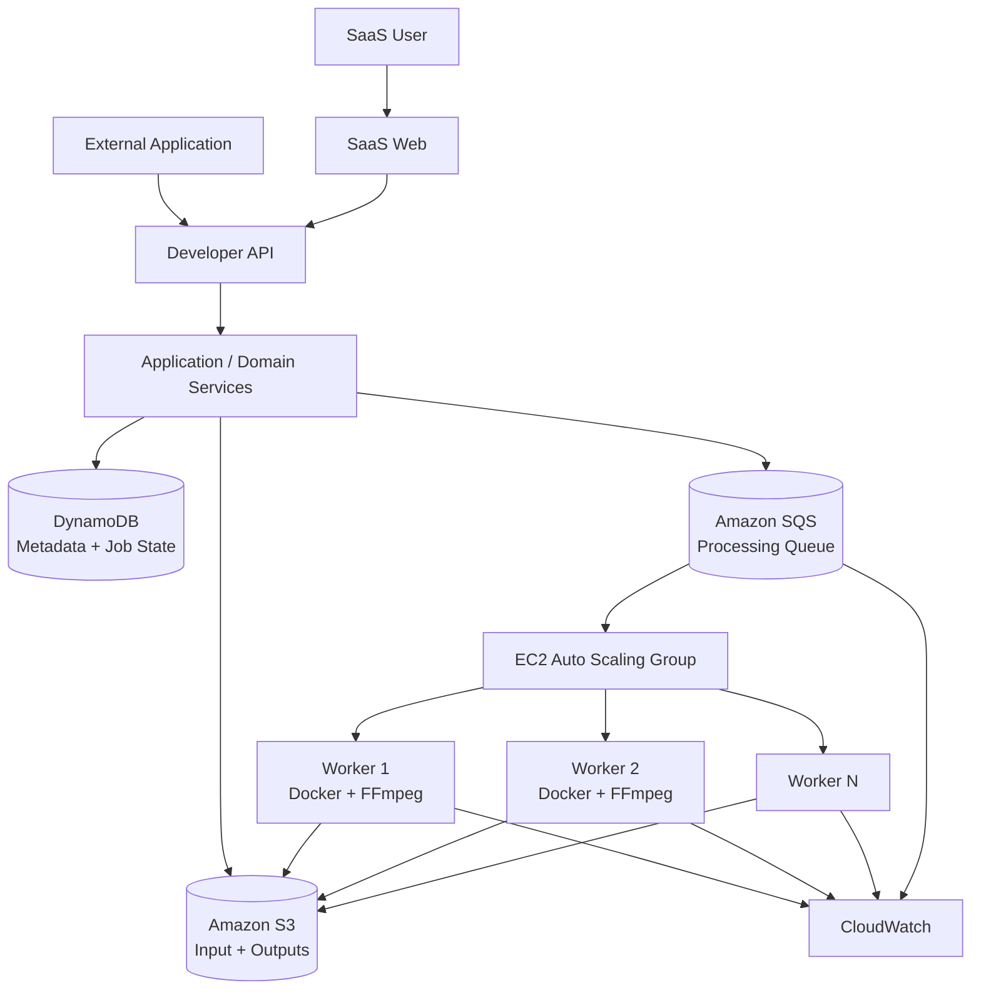
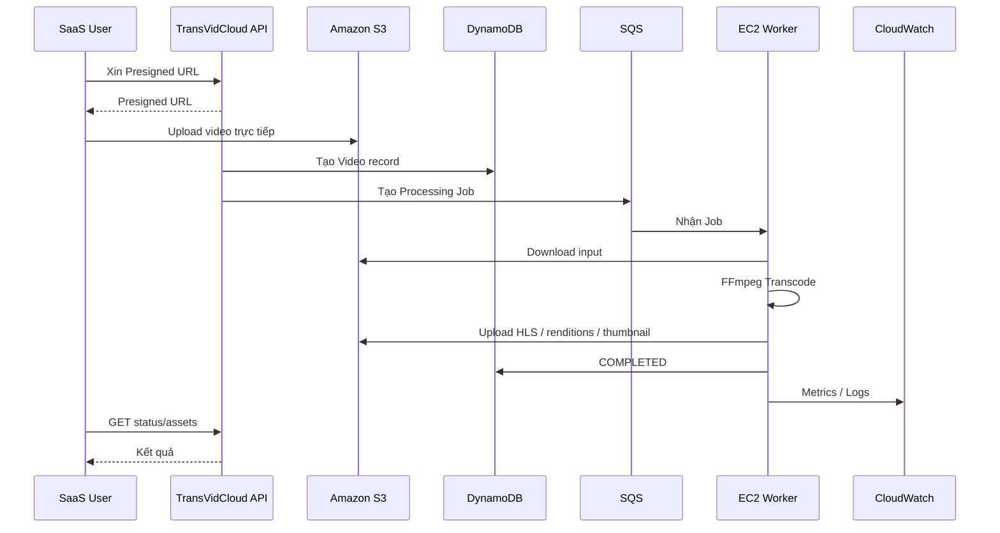
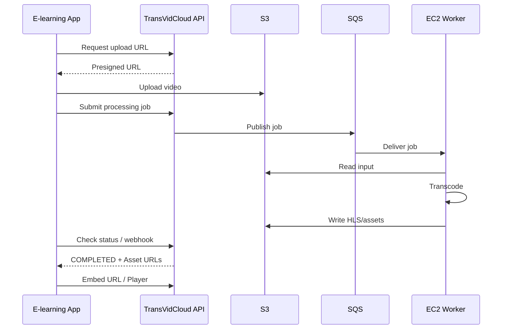
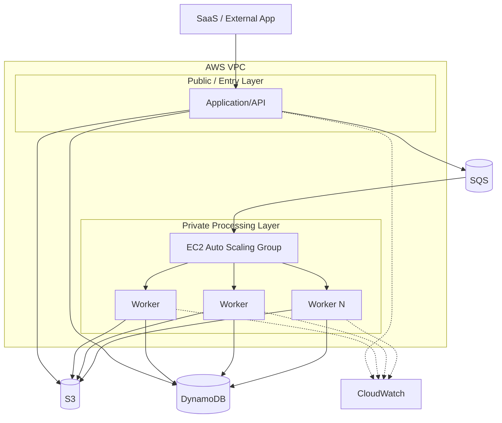

# TransVidCloud — Đặc tả dự án và phạm vi thực hiện

> **Môn học:** Cloud Computing
> **Loại dự án:** Đồ án môn học / BTL học kỳ
> **Tiến độ hiện tại:** Tuần 5 / 15
> **Thời gian còn lại:** Khoảng 10 tuần, bao gồm triển khai, nghiên cứu bổ sung, tích hợp, thực nghiệm, viết báo cáo LaTeX, chuẩn bị demo và dự phòng rủi ro
> **Định hướng sản phẩm:** SaaS + Developer API/Platform trên nền tảng AWS
> **Core:** Video Processing / Transcoding + Cloud Storage + Elastic Compute

---

# 0. Mục đích của tài liệu

Đây là tài liệu đặc tả kỹ thuật và sản phẩm dùng làm **tài liệu tham chiếu chung của nhóm** trong suốt quá trình thực hiện TransVidCloud.

Tài liệu được dùng cho:

- Chốt bài toán và phạm vi dự án.
- Thiết kế kiến trúc hệ thống.
- Phân chia module và công việc giữa các thành viên.
- Thiết kế nghiệp vụ và use case.
- Thiết kế API và dữ liệu.
- Triển khai AWS.
- Lập kế hoạch thực nghiệm Cloud.
- Chuẩn bị báo cáo LaTeX.
- Chuẩn bị demo/thuyết trình.
- Kiểm soát scope để tránh phát sinh tính năng quá lớn trong quá trình làm.

## 0.1. Nguyên tắc quan trọng

Dự án không hướng tới việc xây một nền tảng video quy mô lớn như YouTube/Netflix. Mục tiêu là xây dựng một **hệ thống cloud nhỏ nhưng hoàn chỉnh**, trong đó phần Cloud Computing là trọng tâm.

Trọng tâm của dự án là:

```text
Video Upload
    -> Object Storage
    -> Job Queue
    -> Elastic EC2 Workers
    -> FFmpeg Transcoding
    -> HLS / Video / Thumbnail
    -> Object Storage
    -> SaaS / External Application
```

Lớp SaaS và Developer API tồn tại để biến core kỹ thuật này thành một sản phẩm có người dùng thật, thay vì chỉ là một tập API hoặc một pipeline chạy trên AWS.

---

# 1. Tóm tắt dự án

## 1.1. Phát biểu bài toán

Xử lý video là một workload tiêu tốn nhiều CPU và thường có tính **burst**: có thời điểm gần như không có việc nhưng cũng có thời điểm xuất hiện rất nhiều video cùng lúc.

Một công ty cung cấp hệ thống E-learning, mạng xã hội, báo điện tử, hệ thống thương mại điện tử hoặc bất kỳ ứng dụng nào cho phép người dùng upload video có thể phải giải quyết các vấn đề:

- Nhận video dung lượng lớn.
- Lưu trữ video gốc an toàn.
- Không làm server ứng dụng chính bị nghẽn bởi FFmpeg.
- Xử lý video bất đồng bộ.
- Chuyển một video nguồn thành nhiều phiên bản độ phân giải/bitrate.
- Đóng gói đầu ra để streaming, ví dụ HLS.
- Sinh thumbnail và lưu metadata xử lý.
- Xử lý lỗi và retry.
- Tăng/giảm năng lực xử lý theo lượng workload.
- Không phải duy trì một cụm máy xử lý video lớn chạy 24/7 khi không có việc.

TransVidCloud giải quyết bài toán trên bằng cách xây dựng một **nền tảng xử lý video trên Cloud**, trong đó AWS cung cấp object storage, queue, compute, monitoring và cơ chế scale.

## 1.2. Ý tưởng sản phẩm

TransVidCloud có **hai cách sử dụng**, nhưng chỉ có **một processing core**:

### A. SaaS — dành cho người dùng trực tiếp

Người dùng truy cập web của TransVidCloud để:

- đăng nhập;
- quản lý project/workspace;
- upload video;
- theo dõi trạng thái xử lý;
- xem video đã xử lý;
- xem các asset được tạo ra;
- lấy link HLS hoặc mã nhúng;
- quản lý các kết quả liên quan đến video.

### B. Developer API / Platform — dành cho hệ thống bên ngoài

Developer hoặc một hệ thống như E-learning có thể tích hợp TransVidCloud bằng API để:

- xin Presigned URL;
- upload video trực tiếp lên S3;
- tạo/khởi chạy processing job;
- kiểm tra trạng thái;
- nhận webhook khi hoàn tất (nếu có);
- lấy HLS URL, thumbnail và các asset khác;
- lấy embed URL để tích hợp video vào ứng dụng của họ.

> Trong phạm vi đồ án, nên gọi đây là **Developer Platform / API integration layer** thay vì cố khẳng định TransVidCloud là một PaaS tổng quát. Sản phẩm chính là SaaS; API là lớp tích hợp dành cho developer.

## 1.3. Core Cloud

Luồng Cloud cốt lõi:

```text
SaaS User / External App
        |
        v
  Upload Request
        |
        v
       S3
        |
        v
      SQS
        |
        v
EC2 Auto Scaling Group
        |
   Docker + FFmpeg
        |
        v
  Transcoding
        |
   +----+----+
   |    |    |
 360p 720p 1080p*
        |
       HLS
        |
        v
       S3
        |
        +----> SaaS
        |
        +----> External App

* 1080p chỉ là P0 khi đủ an toàn về hiệu năng/chi phí.
```

Kiến trúc phải cho phép nhóm chứng minh:

```text
Workload thấp
    -> ít hoặc không có worker cần thiết

Workload cao
    -> scale out worker

Queue giảm về thấp
    -> scale in worker

Worker gặp lỗi
    -> job có thể retry
```

---

# 2. Mục tiêu dự án

## 2.1. Mục tiêu sản phẩm

Xây dựng một SaaS nhỏ nhưng hoàn chỉnh cho phép người dùng quản lý và xem video đã xử lý.

## 2.2. Mục tiêu Cloud Computing

Minh họa bằng triển khai thật các khái niệm:

- Object Storage.
- Asynchronous Processing.
- Message Queue.
- Elasticity / Auto Scaling.
- Compute on demand.
- Fault handling / Retry.
- Monitoring / Observability.
- IAM / Network isolation.
- Đánh giá hiệu năng và chi phí.

## 2.3. Mục tiêu học thuật

Dự án không chỉ cần “chạy được”, mà phải có thể trả lời được:

1. Tại sao workload này phù hợp với Cloud?
2. Tại sao phải dùng queue?
3. Tại sao video được lưu trên S3 thay vì EC2 disk?
4. Tại sao worker nên scale?
5. Điều gì xảy ra khi worker chết?
6. Cloud architecture cải thiện hệ thống ở điểm nào?
7. Hiệu năng/chi phí thay đổi thế nào khi workload tăng?

---

# 3. Scope tổng thể

Vì đã ở tuần 5/15 và nhóm còn phải nghiên cứu, viết LaTeX, chuẩn bị demo và dự phòng lỗi, scope được chia thành 3 mức:

```text
P0 = Bắt buộc, phải hoàn thành
P1 = Nên làm nếu P0 ổn định
P2 = Stretch goal, cắt đầu tiên khi chậm tiến độ
```

## 3.1. P0 — Bắt buộc

### SaaS

- Đăng ký/đăng nhập cơ bản.
- Project/workspace cơ bản.
- Video Library.
- Upload video.
- Theo dõi trạng thái xử lý.
- Trang chi tiết video.
- Player cho video đã xử lý.
- Hiển thị output và asset.
- Trang Integration/Embed.

### Cloud Processing

- S3.
- SQS.
- EC2 worker.
- Docker + FFmpeg.
- DynamoDB.
- CloudWatch.
- IAM.
- VPC/Security Group.
- Auto Scaling hoặc ít nhất cơ chế scale được chứng minh bằng thực nghiệm.
- Retry/failure handling cơ bản.

### Video

- Input profile được giới hạn rõ ràng.
- 360p.
- 720p.
- HLS.
- Thumbnail.
- 1080p nếu hiệu năng/chi phí cho phép.

### Developer Platform

- API key cơ bản.
- API xin Presigned URL.
- API tạo/submit job.
- API lấy trạng thái.
- API lấy asset.
- Embed URL hoặc embed code.
- Demo một hệ thống ngoài tích hợp, ví dụ mock E-learning.

### Thực nghiệm

- Baseline processing.
- Workload vs queue backlog.
- Scale-out/scale-in.
- Worker failure và retry.
- Đo latency/throughput ở mức vừa phải.

## 3.2. P1 — Làm khi P0 đã ổn định

- Output 1080p hoàn chỉnh.
- Webhook khi job hoàn thành.
- Subtitle asset.
- Transcript/script asset ở dạng file/metadata được upload hoặc gắn vào video.
- CloudFront.
- Usage dashboard đơn giản.
- API key quản lý theo project.

## 3.3. P2 — Chỉ làm nếu còn thời gian

- Spot Instances.
- Signed playback URL nâng cao.
- Multi-tenant administration đầy đủ.
- SDK.
- Tự động sinh subtitle bằng AI.
- Tự động sinh transcript bằng AI.
- Tự động sinh quiz bằng AI.
- Billing/charging.
- Analytics nâng cao.
- Multi-region.
- Kubernetes/EKS.
- Video editing.

### Quy tắc scope quan trọng

**Subtitle, transcript và quiz là các loại content asset có thể được lưu và expose trong SaaS/API; pipeline AI tự động sinh chúng không phải core của môn học.**

Không được để việc làm AI media processing khiến nhóm chậm tiến độ phần Cloud core.

---

# 4. Người dùng và stakeholder

## 4.1. Người dùng SaaS chính

### Content creator / giảng viên / media operator

Sử dụng web app để:

- upload video;
- xem processing status;
- xem kết quả;
- phát video;
- quản lý các asset;
- lấy embed link.

## 4.2. Developer / đội kỹ thuật của khách hàng

Tích hợp TransVidCloud vào ứng dụng hiện có để:

- upload video trực tiếp lên S3;
- submit job;
- theo dõi job;
- nhận output;
- nhúng video vào hệ thống của họ.

## 4.3. Use case khách hàng tham chiếu

**E-learning** được dùng làm use case chính vì rất trực quan.

```text
Giảng viên
   |
   v
E-learning Platform
   |
   | API
   v
TransVidCloud
   |
   +--> S3
   +--> SQS
   +--> EC2/FFmpeg
   +--> HLS
   |
   v
E-learning Player
```

---

# 5. Vì sao người dùng cần TransVidCloud?

## 5.1. Offload workload CPU

Thay vì để server ứng dụng chính chạy FFmpeg:

```text
Application Server
    |
    +--> Web Request
    |
    +--> Database
    |
    +--> FFmpeg (CPU-heavy)
```

hệ thống tách video processing ra thành một workload độc lập:

```text
Application
    |
    +----> TransVidCloud
              |
              +--> S3
              +--> SQS
              +--> EC2 Workers
```

## 5.2. Xử lý bất đồng bộ

Upload không phải chờ transcoding hoàn tất.

```text
Upload
  |
  v
Job Created
  |
  +----> User tiếp tục sử dụng app
  |
  +----> Worker xử lý background
```

## 5.3. Elastic Compute

Khi không có workload, không cần duy trì một cụm worker lớn.

```text
0 job   -> 0/few workers
Nhiều job -> scale out
Queue giảm -> scale in
```

## 5.4. Chuẩn hóa đầu ra

Video đầu vào có thể khác nhau về codec, bitrate, resolution, container. Hệ thống tạo một output profile có kiểm soát.

## 5.5. Reusable Integration

Khách hàng không cần tự xây toàn bộ video processing pipeline mà có thể dùng API/Embed của TransVidCloud.

---

# 6. Ranh giới SaaS và Developer Platform

## 6.1. SaaS

SaaS là lớp giao diện cho người dùng.

```text
Login
 |
 v
Dashboard
 |
 +--> Video Library
 |       |
 |       +--> Upload
 |       +--> Processing
 |       +--> Completed
 |       +--> Failed
 |
 +--> Video Detail
         |
         +--> Player
         +--> Outputs
         +--> Assets
         +--> Integration
```

UI chỉ cần đủ để chứng minh product flow; đây không phải đồ án Web Programming.

## 6.2. Developer Platform / API

Developer nhìn thấy các khái niệm nghiệp vụ:

```text
Project
Video
Processing Job
Asset
API Key
Webhook
```

Developer **không cần biết**:

```text
S3 bucket nào
SQS receipt handle nào
EC2 instance ID nào
Auto Scaling policy nào
```

### Nhóm API cốt lõi

```text
POST /api/v1/uploads/presigned-url
POST /api/v1/videos
GET  /api/v1/videos/{id}
POST /api/v1/videos/{id}/process
GET  /api/v1/videos/{id}/status
GET  /api/v1/videos/{id}/assets
GET  /api/v1/videos/{id}/embed
```

## 6.3. Một backend, hai cách sử dụng

SaaS và Developer API không phải hai hệ thống độc lập.

```text
               +----------------+
               |    SaaS Web    |
               +-------+--------+
                       |
               +-------v--------+
               | Application API|
               +-------+--------+
                       |
        +--------------+---------------+
        |                              |
+-------v------+               +-------v------+
| Video / Job  |               | Integration  |
| Services     |               | Services     |
+-------+------+               +-------+------+
        |                              |
        +--------------+---------------+
                       |
                 Processing Core
```

---

# 7. Yêu cầu chức năng

## 7.1. Xác thực và Project — P0

- User đăng ký/đăng nhập.
- User chỉ nhìn thấy video thuộc project của mình.
- Project có thể có API key.
- Không triển khai RBAC doanh nghiệp phức tạp.

## 7.2. Upload Video — P0

Luồng chuẩn:

```text
1. Client gọi API xin quyền upload.
2. Backend sinh Presigned URL.
3. Browser/client upload trực tiếp lên S3.
4. Backend lưu metadata.
5. Job được tạo.
```

Nguyên tắc:

> Application server không nên proxy toàn bộ file video lớn qua chính nó nếu không cần thiết.

## 7.3. Processing — P0

Worker phải:

1. lấy message từ SQS;
2. lấy input từ S3;
3. chạy FFmpeg;
4. tạo output;
5. upload output lên S3;
6. cập nhật trạng thái;
7. ACK hoặc xử lý retry phù hợp.

## 7.4. Output Generation — P0

MVP:

```text
Input
  |
  v
FFmpeg
  |
  +--> 360p
  +--> 720p
  +--> HLS
  +--> Thumbnail
```

1080p là P0 chỉ khi hệ thống chạy ổn định và chi phí chấp nhận được; nếu không thì để P1.

## 7.5. Asset Management — P0/P1

Mỗi video có thể sở hữu:

```text
Video
 |
 +--> Original
 +--> HLS
 +--> Renditions
 +--> Thumbnail
 +--> Subtitle (P1)
 +--> Transcript/Script (P1)
 +--> Quiz (P1/P2)
```

SaaS phải lưu lại metadata của các kết quả và cho người dùng lấy link/embed.

## 7.6. Integration — P0

Trang Integration phải cho phép người dùng thấy:

- HLS URL.
- Embed URL.
- Embed code.
- Asset URL nếu phù hợp.
- Thông tin API cần thiết.

## 7.7. Developer API — P0

API phải đủ để một ứng dụng bên ngoài thực hiện:

```text
Create/identify project
 -> Request upload URL
 -> Upload video
 -> Submit job
 -> Check status / nhận webhook
 -> Get assets
 -> Embed video
```

---

# 8. Yêu cầu phi chức năng

## 8.1. Scalability

Hệ thống phải thể hiện được việc tăng năng lực xử lý khi workload tăng.

## 8.2. Resilience

Worker lỗi không được khiến job biến mất một cách im lặng.

## 8.3. Observability

CloudWatch phải thể hiện được các thông tin chính:

- CPU của worker.
- Queue backlog.
- số worker.
- throughput.
- processing latency.
- job success/failure.

## 8.4. Cost Awareness

Không sử dụng service đắt chỉ để làm kiến trúc “trông nhiều cloud”.

## 8.5. Security

- IAM role thay vì hard-code credential.
- Security Group giới hạn traffic cần thiết.
- S3 không mở public tùy tiện.
- API key không commit vào repository.
- Các secret đưa vào biến môi trường/secret mechanism phù hợp.

---

# 9. Kiến trúc hệ thống mức cao



## 9.1. Các lớp

### Presentation

- SaaS Web.
- External Application.

### Application/API

- Authentication.
- Video Management.
- Job Management.
- Integration.

### Processing

- SQS.
- EC2 Workers.
- FFmpeg.

### Storage

- S3.
- DynamoDB.

### Infrastructure

- VPC.
- IAM.
- Security Groups.
- Auto Scaling.
- CloudWatch.

---

# 10. Luồng Upload và Processing



---

# 11. Luồng Developer Integration



---

# 12. Thiết kế Cloud Core

## 12.1. Amazon S3

### Vai trò

S3 là nơi lưu:

```text
input video
output renditions
HLS playlist/segments
thumbnail
subtitle/script nếu có
```

### Nguyên tắc

- Video lớn upload trực tiếp lên S3.
- Backend chỉ xử lý metadata/quyền upload.
- Tách prefix input/output.
- Không lưu file video lâu dài trên EC2 local disk.

Gợi ý cấu trúc:

```text
bucket/
├── input/
│   └── {projectId}/{videoId}/original.ext
└── output/
    └── {projectId}/{videoId}/
        ├── hls/
        ├── 360p/
        ├── 720p/
        ├── 1080p/
        └── thumbnails/
```

## 12.2. Amazon SQS

SQS là buffer giữa việc upload và processing.

Ví dụ:

```text
100 video upload
       |
       v
      SQS
       |
  +----+----+
  |    |    |
 W1   W2   W3
```

### Lợi ích

- decouple application và worker;
- absorb burst workload;
- retry message;
- theo dõi backlog;
- hỗ trợ autoscaling dựa trên workload.

## 12.3. EC2 Worker

Worker chạy:

```text
Docker
  |
  +--> Worker Application
  +--> FFmpeg
```

Một worker:

```text
poll SQS
   -> claim job
   -> download video
   -> transcode
   -> upload result
   -> update status
   -> acknowledge
```

## 12.4. Retry

MVP không cần retry cực kỳ phức tạp.

Có thể sử dụng tư duy:

```text
PENDING
   |
   v
PROCESSING
   |
   +--> COMPLETED
   |
   +--> FAILED_RETRYABLE
             |
             +--> retry
             |
             +--> FAILED_FINAL
```

Không được để retry vô hạn.

## 12.5. Idempotency

Worker có thể nhận cùng một logical job nhiều lần trong trường hợp crash/retry. Vì vậy việc tạo output nên có key ổn định:

```text
{videoId}/{jobId}/...
```

và trạng thái cần kiểm tra trước khi đánh dấu hoàn thành.

---

# 13. Chiến lược Auto Scaling

## 13.1. Mục tiêu

Không phải cứ có API request mới scale worker. Worker scale dựa trên **processing workload**.

Một metric quan trọng là:

```text
SQS Queue Backlog
```

Có thể kết hợp với:

- số message đang chờ;
- độ dài queue;
- CPU worker;
- processing time;
- số job chưa hoàn thành.

## 13.2. Luồng khái niệm

```text
Queue backlog tăng
       |
       v
CloudWatch / Scaling Policy
       |
       v
ASG scale-out
       |
       v
Processing capacity tăng
       |
       v
Queue backlog giảm
       |
       v
ASG scale-in
```

## 13.3. Quyết định scope quan trọng

**MVP không cần xây một hệ thống autoscaler tùy biến từ đầu.**

Ưu tiên sử dụng cơ chế AWS có sẵn để nhóm tập trung vào:

- hiểu metric;
- thiết kế scaling policy;
- đo phản ứng của hệ thống;
- phân tích kết quả.

Nếu việc scale về 0 gây quá nhiều complexity cho demo, có thể khóa MVP ở mức **1 -> N worker** và chứng minh scale-in mạnh; sau đó mới xử lý 0 nếu còn thời gian.

---

# 14. Video Output và HLS

## 14.1. MVP output ladder

Khuyến nghị:

```text
360p
720p
1080p (P1 nếu cần cắt scope)
```

## 14.2. Vì sao cần nhiều output?

Resolution và bitrate không phải cùng một khái niệm.

Ví dụ:

```text
360p  -> bitrate thấp hơn
720p  -> bitrate trung bình
1080p -> bitrate cao hơn
```

Nhiều rendition cho phép video được phát phù hợp với điều kiện mạng và thiết bị.

## 14.3. HLS

HLS được dùng làm định dạng phân phối streaming.

Conceptual structure:

```text
master.m3u8
   |
   +--> 360p playlist
   |      +--> segments
   |
   +--> 720p playlist
   |      +--> segments
   |
   +--> 1080p playlist
          +--> segments
```

## 14.4. Từ vựng kỹ thuật nhóm phải nắm

| Khái niệm | Ý nghĩa |
|---|---|
| Frame | Một hình ảnh trong video |
| FPS | Số frame mỗi giây |
| Resolution | Độ phân giải, ví dụ 1920x1080 |
| Bitrate | Lượng dữ liệu video mỗi giây |
| Codec | Cách mã hóa/giải mã, ví dụ H.264, H.265 |
| Container | Bao chứa video/audio, ví dụ MP4 |
| Encode | Raw -> compressed video |
| Decode | Compressed video -> frames |
| Transcode | Video đã encode -> decode -> xử lý -> encode lại |
| HLS | Cơ chế phân phối video streaming qua HTTP |
| Rendition | Một phiên bản video, ví dụ 360p/720p/1080p |

---

# 15. Mô hình dữ liệu tối thiểu

## 15.1. User

```text
User
- id
- email
- passwordHash
- createdAt
```

## 15.2. Project

```text
Project
- id
- name
- ownerId
- createdAt
```

## 15.3. API Key

```text
ApiKey
- id
- projectId
- keyHash
- createdAt
- revokedAt
```

Không lưu API key plaintext nếu không cần.

## 15.4. Video

```text
Video
- id
- projectId
- title
- originalKey
- status
- duration
- createdAt
- updatedAt
```

Status gợi ý:

```text
UPLOADING
PENDING
PROCESSING
COMPLETED
FAILED
```

## 15.5. Processing Job

```text
ProcessingJob
- id
- videoId
- status
- attemptCount
- startedAt
- completedAt
- errorCode
- errorMessage
```

## 15.6. Asset

```text
Asset
- id
- videoId
- type
- resolution
- format
- storageKey
- playbackUrl
- createdAt
```

Ví dụ type:

```text
HLS
VIDEO_RENDITION
THUMBNAIL
SUBTITLE
TRANSCRIPT
QUIZ
```

Không bắt buộc tất cả type phải được tự động sinh trong P0.

---

# 16. Nguyên tắc thiết kế API

## 16.1. API nên expose khái niệm nghiệp vụ

Nên có:

```text
/videos
/videos/{id}
/videos/{id}/process
/videos/{id}/status
/videos/{id}/assets
```

Không nên expose:

```text
/sqs/receive-message
/s3/get-object
/ec2/run-instance
```

Developer dùng TransVidCloud như một video platform, không phải như một AWS wrapper.

## 16.2. Response mẫu

```json
{
  "videoId": "vid_123",
  "status": "COMPLETED",
  "assets": {
    "hlsUrl": "https://.../master.m3u8",
    "thumbnailUrl": "https://.../thumbnail.jpg",
    "renditions": [
      {
        "resolution": "360p",
        "url": "https://..."
      },
      {
        "resolution": "720p",
        "url": "https://..."
      }
    ]
  },
  "embed": {
    "url": "https://.../embed/vid_123"
  }
}
```

---

# 17. Tech Stack đề xuất

## 17.1. Backend

- Java 17.
- Spring Boot 3.x.
- Spring Web.
- Spring Security nếu cần cho auth.
- AWS SDK for Java.
- Maven hoặc Gradle; chọn một và thống nhất toàn repo.

## 17.2. Video processing

- FFmpeg.
- Docker.

## 17.3. Frontend

Có thể dùng:

- React / Next.js.
- UI tối giản.

Frontend không phải trọng tâm điểm số.

## 17.4. AWS — P0

- Amazon S3.
- Amazon SQS.
- Amazon EC2.
- EC2 Auto Scaling.
- Amazon DynamoDB.
- Amazon CloudWatch.
- Amazon VPC.
- AWS IAM.

## 17.5. AWS — P1

- Amazon CloudFront.
- Secrets Manager / Parameter Store nếu cần.
- Webhook endpoint chạy trên backend hiện có.

## 17.6. Testing / Benchmarking

- k6 cho API/load test nếu phù hợp.
- Script sinh workload.
- AWS Console/CLI.
- CloudWatch metrics.

---

# 18. Thiết kế hạ tầng AWS



## 18.1. VPC và network

Nhóm cần quyết định rõ worker được đặt ở public hay private subnet và cách worker truy cập các AWS service cần thiết.

Nếu worker nằm private subnet, phải giải thích rõ network path tới các service như S3/SQS/CloudWatch; không được vẽ private subnet nhưng bỏ qua connectivity.

## 18.2. IAM

Nên dùng IAM Role cho EC2 thay vì access key hard-code.

Worker chỉ nên có quyền cần thiết:

```text
Read input object
Write output object
Consume SQS
Publish metrics/logs nếu cần
```

---

# 19. Ma trận trách nhiệm của AWS services

| Service | Vai trò | P0/P1 |
|---|---|---|
| S3 | Lưu input/output/assets | P0 |
| SQS | Queue processing job | P0 |
| EC2 | Chạy worker + FFmpeg | P0 |
| Auto Scaling | Scale worker capacity | P0 |
| DynamoDB | Metadata + job state | P0 |
| CloudWatch | Metrics/logs/observability | P0 |
| VPC | Network isolation | P0 |
| IAM | Authorization | P0 |
| CloudFront | CDN/delivery | P1 |

Nguyên tắc:

> Không thêm AWS service chỉ để “đủ nhiều service”. Mỗi service phải có một vai trò kỹ thuật rõ ràng.

---

# 20. Use Case

## UC-01 — Upload Video từ SaaS

**Actor:** SaaS User

**Precondition:** User đã đăng nhập.

**Main flow:**

```text
1. User chọn video.
2. Frontend request upload authorization.
3. Backend trả Presigned URL.
4. Browser upload trực tiếp lên S3.
5. Backend tạo Video record.
6. Processing Job được tạo.
7. UI chuyển trạng thái sang PENDING.
```

**Postcondition:** Video đã nằm trên S3 và job nằm trong queue.

## UC-02 — Process Video

**Actor:** Worker

```text
1. Worker nhận job.
2. Đọc metadata.
3. Download input.
4. Chạy FFmpeg.
5. Tạo output.
6. Upload output.
7. Lưu Asset.
8. Update trạng thái COMPLETED.
9. ACK message.
```

## UC-03 — Xem Processing Status

**Actor:** User / External App

```text
GET /videos/{id}/status
```

Trả về:

```text
PENDING
PROCESSING
COMPLETED
FAILED
```

## UC-04 — Xem Video

User mở Video Detail và player sử dụng HLS.

## UC-05 — Lấy Asset

User/developer lấy:

- HLS URL.
- Thumbnail URL.
- Rendition URL.
- Subtitle/Transcript nếu có.
- Embed URL.

## UC-06 — Tích hợp External App

```text
External App
    |
    +--> API Key
    +--> Upload
    +--> Process
    +--> Status
    +--> Assets
    +--> Embed
```

## UC-07 — Worker Failure

```text
Worker nhận job
      |
      X crash
      |
visibility timeout hết
      |
      v
Message khả dụng lại
      |
      v
Worker khác retry
```

---

# 21. Luồng nghiệp vụ cốt lõi

```text
                 USER / EXTERNAL APP
                          |
                          v
                   Upload Video
                          |
                          v
                 Direct Upload -> S3
                          |
                          v
                    Create Job
                          |
                          v
                         SQS
                          |
                          v
                  EC2 Worker Fleet
                          |
                      FFmpeg
                          |
            +-------------+-------------+
            |             |             |
          360p          720p         1080p*
            |             |             |
            +-------------+-------------+
                          |
                         HLS
                          |
                          v
                         S3
                          |
             +------------+-------------+
             |                          |
             v                          v
            SaaS                  External App

* P1 nếu cần cắt scope.
```

---

# 22. Lỗi và edge cases

## 22.1. Upload bị gián đoạn

- Video không được đánh dấu COMPLETED trước khi upload xác nhận.
- Cho phép retry upload.
- Có thể xóa object dang dở bằng cleanup policy nếu cần.

## 22.2. FFmpeg lỗi

Ví dụ:

- codec không hỗ trợ;
- file hỏng;
- profile không hợp lệ.

Xử lý:

```text
PROCESSING
    |
    +--> retry nếu retryable
    |
    +--> FAILED nếu lỗi đầu vào không thể tự phục hồi
```

## 22.3. Worker crash

Job phải có cơ chế visibility timeout/retry để không mất job.

## 22.4. Duplicate processing

Có thể xảy ra trong retry.

Giải pháp:

- jobId ổn định;
- output key ổn định;
- kiểm tra state trước khi commit COMPLETED.

## 22.5. Input không được hỗ trợ

MVP nên giới hạn rõ input để giảm rủi ro.

Khuyến nghị:

```text
Input chính: MP4
Codec hỗ trợ: giới hạn theo FFmpeg profile mà nhóm kiểm soát được
```

Không cố hỗ trợ mọi codec/container ngay từ đầu.

---

# 23. Observability và Metrics

## 23.1. Infrastructure metrics

- EC2 CPU.
- Network.
- Number of instances.
- Queue backlog.
- Worker health.

## 23.2. Application metrics

Khuyến nghị:

```text
jobs_submitted
jobs_completed
jobs_failed
processing_duration
queue_wait_duration
worker_utilization
retry_count
```

## 23.3. Dashboard

Dashboard CloudWatch tối thiểu nên thể hiện:

```text
Queue Backlog
      |
      v
Number of Workers
      |
      v
CPU Usage
      |
      v
Completed Jobs / Processing Time
```

Mục tiêu là chứng minh mối quan hệ giữa workload và cloud resources.

---

# 24. Cloud Experiments

## Experiment 1 — Baseline Processing

### Mục tiêu

Đo thời gian xử lý một video đại diện.

### Metrics

- total processing time;
- queue waiting time;
- FFmpeg processing time;
- output size.

## Experiment 2 — Workload vs Elasticity

### Thiết kế

Tạo các mức workload:

```text
N1 videos
N2 videos
N3 videos
```

Theo dõi:

- queue backlog;
- số worker;
- CPU;
- throughput;
- time to drain queue.

### Câu hỏi

> Khi workload tăng, hệ thống có scale đúng hướng không?

## Experiment 3 — Failure Recovery

### Scenario

```text
Worker đang xử lý
     |
     X kill worker
     |
     v
Job quay lại queue / retry
     |
     v
Worker khác xử lý
```

Đo:

- job có bị mất không;
- mất bao lâu để recover;
- có duplicate output không.

## Experiment 4 — Cost/Efficiency

Không cần tính toán tài chính quá phức tạp.

Có thể phân tích:

```text
Processing workload
vs
Compute time
vs
Number of workers
```

và thảo luận trade-off giữa:

```text
Fewer workers
-> cost thấp hơn
-> queue lâu hơn

More workers
-> throughput cao hơn
-> compute cost cao hơn
```

---

# 25. Kịch bản Demo cuối kỳ

## Bước 1 — Giới thiệu sản phẩm

Mở SaaS:

```text
Login
 -> Dashboard
 -> Video Library
```

## Bước 2 — Upload

Chọn một video mẫu.

Cho thấy upload trực tiếp lên S3 thông qua flow Presigned URL.

## Bước 3 — Cho thấy Cloud behavior

Mở CloudWatch/AWS Console:

```text
Queue tăng
CPU tăng
Worker tăng
```

## Bước 4 — Hoàn thành

```text
PROCESSING
   -> COMPLETED
```

## Bước 5 — Phát video

Player sử dụng HLS.

## Bước 6 — Integration

Hiển thị:

```text
HLS URL
Embed URL
Embed Code
```

## Bước 7 — External App

Mở mock E-learning:

```text
Course
  -> Lecture
       -> Embedded TransVidCloud Player
```

## Bước 8 — Failure Demo

Có thể kill một worker trong môi trường kiểm soát.

Chứng minh job được retry/recover.

## Bước 9 — Giải thích kiến trúc

```text
S3
SQS
EC2
Auto Scaling
DynamoDB
CloudWatch
VPC
IAM
```

---

# 26. Phân rã module

## Module A — Identity & Project

- Authentication.
- User.
- Project.
- API key.

## Module B — Video Management

- Video metadata.
- Video library.
- Video detail.
- Status.

## Module C — Upload Service

- Presigned URL.
- S3 upload flow.
- Input validation.

## Module D — Job Management

- Create job.
- Queue.
- State transition.
- Retry.

## Module E — Worker / Transcoding

- SQS consumer.
- S3 download/upload.
- FFmpeg.
- HLS.
- Thumbnail.

## Module F — Asset & Integration

- Asset metadata.
- HLS URL.
- Embed URL.
- Developer API.
- Webhook nếu làm.

## Module G — Cloud / DevOps

- VPC.
- IAM.
- EC2.
- Auto Scaling.
- CloudWatch.
- Deployment.

## Module H — Benchmarking

- Load generator.
- Experiments.
- Data collection.
- Charts.
- Interpretation.

---

# 27. Phân công nhóm 4 người — gợi ý

## Thành viên 1 — Backend / Video & Job Management

- Video domain.
- Job state.
- S3 integration.
- DynamoDB.
- API contract.

## Thành viên 2 — Worker / FFmpeg / Reliability

- Worker service.
- SQS consumer.
- FFmpeg.
- HLS.
- Retry/failure.

## Thành viên 3 — SaaS / Integration

- Frontend.
- Video Library.
- Video Detail.
- Player.
- Integration page.
- Mock external E-learning.

## Thành viên 4 — Cloud / DevOps / Experiments

- AWS networking.
- IAM.
- EC2.
- Auto Scaling.
- CloudWatch.
- Deployment.
- k6/benchmark.

### Quy tắc

Không đợi tới cuối mới tích hợp. Mỗi tuần phải có ít nhất một lần integration giữa các module.

---

# 28. Cấu trúc repository đề xuất

```text
transvidcloud/
├── backend/
│   ├── auth/
│   ├── project/
│   ├── video/
│   ├── job/
│   ├── asset/
│   └── integration/
│
├── worker/
│   ├── sqs/
│   ├── ffmpeg/
│   ├── hls/
│   └── storage/
│
├── frontend/
│   ├── dashboard/
│   ├── videos/
│   └── integration/
│
├── infra/
│   ├── aws/
│   ├── docker/
│   └── scripts/
│
├── experiments/
│   ├── workload/
│   ├── scaling/
│   └── failure/
│
├── docs/
│   ├── architecture/
│   ├── api/
│   └── report-assets/
│
└── README.md
```

---

# 29. Kế hoạch triển khai — 10 tuần còn lại

## Tuần 6 — Chốt scope và nền tảng

### Deliverables

- Scope freeze P0/P1/P2.
- Architecture diagram.
- API contract.
- Data model.
- Repo structure.

### Công việc

- Khởi tạo project.
- Docker local.
- Setup database.
- Chọn test video chuẩn.
- Chuẩn hóa FFmpeg profile.

### Tiêu chí kết thúc

Các thành viên có thể phát triển song song mà không phải thay đổi contract liên tục.

---

## Tuần 7 — Upload + Job Pipeline

### Công việc

- Presigned URL.
- S3 upload.
- Video record.
- SQS producer.
- Worker skeleton.
- DynamoDB state.

### Tiêu chí kết thúc

```text
Browser -> S3 -> SQS -> Worker
```

đã chạy end-to-end.

Không ưu tiên UI đẹp trong tuần này.

---

## Tuần 8 — Transcoding MVP

### Công việc

- Docker + FFmpeg.
- 360p.
- 720p.
- HLS.
- Thumbnail.
- COMPLETED/FAILED.

### Tiêu chí kết thúc

```text
Upload
 -> Process
 -> HLS
 -> Play
```

chạy được với video thật.

Đây là **mốc kỹ thuật quan trọng nhất của dự án**.

---

## Tuần 9 — AWS Deployment + Observability

### Công việc

- VPC.
- Security Groups.
- IAM.
- EC2.
- S3/SQS/DynamoDB.
- CloudWatch.
- Deployment scripts.

### Tiêu chí kết thúc

MVP chạy được trên AWS, không chỉ chạy local.

---

## Tuần 10 — Auto Scaling + Reliability

### Công việc

- Auto Scaling Group.
- Scaling theo queue/workload.
- Visibility timeout.
- Retry.
- Worker failure test.
- Idempotency cơ bản.

### Tiêu chí kết thúc

Workload tăng phải tạo ra thay đổi quan sát được ở worker capacity; worker failure phải có recovery path.

---

## Tuần 11 — Hoàn thiện SaaS

### Công việc

- Authentication.
- Video Library.
- Video Detail.
- Player.
- Asset listing.
- Integration page.

### Tiêu chí kết thúc

User hoàn thành được toàn bộ flow mà không cần thao tác AWS Console.

---

## Tuần 12 — Developer API / Integration

### Công việc

- API key.
- Upload API.
- Job API.
- Status API.
- Asset API.
- Embed URL/code.
- Mock E-learning integration.
- Webhook nếu còn thời gian.

### Tiêu chí kết thúc

Một ứng dụng ngoài có thể dùng API để upload/process video và hiển thị kết quả.

---

## Tuần 13 — Experiments + Optimization

### Công việc

- Baseline.
- Workload/scaling.
- Failure recovery.
- Cost/efficiency.
- CloudWatch dashboard.
- Chốt dataset.
- Sinh charts.

### Tiêu chí kết thúc

Các biểu đồ chính đã đủ ổn định để đưa vào báo cáo.

---

## Tuần 14 — Báo cáo + Demo Hardening

### Công việc

- Freeze feature.
- Bug fixing.
- Deployment runbook.
- Architecture diagrams.
- LaTeX report.
- Slides.
- Demo script.
- Backup demo.

### Tiêu chí kết thúc

Không thêm feature mới trừ blocker.

---

## Tuần 15 — Final Integration + Rehearsal

### Công việc

- Full end-to-end rehearsal.
- Kiểm tra AWS resources.
- Kiểm tra cost.
- Hoàn thiện report.
- Hoàn thiện slides.
- Kịch bản dự phòng nếu live demo lỗi.

### Tiêu chí kết thúc

Nhóm có thể giải thích trọn vẹn:

```text
Problem
 -> Users
 -> SaaS
 -> Developer API
 -> Cloud architecture
 -> Auto Scaling
 -> Failure Recovery
 -> Experiments
 -> Results
```

---

# 30. Critical Path

Nếu nhóm chậm tiến độ, bảo vệ các thành phần sau trước:

```text
1. S3 Upload
2. SQS Job
3. EC2 Worker + FFmpeg
4. HLS Output
5. DynamoDB Status
6. CloudWatch
7. Auto Scaling Demo
8. SaaS Video Library/Player
9. Developer API + Embed Integration
10. Experiments
```

Các feature phải cắt đầu tiên khi trễ:

```text
AI subtitle generation
-> AI transcript
-> AI quiz
-> 1080p nếu quá nặng
-> CloudFront
-> multi-tenant nâng cao
-> SDK
-> billing
-> analytics nâng cao
```

**Không cắt Cloud processing core để giữ lại các tính năng phụ.**

---

# 31. Quản trị rủi ro

| Rủi ro | Mức độ | Xác suất | Giải pháp |
|---|---:|---:|---|
| FFmpeg/profile phức tạp | Cao | Trung bình | Giới hạn input/output profile ngay từ đầu |
| Auto Scaling không ổn định | Cao | Trung bình | Bắt đầu bằng worker cố định, sau đó thêm scaling |
| Networking AWS | Cao | Trung bình | Thiết kế network path trước khi deploy |
| IAM/S3/SQS permission | Trung bình | Cao | Test quyền truy cập sớm |
| Upload file lớn | Trung bình | Trung bình | Direct-to-S3 bằng Presigned URL |
| Duplicate processing | Trung bình | Trung bình | Idempotent output + state transition |
| AWS cost | Cao | Trung bình | Budget/alert, stop resource idle |
| Scope creep | Rất cao | Cao | P0/P1/P2 và scope freeze |
| Báo cáo chiếm quá nhiều thời gian | Cao | Cao | Thu thập diagram/metric/screenshot trong lúc làm |
| Demo live thất bại | Cao | Trung bình | Có recorded demo và dataset cố định |

---

# 32. Quy tắc kiểm soát chi phí AWS

- Dùng instance nhỏ phù hợp thí nghiệm.
- Tắt resource không sử dụng.
- Tránh NAT Gateway nếu không thật sự cần.
- Không dùng EKS/Kubernetes chỉ để “trông giống cloud”.
- Không thêm ALB nếu chưa có yêu cầu thực tế.
- Giới hạn log retention.
- Dọn video thử nghiệm không cần thiết.
- Sử dụng lifecycle policy nếu phù hợp.
- Đặt AWS Budget/alert càng sớm càng tốt.
- Thực nghiệm với dataset nhỏ nhưng có khả năng tạo workload đủ để quan sát scaling.

---

# 33. Những câu hỏi nhóm phải trả lời được khi bảo vệ

## 33.1. Về sản phẩm

- Ai dùng SaaS?
- Tại sao họ cần TransVidCloud thay vì tự chạy FFmpeg?
- Developer API cung cấp giá trị gì?
- Kết quả xử lý được lưu ở đâu trong SaaS?
- Làm thế nào để hệ thống khác nhúng video?

## 33.2. Về Cloud

- Vì sao dùng S3 thay vì lưu video trên EC2?
- Vì sao dùng SQS?
- Vì sao xử lý bằng EC2 thay vì Lambda?
- Vì sao cần Auto Scaling?
- Metric nào dùng để scale?
- Worker crash thì sao?
- Vì sao có thể duplicate processing?
- Nếu worker ở private subnet thì truy cập AWS service bằng cách nào?
- Chi phí thay đổi thế nào khi scale?

## 33.3. Về Video

- Encode và Transcode khác nhau thế nào?
- Codec là gì?
- Container là gì?
- Bitrate là gì?
- Vì sao cùng 1080p vẫn có chất lượng khác nhau?
- Vì sao phải tạo nhiều resolution?
- HLS là gì?

## 33.4. Về Architecture

- Thành phần nào stateful?
- Thành phần nào scale ngang?
- Source of truth của job state là gì?
- SaaS và API có dùng chung processing core không?
- Tại sao application server không nhận trực tiếp toàn bộ video lớn?

---

# 34. Definition of Done

Dự án được xem là hoàn thành khi P0 chạy ổn định và scenario end-to-end sau đây thành công:

```text
SaaS user đăng nhập
  -> chọn project
  -> upload video
  -> video upload trực tiếp lên S3
  -> job xuất hiện trên SQS
  -> worker xử lý bằng FFmpeg
  -> tạo HLS + 360p + 720p + thumbnail
  -> metadata/state được lưu
  -> CloudWatch hiển thị hoạt động
  -> workload tăng làm worker capacity tăng
  -> kết quả xuất hiện trong SaaS
  -> user lấy embed/integration information
  -> mock external E-learning nhúng được video
  -> controlled worker failure được recovery
```

---

# 35. Định vị cuối cùng của dự án

Cách mô tả nên thống nhất trong báo cáo và thuyết trình:

> **TransVidCloud là một nền tảng xử lý video trên Cloud, cung cấp một SaaS cho người dùng quản lý và sử dụng video, đồng thời cung cấp API dành cho developer để các ứng dụng bên ngoài tích hợp chức năng upload, transcoding và phân phối video. Hệ thống sử dụng AWS để lưu trữ object, điều phối workload bất đồng bộ, tự co giãn năng lực xử lý và giám sát hệ thống.**

Dự án **không phải** chủ yếu là:

```text
Một website xem video
```

và cũng **không phải**:

```text
Một bản clone của YouTube/Netflix
```

Mà là:

```text
Cloud Video Processing Platform
        +
SaaS Product
        +
Developer Integration API
```

Trong đó trọng tâm Cloud vẫn là:

```text
S3 -> SQS -> EC2/Auto Scaling -> FFmpeg -> HLS
                |
          CloudWatch
                |
        DynamoDB / IAM / VPC
```

---

# 36. Sơ đồ tư duy một trang

```text
                         USERS
                +----------+----------+
                |                     |
            SaaS Users           Developers
                |                     |
                v                     v
          Web Application        REST API
                |                     |
                +----------+----------+
                           |
                           v
                    TransVidCloud Core
                           |
                  +--------+--------+
                  |                 |
                 S3                SQS
                  |                 |
                  |                 v
                  |        EC2 Auto Scaling
                  |                 |
                  |              FFmpeg
                  |                 |
                  +--------+--------+
                           |
                  HLS / Renditions / Assets
                           |
                    +------+------+
                    |             |
                    v             v
                  SaaS       External Apps

          DynamoDB = metadata / job state
          CloudWatch = observability
          IAM/VPC = security/networking
```

---

# 37. Tuyên bố Scope Freeze

Từ tuần 6 trở đi, core của dự án được xem là **đóng phạm vi**:

```text
SaaS
+
Developer API / Integration
+
S3
+
SQS
+
EC2 / Auto Scaling
+
FFmpeg Transcoding
+
HLS
+
DynamoDB
+
CloudWatch
+
Basic Reliability
+
Cloud Experiments
```

Một tính năng mới chỉ được đưa vào P0 nếu trả lời “Có” cho cả ba câu hỏi:

1. Nó có làm rõ mục tiêu Cloud Computing không?
2. Nó có thể hoàn thành mà không đe dọa demo end-to-end không?
3. Nó có tạo ra giá trị rõ ràng cho báo cáo/thực nghiệm không?

Nếu không, đưa tính năng đó xuống P1/P2 hoặc bỏ khỏi scope học kỳ.

---

# Phụ lục A — Luồng sản phẩm ngắn gọn

## SaaS

```text
Login
 -> Dashboard
 -> Upload
 -> Processing
 -> Completed
 -> Watch
 -> Assets
 -> Get Embed Link
```

## Developer Platform

```text
Get API Key
 -> Request Presigned URL
 -> Upload to S3
 -> Create Processing Job
 -> Check Status / Webhook
 -> Get Assets
 -> Embed in External App
```

## Cloud Core

```text
S3
 -> SQS
 -> EC2 Worker Fleet
 -> FFmpeg
 -> S3
```

---

# Phụ lục B — Các nguyên tắc kỹ thuật cần thống nhất sớm

1. Chọn một backend framework và một build tool duy nhất cho toàn nhóm.
2. Chốt input video profile trước khi viết pipeline FFmpeg.
3. Chốt output profile trước khi demo.
4. Chốt trạng thái Job/Video trước khi các thành viên code.
5. Chốt API contract trước khi frontend và integration bắt đầu.
6. Chốt naming convention cho S3 object key.
7. Chốt cách xử lý retry/idempotency trước khi load test.
8. Chốt network architecture trước khi chuyển worker vào private subnet.
9. Chụp/thu thập metric ngay trong quá trình implement, không chờ tới cuối mới làm report.
10. Không đưa tính năng mới vào P0 sau khi bước sang tuần 10 nếu feature đó không phải blocker.

---

# Phụ lục C — Mục tiêu của buổi demo cuối

Sau 5–10 phút demo, người xem phải hiểu được ba điều:

### 1. Product

> Có một SaaS thực sự để upload, quản lý và sử dụng video.

### 2. Platform

> Một hệ thống bên ngoài có thể tích hợp TransVidCloud qua API và nhúng kết quả.

### 3. Cloud

> Video processing là workload nặng và biến động; AWS được dùng để lưu trữ, queue, scale compute, xử lý bất đồng bộ và quan sát hệ thống.

Đây là ba lớp giá trị cần giữ nhất quán trong toàn bộ báo cáo, code và demo.
