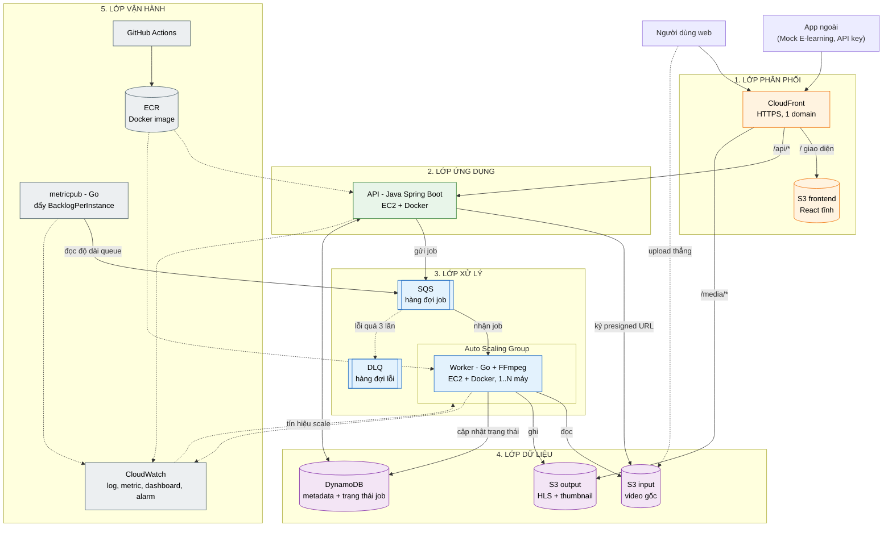
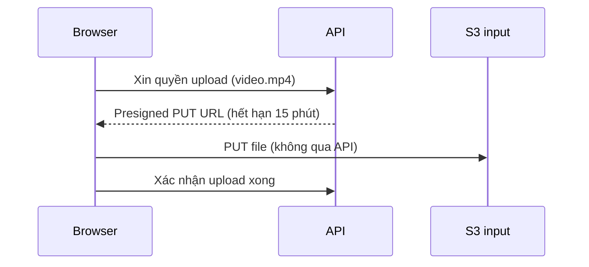
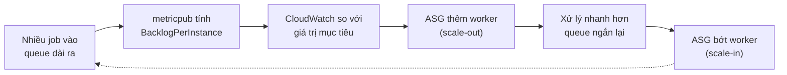
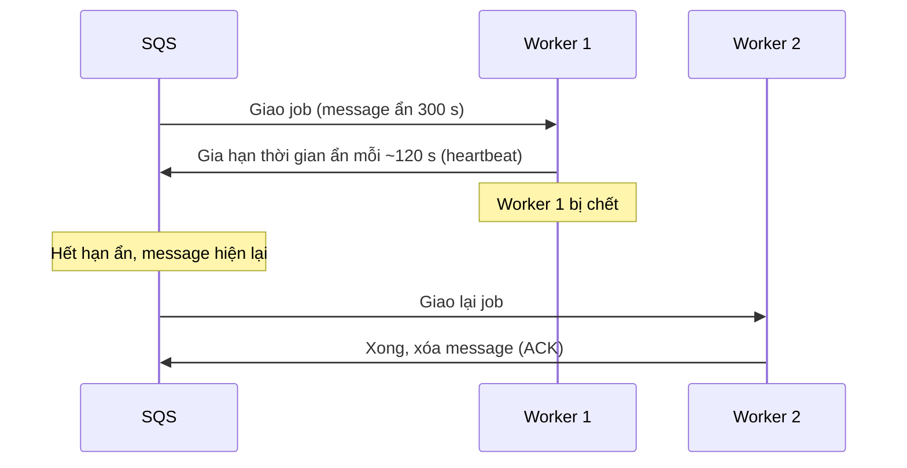
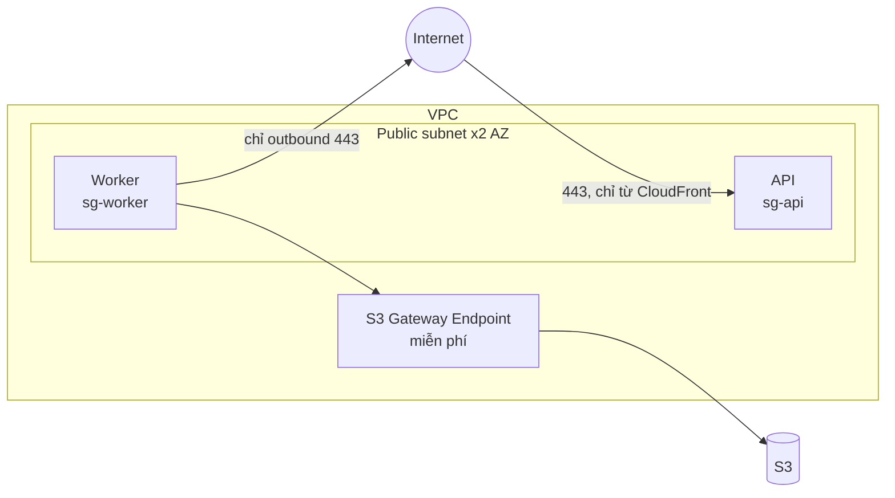
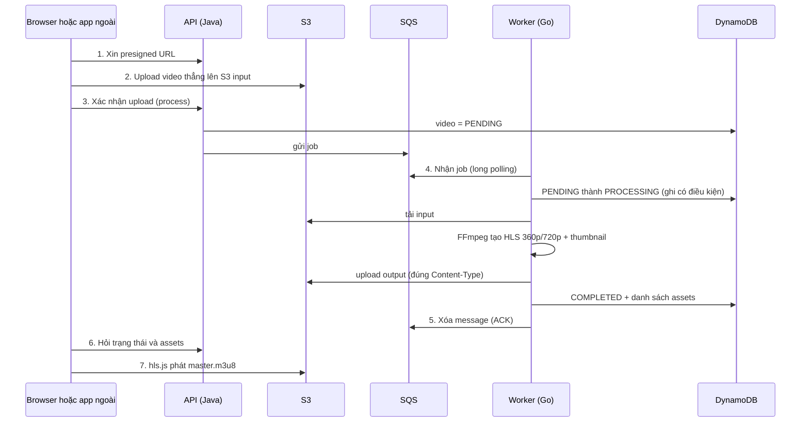
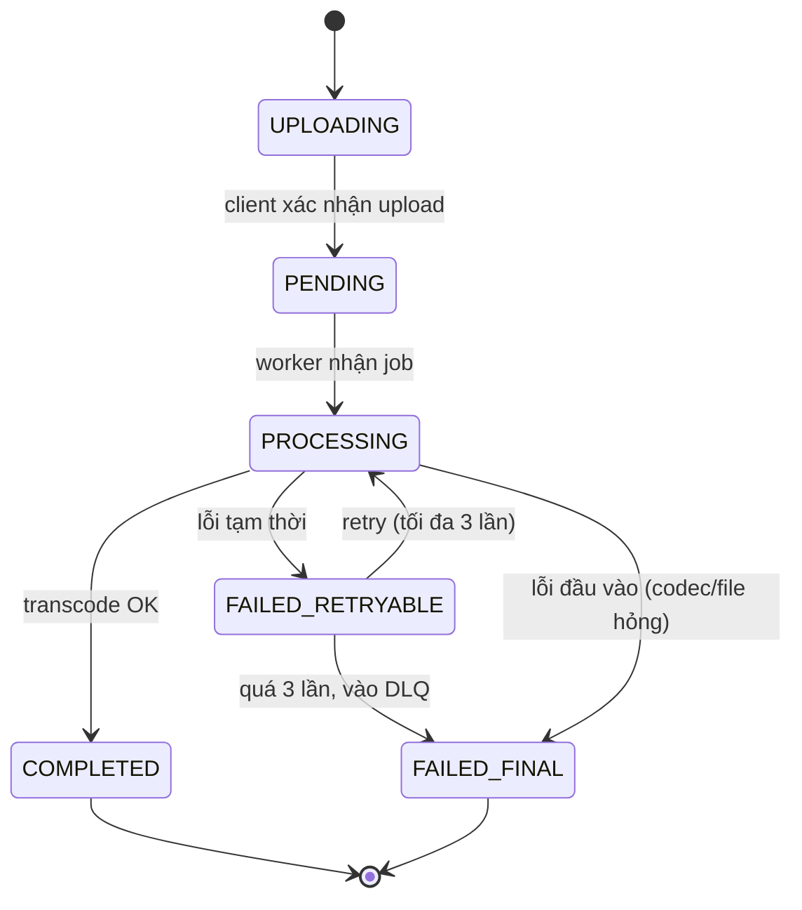
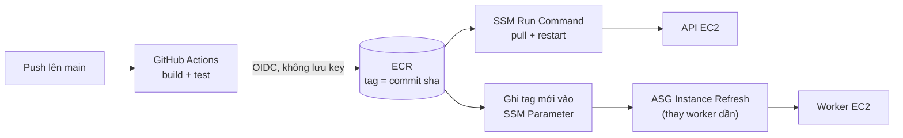

# TransVidCloud – Kiến trúc & kỹ thuật Cloud

> **Mục đích:** một tài liệu duy nhất để cả 4 người hiểu *cùng một cách* về cloud trong dự án: dùng dịch vụ nào, để làm gì, triển khai ra sao, và thống nhất những gì.
> **Trạng thái:** `DRAFT` – phần kiến trúc chờ 2 bạn Software duyệt. Chỗ nào còn phụ thuộc quyết định chung được đánh dấu ❓ (mã `D#` khớp Decision Log trong file kế hoạch).
> **Nhóm:** BE · FE (Software) · CL-A · CL-B (Infra) · Java (API) + Go (worker).

---

## 1. Cloud làm gì cho TransVidCloud?

**Bài toán:** transcode video (FFmpeg) tốn nhiều CPU và đến theo từng đợt (burst): có lúc không có video nào, có lúc 20 video cùng đến.

**Cloud giải quyết bằng 4 việc:**

| Việc | Giải pháp | Dịch vụ chính |
|---|---|---|
| Nhận video lớn mà API không bị nghẽn | Browser upload **thẳng** lên kho lưu trữ | **S3** (+ presigned URL) |
| Không bắt người dùng chờ xử lý | Đặt việc vào hàng đợi, xử lý nền | **SQS** |
| Có nhiều việc thì tăng máy, hết việc thì giảm | Nhóm máy tự co giãn theo độ dài hàng đợi | **EC2 Auto Scaling** |
| Máy chết không mất việc, và nhìn được hệ thống | Retry + hàng đợi lỗi + giám sát | **SQS DLQ, DynamoDB, CloudWatch** |

**Bảng "một câu – một dịch vụ":**

| Câu hỏi | Trả lời |
|---|---|
| Video lưu ở đâu? | **S3** |
| Việc cần làm nằm ở đâu? | **SQS** |
| Ai làm việc? | **Worker** (Go + FFmpeg) chạy trên **EC2** |
| Nhiều việc thì sao? | **Auto Scaling Group** thêm worker |
| Trạng thái từng video ở đâu? | **DynamoDB** |
| Biết hệ thống đang ra sao bằng cách nào? | **CloudWatch** |
| Ai được làm gì? | **IAM** + **Security Group** |
| Code đến máy bằng đường nào? | **GitHub Actions → ECR → EC2** |

---

## 2. Bức tranh tổng thể



> ❓ **D10:** nếu nhóm chọn phương án đơn giản (bỏ CloudFront), FE gọi thẳng API và S3; mọi thứ còn lại giữ nguyên.

---

## 3. Dịch vụ AWS: làm gì cho hệ thống

| # | Dịch vụ | Làm gì cho hệ thống | Kỹ thuật cloud thể hiện | Cấu hình chính | Owner |
|---|---|---|---|---|---|
| 1 | **S3** (Simple Storage Service – lưu object) | Lưu video gốc, HLS, thumbnail, giao diện web | Object storage, direct upload | 3 bucket: `input` (private), `output`, `frontend`; CORS; lifecycle dọn file test | CL-A |
| 2 | **SQS** (Simple Queue Service – hàng đợi) | Đệm job giữa "upload xong" và "xử lý" | Decoupling, bất đồng bộ, absorb burst | Standard · visibility 300 s · long polling 20 s · `maxReceiveCount=3` | CL-A |
| 3 | **SQS DLQ** (Dead-Letter Queue) | Chứa job lỗi quá 3 lần để điều tra | Fault handling | Retention 14 ngày · alarm khi có message | CL-A |
| 4 | **EC2** (máy ảo) – API | Chạy Spring Boot (Docker) | Compute | t3.small · Elastic IP · tắt đêm | CL-A |
| 5 | **EC2 Auto Scaling Group + Launch Template** | Nhóm worker, tự tăng/giảm | **Elasticity** | min 1 · max 4 · target tracking · scale-in protection | CL-A |
| 6 | **DynamoDB** (CSDL NoSQL) | Metadata + **trạng thái job** (source of truth) | Managed database | On-demand · ghi có điều kiện | BE thiết kế, CL-A tạo |
| 7 | **CloudWatch** | Log, metric, dashboard, alarm; **nguồn tín hiệu cho scaling** | Observability | Log 7 ngày · dashboard 4 widget · alarm DLQ | CL-A |
| 8 | **IAM** (quản lý quyền) | Cấp quyền tối thiểu cho người/máy/CI | Security | Role cho EC2, OIDC cho CI | CL-A |
| 9 | **VPC + Security Group** | Mạng ảo + tường lửa | Network isolation | 2 public subnet · worker **0 cổng inbound** · S3 Gateway Endpoint | CL-A |
| 10 | **ECR** (kho Docker image) | Mọi máy pull cùng một image | Container registry | 2 repo · giữ 10 image gần nhất | CL-A |
| 11 | **CloudFront** (CDN) ❓D10 | HTTPS + 1 domain; cache HLS; S3 giữ private | Edge delivery | 3 behavior: `/`, `/api/*`, `/media/*` | CL-A |
| 12 | **SSM** (Systems Manager) | Lưu secret; vào máy không cần SSH; deploy | Secrets, ops | Parameter Store `/tvc/{env}/...` · Session Manager | CL-A |
| 13 | **SNS + Budgets** | Email khi alarm / vượt ngân sách | Cost & alert | Cảnh báo $25 và $50 | CL-A |

**Cố ý KHÔNG dùng** (mỗi dịch vụ phải có vai trò rõ):

| Không dùng | Lý do |
|---|---|
| NAT Gateway | ~$32+/tháng; thay bằng public subnet không inbound |
| ALB (Application Load Balancer) | Chưa cần; CloudFront đã làm cửa vào |
| Lambda / Fargate cho transcode | FFmpeg chạy dài, cần Docker + kiểm soát CPU |
| EKS / Kubernetes | Quá nặng cho phạm vi đồ án (spec cấm) |
| Route 53 / ACM (domain, chứng chỉ) | CloudFront có HTTPS mặc định |
| Multi-region | Ngoài phạm vi |

---

## 4. Sáu kỹ thuật cloud cốt lõi

### 4.1 Upload thẳng lên kho lưu trữ (Direct-to-S3 bằng presigned URL)

*Ý tưởng:* API **không** nhận file video; API chỉ cấp một "vé tạm" (presigned URL) cho phép browser tự đẩy file lên S3.



- **Lợi ích:** API nhẹ, không nghẽn khi nhiều người upload file lớn.
- **Chứng minh:** theo dõi CPU/băng thông API khi upload 200 MB → gần như không tăng.

### 4.2 Tách rời bằng hàng đợi (Decoupling + Async)

*Ý tưởng:* API chỉ **đặt việc** vào SQS rồi trả lời ngay; worker **lấy việc** khi rảnh.

```text
20 video đến cùng lúc → SQS giữ 20 message → worker xử lý dần → không video nào bị rớt
```

- **Lợi ích:** chịu được burst; API và worker cập nhật/khởi động lại độc lập.
- **Chứng minh:** gửi 20 job, đồ thị *queue depth* tăng rồi giảm dần.

### 4.3 Co giãn tự động (Elastic Scaling)

*Ý tưởng:* số worker bám theo **lượng việc tồn đọng**, không bám theo số request API.



**Công thức (phần "thiết kế scaling policy" ăn điểm):**

```text
BacklogPerInstance = số message đang chờ ÷ max(1, số worker đang chạy)
Giá trị mục tiêu   = thời gian chờ chấp nhận được ÷ thời gian xử lý 1 job
Ví dụ: chấp nhận chờ 10 phút, 1 job ~2 phút → mục tiêu = 5 message/worker
```

- Thời gian xử lý 1 job lấy từ **Experiment 1 (baseline)**, rồi mới chốt mục tiêu.
- `min = 1` (scale-to-0 làm sau nếu kịp) · `max = 4` (khống chế chi phí).
- **Chứng minh:** nạp 20 video → thêm ≥ 1 worker trong < 5 phút; queue cạn → worker giảm.

### 4.4 Chịu lỗi (Fault Tolerance)

*Ý tưởng:* worker chết giữa chừng thì **job không mất**, được máy khác làm lại.



| Cơ chế | Giải quyết gì |
|---|---|
| **Visibility timeout 300 s + heartbeat** | Job dài không bị nhận trùng; worker chết thì hồi phục trong ≤ ~5 phút |
| **Retry tối đa 3 lần → DLQ** | Không retry vô hạn; job hỏng được giữ lại để điều tra |
| **Idempotency** (chạy lại không gây hại) | Key output ổn định (retry ghi đè) + ghi DynamoDB có điều kiện (đã COMPLETED thì bỏ qua) |
| **Scale-in protection** | ASG không tắt máy đang chạy FFmpeg |

- **Chứng minh:** Experiment 3 – kill worker 10 lần giữa job → 0 job mất, đo thời gian phục hồi.

### 4.5 Bảo mật & mạng (Security & Network)



| Nguyên tắc | Cách làm |
|---|---|
| **Least privilege** (quyền tối thiểu) | Role riêng cho API, worker, CI; chỉ cấp đúng hành động và đúng resource cần |
| Không hard-code key | Máy dùng **IAM role**; CI dùng **OIDC** (không lưu access key trong GitHub) |
| Worker không mở cổng | `sg-worker` **0 inbound**; vào máy bằng **SSM Session Manager** |
| S3 không mở public | `input` private hoàn toàn; `output` private + CloudFront (OAC) ❓D10 |
| Secret không nằm trong repo | Lưu ở **SSM Parameter Store** (SecureString) |

> **Trade-off ghi vào báo cáo:** production nên đặt worker ở private subnet + VPC endpoint; đồ án dùng public subnet *không inbound* để tránh NAT Gateway ~$32+/tháng. ❓D11

### 4.6 Quan sát & kiểm soát chi phí (Observability & Cost)

| Hạng mục | Nội dung |
|---|---|
| **Dashboard 4 widget** | Queue depth · số worker · CPU · jobs completed/failed + thời gian xử lý |
| **Alarm** | DLQ có message · message cũ nhất > 15 phút · CPU API > 80% · vượt ngân sách (gửi email qua SNS) |
| **Log** | JSON, có `jobId`/`videoId`, giữ 7 ngày |
| **Chi phí** | Budgets $25/$50 · tag mọi resource · tắt API đêm · ASG `max=4` · `terraform destroy` sau demo |

---

## 5. Một video đi qua hệ thống



**Trạng thái của video/job:**



**Vòng đời worker (CL-B làm):**

```text
 1. Nhận message (long polling 20 s)
 2. Đọc DynamoDB — đã COMPLETED? → xóa message, bỏ qua
 3. PENDING/FAILED_RETRYABLE → PROCESSING (ghi có điều kiện)
 4. Bật scale-in protection; chạy heartbeat gia hạn visibility
 5. Tải input; ffprobe kiểm tra (MP4/H.264, ≤ 500 MB, ≤ 10 phút)
 6. FFmpeg → HLS 360p + 720p + master.m3u8 + thumbnail
 7. Upload output (Content-Type đúng); ghi COMPLETED + assets
 8. Xóa message (ACK); tắt protection; dọn file tạm
 Lỗi: ghi FAILED_RETRYABLE, KHÔNG xóa message → SQS giao lại; quá 3 lần → DLQ
```

---

## 6. Triển khai

### 6.1 Hai môi trường

| Môi trường | Dùng để | Quy mô |
|---|---|---|
| `dev` | Phát triển, test hằng ngày (dùng chung) | 1 API, worker `max=2` |
| `demo` | Experiments + demo cuối | `max=4`, pre-warm trước giờ demo |

Cả hai tạo từ **cùng code Terraform**, khác nhau bằng biến (`env`, `max_workers`…).

### 6.2 Thứ tự dựng hạ tầng (theo lớp)

| Lớp | Gồm | Tuần | Xong khi |
|---|---|---|---|
| **0. Nền** | Account, IAM user + MFA, **Budgets**, repo `infra/`, quy ước tag | 4 | Có cảnh báo chi phí; 4 người có quyền dev |
| **1. Dữ liệu & hàng đợi** | S3, SQS + DLQ, DynamoDB, ECR, IAM role | 5 | `terraform apply` dựng lại từ đầu **< 30 phút** |
| **2. Tính toán** | VPC/SG, EC2 API, Launch Template worker, CI/CD | 6 | Gửi message tay → ra HLS trên S3 |
| **3. Quan sát** | CloudWatch log/dashboard, alarm, SNS, CloudFront | 7–8 | E2E chạy; thấy queue/CPU trên dashboard |
| **4. Co giãn** | ASG, `metricpub`, target tracking, scale-in protection | 9 | 20 video → thêm worker; hết việc → bớt |

### 6.3 Đường đi của code (CI/CD)



- **API:** Actions build image → push ECR → SSM chạy `docker pull && docker run`.
- **Worker:** Launch Template đọc tag image từ SSM Parameter `/tvc/{env}/worker-image-tag`; đổi tag rồi *Instance Refresh* để thay máy dần.
- **Rollback:** đặt lại tag cũ (commit sha trước đó) rồi deploy lại – mất vài phút.
- **Quy tắc:** mọi resource tạo bằng **Terraform**, không bấm tay trên Console. ❓D12

---

## 7. Thống nhất chung (hợp đồng & quy ước)

> Đặt trong thư mục `contracts/` của repo. **Đổi hợp đồng phải qua PR có người của cả 2 nhóm duyệt.**

### 7.1 Quy ước đặt tên

| Hạng mục | Quy ước | Ví dụ |
|---|---|---|
| Region | `ap-southeast-1` (Singapore) ❓D9 | — |
| Tên resource | `tvc-{env}-{resource}` | `tvc-dev-jobs`, `tvc-dev-jobs-dlq`, `tvc-demo-videos` |
| Tag bắt buộc | `Project=TransVidCloud`, `Env=dev/demo`, `ManagedBy=terraform` | — |
| ID | Tiền tố + UUID | `vid_…`, `job_…`, `prj_…` |
| Thời gian | ISO-8601, UTC | `2026-10-06T10:30:00Z` |
| SSM Parameter | `/tvc/{env}/{tên}` | `/tvc/dev/jwt-secret` |
| Metric (namespace `TransVidCloud`) | `jobs_completed`, `jobs_failed`, `processing_duration`, `retry_count`, `BacklogPerInstance` | — |
| Log | JSON một dòng: `ts, level, service, jobId, videoId, projectId, msg` | — |

### 7.2 Biến môi trường chuẩn (Infra cấp qua `.env.example`)

| Biến | Ý nghĩa |
|---|---|
| `AWS_REGION` | Region |
| `TVC_ENV` | `dev` hoặc `demo` |
| `TVC_INPUT_BUCKET` / `TVC_OUTPUT_BUCKET` | Tên bucket input / output |
| `TVC_JOBS_QUEUE_URL` / `TVC_DLQ_URL` | URL hàng đợi chính / DLQ |
| `TVC_DDB_VIDEOS` / `TVC_DDB_USERS` / `TVC_DDB_PROJECTS` / `TVC_DDB_APIKEYS` | Tên bảng DynamoDB |
| `TVC_MEDIA_BASE_URL` | Gốc URL phát video (`/media` hoặc domain CloudFront) |
| `TVC_ASG_NAME` | Tên ASG (worker, metricpub dùng) |

### 7.3 Bốn hợp đồng

| Hợp đồng | Nội dung | Ai viết | Ai duyệt |
|---|---|---|---|
| **API** `openapi.yaml` | 7 endpoint: `POST /uploads/presigned-url`, `POST /videos`, `POST /videos/{id}/process`, `GET /videos/{id}`, `/status`, `/assets`, `/embed` + mã lỗi chuẩn `{code, message}` | BE | FE, CL-B |
| **SQS message** | `{"schemaVersion":1, "jobId", "videoId", "projectId", "inputKey"}` · số lần thử lấy từ thuộc tính `ApproximateReceiveCount` (body không sửa được) | BE + CL-B | CL-A |
| **DynamoDB** | 4 bảng (`users`, `projects`, `apikeys`, `videos`) + bảng quyền ghi bên dưới ❓D3 | BE | CL-B, CL-A |
| **S3 key & Content-Type** | Bên dưới | CL-B | BE, FE |

**S3 key:**

```text
input/{projectId}/{videoId}/original.mp4
output/{projectId}/{videoId}/hls/master.m3u8
output/{projectId}/{videoId}/hls/360p/...    output/{projectId}/{videoId}/hls/720p/...
output/{projectId}/{videoId}/thumbnails/thumb.jpg
Content-Type:  .m3u8 = application/vnd.apple.mpegurl    .ts = video/mp2t
```

**Ai được ghi trường nào trong bảng `videos`** (tránh hai bên ghi đè nhau):

| Trường | API (Java) | Worker (Go) |
|---|---|---|
| `title`, `originalKey`, `createdAt` | ✍️ ghi | đọc |
| `status`: `UPLOADING → PENDING` | ✍️ ghi | — |
| `status`: `PENDING/FAILED_RETRYABLE → PROCESSING → COMPLETED/FAILED_*` | đọc | ✍️ ghi **có điều kiện** |
| `attemptCount`, `startedAt`, `completedAt`, `errorCode` | đọc | ✍️ ghi |
| `assets` (HLS key, thumbnail, renditions) | đọc | ✍️ ghi |

### 7.4 Quy trình đổi hợp đồng

1. Mở PR sửa file trong `contracts/` (nêu lý do + ảnh hưởng).
2. Người của **nhóm còn lại** review (bắt buộc).
3. Merge → cập nhật code hai phía **trong cùng tuần**; báo ở standup.

---

## 8. Ai phụ trách gì

**Ký hiệu:** **T** = tạo/vận hành · **D** = dùng trong code · **R** = review

| Dịch vụ | BE | FE | CL-A | CL-B |
|---|---|---|---|---|
| IAM, VPC/SG | R (xin quyền) | – | **T** | R |
| S3 | **D** (ký presigned) | **D** (URL phát) | **T** | **D** (đọc/ghi) |
| SQS + DLQ | **D** (gửi) | – | **T** | **D** (nhận/xóa/gia hạn) |
| EC2 API + CI/CD | **D** (Dockerfile, `/health`) | – | **T** | – |
| ASG + `metricpub` | – | – | **T** | R |
| Worker (code chạy trên EC2) | R | – | R | **T** |
| DynamoDB | **T** thiết kế + **D** | – | **T** tạo bảng | **D** |
| CloudWatch | D (log) | – | **T** | **D** (metric) |
| CloudFront | D (URL media) | **D** | **T** | – |
| SSM / SNS / Budgets / ECR | D | – | **T** | D |

**Hai gói giao nhận:**

| Infra giao cho Software | Software giao cho Infra |
|---|---|
| `.env.example` + Terraform output (bucket, queue, bảng) – tuần 5 | `openapi.yaml`, schema DynamoDB, danh sách hành động AWS cần – tuần 5 |
| Môi trường `dev` dùng chung – tuần 5 | Dockerfile + endpoint `/health` – tuần 6 |
| Pipeline deploy từ `main` – tuần 6 | — |
| Dashboard + hướng dẫn xem log – tuần 8 | — |

---

## 9. Checklist nghiệm thu phần Cloud

| # | Kỹ thuật | Cách kiểm chứng | Ngưỡng đạt | Tuần |
|---|---|---|---|---|
| 1 | IaC | `terraform apply` dựng lại từ đầu | < 30 phút | 5 |
| 2 | Direct upload | `curl -X PUT` bằng presigned URL → file đúng key | Đúng | 6 |
| 3 | Pipeline end-to-end | Upload 100–200 MB → xem được HLS | 5/5 video; ghi baseline time-to-playable | 7 |
| 4 | Retry + DLQ | Job lỗi codec | Rơi đúng DLQ, alarm kêu | 8 |
| 5 | Quyền tối thiểu | Worker ghi vào `input/` | Bị `AccessDenied` | 8 |
| 6 | Cửa mạng | Quét cổng từ ngoài vào worker | Không cổng nào mở | 8 |
| 7 | Auto Scaling | Nạp 20 video | Thêm ≥ 1 worker < 5 phút; hết việc thì bớt | 9 |
| 8 | Quan sát | Dashboard | Đủ 4 widget | 9 |
| 9 | Chịu lỗi | Kill worker giữa job × 10 | 0 job mất; đo recovery time | 13 |
| 10 | Chi phí | Cost Explorer + experiment | < $50/tháng; $/video | 13 |

---

## 10. Chi phí (ước lượng, region Singapore)

> Chỉ là ước lượng – kiểm tra lại bằng **AWS Pricing Calculator**; chính sách free tier/credit của account mới có thể khác.

| Hạng mục | Tháng thường | Tháng có experiment/demo |
|---|---|---|
| EC2 API (tắt đêm / 24-7) | ~$5–8 | ~$19 |
| EC2 Workers (min 1, max 4, chạy theo phiên) | ~$5–10 | ~$15–25 |
| S3 + SQS + DynamoDB on-demand | ~$0–1 | ~$1–2 |
| CloudWatch + ECR | ~$2–4 | ~$4–6 |
| CloudFront | ~$0 (gói miễn phí) | ~$0 |
| IPv4 công khai | ~$4 | ~$6 |
| **Tổng** | **~$15–25** | **~$40–55** |

**Lưu ý kỹ thuật:** t3 hết CPU credit khi transcode kéo dài → bật **Unlimited mode** trong phiên experiment hoặc dùng `c5.large` theo giờ.

---

## 11. Quyết định cloud còn mở

| # | Câu hỏi | Mặc định đề xuất | Cần ai chốt |
|---|---|---|---|
| D8 | Worker viết bằng gì? | **Go** (Infra làm); phương án khác: Java | Cả 4 |
| D9 | Region | `ap-southeast-1` | Cả 4 |
| D10 | Phát video & HTTPS | **CloudFront** trước FE + API + S3 output (S3 private); tạm `public-read` + UUID ở tuần 6–9 nếu chưa kịp | Cả 4 |
| D11 | Mạng worker | Public subnet, **0 inbound**, truy cập qua SSM | Infra (Software biết) |
| D12 | IaC | **Terraform** | Infra |
| D13 | Nền chạy | EC2 + Docker (không Lambda/Fargate/EKS) | Đã chốt theo spec |
| D14 | Input chấp nhận | MP4 H.264/AAC, ≤ 500 MB, ≤ 10 phút | Cả 4 |

---

## 12. Thuật ngữ nhanh

| Thuật ngữ | Giải thích ngắn |
|---|---|
| **Transcode** | Chuyển video sang độ phân giải/định dạng khác |
| **HLS** (HTTP Live Streaming) | Phát video bằng nhiều đoạn `.ts` nhỏ + file danh mục `.m3u8` |
| **Presigned URL** | Link S3 tạm thời có chữ ký để upload/tải mà không cần credential |
| **Visibility timeout** | Thời gian message bị "ẩn" sau khi nhận; hết hạn chưa xóa thì hiện lại |
| **Heartbeat** | Gia hạn visibility timeout định kỳ khi job còn chạy |
| **ACK** | Xác nhận xử lý xong, xóa message khỏi queue |
| **DLQ** (Dead-Letter Queue) | Hàng đợi chứa message lỗi quá số lần cho phép |
| **Idempotency** | Chạy lại nhiều lần cho cùng kết quả, không gây trùng/hỏng |
| **ASG** (Auto Scaling Group) | Nhóm EC2 tự tăng/giảm số máy |
| **Target tracking** | Policy scaling giữ một metric ở mức mục tiêu |
| **Scale-out / scale-in** | Thêm máy / bớt máy |
| **Scale-in protection** | Cờ chặn ASG tắt máy đang giữ job |
| **Least privilege** | Chỉ cấp quyền tối thiểu cần thiết |
| **IAM role / OIDC** | "Vai" cấp quyền cho máy / cách CI lấy quyền tạm, không lưu key |
| **OAC** (Origin Access Control) | Cho CloudFront đọc S3 private |
| **CORS** | Cho trang ở domain A gọi tài nguyên ở domain B |
| **IaC / Terraform** | Hạ tầng bằng code / công cụ IaC phổ biến |
| **Source of truth** | Nơi lưu dữ liệu "chuẩn" duy nhất (ở đây là DynamoDB) |
| **Baseline** | Số đo gốc để so sánh sau tối ưu |
