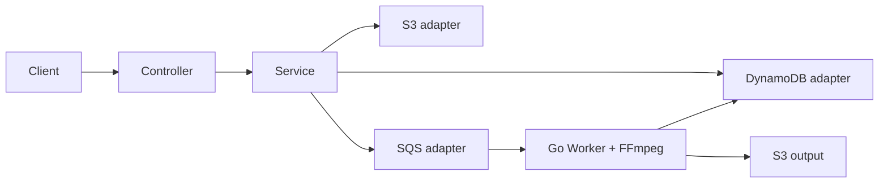

# 4. Design & Architecture

## Thành phần và trách nhiệm

| Thành phần | Trách nhiệm |
|---|---|
| Controller | HTTP boundary, request mapping và response. |
| Service | Business rules, ownership checks và điều phối nghiệp vụ. |
| Repository | Đóng gói truy vấn/ghi DynamoDB. |
| AWS adapters | Tích hợp S3, SQS và các API AWS cần thiết. |
| DTO/Mapper | Tách API representation khỏi dữ liệu lưu trữ. |

Đây là ranh giới logic đề xuất; map vào cấu trúc package thực tế trong `backend/`, không tạo abstraction chỉ để đủ layer.

## Module logic gợi ý

- `auth`: đăng ký, đăng nhập, xác thực.
- `project`: project và ownership.
- `apikey`: tạo/kiểm tra/thu hồi key theo scope được chốt.
- `video`: khởi tạo, liệt kê, chi tiết và confirm.
- `storage`: presigned URL và thao tác metadata object cần thiết.
- `messaging`: tạo SQS job message.
- `common/config`: cấu hình, lỗi chung và AWS clients.

`job`/`asset` có thể là service hoặc package riêng khi cấu trúc code chứng minh cần thiết; không mặc định rằng phải có bảng riêng.

## Dependency rule

```text
Controller -> Service -> Repository / AWS adapters
```

Controller không chứa business workflow; domain/service không phụ thuộc vào HTTP details. AWS SDK được đóng gói tại adapter/repository phù hợp để test logic dễ hơn.

## Ranh giới với Worker

Backend tiếp nhận yêu cầu, xác minh quyền, quản lý metadata ở giai đoạn upload và phát job. Worker nhận SQS message, kiểm tra media, chạy FFmpeg, lưu output và cập nhật trạng thái xử lý theo contract. Backend không chờ transcoding hoàn tất trong request.

## Reliability boundary

Ghi DynamoDB và gửi SQS là hai thao tác riêng, không mặc định nguyên tử. Cần thiết kế confirm an toàn khi retry và có cách phát hiện/phục hồi trường hợp ghi dữ liệu thành công nhưng enqueue lỗi. Cơ chế cụ thể là **TBD/ADR**; không tự tuyên bố có exactly-once delivery.

## Sơ đồ tương tác



Luồng edge/routing và hạ tầng chi tiết tuân theo root README cùng docs triển khai chung.
