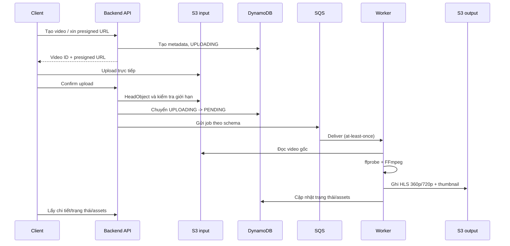

# 8. Upload & Processing Workflow

## Luồng chính

Đây là mô hình chức năng; thứ tự chính xác giữa update DynamoDB và SendMessage cùng cơ chế recovery khi một bước lỗi cần được chốt trong implementation/ADR.

## State ownership

Tham chiếu [`../contracts/video-state-machine.md`](../contracts/video-state-machine.md): API quản lý trạng thái tiếp nhận; Worker quản lý trạng thái xử lý. State machine hiện là DRAFT. Không tự đặt thêm trạng thái trong Backend mà chưa cập nhật contract.

## Job message và output keys

- Message phải theo [`../contracts/sqs-job-message.schema.json`](../contracts/sqs-job-message.schema.json); không tự đổi field hoặc `schemaVersion`.
- S3 key phải theo [`../contracts/s3-key-convention.md`](../contracts/s3-key-convention.md).
- Worker có thể nhận lại message; xử lý phải idempotent ở mức cần thiết và không ghi đè `COMPLETED`.

## Upload constraints

Tham chiếu [`../contracts/upload-limits.md`](../contracts/upload-limits.md). Theo bản DRAFT hiện tại, API kiểm tra dung lượng khai báo và xác minh object qua `HeadObject`; Worker dùng `ffprobe` để xác minh media thực tế.

## Failure cases cần xử lý/test

- Upload chưa hoàn tất hoặc object không tồn tại.
- Confirm được gọi nhiều lần.
- SQS send thất bại sau khi dữ liệu đã được cập nhật.
- Worker nhận duplicate message hoặc chết giữa lúc xử lý.
- Transcode hoặc upload output thất bại.
