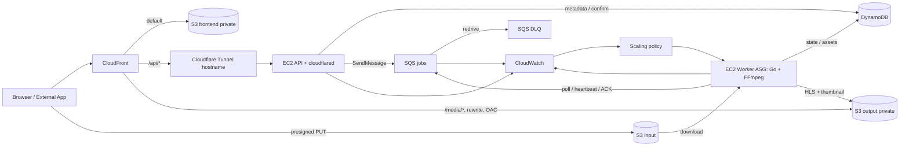

# 3. Designs — Thiết kế hạ tầng Cloud

## 1. Cơ sở thiết kế

Thiết kế phục vụ MVP trong [timeline v4](../introduction/1.%20Timelines.md): một backend cho SaaS và Developer API, xử lý video bất đồng bộ trên EC2, có đo elasticity và recovery. Đây là kiến trúc đích; trạng thái hiện thực hóa xem [Implement](4.%20Implement.md).

Các ràng buộc chính: DynamoDB duy nhất theo [ADR 0001](../adr/0001-dynamodb-only.md); input tối đa 209715200 byte/300 giây/1080p; output 360p/720p; local trước AWS; ưu tiên chi phí đồ án. Bản kiến trúc cũ có giới hạn 500 MB/10 phút, S3 key và trạng thái khác; khi triển khai dùng [contracts hiện tại](../../contracts/README.md), review các phần DRAFT trước M1.

## 2. Kiến trúc tổng thể

Sơ đồ thể hiện đường đi logic của request. `cloudflared` chủ động tạo kết nối ra Cloudflare; API không cần mở inbound Internet. Đây là đặc tính của [Cloudflare Tunnel](https://developers.cloudflare.com/cloudflare-one/networks/connectors/cloudflare-tunnel/), không phải một kết nối inbound trực tiếp vào EC2.

## 3. Local và AWS

| Thành phần | Local | AWS |
|---|---|---|
| API | Container `backend`, cổng 8080; hoặc chạy IDE | EC2 chạy Docker, image ECR |
| Worker | Container `worker`, không publish port | Launch Template + ASG, mỗi máy chạy worker |
| S3/SQS/DynamoDB | LocalStack tại cổng 4566 | Dịch vụ thật ở `ap-southeast-1` |
| Frontend | Vite trên host cổng 5173, nginx proxy | Build tĩnh trong S3 frontend |
| Edge | nginx tại `http://localhost:8000` | CloudFront + OAC; Tunnel cho API |
| Co giãn | `docker compose --scale` để thử nhiều consumer | Backlog metric + ASG policy |
| Credential | `test/test`, chỉ dùng local | EC2 instance profile; CI dùng OIDC khi hoàn thiện C6 |
| Quan sát/bảo mật | Log container; không chứng minh IAM/scaling thật | CloudWatch, IAM, SG, SSM, SNS và Budgets |

Compose khai báo SSM trong LocalStack nhưng hiện chưa có init/luồng cấp secret tương ứng. Không coi local là kiểm chứng SSM, IAM, CloudFront hay Spot. Local hiện không cấu hình lưu bền dữ liệu qua việc xóa container.

## 4. Tổ chức Terraform và môi trường

| Module dự kiến | Tài nguyên / output cần có | Chủ |
|---|---|---|
| `storage` | S3 frontend/input/output; CORS input; lifecycle input 7 ngày; bucket name/ARN | Lưu |
| `queue` | Standard queue + DLQ; URL/ARN; visibility 300s, long polling 20s, maxReceiveCount 3 | Lưu |
| `database` | Bốn bảng/GSI đúng contract; table name/ARN | Lưu |
| `network` | VPC, public subnet, route Internet Gateway, S3 Gateway Endpoint; VPC/subnet ID | Lưu |
| `iam` | Role/profile API/worker; deploy role; policy theo resource | Nguyên |
| `compute` | EC2 API, ECR, Launch Template, ASG; instance/ASG/repository thông tin | Nguyên |
| `edge` | CloudFront/OAC, rewrite, DNS/HTTPS liên quan; distribution ID/domain | Nguyên; Lưu hosting |
| `observability` | Log group, dashboard, alarm DLQ, SNS, Budgets, scaling policy | Nguyên |

Module `queue` xuất ARN/DLQ name cho `observability` tạo alarm, tránh hai module cùng quản lý một alarm. ECR có thể tách module riêng khi cần; đây là đề xuất phân bổ, chưa có module `.tf` trong repo.

`envs/dev` và `envs/demo` gọi cùng module, tách state và cấu hình. Tên mặc định `tvc-{env}-{resource}`; bucket S3 cloud cần hậu tố duy nhất toàn cục nếu tên đã bị dùng. App nhận tên thực tế từ cấu hình/output, không hard-code bucket local lên cloud.

Các tên đã được script dùng cứng cần giữ đồng bộ:

| Mục | Tên |
|---|---|
| Tag Name của API | `tvc-{env}-api` |
| ASG worker | `tvc-{env}-worker-asg` |
| Worker image tag trong SSM | `/tvc/{env}/worker/image-tag` |
| Tunnel token trong SSM | `/tvc/{env}/cloudflared/token` (SecureString) |
| ECR theo workflow | `tvc-backend`, `tvc-worker` |

Remote state dùng bucket S3 riêng, versioning, mã hóa, chặn public và khóa bằng `use_lockfile` theo [Terraform S3 backend](https://developer.hashicorp.com/terraform/language/backend/s3). Tách key state cho `dev`/`demo`; bucket state không nằm trong vòng đời destroy môi trường ứng dụng. Không commit state, plan chứa dữ liệu nhạy cảm hoặc tfvars thật.

## 5. Dữ liệu, queue và tính đúng đắn của pipeline

### 5.1. S3 và DynamoDB

| Tài nguyên | Thiết kế |
|---|---|
| Input bucket | Private; API ký PUT 15 phút; CORS cho origin được phép; lifecycle xóa input sau 7 ngày |
| Output bucket | Private; worker ghi, CloudFront đọc qua OAC; không tự thêm lifecycle xóa output khi chưa thống nhất với App |
| Frontend bucket | Private, chứa build React; CloudFront dùng S3 REST origin qua OAC |
| DynamoDB | On-demand; `users`, `projects`, `apikeys`, `videos`; key/GSI giữ đúng contract |

S3 key là `{projectId}/{videoId}/source.{ext}` ở input và `{projectId}/{videoId}/hls/master.m3u8` ở output; thumbnail ở `{projectId}/{videoId}/thumb/default.jpg`. Không thêm tiền tố `input/`, `output/` hay `media/` vào key. Xem [S3 contract](../../contracts/s3-key-convention.md) và [DynamoDB contract](../../contracts/dynamodb-tables.md).

API kiểm tra khai báo dung lượng và `HeadObject` khi confirm; worker dùng ffprobe cho thời lượng/độ phân giải/định dạng. Việc ký Content-Length phải được thử trên AWS; lifecycle là cơ chế dọn dữ liệu, không phải giới hạn upload tại thời điểm PUT.

### 5.2. Job lifecycle và retry

1. API tạo video `UPLOADING`, cấp presigned URL; client PUT trực tiếp vào S3.
2. API confirm kiểm tra object rồi chuyển `PENDING` và gửi SQS theo [message schema](../../contracts/sqs-job-message.schema.json).
3. Worker nhận job, đọc metadata; nếu đã `COMPLETED` thì bỏ qua và ACK.
4. Worker chuyển sang `PROCESSING`, bảo vệ instance khỏi scale-in, gia hạn visibility trong lúc chạy FFmpeg.
5. Upload đầy đủ output, ghi `COMPLETED` và assets rồi mới ACK; cuối cùng dọn file tạm và bỏ protection.
6. Nếu lỗi, cập nhật lỗi theo contract; message chưa ACK được giao lại, quá ngưỡng redrive thì vào DLQ.

[State contract hiện tại](../../contracts/video-state-machine.md) dùng `FAILED_VALIDATION`, `FAILED_TRANSCODE`, `FAILED_STORAGE`; không tự thay bằng `FAILED_RETRYABLE`/`FAILED_FINAL` của bản kiến trúc cũ. Việc loại lỗi nào dừng ngay, loại nào retry và ai đồng bộ trạng thái khi message vào DLQ cần App chốt trước kiểm thử A5/A8.

Ba điểm phải review khi hiện thực hóa: ghi DynamoDB và gửi SQS không phải một giao dịch nguyên tử; điều kiện `status <> COMPLETED` chưa ngăn hai worker cùng xử lý; lease/heartbeat và cách reclaim job khi worker chết chưa được contract chi tiết hóa. Phương/Vũ cần thống nhất chống mất job ở confirm, quyền sở hữu lần xử lý và retry idempotent. Hạ tầng SQS tự nó không giải quyết các khoảng trống này.

Visibility 300 giây là cấu hình bắt đầu, không phải deadline transcode. Heartbeat phải gia hạn trước khi hết hạn; `maxReceiveCount=3` được kiểm chứng bằng số lần nhận và DLQ, không diễn giải thành “ba lần retry sau lần chạy đầu”.

## 6. Mạng, IAM và secret

MVP dùng public subnet với Internet Gateway và public IP cho outbound, không NAT Gateway. API/worker có SG không inbound, quản trị bằng SSM; mở outbound cần thiết cho AWS API, ECR, cập nhật image và Tunnel. S3 Gateway Endpoint hỗ trợ đường truy cập S3; không thay thế toàn bộ outbound. Không cần Elastic IP cố định cho Tunnel.

| Danh tính | Quyền cần cấp theo phạm vi | Không cấp mặc định |
|---|---|---|
| API role | S3 input PUT để ký URL và GetObject cho HeadObject; SQS SendMessage; DynamoDB bảng/GSI nghiệp vụ; cấu hình SSM của API; ECR/log/SSM vận hành máy | Ghi HLS output, nhận/xóa job như worker |
| Worker role | Đọc input; ghi output; Receive/Delete/ChangeMessageVisibility/GetQueueAttributes; đọc/cập nhật `videos`; đọc tag/config worker; ECR/log/SSM và protection ASG | Ghi input; đọc bảng user/API key; sửa hạ tầng tùy ý |
| Deploy role | Push ECR, chạy SSM đúng API instance, cập nhật worker tag, Instance Refresh, sync frontend/invalidation đúng env | Admin toàn account, truy cập secret không phục vụ deploy |
| Metric publisher (nếu có) | Đọc queue/ASG và PutMetricData namespace đã chọn | Nhận/xóa job hoặc sửa metadata |

Policy phải dùng ARN/prefix phù hợp; kiểm tra thêm quyền KMS nếu SecureString dùng customer-managed key. Phân quyền ghi trạng thái vẫn phải nằm trong code và conditional write, không chỉ dựa vào việc tách IAM role.

EC2 lấy credential từ instance profile; cloud không mang theo `AWS_ACCESS_KEY_ID=test` hoặc `AWS_ENDPOINT_URL` local. Secret JWT và Tunnel token lưu SSM SecureString, không nhúng vào image, user-data công khai hoặc output Terraform. Host API bind `127.0.0.1:8080`; `cloudflared` chạy host network trên EC2 Linux để truy cập địa chỉ này.

## 7. CloudFront, Tunnel và HLS

| Behavior | Origin | Xử lý cần có |
|---|---|---|
| Default `*` | S3 frontend REST endpoint | OAC; default root `index.html`; fallback route React giới hạn ở frontend |
| `/api/*` | HTTPS `origin-api.<domain>` của Tunnel | Không cache; cho phép method API; chuyển auth/cookie/query cần thiết, giữ `/api` |
| `/media/*` | S3 output REST endpoint | OAC; bỏ `/media` trước khi truy cập S3; giữ đường dẫn tương đối của playlist/segment |

Với API, dùng cache policy `CachingDisabled` và origin request policy `AllViewerExceptHostHeader`: Host của viewer bị loại, CloudFront gửi Host theo origin, trong khi các header khác được chuyển tiếp. Cấu hình này cần được thử với JWT/API key thật. Xem [AWS managed origin request policies](https://docs.aws.amazon.com/AmazonCloudFront/latest/DeveloperGuide/using-managed-origin-request-policies.html).

**Điểm bắt buộc cho media:** behavior chỉ chọn origin, không tự bỏ `/media/`. Đề xuất CloudFront Function viewer-request gắn riêng behavior media để đổi `/media/prj/vid/hls/master.m3u8` thành `/prj/vid/hls/master.m3u8`. Local nginx đã rewrite tương đương. Đây là thiết kế cần triển khai ở C4; tham khảo cơ chế [rewrite request URI](https://docs.aws.amazon.com/AmazonCloudFront/latest/DeveloperGuide/example_cloudfront_functions_url_rewrite_single_page_apps_section.html).

Frontend và output dùng S3 REST origin, bucket policy giới hạn CloudFront distribution qua OAC; S3 website endpoint không dùng được OAC. Theo [AWS OAC](https://docs.aws.amazon.com/AmazonCloudFront/latest/DeveloperGuide/private-content-restricting-access-to-s3.html). OAC bảo vệ origin, không tự xác thực người xem HLS; kiểm soát playback theo người dùng là phần nâng cao chưa thuộc MVP.

Các kiểm tra C4: master/rendition/segment/thumbnail đúng Content-Type; deep link React không làm API/HLS 404 thành HTML; API không trả dữ liệu cache của người khác; tên miền Tunnel được phân giải đúng; link S3 trực tiếp không public. Vì output có key ổn định, TTL/invalidation khi xử lý lại phải được thống nhất với App để tránh phát kết quả cũ.

Dùng tên CloudFront mặc định trước; nếu thêm domain riêng, dùng certificate ACM phù hợp CloudFront tại `us-east-1` và DNS Cloudflare dạng DNS only cho hostname web. Hostname origin Tunnel vẫn đi qua Cloudflare. API origin có thể được gọi trực tiếp nên vẫn phải xác thực; phương án hai domain + CORS chỉ dùng khi nhóm thống nhất đổi đường truy cập.

## 8. Compute, scaling và Spot

API chạy một EC2 cho MVP; worker chạy ASG, image cùng kiến trúc CPU với máy (ưu tiên x86_64 ở MVP). Dev/demo dùng Spot nhiều loại máy tương thích; benchmark cố định loại máy on-demand để giảm sai lệch. Chọn EBS đủ input + output + file tạm; theo dõi và dọn sau mỗi job.

| Chế độ | Cấu hình đề xuất | Điều kiện |
|---|---|---|
| Dev ít tải | Min 0, max 2 | Đã kiểm chứng đánh thức từ 0; chấp nhận cold start |
| Demo | Min 1, max 2; nâng max 4 nếu quota/chi phí cho phép | Pre-warm và thử trước buổi demo |
| Benchmark | Cố định 1 rồi 2 worker on-demand | Tách bài đo throughput cố định khỏi bài đo autoscaling |

Scaling theo `BacklogPerInstance = visible messages / max(1, InService workers)`. Chọn target dựa trên thời gian chờ chấp nhận được và thời gian xử lý trung bình, rồi kiểm chứng bằng dữ liệu thực tế. AWS mô tả [backlog theo số instance và scale-in protection](https://docs.aws.amazon.com/autoscaling/ec2/userguide/as-using-sqs-queue.html).

- Nếu min ≥ 1: có thể dùng metric math backlog/worker, giảm thành phần vận hành.
- Nếu min 0: theo định hướng timeline chung, cần `metricpub` chạy ngoài Worker ASG, ví dụ trên API EC2, phát metric định kỳ kể cả khi không có worker. Công thức tránh chia 0 chưa đủ chứng minh scale-out: cần test một job ở trạng thái 0 máy và bổ sung policy đánh thức 0 → 1 nếu target tracking chưa đáp ứng. Nếu API/metricpub tắt, đường đánh thức này không còn hoạt động.
- Chọn chu kỳ metric, warmup và cooldown sau khi đo thời gian boot/pull image. Khi hết backlog, kiểm tra cả job đang xử lý; bảo vệ instance trong khoảng giữ job và luôn bỏ protection khi xong/lỗi.
- Scale-in protection không ngăn Spot bị thu hồi hoặc máy lỗi. Muốn phản ứng sớm với Spot cần cơ chế nhận thông báo, ngừng poll và chuyển tín hiệu dừng tới container; không giả định AWS tự gửi SIGTERM cho ứng dụng. Heartbeat/visibility và retry vẫn là đường phục hồi chính.

## 9. Quan sát, chi phí và triển khai phiên bản

Dashboard tối thiểu gồm queue backlog/tuổi message, số worker, CPU và kết quả/thời gian job. Log JSON có `service`, `videoId`, `jobId`, thời điểm, mức log và lỗi; đề xuất retention 7 ngày. Alarm DLQ + SNS là bắt buộc; alarm tuổi message/CPU bổ sung nếu đủ thời gian.

Budgets 25/50 USD là ngưỡng cảnh báo theo kế hoạch nhóm, không phải cơ chế tự chặn chi tiêu hay cam kết chi phí tháng. Theo dõi EC2/Spot, EBS, public IPv4, S3, CloudWatch, ECR và CDN theo số dùng thực tế; không đưa bảng giá cũ trong ADR thành dự toán chắc chắn.

Ứng dụng được gắn tag commit SHA và ghi lại digest. API deploy qua SSM; worker đọc `/tvc/{env}/worker/image-tag` khi boot và thay phiên bản bằng Instance Refresh. Script hiện dùng `ScaleInProtectedInstances=Wait`; cần theo dõi refresh hoàn tất, không coi trả về refresh ID là deploy thành công. Frontend lưu artifact của phiên bản trước để rollback cùng API nếu cần.

## 10. Điểm cần chốt trước triển khai

| Điểm mở | Người xử lý | Mốc |
|---|---|---|
| API request/response, health endpoint và tên env runtime đầy đủ | Phương/Vũ với Cloud | M1 |
| Retry lỗi validation, lease và khoảng trống confirm → SQS | Phương/Vũ, Cloud review | M2 |
| Instance type, quota, giới hạn worker và cấu hình disk | Nguyên | M1–M2 |
| TTL/rewrite media và fallback React | Nguyên/Lưu/Vũ | M3 |
| Metric publisher, target/warmup và policy 0 → 1 | Nguyên/Vũ | M3, trước bật min 0 |
| Phần hạ tầng làm thủ công nếu C6 hoãn, kế hoạch import Terraform | Lưu/Nguyên | M2 rồi rà soát M4 |

Thao tác triển khai và cách kiểm chứng từng lớp: [Implement](4.%20Implement.md).
