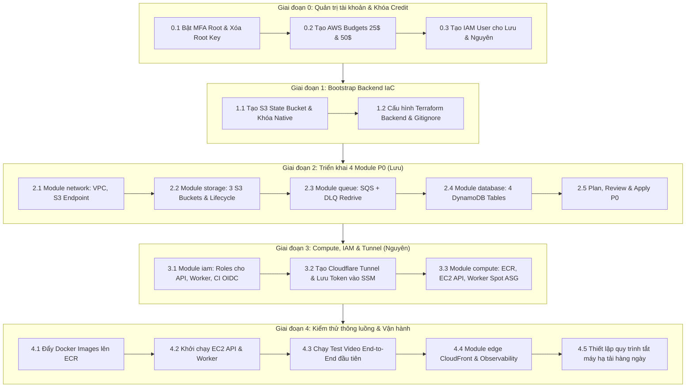
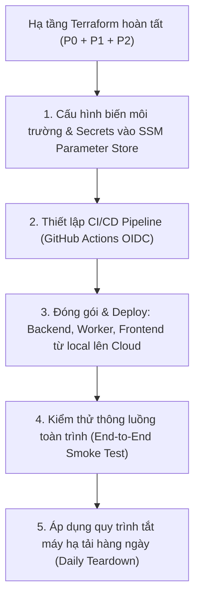

# 5. Cloud Deployment Runbook — Hướng dẫn từng bước triển khai AWS & FinOps

> **Mục tiêu:** Cung cấp quy trình thao tác kỹ thuật chi tiết từng bước, phân chia trách nhiệm rõ ràng và các lưu ý sống còn (FinOps, bảo mật, vận hành) cho nhóm Cloud/Infra khi chuyển từ LocalStack lên môi trường AWS thật (`ap-southeast-1`).  
> **Tài liệu căn cứ:** [3. Designs.md](file:///D:/TransvidCloud/docs/docs-cloud/3.%20Designs.md), [4. Implement.md](file:///D:/TransvidCloud/docs/docs-cloud/4.%20Implement.md), [AGENTS.md](file:///D:/TransvidCloud/AGENTS.md).

---

## 1. Phân vai & Nguyên tắc làm việc

| Vai trò | Thành viên | Trách nhiệm chính |
|---|---|---|
| **Chủ tài khoản (Root)** | Thành viên cấp credit | Giữ tài khoản Root, quản trị thẻ/credit, cấu hình Billing Alerts/Budgets, cấp quyền IAM ban đầu cho Lưu & Nguyên. |
| **Data & Network Lead** | **Lưu** | S3 State Bootstrap, module `network` (VPC/Endpoint), `storage` (S3), `queue` (SQS/DLQ), `database` (DynamoDB), kiểm thử E2E/Benchmark. |
| **Compute & Edge Lead** | **Nguyên** | Module `iam` (EC2 profiles, GitHub OIDC), `compute` (ECR, EC2 API, Worker ASG Spot), Cloudflare Tunnel, `edge` (CloudFront/OAC), `observability` (Log/Alarm). |

### 3 Nguyên tắc FinOps & An toàn sống còn
1. **Tuyệt đối không tạo NAT Gateway:** Dùng Public Subnet + Internet Gateway + S3 Gateway Endpoint + Cloudflare Tunnel (tiết kiệm ngay ~$32.40/tháng + data fee).
2. **Không chia sẻ mật khẩu Root hoặc tạo Root Access Key:** Mọi thao tác hạ tầng chỉ dùng IAM User hoặc OIDC Role.
3. **Luôn chạy Teardown / Hạ tải khi dừng test:** Không để EC2 chạy không tải qua đêm.

---

## 2. Bản đồ lộ trình triển khai (Deployment Roadmap)



---

## 3. Hướng dẫn chi tiết từng bước

### Giai đoạn 0: Thiết lập tài khoản & Bảo vệ Credit (Chủ tài khoản thực hiện)

#### Bước 0.1: Khóa chặt Root User
- **Thao tác:**
  1. Đăng nhập AWS Console bằng tài khoản Root.
  2. Vào **IAM Console** $\rightarrow$ **Security credentials**.
  3. Bật **Multi-factor authentication (MFA)** bằng ứng dụng Authenticator (Google Authenticator, Bitwarden...).
  4. Kiểm tra mục **Access keys**: Nếu có access key nào thuộc user Root, bấm **Delete** ngay lập tức.
> [!CAUTION]
> **Lưu ý:** Tuyệt đối không bao giờ tạo Access Key cho user Root. Không chia sẻ mật khẩu Root cho bất kỳ ai trong nhóm.

#### Bước 0.2: Cài đặt cảnh báo ngân sách (AWS Budgets)
- **Thao tác:**
  1. Vào **AWS Billing and Cost Management Console** $\rightarrow$ **Budgets** $\rightarrow$ **Create budget**.
  2. Chọn **Cost budget - Recommended**, đặt tên `tvc-monthly-budget`.
  3. Đặt hạn mức: **$25.00 USD / tháng**.
  4. Cấu hình 2 ngưỡng cảnh báo:
     - **Cảnh báo 1 ($25 USD):** Gửi email khi chi phí thực tế (Actual) hoặc dự báo (Forecasted) đạt 100% của $25.
     - **Cảnh báo 2 ($50 USD):** Gửi email khẩn cấp khi chi phí thực tế đạt $50.
  5. Điền email của cả 3 người: Chủ account, Lưu và Nguyên.
  6. Vào mục **Billing preferences**, tích chọn:
     - *Receive Free Tier Usage Alerts*
     - *Receive Billing Alerts*
> [!IMPORTANT]
> **Lưu ý:** Đây là chiếc phanh an toàn bảo vệ thẻ ngân hàng cá nhân. Không được bỏ qua bước này trước khi tạo bất kỳ tài nguyên EC2/S3 nào.

#### Bước 0.3: Tạo IAM User & Cấp quyền cho Lưu và Nguyên
- **Thao tác:**
  1. Vào **IAM Console** $\rightarrow$ **Users** $\rightarrow$ **Create user**.
  2. Tạo lần lượt: `luu-cloud` và `nguyen-cloud`.
  3. Tích chọn **Provide user access to the AWS Management Console**, tạo mật khẩu tạm và yêu cầu đổi mật khẩu lần đầu.
  4. Phân quyền: Gắn policy `PowerUserAccess` (cho phép quản lý toàn bộ dịch vụ infra EC2, S3, SQS, VPC... nhưng không cho sửa Billing và IAM), hoặc tạo IAM Group `tvc-infra-engineers` có quyền quản trị tài nguyên dự án.
  5. Yêu cầu Lưu và Nguyên đăng nhập Console và bật **MFA** trên tài khoản IAM của mình.
  6. Lưu và Nguyên vào IAM của mình $\rightarrow$ **Security credentials** $\rightarrow$ **Create access key** (mục đích: CLI).
- **Cấu hình trên máy cá nhân của Lưu & Nguyên:**
  Mở terminal (PowerShell hoặc Bash) chạy:
  ```bash
  aws configure --profile tvc-dev
  # AWS Access Key ID: <Access Key của bạn>
  # AWS Secret Access Key: <Secret Key của bạn>
  # Default region name: ap-southeast-1
  # Default output format: json
  
  # Kiểm tra kết nối:
  aws sts get-caller-identity --profile tvc-dev
  ```
> [!NOTE]
> **Lưu ý:** Từ nay về sau, toàn bộ lệnh AWS CLI hoặc Terraform chạy trên máy cá nhân đều dùng profile `tvc-dev`.

---

### Giai đoạn 1: Khởi tạo Remote State Backend cho Terraform (Lưu thực hiện)

#### Bước 1.1: Tạo S3 Bucket chứa Terraform State (Bootstrap) — [ĐÃ HOÀN THÀNH]
Terraform cần nơi lưu file `terraform.tfstate` dùng chung cho cả Lưu và Nguyên để tránh xung đột hạ tầng.
- **Trạng thái thực tế:** Đã hoàn thành khởi tạo bucket `tvc-terraform-state-060245183757` tại `ap-southeast-1` với đầy đủ Versioning, mã hóa SSE-S3 và chặn 100% Public Access.
- **Lưu ý:** Với Terraform $\ge$ 1.10, nhóm dùng khóa native `use_lockfile = true`, không cần tạo bảng DynamoDB lock riêng.

#### Bước 1.2: Cấu hình Backend Terraform & Gitignore
- Trong file cấu hình dev [`infra/terraform/envs/dev/versions.tf`](file:///D:/TransvidCloud/infra/terraform/envs/dev), khai báo block backend:
  ```hcl
  terraform {
    required_version = ">= 1.10"
    required_providers {
      aws = {
        source  = "hashicorp/aws"
        version = "~> 5.0"
      }
    }
    backend "s3" {
      bucket       = "tvc-terraform-state-060245183757"
      key          = "dev/terraform.tfstate"
      region       = "ap-southeast-1"
      use_lockfile = true
    }
  }

  provider "aws" {
    region = "ap-southeast-1"
    default_tags {
      tags = {
        Project     = "TransVidCloud"
        Environment = "dev"
      }
    }
  }
  ```
- **Kiểm tra `.gitignore`:** Đảm bảo các mục sau không bị commit:
  ```gitignore
  *.tfstate
  *.tfstate.*
  *.tfvars
  !*.tfvars.example
  .terraform/
  ```

---

### Giai đoạn 2: Triển khai 4 Module P0 — Dữ liệu & Mạng (Lưu thực hiện)

Tuân thủ đúng thứ tự phụ thuộc và các ràng buộc kiến trúc trong [`docs/docs-cloud/3. Designs.md`](file:///D:/TransvidCloud/docs/docs-cloud/3.%20Designs.md).

#### Bước 2.1: Module `network`
- **Mục tiêu:** Tạo mạng tối giản, an toàn mà không tốn chi phí NAT Gateway.
- **Tài nguyên cần tạo:**
  1. `aws_vpc`: CIDR `10.0.0.0/16`, bật `enable_dns_hostnames` và `enable_dns_support`.
  2. `aws_internet_gateway`: Gắn vào VPC.
  3. `aws_subnet`: 2 Public Subnets trên 2 AZs (`ap-southeast-1a`, `ap-southeast-1b`), ví dụ `10.0.1.0/24` và `10.0.2.0/24`. Bật `map_public_ip_on_launch = true`.
  4. `aws_route_table`: Route `0.0.0.0/0` trỏ tới Internet Gateway.
  5. `aws_vpc_endpoint` (S3 Gateway Endpoint): **Hoàn toàn miễn phí**, giúp EC2 API và Worker đẩy/kéo video từ S3 qua mạng nội bộ AWS, không đi vòng qua Internet.
> [!WARNING]
> **Lưu ý FinOps:** Kiểm tra kỹ mã nguồn: **Không được có resource `aws_nat_gateway`**. Nếu vô tình tạo 1 NAT Gateway, tài khoản sẽ bị trừ ~$32.40/tháng dù không có lưu lượng!

#### Bước 2.2: Module `storage`
- **Mục tiêu:** Tạo 3 bucket S3 riêng biệt theo contract [`contracts/s3-key-convention.md`](file:///D:/TransvidCloud/contracts/s3-key-convention.md).
- **Tài nguyên:**
  1. `tvc-dev-input-<account_id>`:
     - Chặn 100% Public Access.
     - Cấu hình CORS cho phép `PUT` từ domain trình duyệt (`localhost:8000`, `*.cloudfront.net`).
     - **Lifecycle Rule:** Expiration sau **7 ngày** (tự động xóa video gốc để bảo vệ dung lượng).
  2. `tvc-dev-output-<account_id>`:
     - Chặn 100% Public Access (chỉ đọc qua CloudFront OAC, không cho public trực tiếp).
     - **Không đặt Lifecycle xóa**: File HLS cần giữ để xem lại.
  3. `tvc-dev-frontend-<account_id>`:
     - Chặn 100% Public Access, lưu bản build React.

#### Bước 2.3: Module `queue`
- **Mục tiêu:** Hàng đợi xử lý video bất đồng bộ và Dead-Letter Queue (DLQ).
- **Tài nguyên:**
  1. `tvc-dev-jobs-dlq`: Standard queue (tạo trước).
  2. `tvc-dev-jobs`: Standard queue chính:
     - `visibility_timeout_seconds = 300` (5 phút cho worker transcode trước khi message lộ lại).
     - `receive_wait_time_seconds = 20` (Long polling để giảm số lượng request rỗng $\rightarrow$ giảm chi phí SQS về $0).
     - `redrive_policy`: Trỏ tới DLQ với `maxReceiveCount = 3` (thử lỗi 3 lần thì cách ly vào DLQ).
> [!IMPORTANT]
> **Lưu ý:** Thuộc tính SQS phải khớp tuyệt đối contract [`contracts/sqs-job-message.schema.json`](file:///D:/TransvidCloud/contracts/sqs-job-message.schema.json).

#### Bước 2.4: Module `database`
- **Mục tiêu:** Tạo 4 bảng DynamoDB theo contract [`contracts/dynamodb-tables.md`](file:///D:/TransvidCloud/contracts/dynamodb-tables.md).
- **Tài nguyên:**
  1. `tvc-dev-users` (PK: `userId`)
  2. `tvc-dev-projects` (PK: `projectId`, GSI: `owner-index`, PK `ownerId`, SK `createdAt`)
  3. `tvc-dev-apikeys` (PK: `keyHash`, GSI: `project-index`, PK `projectId`)
  4. `tvc-dev-videos` (PK: `videoId`, GSI: `project-index`, PK `projectId`, SK `createdAt`)
  - `users` có GSI `email-index` (PK `email`). Schema theo `docs/contracts/dynamodb-tables.md` và mã ứng dụng hiện tại.
- **Cấu hình chung cho cả 4 bảng:**
  ```hcl
  billing_mode = "PAY_PER_REQUEST" # On-Demand, chỉ trả tiền khi đọc/ghi, 0 request = 0 đồng
  ```

#### Bước 2.5: Plan, Review và Apply P0
Lưu chạy từ thư mục [`infra/terraform/envs/dev`](file:///D:/TransvidCloud/infra/terraform/envs/dev):
```bash
terraform init
terraform plan -out=p0.tfplan
```
- **Rà soát đầu ra `p0.tfplan`:**
  - Có đúng tên môi trường `dev` không?
  - Có NAT Gateway không? (Phải là KHÔNG).
  - DynamoDB có phải `PAY_PER_REQUEST` không?
  - Sau khi kiểm tra kỹ:
    ```bash
    terraform apply p0.tfplan
    ```
- **Bàn giao:** Chạy `terraform output` và gửi các thông số cho App team và Nguyên:
  ```hcl
  frontend_bucket_name = "tvc-dev-frontend-060245183757"
  input_bucket_name    = "tvc-dev-input-060245183757"
  output_bucket_name   = "tvc-dev-output-060245183757"
  jobs_queue_url       = "https://sqs.ap-southeast-1.amazonaws.com/060245183757/tvc-dev-jobs"
  jobs_dlq_url         = "https://sqs.ap-southeast-1.amazonaws.com/060245183757/tvc-dev-jobs-dlq"
  videos_table_name    = "tvc-dev-videos"
  vpc_id               = "vpc-0fd4b783df40a8ec1"
  public_subnet_ids    = [
    "subnet-0e63db0be8804bad3",
    "subnet-065fb69501d841ca4"
  ]
  ```

---

### Giai đoạn 3: Triển khai IAM, Compute & Cloudflare Tunnel (Nguyên thực hiện)

> [!NOTE]
> **Điểm tiếp nhận của Nguyên:**  
> Nguyên kéo branch mới nhất về máy (`git pull origin luuLoad`), cấu hình profile `aws configure --profile tvc-dev` bằng Access Key đã được cấp, và chạy `terraform init` trong `infra/terraform/envs/dev` để liên kết với S3 Remote State `tvc-terraform-state-060245183757`.

#### Bước 3.1: Module `iam` (Nguyên lý quyền tối thiểu - Least Privilege)
- **Tài nguyên cần tạo trong `modules/iam`:**
  1. **API Instance Profile (`tvc-dev-api-role`):**
     - S3: `PutObject`, `GetObject` trên bucket Input (ký Presigned URL và HeadObject confirm).
     - SQS: `SendMessage`, `GetQueueUrl` trên queue Jobs.
     - DynamoDB: CRUD trên 4 bảng nghiệp vụ.
     - SSM: Quyền đọc parameter `/tvc/dev/*` và quyền kết nối `AmazonSSMManagedInstanceCore`.
     - *Tuyệt đối không cấp quyền ghi S3 Output hoặc xóa message SQS*.
  2. **Worker Instance Profile (`tvc-dev-worker-role`):**
     - S3: `GetObject` trên bucket Input; `PutObject` trên bucket Output.
     - SQS: `ReceiveMessage`, `DeleteMessage`, `ChangeMessageVisibility` trên queue Jobs.
     - DynamoDB: Đọc và cập nhật status trên bảng `videos`.
     - AutoScaling: Quyền bật Scale-in Protection (`autoscaling:SetInstanceProtection`) trong lúc transcode video.
     - SSM: Quyền đọc parameter `/tvc/dev/worker/*` và kết nối SSM Core.
     - *Tuyệt đối không cấp quyền ghi S3 Input hay đọc bảng Users/API Keys*.
  3. **GitHub OIDC Deploy Role (`tvc-dev-github-deploy-role`):**
     - Trust relationship chỉ cho phép repo `TransvidCloud` qua GitHub OIDC Provider (không dùng Access Key tĩnh).
     - Quyền: ECR push image, cập nhật SSM worker tag, chạy SSM command deploy API.

#### Bước 3.2: Thiết lập Cloudflare Zero Trust Tunnel
Thay vì dùng AWS Application Load Balancer (ALB tốn ~$16–20/tháng) và mở cổng 80/443, dự án dùng Cloudflare Tunnel miễn phí:
1. Đăng nhập [Cloudflare Zero Trust](https://one.dash.cloudflare.com/) $\rightarrow$ **Networks** $\rightarrow$ **Tunnels** $\rightarrow$ **Create a Tunnel**.
2. Đặt tên tunnel: `tvc-dev-tunnel`.
3. Lấy **Tunnel Token** (chuỗi ký tự bí mật).
4. Cấu hình **Public Hostname**:
   - Service: `HTTP` $\rightarrow$ `127.0.0.1:8080`.
5. **Lưu Token vào AWS SSM Parameter Store:**
   ```bash
   aws ssm put-parameter \
     --name "/tvc/dev/cloudflared/token" \
     --value "<TUNNEL_TOKEN_VỪA_LẤY>" \
     --type "SecureString" \
     --overwrite \
     --profile tvc-dev
   ```
> [!CAUTION]
> **Lưu ý bảo mật:** Tuyệt đối không hardcode Tunnel Token vào file `.tf` hoặc commit git!

#### Bước 3.3: Module `compute` (ECR, EC2 API & Worker Spot ASG)
- **Tài nguyên cần tạo trong `modules/compute`:**
  1. **ECR Repositories:** Tạo 2 repo `tvc-backend` và `tvc-worker` (`scan_on_push = true`, lifecycle policy giữ 5 image gần nhất).
  2. **EC2 API Security Group:**
     - **Inbound: RỖNG (0 quy tắc)**. Không mở bất kỳ cổng nào (80, 443, 22) từ Internet.
     - Outbound: Mở `0.0.0.0/0` để kết nối ra ngoài (Cloudflare Tunnel, AWS API, ECR).
  3. **EC2 API Instance:**
     - Type: `t3.small` (hoặc `t3a.small`), 20GB gp3.
     - Gắn vào `vpc_id` và 1 Public Subnet từ output của Lưu.
     - Gắn API Instance Profile.
     - User-data: Cài Docker, SSM Agent, lấy token từ SSM và chạy container `cloudflared` + `backend` bind vào `127.0.0.1:8080`.
  4. **Worker Launch Template:**
     - **Spot Instances** với các dòng máy: `c6i.large`, `c5.large`, `t3.large` (cắt giảm 70% chi phí compute).
     - 30GB gp3 (chứa video tạm trong lúc FFmpeg transcode).
     - Gắn Worker Instance Profile.
     - User-data: Đọc SSM `/tvc/dev/worker/image-tag`, pull image từ ECR và chạy worker.
  5. **Worker Auto Scaling Group:**
     - Gắn vào 2 Public Subnet từ output của Lưu để đạt chuẩn High Availability (Multi-AZ).
     - Đặt ban đầu: `min = 0`, `desired = 0` (chỉ đặt `1` khi bắt đầu test), `max = 3`.
     - Bật tính năng bảo vệ phiên bản: `scale_in_protected_instances = true`.

---

### Quy trình tổng thể sau khi hoàn thành toàn bộ hạ tầng (Next Steps):



---

### Giai đoạn 4: Đóng gói & Triển khai từng cấu phần (Backend, Worker, Frontend)

#### Bước 4.1: Triển khai Backend (Spring Boot trên EC2)
1. **Build & Push Image lên ECR:**
   ```bash
   ACCOUNT_ID="060245183757"
   COMMIT_SHA=$(git rev-parse --short HEAD)
   ECR_URI="${ACCOUNT_ID}.dkr.ecr.ap-southeast-1.amazonaws.com"

   # Đăng nhập ECR
   aws ecr get-login-password --region ap-southeast-1 --profile tvc-dev | docker login --username AWS --password-stdin "$ECR_URI"

   # Build & Push API
   docker build -t "$ECR_URI/tvc-backend:$COMMIT_SHA" -f backend/Dockerfile backend/
   docker push "$ECR_URI/tvc-backend:$COMMIT_SHA"
   ```
2. **Khởi chạy trên máy chủ EC2 API (`tvc-dev-api`):**
   Container chạy qua Docker trên EC2 kết nối qua Cloudflare Tunnel (`127.0.0.1:8080`).
   > [!IMPORTANT]
   > **Biến môi trường bắt buộc khi chạy container Backend trên EC2:**
   > - `AWS_ACCESS_KEY_ID=""` và `AWS_SECRET_ACCESS_KEY=""`: Để trống để kích hoạt `DefaultCredentialsProvider` nhận IAM Instance Profile.
   > - Không truyền biến `AWS_ENDPOINT_URL` vào container trên AWS: SDK có thể coi chuỗi rỗng là endpoint thiếu protocol. Dùng `TVC_AWS_ENDPOINT=""` để ghi đè cấu hình Spring về AWS thật và `S3_PRESIGN_ENDPOINT=""` để sinh Presigned URL virtual-hosted chuẩn.
   > - `S3_BUCKET_INPUT="tvc-dev-input-060245183757"`
   > - `S3_BUCKET_OUTPUT="tvc-dev-output-060245183757"`
   > - `SQS_QUEUE_NAME="tvc-dev-jobs"`
   > - `DDB_TABLE_PREFIX="tvc-dev-"`
   > - `JWT_SECRET`: Lấy từ SSM Parameter Store.

#### Bước 4.2: Triển khai Worker (Go + FFmpeg trên Spot ASG)
1. **Build & Push Worker Image lên ECR:**
   ```bash
   docker build -t "$ECR_URI/tvc-worker:$COMMIT_SHA" -f worker/Dockerfile worker/
   docker push "$ECR_URI/tvc-worker:$COMMIT_SHA"
   ```
2. **Cập nhật tag phiên bản qua SSM Parameter Store:**
   ```bash
   aws ssm put-parameter \
     --name "/tvc/dev/worker/image-tag" \
     --value "$COMMIT_SHA" \
     --type "String" \
     --overwrite \
     --profile tvc-dev
   ```
3. **Kích hoạt Instance Refresh hoặc Scale Worker:**
   Worker ASG tự động kéo tag mới nhất từ SSM khi khởi động máy mới. Khi cần cập nhật ngay:
   ```bash
   aws autoscaling start-instance-refresh \
     --auto-scaling-group-name tvc-dev-worker-asg \
     --preferences '{"MinHealthyPercentage": 0, "InstanceWarmup": 60}' \
     --profile tvc-dev
   ```
   > [!NOTE]
   > Worker tận dụng **S3 Gateway Endpoint nội bộ** trong VPC để tải video gốc và đẩy hàng nghìn HLS segments với băng thông cao và chi phí Data Transfer = 0$.

#### Bước 4.3: Triển khai Frontend (React SPA trên S3 & CloudFront)
1. **Build bản phát hành Production:**
   ```bash
   cd frontend
   # Bắt buộc mode real để không dùng mock data
   npm run build
   ```
2. **Đồng bộ mã tĩnh lên S3 Frontend Bucket:**
   ```bash
   aws s3 sync dist/ s3://tvc-dev-frontend-060245183757 --delete --profile tvc-dev
   ```
3. **Cấu hình CloudFront Edge & Xóa Cache:**
   - **Default Behavior `/*`:** Trỏ tới S3 Frontend Bucket qua OAC.
   - **Custom Error Response (SPA Fallback):** Cấu hình mã lỗi `403` và `404` phản hồi về `/index.html` với HTTP Status `200` để React Router hoạt động bình thường khi người dùng tải lại trang.
   - **Behavior `/media/*`:** Trỏ tới S3 Output Bucket qua OAC; gắn kèm CloudFront Function rewrite URI bỏ tiền tố `/media/`.
   - **Behavior `/api/*`:** Trỏ tới Cloudflare Tunnel Hostname (Cache Policy `CachingDisabled`, Origin Request Policy `AllViewerExceptHostHeader`).
   - Xóa cache sau khi sync code mới:
     ```bash
     aws cloudfront create-invalidation --distribution-id "<DISTRIBUTION_ID>" --paths "/*" --profile tvc-dev
     ```

---

#### Bước 4.4: Kiểm thử thông luồng toàn trình (End-to-End Verification)
Sau khi cả 3 cấu phần đã lên Cloud, thực hiện kiểm thử trên domain CloudFront (`https://<distribution-id>.cloudfront.net`):
1. Mở trình duyệt truy cập CloudFront domain $\rightarrow$ Giao diện React hiển thị mượt mà.
2. Đăng ký/Đăng nhập tài khoản mới $\rightarrow$ Kiểm tra bản ghi xuất hiện trong DynamoDB `tvc-dev-users`.
3. Tạo project mới và chọn tải lên video kiểm thử (`testdata/sample-10s-720p.mp4`).
4. Quan sát: Trình duyệt nhận S3 Presigned URL và `PUT` trực tiếp lên `tvc-dev-input-060245183757`.
5. Sau khi upload xong, Frontend gọi `/api/videos/{id}/confirm` $\rightarrow$ Backend HeadObject S3 thành công và đẩy job vào `tvc-dev-jobs`.
6. Scale Worker ASG lên 1 node:
   ```bash
   aws autoscaling update-auto-scaling-group --auto-scaling-group-name tvc-dev-worker-asg --desired-capacity 1 --profile tvc-dev
   ```
7. Quan sát CloudWatch Logs của Worker: Worker bốc message $\rightarrow$ FFmpeg transcode $\rightarrow$ đẩy `master.m3u8`, các rendition và thumbnail lên S3 Output $\rightarrow$ cập nhật DynamoDB `COMPLETED`.
8. Trên giao diện web, video chuyển sang trạng thái sẵn sàng và trình phát HLS phát video trơn tru qua đường dẫn `/media/{projectId}/{videoId}/hls/master.m3u8`.

#### Bước 4.5: Cấu hình Observability & Cảnh báo Ngân sách
1. CloudWatch Log Group retention: Đảm bảo tối đa 7 ngày cho cả API và Worker.
2. CloudWatch Metric Alarm cho SQS DLQ: Kích hoạt cảnh báo khi `ApproximateNumberOfMessagesVisible > 0` và gửi email qua SNS.

---

### Giai đoạn 5: Quy trình Vận hành & Dọn dẹp hàng ngày (Daily Teardown)

Để credit không bị tiêu hao ngoài ý muốn khi hết giờ học/giờ test:

#### 1. Quy trình kết thúc buổi test (Cuối ngày):
Lưu hoặc Nguyên chạy script hạ tải:
```bash
# 1. Scale Worker ASG về 0
aws autoscaling update-auto-scaling-group \
  --auto-scaling-group-name tvc-dev-worker-asg \
  --min-size 0 --desired-capacity 0 --profile tvc-dev

# 2. Dừng máy chủ API EC2 (không xóa, chỉ Stop để không tính tiền CPU)
API_ID=$(aws ec2 describe-instances --filters "Name=tag:Name,Values=tvc-dev-api" "Name=instance-state-name,Values=running" --query "Reservations[0].Instances[0].InstanceId" --output text --profile tvc-dev)
if [ "$API_ID" != "None" ] && [ -n "$API_ID" ]; then
  aws ec2 stop-instances --instance-ids "$API_ID" --profile tvc-dev
  echo "Đã dừng API EC2: $API_ID"
fi
```

#### 2. Quy trình bắt đầu buổi test mới (Đầu ngày):
```bash
# 1. Bật lại API EC2
aws ec2 start-instances --instance-ids "$API_ID" --profile tvc-dev

# 2. Scale Worker lên 1 máy để sẵn sàng nhận job
aws autoscaling update-auto-scaling-group \
  --auto-scaling-group-name tvc-dev-worker-asg \
  --min-size 1 --desired-capacity 1 --profile tvc-dev
```

#### 3. Lệnh kiểm tra định kỳ tài nguyên bỏ quên (Audit Zombie Resources):
```bash
# Kiểm tra ổ đĩa EBS không gắn vào máy nào (vẫn bị tính tiền lưu trữ):
aws ec2 describe-volumes --filters "Name=status,Values=available" --profile tvc-dev

# Kiểm tra IP tĩnh (EIP) không gắn vào máy nào (bị phạt phí theo giờ):
aws ec2 describe-addresses --query "Addresses[?AssociationId==null]" --profile tvc-dev

# Kiểm tra có NAT Gateway nào đang chạy lén không:
aws ec2 describe-nat-gateways --filter "Name=state,Values=available,pending" --profile tvc-dev
```

#### 4. Hủy toàn bộ môi trường dev (Khi kết thúc học kỳ hoặc bảo vệ đồ án):
```bash
cd infra/terraform/envs/dev
terraform destroy
```
*(Lưu ý: Bucket `tvc-terraform-state-*` vẫn còn nguyên để lưu vết).*
