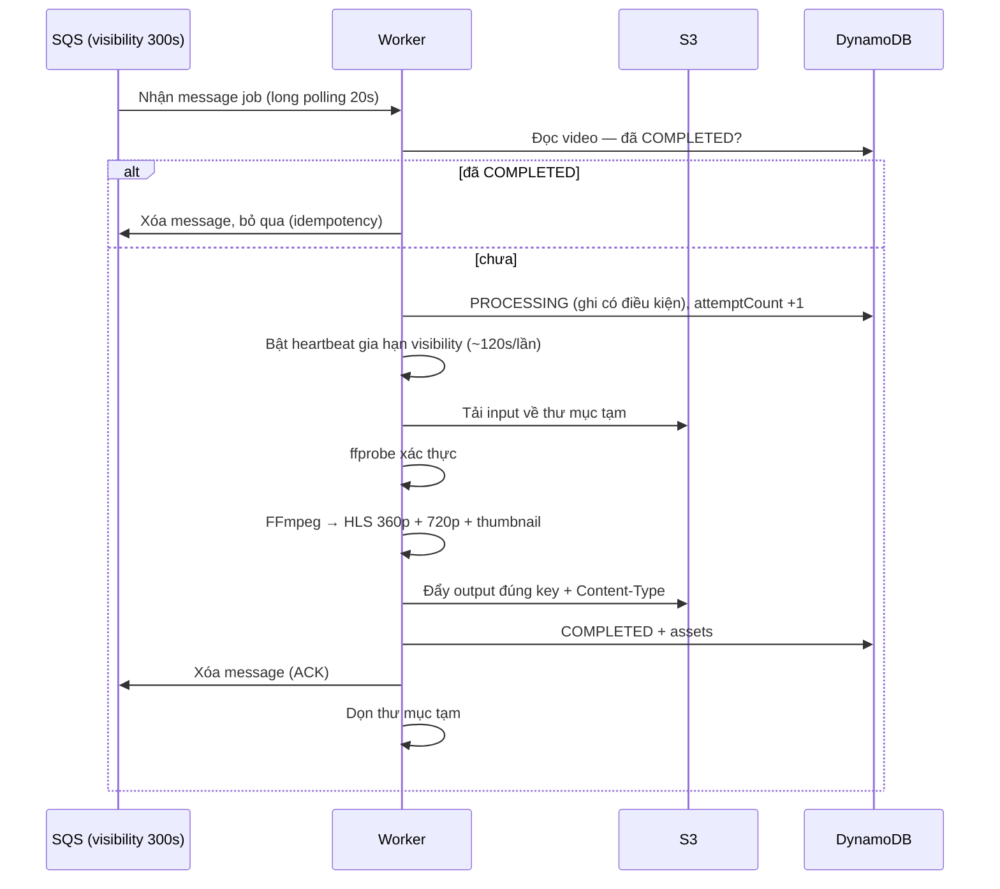

# 2. Nghiệp vụ của Worker

Tài liệu này mô tả worker dưới góc độ nghiệp vụ: vòng đời một job, các nhánh lỗi và quy tắc buộc phải tuân theo. Chi tiết kỹ thuật (lệnh FFmpeg, điều kiện DynamoDB) nằm ở [[3. Architecture]] và [[5. Contact docs]].

## 2.1. Bối cảnh nghiệp vụ

Xử lý video là workload **CPU nặng và đến theo đợt**: có lúc không có video nào, có lúc nhiều video cùng lúc. Worker là nơi "làm việc nặng" được tách khỏi API:

- API không bao giờ chạy FFmpeg → không nghẽn khi có transcode.
- Người dùng không chờ: upload xong là thoát, trạng thái xử lý xem sau (polling).
- Nhiều video cùng lúc → SQS giữ hàng, worker xử lý dần, ASG thêm máy khi backlog dài.

## 2.2. Vòng đời một job (happy path)



## 2.3. Máy trạng thái video (phía worker)

Đầy đủ ở `docs/contracts/video-state-machine.md`. Phần worker phụ trách:

| Chuyển trạng thái | Điều kiện | Ghi chú |
|---|---|---|
| `PENDING/PROCESSING/FAILED_* -> PROCESSING` | Worker nhận job (kể cả giao lại/retry) | `ConditionExpression: status <> COMPLETED`; tăng `attemptCount` |
| `PROCESSING -> COMPLETED` | Transcode + upload xong | Ghi `assets`; **không bao giờ ghi đè nếu đã COMPLETED** |
| `PROCESSING -> FAILED_VALIDATION` | ffprobe phát hiện input sai giới hạn | Ghi `errorCode` |
| `PROCESSING -> FAILED_TRANSCODE` | FFmpeg lỗi (file hỏng, codec không hỗ trợ) | Ghi `errorCode` |
| `PROCESSING -> FAILED_STORAGE` | Đọc/ghi S3 lỗi | Ghi `errorCode` |

Quy tắc quan trọng:

- **SQS là at-least-once**: message có thể được giao nhiều lần. Worker thấy video đã `COMPLETED` thì **bỏ qua và xóa message** — đây là lớp idempotency đầu tiên.
- Trạng thái `FAILED_*` **không phải chốt**: message chưa bị xóa nên SQS sẽ giao lại, video vẫn được retry cho tới khi hết lượt (3 lần nhận) và message vào DLQ.
- `COMPLETED` là trạng thái cuối, không bị ghi đè.

## 2.4. Các luồng nghiệp vụ phụ

### 2.4.1. Input không hợp lệ → `FAILED_VALIDATION`

ffprobe kiểm tra theo thứ tự: (1) có giải mã được không / có phải video không, (2) codec, (3) thời lượng ≤ 300 giây, (4) chiều cao ≤ 1080. Sai ở bước nào thì dừng ngay **không chạy FFmpeg** — tiết kiệm CPU là mục đích của lớp kiểm tra này.

```text
Video 6 phút       -> FAILED_VALIDATION (DURATION_EXCEEDED)
Video 1440p        -> FAILED_VALIDATION (HEIGHT_EXCEEDED)
File text đổi đuôi -> FAILED_VALIDATION (NOT_A_VIDEO)
Codec lạ           -> FAILED_VALIDATION (CODEC_UNSUPPORTED) *(chờ chốt danh sách codec)*
```

Người dùng thấy trạng thái `FAILED_VALIDATION` + `errorCode` qua API, sửa file rồi upload lại thành video mới.

### 2.4.2. Transcode lỗi → `FAILED_TRANSCODE`

FFmpeg thoát với mã khác 0 (file hỏng giữa chừng, audio stream thiếu...). Worker ghi `FAILED_TRANSCODE` kèm `errorCode` (dự kiến `FFMPEG_EXIT_<code>`), **không xóa message**. SQS giao lại; sau lần nhận thứ 3, message vào DLQ và có alarm (phần C5 của Nguyên).

### 2.4.3. Lưu trữ lỗi → `FAILED_STORAGE`

Tải input thất bại (mạng, object không tồn tại — ví dụ lifecycle đã dọn) hoặc đẩy output thất bại. Ghi `FAILED_STORAGE`, không xóa message, để retry.

### 2.4.4. Worker chết giữa job (chuyện bình thường, không phải sự cố)

```text
Worker đang transcode
   |
   X  tiến trình chết / EC2 Spot bị thu hồi / ASG scale-in
   |
Visibility timeout (300s) hết hạn, hoặc worker trả message khi nhận SIGTERM
   |
   v
Message hiện lại trong queue
   |
   v
Worker (máy khác hoặc chính nó sau khi khởi động lại) nhận lại job
   |
   v
Ghi đè PROCESSING, attemptCount +1, chạy lại từ đầu (key output ổn định nên không sinh rác)
```

Thiết kế **cố ý** không checkpoint giữa chừng FFmpeg: với video ≤ 5 phút, chạy lại cả job rẻ và đơn giản hơn nhiều so với resume transcode.

### 2.4.5. Xử lý SIGTERM (Spot bị thu hồi)

Khi nhận SIGTERM (EC2 Spot cho ~2 phút cảnh báo trước khi thu hồi):

1. **Ngừng nhận job mới**: không gọi `ReceiveMessage` nữa.
2. **Job đang chạy**: đặt `VisibilityTimeout` của message về thời gian ngắn (ví dụ 30 giây) rồi thoát — job nhanh chóng quay về queue cho máy khác, không phải chờ hết 300 giây. Nếu job sắp xong (< ~30 giây) thì có thể chọn chạy nốt rồi ACK. *(Chiến lược "trả ngay" là mặc định cho đơn giản.)*
3. **Dọn thư mục tạm** (tốt nhất có thể trong thời gian còn lại).
4. Thoát với mã 0. Container restart / máy bị thay thế là việc của hạ tầng.

### 2.4.6. Trùng lặp xử lý (duplicate processing)

Hai worker có thể cùng nhận một job (giao lại khi visibility hết hạn trong lúc job dài). Hệ quả:

- Hai lần transcode chạy song song: tốn CPU nhưng **không gây hại** vì ghi đè đúng key cũ.
- Ghi trạng thái: chỉ một lần ghi `COMPLETED` đầu tiên thắng; lần sau bị `ConditionExpression` chặn.
- Heartbeat ~120 giây với visibility 300 giây là biện pháp phòng chính để hiếm khi xảy ra.

## 2.5. Quy tắc nghiệp vụ bắt buộc

| # | Quy tắc | Lý do |
|---|---|---|
| N1 | Chỉ ffprobe quyết định video hợp lệ, không tin phần mở rộng hay khai báo | Input là dữ liệu lạ, không tin được |
| N2 | Output chỉ có **360p + 720p**, không làm 1080p (MVP) | Quyết định tối ưu chi phí đã chốt trong `docs/introduction/1. Timelines.md` |
| N3 | Giải mã input một lần, sinh 2 bản bằng filter `split` | Tiết kiệm ~40% CPU so với chạy 2 lần FFmpeg |
| N4 | Preset `veryfast` | Điểm ngọt hiệu năng/chi phí cho transcode theo demand |
| N5 | Key output suy từ `{projectId}/{videoId}`, ổn định | Retry ghi đè đúng chỗ, không sinh rác trên S3 |
| N6 | Content-Type đúng từng loại file khi upload | Trình phát và CloudFront phụ thuộc vào đó |
| N7 | Dọn thư mục tạm sau **mọi** job, kể cả lỗi | Đĩa máy nhỏ (EBS gp3 20-30 GB), không được chất rác |
| N8 | `attemptCount` lấy/tăng mỗi lần nhận job | Dấu vết để điều tra retry; số lần nhận thật lấy từ `ApproximateReceiveCount` của SQS |
| N9 | Log mỗi bước đều có `jobId`, `videoId`, `projectId` | Truy vết một job qua toàn hệ thống |
| N10 | Job không hợp lệ (validation) xóa message ngay; job lỗi hệ thống thì giữ message để retry | Validation là lỗi đầu vào, retry vô ích; transcode/storage là lỗi tạm thời, đáng thử lại |

> **Ghi chú đối chiếu:** nhánh `FAILED_RETRYABLE`/`FAILED_FINAL` và giới hạn 500 MB/10 phút thuộc giai đoạn đặc tả ban đầu — **đã lỗi thời**. Chuẩn hiện tại là `docs/contracts/`: các trạng thái `FAILED_VALIDATION | FAILED_TRANSCODE | FAILED_STORAGE`, giới hạn 200 MB/5 phút/1080p.

## 2.6. Tài sản output của một job thành công

| Asset | Key | Ghi vào `assets` của video |
|---|---|---|
| Master playlist | `{projectId}/{videoId}/hls/master.m3u8` | `hls` (URL phát: `/media/{projectId}/{videoId}/hls/master.m3u8`) |
| Rendition 360p | `{projectId}/{videoId}/hls/360p/index.m3u8` + segment `.ts` | `hls360` |
| Rendition 720p | `{projectId}/{videoId}/hls/720p/index.m3u8` + segment `.ts` | `hls720` |
| Thumbnail | `{projectId}/{videoId}/thumb/default.jpg` | `thumbnail` |

## 2.7. Metric nghiệp vụ worker đóng góp

Phục vụ dashboard CloudWatch và phần thực nghiệm (A8), worker phát các metric trong namespace `TransVidCloud`:

```text
jobs_completed        jobs_failed (kèm dimension errorCode)
processing_duration   queue_wait_duration
retry_count           worker_utilization (phần trăm thời gian có job đang chạy)
```

Các metric này là đầu vào của: dashboard 4 widget (C5), thí nghiệm baseline và elasticity (A8), và công thức `BacklogPerInstance` dùng để scale.
