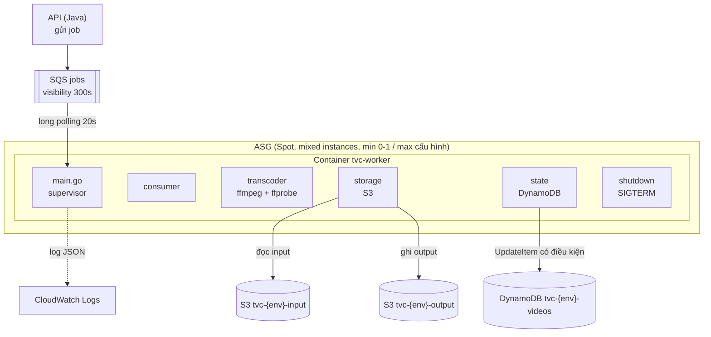

# 3. Kiến trúc Worker

## 3.1. Vị trí trong kiến trúc tổng thể



Worker là **worker process đơn giản, một job một lúc mỗi máy** (máy 2 vCPU). Không cần concurrency nội bộ — muốn tăng throughput thì ASG thêm máy (scale ngang), đúng tinh thần "scale worker theo backlog".

## 3.2. Cấu trúc thư mục code

```text
worker/
├── cmd/worker/main.go          # đọc config, dựng dependency, chạy supervisor
├── internal/
│   ├── config/                 # đọc biến môi trường, validate bắt buộc
│   ├── consumer/               # SQS: ReceiveMessage, heartbeat, DeleteMessage, ChangeMessageVisibility
│   ├── validate/               # ffprobe wrapper -> ProbeResult, so với giới hạn
│   ├── transcode/              # ffmpeg wrapper: build args, chạy, đọc exit code
│   ├── storage/                # S3: DownloadToFile, UploadDir (đúng Content-Type)
│   ├── state/                  # DynamoDB: MarkProcessing, MarkCompleted, MarkFailed, GetStatus
│   ├── job/                    # pipeline: ghép các bước trên thành run một job
│   ├── shutdown/               # bắt SIGTERM/SIGINT, phối hợp với consumer
│   └── logging/                # log JSON có jobId/videoId/projectId
├── go.mod
└── Dockerfile                  # (Lưu dựng, Vũ cung cấp lệnh chạy + env)
```

Nguyên tắc module: `job` là chỗ duy nhất biết trình tự các bước; các module còn lại là thư viện thuần, dễ unit test bằng interface (SQS/S3/DynamoDB đều là interface để mock).

## 3.3. Vòng xử lý một job (số liệu cụ thể)

```text
0. Nhận message        : ReceiveMessage wait 20s, VisibilityTimeout mặc định 300s (theo queue)
1. Parse + validate    : đúng schema sqs-job-message.schema.json; sai schema -> log, xóa message
2. Idempotency check   : GetItem videos[videoId]; status = COMPLETED -> xóa message, return
3. Mark PROCESSING     : UpdateItem SET status=PROCESSING, attemptCount=attemptCount+1
                         ConditionExpression: status <> COMPLETED (thua điều kiện -> đọc lại, xử lý như bước 2)
4. Heartbeat start     : goroutine ChangeMessageVisibility còn lại ~300s, chu kỳ 120s
5. Download input      : S3 GetObject inputKey -> $TMP/tvc/{jobId}/source (stream xuống file)
6. ffprobe             : thời lượng, chiều cao, codec, hasVideo/hasAudio
                         vượt giới hạn -> MarkFailed(FAILED_VALIDATION, errorCode), xóa message, return
7. FFmpeg              : lệnh ở mục 3.5, output vào $TMP/tvc/{jobId}/out/
8. Upload output       : duyệt cây out/, PUT đúng key + Content-Type (mục 3.6)
9. Mark COMPLETED      : UpdateItem SET status=COMPLETED, assets={...}
                         ConditionExpression: status <> COMPLETED
10. ACK                : DeleteMessage
11. Cleanup            : xóa $TMP/tvc/{jobId}/ (defer — luôn chạy, kể cả panic)

Nhánh lỗi hệ thống (bước 5, 7, 8):
   MarkFailed(FAILED_TRANSCODE | FAILED_STORAGE, errorCode)
   KHÔNG xóa message -> SQS giao lại sau 300s
   sau lần nhận thứ 3 (ApproximateReceiveCount) -> redrive sang DLQ (queue tự lo)
```

## 3.4. Xác thực input bằng ffprobe

```bash
ffprobe -v error -print_format json -show_format -show_streams "source.mp4"
```

Các trường dùng: `format.duration`, `streams[type=video].height`, `streams[type=video].codec_name`, tồn tại stream video. Bộ kiểm (config nạp từ env, mặc định theo `docs/contracts/upload-limits.md`):

| Kiểm | Điều kiện sai | errorCode |
|---|---|---|
| Có stream video | không có | `NOT_A_VIDEO` |
| Codec trong danh sách | ngoài | `CODEC_UNSUPPORTED` |
| Thời lượng | > 300s | `DURATION_EXCEEDED` |
| Chiều cao | > 1080 | `HEIGHT_EXCEEDED` |

*(Danh sách codec cụ thể chờ chốt trong A1; dự kiến h264, và các codec phổ biến trong mp4/mov/mkv/webm.)*

## 3.5. Lệnh FFmpeg transcode

Mục tiêu: **giải mã một lần, sinh 2 rendition + thumbnail**, preset `veryfast`, không 1080p.

### Rendition 360p + 720p trong một lần chạy (filter `split`)

```bash
ffmpeg -y -i source.ext \
  -filter_complex "[0:v]split=2[v1][v2]; \
                   [v1]scale=-2:360[v360]; \
                   [v2]scale=-2:720[v720]" \
  -map "[v360]" -map 0:a? -c:v:0 libx264 -preset veryfast -b:v:0 800k -maxrate:0 856k -bufsize:0 1200k \
                                    -c:a:0 aac -b:a:0 96k \
  -map "[v720]" -map 0:a? -c:v:1 libx264 -preset veryfast -b:v:1 2800k -maxrate:1 3000k -bufsize:1 4800k \
                                    -c:a:1 aac -b:a:1 128k \
  -f hls -hls_time 4 -hls_playlist_type vod \
  -hls_segment_filename "out/hls/360p/seg_%03d.ts" "out/hls/360p/index.m3u8" \
  -f hls -hls_time 4 -hls_playlist_type vod \
  -hls_segment_filename "out/hls/720p/seg_%03d.ts" "out/hls/720p/index.m3u8"
```

Ghi chú:

- Hai cặp `-map` + hai block `-f hls` cho **hai output trong một process**; FFmpeg chỉ decode mỗi frame một lần rồi nhân đôi bằng `split`.
- `scale=-2:360` giữ tỉ lệ, chiều cao chẵn (yêu cầu của h264 4:2:0). Video nguồn đã ≤ 360 chiều cao thì bỏ qua bước scale cho rendition đó (kiểm tra trong code để không "phóng to" video nhỏ) — logic này nằm trong `transcode`, chọn map thay vì để scale tự xử.
- `-map 0:a?`: audio không bắt buộc (`?`) — video không tiếng vẫn transcode được.
- `-hls_time 4`: segment ~4 giây, hợp cho playback và cache ở edge.

### Thumbnail

```bash
ffmpeg -y -ss 1 -i source.ext -frames:v 1 -q:v 3 out/thumb/default.jpg
```

Lấy frame ở giây thứ 1 (tránh khung đen đầu video); nếu video ngắn hơn 1 giây thì fallback `-ss 0`.

### Master playlist (tự sinh, không nhờ FFmpeg)

FFmpeg không sinh master khi xuất hai playlist rời; worker tự viết file `out/hls/master.m3u8`:

```text
#EXTM3U
#EXT-X-STREAM-INF:BANDWIDTH=1010000,RESOLUTION=640x360
360p/index.m3u8
#EXT-X-STREAM-INF:BANDWIDTH=3100000,RESOLUTION=1280x720
720p/index.m3u8
```

(Chiều rộng thực tế lấy từ ffprobe để ghi RESOLUTION chính xác.) Viết tay master đơn giản, ổn định và dễ test hơn dùng `-var_stream_map` + `-master_pl_name`.

### Timeout tiến trình

FFmpeg có `context.WithTimeout` (mặc định 15 phút — dư sức cho video 5 phút trên máy 2 vCPU). Hết timeout: kill process, coi như `FAILED_TRANSCODE`, `errorCode=FFMPEG_TIMEOUT`.

## 3.6. Upload output lên S3

Duyệt cây `out/` và PUT từng file (số file ~ vài chục segment; không cần multipart):

| Đuôi file | Content-Type |
|---|---|
| `.m3u8` | `application/vnd.apple.mpegurl` |
| `.ts` | `video/mp2t` |
| `.jpg` | `image/jpeg` |

Key đích = `{projectId}/{videoId}/` + đường dẫn tương đối trong `out/` (khớp `docs/contracts/s3-key-convention.md`). Upload **trước** khi ghi `COMPLETED` — chỉ coi là hoàn tất khi mọi object đã lên S3.

## 3.7. Thư mục tạm và dọn dẹp

- Gốc: `TVC_TMP_DIR` (mặc định `/tmp/tvc`); mỗi job một thư mục con `{jobId}`.
- Dung lượng cần: input (≤200 MB) + output (≤ ~300 MB với 2 rendition) → **EBS gp3 20-30 GB là dư** cho vài job kẹt lại.
- Cleanup bằng `defer` trong `job.Run()` — chạy kể cả khi bước nào panic.
- Khi khởi động, quét `TVC_TMP_DIR` xóa các thư mục mồ côi từ lần chạy trước bị chết.

## 3.8. Cấu hình (biến môi trường)

| Biến | Mặc định | Ý nghĩa |
|---|---|---|
| `AWS_REGION` | `ap-southeast-1` | Region |
| `AWS_ENDPOINT_URL` | (trống) | `http://localhost:4566` khi local; trống khi cloud |
| `TVC_INPUT_BUCKET` | — | Bucket input, ví dụ `tvc-dev-input` |
| `TVC_OUTPUT_BUCKET` | — | Bucket output |
| `TVC_JOBS_QUEUE_URL` | — | URL queue chính |
| `TVC_DDB_VIDEOS` | `tvc-{env}-videos` | Bảng DynamoDB videos |
| `MAX_DURATION_SECONDS` | `300` | Giới hạn thời lượng |
| `MAX_HEIGHT_PIXELS` | `1080` | Giới hạn chiều cao |
| `MAX_UPLOAD_BYTES` | `209715200` | Giới hạn dung lượng (đối chiếu sau khi tải) |
| `TVC_TMP_DIR` | `/tmp/tvc` | Thư mục tạm |
| `TVC_FFMPEG_TIMEOUT` | `15m` | Timeout một lần transcode |
| `TVC_HEARTBEAT_INTERVAL` | `120s` | Chu kỳ gia hạn visibility |
| `TVC_VISIBILITY_TIMEOUT` | `300s` | Timeout đặt lại mỗi lần gia hạn |

Thiếu biến bắt buộc (bucket, queue, bảng): thoát ngay lúc khởi động với thông báo rõ ràng — cấu hình sai phải được phát hiện ở giây đầu tiên, không phải ở job đầu tiên.

## 3.9. IAM worker cần (least privilege)

Danh sách để Nguyên viết policy (epic C2), review chéo với Vũ:

```text
sqs:ReceiveMessage, sqs:DeleteMessage, sqs:ChangeMessageVisibility
  trên TVC_JOBS_QUEUE_URL (và DLQ cho phép nhận nếu cần điều tra)
s3:GetObject  trên tvc-{env}-input/*
s3:PutObject  trên tvc-{env}-output/{projectId}/{videoId}/*
dynamodb:GetItem, dynamodb:UpdateItem  trên tvc-{env}-videos
logs: CreateLogStream, PutLogEvents (nếu không dùng log driver của Docker)
```

Chưa cấp `cloudwatch:PutMetricData`: worker hiện chỉ ghi log JSON, chưa phát metric (xem 3.11 và [[5. Contact docs]] mục 5.6). Chỉ thêm quyền này khi nhóm chốt cách phát metric với C5.

Cố tình **không** có: `s3:PutObject` vào bucket input (checklist nghiệm thu số 5: worker ghi vào input phải bị `AccessDenied`), `sqs:SendMessage`, quyền vào bảng users/projects/apikeys.

## 3.10. Shutdown và Spot

```text
main()                  : bắt SIGTERM + SIGINT -> đóng channel stop
supervisor              : thấy stop -> không gọi ReceiveMessage mới
job đang chạy           : đặt lại VisibilityTimeout của message về ~30s rồi kết thúc sớm
                          (bỏ heartbeat, bỏ phần upload chưa xong)
defer cleanup           : xóa thư mục tạm
exit 0
```

Lý do chọn "trả message ngay" thay vì "cố chạy nốt": Spot cho 2 phút, một job 720p có thể mất hơn thế; trả về sớm giúp job được máy khác nhận lại gần như ngay. ASG có `ScaleInProtectedInstances=Wait` khi Instance Refresh để không thay máy đang transcode (phần C3/C5).

## 3.11. Observability

- **Log**: JSON một dòng mỗi bản ghi: `time` (RFC3339 nano), `level`, `msg`, `service=worker`, `jobId`, `videoId`, `projectId`, ... Log ghi ra stdout; local xem bằng `make logs S=worker`, cloud do log driver/agent của C5 thu. Chi tiết trường và query ở [[5. Contact docs]] mục 5.5.
- **Metric**: **chưa phát** — worker không gọi `cloudwatch:PutMetricData` và không phát EMF. C5 lấy số liệu từ log (job_finished/job_failed/job_received) theo bảng bàn giao ở [[5. Contact docs]] mục 5.6; không tuyên bố metric tồn tại chỉ vì log có trường tương ứng.
- **Cấu trúc giúp debug**: mỗi job bắt đầu và kết thúc đều có một dòng log tổng kết: `job_finished jobId=... videoId=... status=COMPLETED durationMs=... attempt=...`.

## 3.12. Chạy local và trên cloud — một codebase

| | Local | Cloud |
|---|---|---|
| Endpoint AWS | `AWS_ENDPOINT_URL=http://localhost:4566` | trống (IAM role) |
| Credential | `test/test` | IAM role của instance profile |
| Tên tài nguyên | `tvc-local-*` | `tvc-{env}-*` |
| Chạy | `make up`, hoặc go chạy trực tiếp với `make infra` | Container từ ECR, user-data của Launch Template |
| Nhiều worker | `make worker-scale N=3` | ASG thêm máy |

Worker **không có code riêng cho từng môi trường** — mọi khác biệt nằm ở biến môi trường. Đây là điều kiện để "cùng image chạy được local và AWS".

## 3.13. Kiểm thử

| Tầng | Phạm vi | Cách chạy |
|---|---|---|
| Unit | config, validate logic (bảng case ffprobe giả), state (mock DynamoDB), key/Content-Type mapping | `make test` |
| Tích hợp local | pipeline đầy đủ trên LocalStack | `make e2e` (upload → `COMPLETED` → phát `/media/*`) |
| Chaos | kill worker giữa job; job lỗi 3 lần → DLQ | `make chaos` / `local/scripts/chaos-kill-worker.sh` |
| Trên AWS | kịch bản lỗi worker thật (A8) | Sprint 4 trong tuần 9, Lưu chủ trì; xong trước tuần nộp 10 |

Bộ video test cố định (đặt trong `local/samples/`): video mp4 chuẩn, video > 5 phút, video 1440p, file giả mạo đuôi, video không audio — mỗi cái ứng một nhánh trong mục 2.4 của [[2. Business]].
