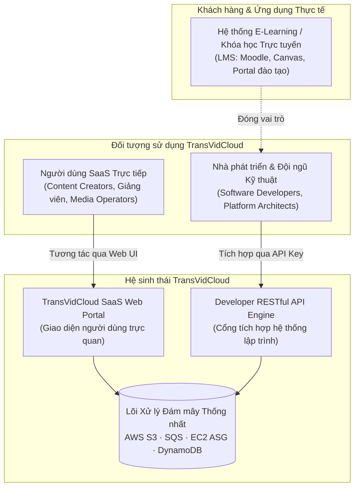
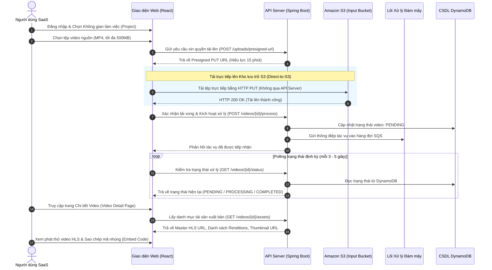
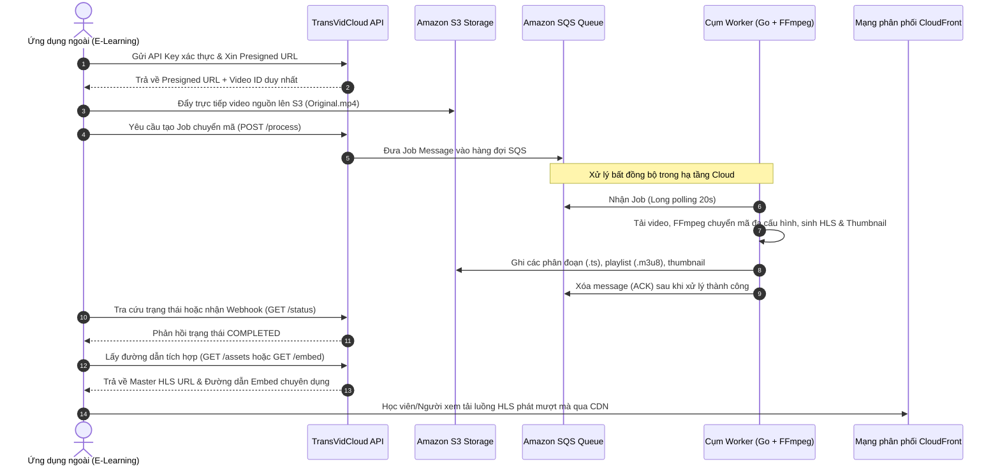
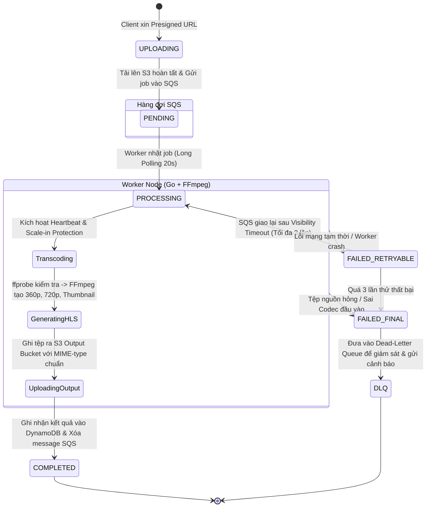

# CHƯƠNG 1: TỔNG QUAN VỀ DỰ ÁN (PROJECT OVERVIEW)

---

## 1.1. Giới thiệu chung về dự án TransVidCloud

TransVidCloud là nền tảng xử lý và phân phối video trên nền tảng đám mây, được xây dựng nhằm giải quyết bài toán xử lý video có nhu cầu cao về tài nguyên tính toán và lưu trữ. Dự án kết hợp mô hình **SaaS** dành cho người dùng cuối (đối tượng người dùng cụ thể sẽ được trình bày tại mục 1.2) và **PaaS** dành cho các hệ thống phần mềm bên thứ ba, cùng vận hành trên một lõi xử lý video phân tán.

TransVidCloud tập trung giải quyết đặc thù của video processing workload, vốn tiêu tốn nhiều CPU và có tính **burst** cao, khi khối lượng công việc có thể tăng đột biến do nhiều video được tải lên cùng lúc. Hệ thống hỗ trợ tiếp nhận và lưu trữ video gốc an toàn, xử lý bất đồng bộ để tránh gây quá tải cho server ứng dụng chính, đồng thời chuyển đổi video thành nhiều phiên bản với độ phân giải và bitrate khác nhau, đóng gói cho streaming như HLS, tạo thumbnail và lưu trữ metadata. Bên cạnh đó, hệ thống cung cấp cơ chế xử lý lỗi và retry, kết hợp khả năng tự động scale theo workload nhằm tối ưu chi phí tài nguyên và tránh phải duy trì một cụm máy xử lý video lớn hoạt động liên tục khi không có yêu cầu.

---

## 1.2. Đối tượng người dùng và các bên liên quan (Target Users & Stakeholders)

TransVidCloud hướng tới việc phục vụ hai nhóm đối tượng người dùng chính với những nhu cầu và đặc thù sử dụng khác nhau:

### 1.2.1. Người dùng ứng dụng SaaS trực tiếp (Direct SaaS Users)
Nhóm đối tượng này bao gồm các nhà sáng tạo nội dung độc lập (Content Creators), giảng viên, giáo viên trực tuyến, và các chuyên viên vận hành truyền thông số (Media Operators) tại các tổ chức, doanh nghiệp nhỏ và vừa.
* **Đặc điểm & Nhu cầu:** Không đòi hỏi kiến thức chuyên sâu về công nghệ đám mây hay kỹ thuật nén video phức tạp. Họ cần một giao diện trực quan, thao tác nhanh gọn để:
  * Quản trị các không gian làm việc (Projects / Workspaces) phục vụ từng mục đích hoặc khóa học riêng biệt.
  * Tải lên các video bài giảng, video tư liệu nguồn với dung lượng lớn một cách an toàn mà không bị gián đoạn hay nghẽn mạng trình duyệt.
  * Theo dõi minh bạch tiến độ chuyển mã video trong thời gian thực (chờ xử lý, đang xử lý, hoàn thành, thất bại).
  * Xem trước video đầu ra trực tiếp trên trình phát video tương thích cao (HLS Player), kiểm tra chất lượng hình ảnh ở các độ phân giải khác nhau (360p, 720p, 1080p).
  * Lấy nhanh đường dẫn phát trực tuyến (HLS Playlist URL), tải về ảnh đại diện (thumbnail) hoặc sao chép mã nhúng (`<iframe>`) để đưa vào bài viết, trang web hoặc blog cá nhân.
* **Vấn đề được giải quyết:** Loại bỏ hoàn toàn sự phụ thuộc vào máy trạm cá nhân (tránh việc render video thủ công làm nóng máy, đơ máy), khắc phục hiện tượng video không xem được trên điện thoại do sai codec, và giải quyết bài toán băng thông khi phát video cho nhiều người xem cùng lúc.

### 1.2.2. Nhà phát triển và Đội ngũ kỹ thuật của ứng dụng ngoài (Developers & Platform Engineers)
Nhóm đối tượng này là các kỹ sư phần mềm, kiến trúc sư giải pháp và đội ngũ kỹ thuật vận hành các hệ thống web/mobile quy mô vừa và lớn (như sàn thương mại điện tử cần video review, mạng xã hội chia sẻ video, cổng thông tin điện tử, doanh nghiệp truyền thông).
* **Đặc điểm & Nhu cầu:** Cần một hạ tầng xử lý video mạnh mẽ, ổn định, cung cấp đầy đủ API chuẩn RESTful để tự động hóa toàn bộ luồng xử lý phương tiện truyền thông mà không cần tự phát triển hay duy trì hệ thống máy chủ FFmpeg riêng biệt. Họ cần:
  * Cơ chế xác thực an toàn bằng API Key theo từng Project riêng biệt.
  * API yêu cầu quyền tải lên trực tiếp (Presigned URL) để client của họ đẩy video thẳng lên kho lưu trữ đám mây, không gây áp lực tải lên máy chủ ứng dụng chính.
  * API kích hoạt tác vụ xử lý (`POST /videos/{id}/process`), kiểm tra trạng thái (`GET /videos/{id}/status`), và truy xuất danh mục tài sản kỹ thuật số đã sinh (`GET /videos/{id}/assets`).
  * Cơ chế Webhook phản hồi tự động khi job hoàn tất để kích hoạt các nghiệp vụ tiếp theo (thông báo cho người học, kích hoạt duyệt nội dung, v.v.).
  * Mã nhúng phát video (Embed URL) để tích hợp mượt mà vào giao diện ứng dụng sẵn có của họ.
* **Vấn đề được giải quyết:** Tiết kiệm hàng tháng trời phát triển hạ tầng video phức tạp; không phải trả chi phí duy trì cụm máy chủ GPU/CPU đắt đỏ 24/7; giải quyết triệt để nguy cơ sập máy chủ ứng dụng (Application Crash) khi nhiều người dùng cùng đăng tải video trong các khung giờ cao điểm.

### 1.2.3. Khách hàng tham chiếu tiêu biểu: Nền tảng Giáo dục Trực tuyến (E-learning Platform)
Để minh chứng tính ứng dụng thực tế sâu sắc của đồ án, một hệ thống đào tạo trực tuyến (Mock E-learning Platform) được chọn làm ca sử dụng tham chiếu (Reference Use Case). 
* Trong mô hình này, giảng viên thao tác trên hệ thống E-learning để đăng tải video bài giảng.
* Thay vì máy chủ E-learning tự giải mã và nén video (dễ làm nghẽn toàn bộ dịch vụ làm bài tập, thi cử của học viên), hệ thống E-learning sẽ gọi sang TransVidCloud thông qua Developer API.
* Video sau khi được xử lý phân tán trên AWS sẽ sẵn sàng phát cho hàng ngàn học viên trên trình duyệt và thiết bị di động với khả năng tự thích ứng băng thông mạng (Adaptive Bitrate Streaming), mang lại trải nghiệm học tập mượt mà nhất.

---

## 1.3. Cách thức và Quy trình sử dụng sản phẩm của dự án

Hệ thống TransVidCloud cung cấp hai luồng quy trình tác nghiệp độc lập cho người dùng SaaS và nhà phát triển ứng dụng, đồng thời vận hành một quy trình ngầm tự động hóa bằng điện toán đám mây.

### 1.3.1. Quy trình người dùng SaaS (SaaS User Workflow)

Người dùng tương tác với hệ thống thông qua giao diện Web trực quan theo các bước tuần tự sau:

1. **Khởi tạo và Quản lý Không gian làm việc:** Người dùng đăng nhập vào hệ thống, lựa chọn hoặc tạo mới một Dự án (Project) để phân loại nội dung lưu trữ.
2. **Ủy quyền và Tải lên trực tiếp (Direct-to-S3 Upload):** 
   * Người dùng chọn tệp video nguồn từ máy tính cá nhân.
   * Giao diện web gửi yêu cầu ủy quyền đến máy chủ API. Thay vì nhận tệp video, máy chủ API chỉ ký một đường dẫn bảo mật có thời hạn tạm thời (Presigned URL) của Amazon S3 và trả về cho trình duyệt.
   * Trình duyệt thực hiện tải trực tiếp tệp đa phương tiện lên Amazon S3 Input Bucket thông qua phương thức `PUT`. Cơ chế này loại bỏ hoàn toàn tình trạng nghẽn băng thông và tràn bộ nhớ đệm tại API Server.
3. **Kích hoạt xử lý và Giám sát tiến độ:**
   * Sau khi tệp tin đã an tọa trên S3, trình duyệt gửi tín hiệu xác nhận hoàn tất để hệ thống chuyển trạng thái sang `PENDING` và đẩy thông điệp vào hàng đợi tin nhắn Amazon SQS.
   * Giao diện người dùng tự động chuyển sang màn hình tiến độ, hiển thị trực quan các giai đoạn: Đang chờ máy công nhân tiếp nhận (`PENDING`) $\rightarrow$ Đang giải mã và chuyển mã (`PROCESSING`) $\rightarrow$ Hoàn tất xử lý (`COMPLETED`).
4. **Kiểm tra chất lượng và Khai thác tài nguyên:**
   * Khi trạng thái đạt `COMPLETED`, người dùng được chuyển đến giao diện trình phát video tích hợp (Player trang bị thư viện `hls.js`).
   * Người dùng có thể kiểm tra khả năng tự chuyển đổi độ phân giải (360p, 720p), tải ảnh bìa đại diện (thumbnail trích xuất tự động tại giây thứ 3), hoặc sao chép liên kết phát trực tuyến và thẻ nhúng mã nguồn mở `<iframe>` để tích hợp vào bất kỳ trang web nào.

---

### 1.3.2. Quy trình tích hợp dành cho Nhà phát triển (Developer Integration Workflow)

Các ứng dụng bên ngoài (như hệ thống E-learning) tương tác với TransVidCloud hoàn toàn thông qua giao diện lập trình hướng dịch vụ:

1. **Ủy quyền tích hợp (Authentication & Identification):** Ứng dụng ngoài gửi kèm `X-API-Key` trong tiêu đề HTTP Header để xác định ngữ cảnh dự án và quyền hạn truy cập.
2. **Khởi tạo định danh & Cấp quyền tải lên:** Ứng dụng ngoài gọi `POST /api/v1/uploads/presigned-url` truyền thông tin định dạng và kích thước video. Hệ thống phản hồi mã định danh duy nhất (`videoId`) và đường dẫn S3 Presigned URL.
3. **Đẩy dữ liệu nguồn (Source Offload):** Ứng dụng bên thứ ba (hoặc ứng dụng phía client của họ) đưa tệp lên Amazon S3. Sau đó gọi `POST /api/v1/videos/{videoId}/process` để kích hoạt dây chuyền xử lý tự động.
4. **Xử lý ngắt kết nối (Decoupled Execution):** Lời gọi API trả về mã `202 Accepted` ngay lập tức, giải phóng ứng dụng bên thứ ba mà không bắt buộc hệ thống của họ phải giữ kết nối mạng chờ đợi hàng phút chuyển mã.
5. **Đồng bộ kết quả và Nhúng nội dung:**
   * Ứng dụng ngoài kiểm tra trạng thái qua `GET /api/v1/videos/{videoId}/status` (hoặc đăng ký cơ chế nhận Webhook thông báo tự động).
   * Khi hoàn tất, ứng dụng ngoài gọi `GET /api/v1/videos/{videoId}/assets` để lấy danh mục URL phân phối nội dung qua mạng CDN hoặc lấy mã `GET /api/v1/videos/{videoId}/embed` để hiển thị trình phát video độc lập trực tiếp trong giao diện bài học của học viên.

---

### 1.3.3. Quy trình vận hành và xử lý ngầm định của Hệ thống Lõi (Core Cloud Processing Flow)

Để đáp ứng được hai luồng tương tác trên một cách mượt mà và tin cậy, quy trình nghiệp vụ ngầm định dưới tầng hạ tầng đám mây của TransVidCloud được thiết kế theo mô hình kiến trúc hướng sự kiện (Event-Driven Architecture) với các bước kiểm soát nghiêm ngặt:

1. **Tiếp nhận và Đệm công việc (Buffering via SQS):**
   * Mọi yêu cầu chuyển mã sau khi được API xác thực sẽ đóng gói thành một thông điệp chuẩn JSON (`jobId`, `videoId`, `projectId`, `inputKey`) và đẩy vào hàng đợi chính `tvc-{env}-jobs`.
   * Hàng đợi đóng vai trò như một bộ đệm chống sốc tải (burst buffer). Khi cùng lúc có 20 hay 50 video được tải lên, toàn bộ yêu cầu đều được xếp hàng an toàn, loại trừ khả năng quá tải hệ thống.
2. **Tiếp nhận tác vụ và Khóa hiển thị (Long Polling & Visibility Timeout):**
   * Các nút tính toán công nhân (EC2 Worker) liên tục thăm dò hàng đợi thông qua cơ chế `ReceiveMessage` với thời gian chờ lâu (Long Polling 20 giây) nhằm tiết kiệm chi phí gọi API.
   * Khi một worker tiếp nhận thông điệp, Amazon SQS kích hoạt cơ chế `Visibility Timeout` (thiết lập mặc định 300 giây). Trong khoảng thời gian này, thông điệp sẽ bị ẩn khỏi các worker khác nhằm ngăn chặn việc xử lý trùng lặp.
   * Đồng thời, worker cập nhật trạng thái video trong DynamoDB sang `PROCESSING` thông qua biểu thức ghi có điều kiện (Conditional Write), bật cơ chế bảo vệ khỏi tự hủy (Scale-In Protection), và khởi chạy một tiến trình ngầm (heartbeat routine) định kỳ gia hạn `Visibility Timeout` mỗi 120 giây đối với các video có thời lượng dài.
3. **Kiểm tra hợp lệ và Chuyển mã phân tán (Validation & Transcoding):**
   * Worker tải tệp nguồn từ S3 Input Bucket về thư mục làm việc cục bộ tạm thời.
   * Sử dụng công cụ `ffprobe` để thẩm định tính toàn vẹn của tệp: kiểm tra định dạng chứa (MP4), bộ giải mã hình ảnh (H.264), thời lượng (dưới 10 phút) và kích thước (dưới 500MB). Nếu tệp lỗi hoặc định dạng không hỗ trợ, tác vụ bị từ chối ngay lập tức với trạng thái `FAILED_FINAL`.
   * Sử dụng công cụ `FFmpeg` đa luồng để giải mã và nén lại đồng thời thành 2 thang cấu hình (renditions ladder):
     * Độ phân giải **360p** (tốc độ bit thấp ~800 kbps, phục vụ người dùng có kết nối mạng chậm hoặc thiết bị di động).
     * Độ phân giải **720p** (tốc độ bit tiêu chuẩn ~2500 kbps, độ nét cao cho máy tính và mạng ổn định).
   * Đóng gói đầu ra dưới định dạng luồng phát thích ứng HLS: chia nhỏ luồng video thành các phân đoạn đa phương tiện `.ts` dài 4 giây, sinh các tệp chỉ mục cục bộ `.m3u8` cho từng độ phân giải, và tạo tệp chỉ mục tổng thể `master.m3u8`.
   * Trích xuất một ảnh tĩnh sắc nét làm ảnh bìa (thumbnail `.jpg`) tại giây thứ 3 của video.
4. **Đồng bộ dữ liệu đầu ra và Hoàn tất tác vụ (Output Sync & Acknowledgment):**
   * Worker đồng bộ toàn bộ các tệp `.m3u8`, `.ts`, và `.jpg` lên Amazon S3 Output Bucket, đồng thời gắn chính xác các trường siêu dữ liệu HTTP `Content-Type` chuẩn (`application/vnd.apple.mpegurl` cho m3u8, `video/mp2t` cho ts, và `image/jpeg` cho thumbnail).
   * Ghi nhận danh mục tài sản số (Assets list), thời gian hoàn tất và cập nhật trạng thái `COMPLETED` vào bảng `videos` trong cơ sở dữ liệu DynamoDB.
   * Gửi tín hiệu xác nhận hoàn thành (ACK) lên Amazon SQS để xóa vĩnh viễn thông điệp khỏi hàng đợi, tắt cờ Scale-In Protection và dọn dẹp các tệp tạm thời trên ổ đĩa.
5. **Cơ chế Chịu lỗi và Hàng đợi Thông điệp chết (Fault Tolerance & Dead-Letter Queue):**
   * Trong trường hợp một worker gặp sự cố phần cứng, sập nguồn hoặc bị hủy bất ngờ giữa chừng, tiến trình heartbeat sẽ ngừng hoạt động. Khi hết hạn `Visibility Timeout`, SQS sẽ tự động hiển thị lại thông điệp đó cho một worker khác tiếp nhận và thực hiện lại.
   * Để ngăn ngừa lỗi lặp vô hạn (Poison Pill Message), hệ thống thiết lập ngưỡng thử lại tối đa là 3 lần (`maxReceiveCount = 3`). Nếu một tác vụ thất bại vượt quá 3 lần, SQS sẽ tự động cô lập thông điệp sang Hàng đợi Thông điệp chết (Dead-Letter Queue - DLQ), đồng thời phát tín hiệu cảnh báo qua CloudWatch Alarm và Amazon SNS đến đội ngũ quản trị để kịp thời điều tra nguyên nhân.

---

## 1.4. Bảng tổng hợp Tính năng và Giá trị mang lại cho Người dùng

Để làm nổi bật sự khác biệt giữa mô hình xử lý video truyền thống (Monolithic / On-Premise) và mô hình hiện đại trên nền tảng TransVidCloud, bảng đối sánh dưới đây tổng hợp các tính năng then chốt cùng giá trị thực tiễn đem lại cho người dùng:

| Hạng mục tính năng | Mô hình truyền thống | Nền tảng TransVidCloud | Giá trị thực tiễn đem lại cho người dùng |
| :--- | :--- | :--- | :--- |
| **Quy trình Tải lên (Video Upload)** | Tải qua máy chủ web trung gian, dễ nghẽn băng thông, tràn bộ nhớ RAM, giới hạn dung lượng file nhỏ. | Tải trực tiếp lên Amazon S3 qua **Presigned URL** bảo mật có thời hạn. | Người dùng tải video 500MB+ nhanh chóng, ổn định; máy chủ ứng dụng hoàn toàn không bị ảnh hưởng. |
| **Kiến trúc Xử lý (Processing Architecture)** | Đồng bộ (Synchronous) hoặc xử lý trực tiếp trên server chính; người dùng phải treo trình duyệt chờ đợi. | **Bất đồng bộ (Asynchronous)** qua hàng đợi **Amazon SQS**; tách rời hoàn toàn giao diện và xử lý. | Người dùng nhận phản hồi ngay lập tức sau khi upload, tự do điều hướng hoặc tắt máy trong khi video được xử lý ngầm. |
| **Năng lực Co giãn (Elastic Scalability)** | Số máy chủ cố định; thiếu tài nguyên vào giờ cao điểm gây sập web, dư thừa lãng phí vào ban đêm. | Tự động co giãn (**EC2 Auto Scaling**) dựa trên chỉ số công việc tồn đọng thực tế (**BacklogPerInstance**). | Đảm bảo tốc độ xử lý nhanh cả khi nhiều video gửi đến cùng lúc; tự động giảm máy khi hết việc giúp tiết kiệm chi phí tối đa. |
| **Khả năng Phục hồi (Fault Resilience)** | Khi tiến trình xử lý sập, video bị mất dấu vết hoặc treo vĩnh viễn ở trạng thái đang xử lý. | Cơ chế **SQS Visibility Timeout + Heartbeat**, tự động retry tối đa 3 lần; chuyển lỗi vào **DLQ**. | Đảm bảo không mất mát bất kỳ tác vụ nào của người dùng; hệ thống tự phục hồi minh bạch không cần can thiệp thủ công. |
| **Định dạng Phát sóng (Video Playback)** | Phát tệp tĩnh MP4 đơn lẻ; dễ giật lag, tải chậm khi mạng yếu hoặc tốn dung lượng 4G/5G. | Luồng phát thích ứng **HLS (360p, 720p)** kèm **Thumbnail** sắc nét phân phối qua **CloudFront CDN**. | Người xem phát mượt mà tức thì trên mọi kích thước màn hình và điều kiện băng thông; tự động hạ chất lượng khi mạng chập chờn. |
| **Khả năng Tích hợp (Integration)** | Phức tạp, phụ thuộc chặt chẽ vào mã nguồn và hạ tầng nội bộ của từng ứng dụng. | Chuẩn hóa qua **Developer REST API, API Key**, Webhook và mã nhúng **Embed Code/Player** độc lập. | Các nền tảng đối tác (như E-learning) tích hợp toàn bộ giải pháp video chuyên nghiệp chỉ với vài dòng mã lệnh đơn giản. |

---

## 1.5. Kết luận Chương 1

Chương 1 đã phác họa bức tranh toàn cảnh về dự án TransVidCloud, từ mục tiêu giải quyết bài toán xử lý video có tính biến thiên cao trong thực tế đến việc xác định rõ chân dung của hai nhóm đối tượng người dùng then chốt: người dùng trực tiếp trên nền tảng SaaS và các kỹ sư tích hợp thông qua Developer API. Bằng cách thiết lập các quy trình vận hành trực quan, chuẩn hóa luồng truyền thông điệp bất đồng bộ và tận dụng sức mạnh co giãn tự nhiên của các dịch vụ đám mây AWS, TransVidCloud mang đến một giải pháp toàn diện, bền bỉ và tối ưu chi phí, đặt nền tảng vững chắc cho việc đi sâu vào chi tiết kiến trúc kỹ thuật và kết quả thực nghiệm trong các chương tiếp theo.
